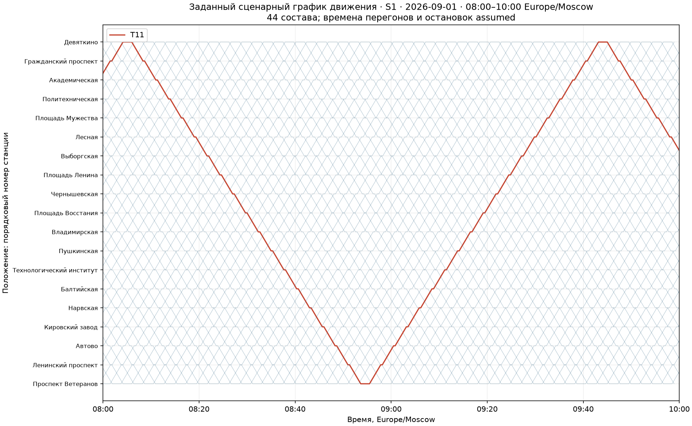
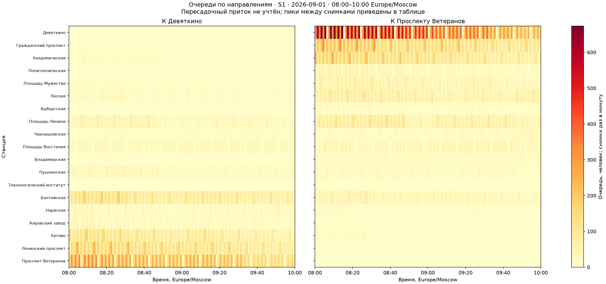
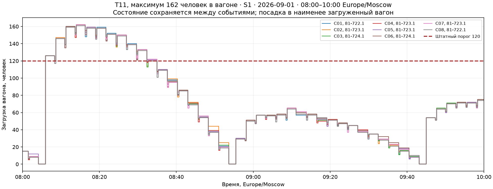

# Эксперимент GOAL 3.3

2026-09-01, Europe/Moscow: предварительный расчёт 06:00–08:00, оценка 08:00–10:00.

Исторические входы наблюдались через турникеты; назначения и движение заданы как инженерные сценарии. Пересадочный приток не учтён.

| Сценарий | Очередь в 10:00 | Ожидание в окне, пассажиро-секунды | Среднее полного ожидания, с | P95, с | Пик очереди станции/направления | Пик вагона, человек |
|---|---:|---:|---:|---:|---:|---:|
| S1 | 555 | 7560665 | 64.32 | 125 | 1008 | 162 |
| S2 | 569 | 7563310 | 64.34 | 125 | 1008 | 187 |
| S3 | 563 | 7591880 | 64.59 | 125 | 1008 | 187 |

Источник D14: Юбилейный, 168 человек в головном вагоне, 187 в моторном и безмоторном промежуточном при 5 чел/м². Штатный порог 120 задан отдельно. Позиции промежуточных вагонов приняты условно.

Принято: 44 состава, цикл 5940 с, интервал 135 с, перегон 140 с, промежуточная остановка 20 с, оборот 110 с, подход 120 с. Длина 29,6 км взята из справочного учебного расчёта и распределена по перегонам условно; геометрия оператора не подтверждена.

Все пассажирские балансы выполнены с учётом начальных очередей, людей в вагонах и на подходе. Полное ожидание севших включает возраст очереди до 08:00; интеграл очереди относится только к основному окну. Предварительный расчёт не доказывает устранения влияния неизвестного состояния в 06:00.

Транспортная работа всех трёх вариантов одинакова. Пробег учитывается прежним журналом прибытия, с частичным статусом на границах. Денежный статус неизвестен: энергия, оплаченный труд и ставки не заданы. Экономия не рассчитывается, сравнивается один план при разных OD.

Неизвестны реальные OD, пересадочный поток, полное расписание, точные перегоны, распределение людей по вагонам и исходная загрузка. Посадка в наименее загруженный вагон может недооценивать реальную неравномерность. Допуск к выпуску не подтверждён.

