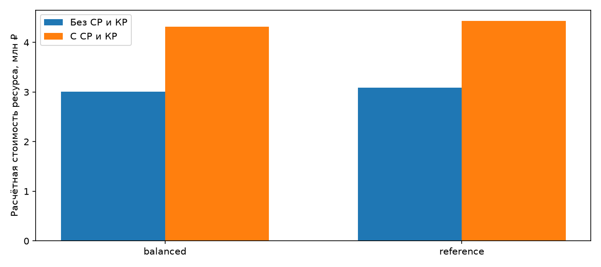
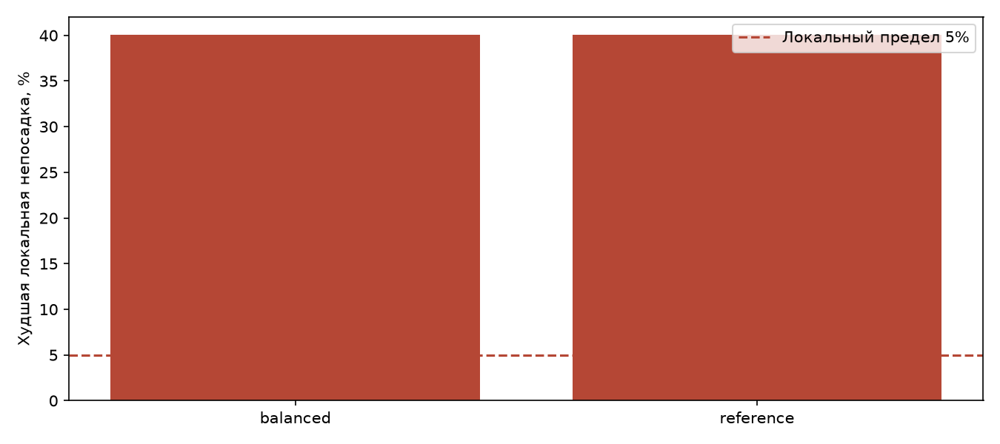

# Красная линия: баланс перевозки, ремонтного ресурса и объяснений

## Область исследования

Полный суточный опыт.

Есть нарушения или неполные проверки. Расчётное снижение стоимости таких вариантов не считается допустимой экономией.

Показан результат суточного опыта, а не только утреннего окна.

Полный день: входы 06:00–00:00, учёт конца платформенного потока после полуночи, закрытие наблюдения до 02:00.

Стоимость описывает расход ремонтного ресурса по пробегу. Денежная экономия бюджета, энергия, работа персонала и упущенная выручка не подтверждены.

Исходный график является модельным. Результат одного дня не доказывает переносимость на реальную линию, другие дни или аварии.

## Безопасность и качество перевозки

| Вариант | Допустим | Пробег, км | Среднее ожидание, с | P95 ожидания, с | Худшая первая непосадка, % | Худшая повторная, % |
| --- | --- | --- | --- | --- | --- | --- |
| balanced | нет | 27 274.47 | 72.28 | 142.00 | 40.05 | 6.97 |
| reference | нет | 27 962.57 | 69.48 | 140.00 | 40.05 | 6.97 |

## Проверка ограничений

Локальные доли относятся к уникальным людям в группе «станция × направление × 15 минут готовности к посадке». Пределы первой и повторной непосадки: 5% и 1%. Незавершённые наблюдения не считаются прошедшими проверку.

Физические ограничения: минимум 113 секунд в будний пик 08:00–10:00 и 17:00–19:00, 150 секунд вне пика, максимум 480 секунд; не более 53 составов на линии; предел посадки 150 человек на вагон. 120 человек является мягким ориентиром комфорта.

Ожидание проверяется на одинаковых пассажирских группах относительно фиксированного исходного графика: среднее +10 секунд и P95 +40 секунд за всё окно и отдельно в каждом наблюдаемом пике.

| Вариант | Непройденные проверки | Предел нагрузки, чел/вагон | Макс. время решения, с |
| --- | --- | --- | --- |
| balanced | local_boarding_service | 150.00 | 251.53 |
| reference | local_boarding_service | 150.00 | не подтверждено |

## Самые трудные локальные группы

| Вариант | Станция | Напр. | Начало | Людей | Не сели | % | Статус |
| --- | --- | --- | --- | --- | --- | --- | --- |
| balanced | L1_17 | -1.00 | 2026-09-30T08:00:00+03:00 | 1 291.00 | 517.00 | 40.05 | failed |
| balanced | L1_17 | -1.00 | 2026-09-30T07:45:00+03:00 | 1 284.00 | 361.00 | 28.12 | failed |
| balanced | L1_16 | -1.00 | 2026-09-30T08:00:00+03:00 | 499.00 | 115.00 | 23.05 | failed |
| balanced | L1_14 | -1.00 | 2026-09-30T08:15:00+03:00 | 675.00 | 74.00 | 10.96 | failed |
| balanced | L1_16 | -1.00 | 2026-09-30T07:45:00+03:00 | 554.00 | 38.00 | 6.86 | failed |
| balanced | L1_14 | -1.00 | 2026-09-30T08:00:00+03:00 | 601.00 | 5.00 | 0.83 | passed |
| balanced | L1_15 | -1.00 | 2026-09-30T08:00:00+03:00 | 530.00 | 2.00 | 0.38 | passed |
| balanced | L1_01 | 1.00 | 2026-09-30T06:00:00+03:00 | 546.00 | 0.00 | 0.00 | passed |
| balanced | L1_02 | -1.00 | 2026-09-30T06:00:00+03:00 | 13.00 | 0.00 | 0.00 | passed |
| balanced | L1_02 | 1.00 | 2026-09-30T06:00:00+03:00 | 210.00 | 0.00 | 0.00 | passed |
| reference | L1_17 | -1.00 | 2026-09-30T08:00:00+03:00 | 1 291.00 | 517.00 | 40.05 | failed |
| reference | L1_17 | -1.00 | 2026-09-30T07:45:00+03:00 | 1 284.00 | 361.00 | 28.12 | failed |
| reference | L1_16 | -1.00 | 2026-09-30T08:00:00+03:00 | 499.00 | 115.00 | 23.05 | failed |
| reference | L1_14 | -1.00 | 2026-09-30T08:15:00+03:00 | 675.00 | 74.00 | 10.96 | failed |
| reference | L1_16 | -1.00 | 2026-09-30T07:45:00+03:00 | 554.00 | 38.00 | 6.86 | failed |
| reference | L1_14 | -1.00 | 2026-09-30T08:00:00+03:00 | 601.00 | 5.00 | 0.83 | passed |
| reference | L1_15 | -1.00 | 2026-09-30T08:00:00+03:00 | 530.00 | 2.00 | 0.38 | passed |
| reference | L1_01 | 1.00 | 2026-09-30T06:00:00+03:00 | 546.00 | 0.00 | 0.00 | passed |
| reference | L1_02 | -1.00 | 2026-09-30T06:00:00+03:00 | 13.00 | 0.00 | 0.00 | passed |
| reference | L1_02 | 1.00 | 2026-09-30T06:00:00+03:00 | 210.00 | 0.00 | 0.00 | passed |

## Комфорт в вагонах

P95/P99 относятся к каждому вагону после посадки при пассажирском отправлении, включая пустые вагоны. Пики представлены отдельно, если попали в наблюдение.

Вагоно-секунды выше 120 и 140 учитывают длительность состояния, включая движение и ожидание с пассажирами. Доли делятся на время положительной загрузки, чтобы простой пустых вагонов не улучшал показатель. Полное наблюдаемое время также сохранено в comparison.json.

| Вариант | Окно | P95 | P99 | Макс. | >120, ваг·с | >140, ваг·с | >120, % времени | >140, % времени |
| --- | --- | --- | --- | --- | --- | --- | --- | --- |
| balanced | whole_window | 91.00 | 122.00 | 150.00 | 231 825.00 | 70 457.00 | 0.93 | 0.28 |
| balanced | morning_peak | 124.00 | 150.00 | 150.00 | 166 141.00 | 55 327.00 | 6.01 | 2.00 |
| balanced | evening_peak | 98.00 | 116.00 | 145.00 | 16 660.00 | 700.00 | 0.58 | 0.02 |
| reference | whole_window | 87.00 | 122.00 | 150.00 | 226 811.00 | 70 457.00 | 0.89 | 0.28 |
| reference | morning_peak | 124.00 | 150.00 | 150.00 | 166 141.00 | 55 327.00 | 5.78 | 1.93 |
| reference | evening_peak | 98.00 | 116.00 | 145.00 | 16 660.00 | 700.00 | 0.58 | 0.02 |

## Ожидание, очереди и их возраст по платформам

Среднее и P95/P99 считаются по выбранным группам готовности к посадке с последующим наблюдением. Максимальная очередь относится ко всему наблюдаемому окну; возраст соответствует самому длинному наблюдавшемуся ожиданию человека. Геометрия платформ неизвестна, оценка плотности не выдаётся.

| Вариант | Станция | Напр. | Людей | Среднее, с | P95, с | P99, с | Макс. очередь | Макс. возраст, с |
| --- | --- | --- | --- | --- | --- | --- | --- | --- |
| balanced | L1_01 | 1.00 | 56 360.00 | 69.57 | 137.00 | 190.00 | 595.00 | 274.00 |
| balanced | L1_02 | -1.00 | 2 502.00 | 84.26 | 168.00 | 357.00 | 32.00 | 477.00 |
| balanced | L1_02 | 1.00 | 32 387.00 | 76.08 | 146.00 | 206.00 | 246.00 | 291.00 |
| balanced | L1_03 | -1.00 | 4 453.00 | 76.10 | 154.00 | 275.00 | 42.00 | 437.00 |
| balanced | L1_03 | 1.00 | 25 637.00 | 72.53 | 147.00 | 211.00 | 180.00 | 285.00 |
| balanced | L1_04 | -1.00 | 4 829.00 | 74.47 | 146.00 | 258.00 | 30.00 | 457.00 |
| balanced | L1_04 | 1.00 | 16 824.00 | 68.75 | 139.00 | 181.00 | 180.00 | 294.00 |
| balanced | L1_05 | -1.00 | 9 851.00 | 77.84 | 145.00 | 237.00 | 72.00 | 477.00 |
| balanced | L1_05 | 1.00 | 26 822.00 | 68.53 | 139.00 | 161.00 | 252.00 | 389.00 |
| balanced | L1_06 | -1.00 | 17 303.00 | 69.17 | 136.00 | 217.00 | 120.00 | 437.00 |
| balanced | L1_06 | 1.00 | 37 455.00 | 71.25 | 143.00 | 211.00 | 240.00 | 424.00 |
| balanced | L1_07 | -1.00 | 7 480.00 | 73.87 | 140.00 | 230.00 | 54.00 | 457.00 |
| balanced | L1_07 | 1.00 | 7 257.00 | 68.54 | 135.00 | 146.00 | 75.00 | 285.00 |
| balanced | L1_08 | -1.00 | 10 100.00 | 75.39 | 146.00 | 236.00 | 63.00 | 477.00 |
| balanced | L1_08 | 1.00 | 9 666.00 | 68.69 | 143.00 | 171.00 | 77.00 | 293.00 |
| balanced | L1_09 | -1.00 | 13 144.00 | 67.85 | 129.00 | 219.00 | 72.00 | 437.00 |
| balanced | L1_09 | 1.00 | 10 951.00 | 76.55 | 146.00 | 167.00 | 63.00 | 296.00 |
| balanced | L1_10 | -1.00 | 41 208.00 | 73.81 | 136.00 | 205.00 | 243.00 | 457.00 |
| balanced | L1_10 | 1.00 | 36 814.00 | 69.74 | 133.00 | 185.00 | 283.00 | 425.00 |
| balanced | L1_11 | -1.00 | 28 185.00 | 77.14 | 148.00 | 188.00 | 195.00 | 477.00 |
| balanced | L1_11 | 1.00 | 19 001.00 | 67.95 | 141.00 | 171.00 | 192.00 | 302.00 |
| balanced | L1_12 | -1.00 | 35 532.00 | 69.38 | 136.00 | 221.00 | 276.00 | 437.00 |
| balanced | L1_12 | 1.00 | 18 943.00 | 71.93 | 144.00 | 205.00 | 150.00 | 445.00 |
| balanced | L1_13 | -1.00 | 18 503.00 | 69.17 | 137.00 | 197.00 | 162.00 | 457.00 |
| balanced | L1_13 | 1.00 | 5 584.00 | 64.67 | 131.00 | 146.00 | 90.00 | 272.00 |
| balanced | L1_14 | -1.00 | 31 014.00 | 72.30 | 145.00 | 235.00 | 195.00 | 456.00 |
| balanced | L1_14 | 1.00 | 9 091.00 | 72.09 | 146.00 | 225.00 | 60.00 | 465.00 |
| balanced | L1_15 | -1.00 | 21 365.00 | 68.65 | 138.00 | 218.00 | 126.00 | 361.00 |
| balanced | L1_15 | 1.00 | 4 103.00 | 72.07 | 142.00 | 223.00 | 30.00 | 445.00 |
| balanced | L1_16 | -1.00 | 20 370.00 | 76.55 | 149.00 | 200.00 | 144.00 | 326.00 |
| balanced | L1_16 | 1.00 | 2 450.00 | 69.74 | 144.00 | 198.00 | 27.00 | 277.00 |
| balanced | L1_17 | -1.00 | 35 578.00 | 74.21 | 148.00 | 243.00 | 446.00 | 305.00 |
| balanced | L1_17 | 1.00 | 3 153.00 | 78.62 | 160.00 | 345.00 | 48.00 | 465.00 |
| balanced | L1_18 | -1.00 | 39 890.00 | 74.62 | 145.00 | 226.00 | 348.00 | 286.00 |
| balanced | L1_18 | 1.00 | 1 809.00 | 78.78 | 172.00 | 385.00 | 32.00 | 445.00 |
| balanced | L1_19 | -1.00 | 93 322.00 | 74.23 | 142.00 | 232.00 | 1 046.00 | 292.00 |
| reference | L1_01 | 1.00 | 56 360.00 | 66.67 | 133.00 | 146.00 | 595.00 | 159.00 |
| reference | L1_02 | -1.00 | 2 502.00 | 81.22 | 149.00 | 357.00 | 32.00 | 477.00 |
| reference | L1_02 | 1.00 | 32 387.00 | 72.67 | 146.00 | 146.00 | 246.00 | 224.00 |
| reference | L1_03 | -1.00 | 4 453.00 | 72.26 | 149.00 | 257.00 | 42.00 | 437.00 |
| reference | L1_03 | 1.00 | 25 637.00 | 68.16 | 135.00 | 147.00 | 156.00 | 259.00 |
| reference | L1_04 | -1.00 | 4 829.00 | 71.93 | 138.00 | 174.00 | 30.00 | 457.00 |
| reference | L1_04 | 1.00 | 16 824.00 | 66.98 | 139.00 | 146.00 | 180.00 | 294.00 |
| reference | L1_05 | -1.00 | 9 851.00 | 75.32 | 145.00 | 160.00 | 72.00 | 477.00 |
| reference | L1_05 | 1.00 | 26 822.00 | 66.74 | 136.00 | 139.00 | 252.00 | 389.00 |
| reference | L1_06 | -1.00 | 17 303.00 | 66.25 | 132.00 | 155.00 | 120.00 | 437.00 |
| reference | L1_06 | 1.00 | 37 455.00 | 67.77 | 141.00 | 143.00 | 240.00 | 424.00 |
| reference | L1_07 | -1.00 | 7 480.00 | 71.15 | 140.00 | 148.00 | 54.00 | 457.00 |
| reference | L1_07 | 1.00 | 7 257.00 | 67.55 | 135.00 | 146.00 | 75.00 | 160.00 |
| reference | L1_08 | -1.00 | 10 100.00 | 72.91 | 146.00 | 151.00 | 63.00 | 477.00 |
| reference | L1_08 | 1.00 | 9 666.00 | 66.84 | 135.00 | 143.00 | 77.00 | 164.00 |
| reference | L1_09 | -1.00 | 13 144.00 | 65.17 | 129.00 | 151.00 | 72.00 | 437.00 |
| reference | L1_09 | 1.00 | 10 951.00 | 74.59 | 146.00 | 146.00 | 63.00 | 156.00 |
| reference | L1_10 | -1.00 | 41 208.00 | 71.29 | 136.00 | 146.00 | 243.00 | 457.00 |
| reference | L1_10 | 1.00 | 36 814.00 | 67.72 | 133.00 | 145.00 | 283.00 | 425.00 |
| reference | L1_11 | -1.00 | 28 185.00 | 75.47 | 142.00 | 148.00 | 195.00 | 477.00 |
| reference | L1_11 | 1.00 | 19 001.00 | 66.30 | 136.00 | 141.00 | 192.00 | 159.00 |
| reference | L1_12 | -1.00 | 35 532.00 | 66.68 | 131.00 | 140.00 | 276.00 | 437.00 |
| reference | L1_12 | 1.00 | 18 943.00 | 69.14 | 141.00 | 144.00 | 150.00 | 445.00 |
| reference | L1_13 | -1.00 | 18 503.00 | 67.16 | 135.00 | 137.00 | 162.00 | 457.00 |
| reference | L1_13 | 1.00 | 5 584.00 | 64.40 | 131.00 | 146.00 | 90.00 | 157.00 |
| reference | L1_14 | -1.00 | 31 014.00 | 69.39 | 145.00 | 148.00 | 195.00 | 456.00 |
| reference | L1_14 | 1.00 | 9 091.00 | 69.63 | 146.00 | 146.00 | 60.00 | 465.00 |
| reference | L1_15 | -1.00 | 21 365.00 | 65.70 | 128.00 | 138.00 | 126.00 | 361.00 |
| reference | L1_15 | 1.00 | 4 103.00 | 68.74 | 139.00 | 147.00 | 30.00 | 445.00 |
| reference | L1_16 | -1.00 | 20 370.00 | 74.35 | 146.00 | 149.00 | 144.00 | 326.00 |
| reference | L1_16 | 1.00 | 2 450.00 | 67.43 | 136.00 | 145.00 | 27.00 | 242.00 |
| reference | L1_17 | -1.00 | 35 578.00 | 71.23 | 145.00 | 208.00 | 446.00 | 305.00 |
| reference | L1_17 | 1.00 | 3 153.00 | 75.47 | 144.00 | 345.00 | 48.00 | 465.00 |
| reference | L1_18 | -1.00 | 39 890.00 | 70.71 | 140.00 | 145.00 | 348.00 | 196.00 |
| reference | L1_18 | 1.00 | 1 809.00 | 74.53 | 145.00 | 385.00 | 32.00 | 445.00 |
| reference | L1_19 | -1.00 | 93 322.00 | 70.76 | 142.00 | 148.00 | 1 046.00 | 165.00 |

## Стоимость и дельта за день

| Показатель | Без СР и КР | С СР и КР |
| --- | --- | --- |
| balanced / Исходная стоимость, ₽ | 3 086 297.19 | 4 431 687.05 |
| balanced / Стоимость варианта, ₽ | 3 008 408.11 | 4 318 271.43 |
| balanced / Расчётная дельта стоимости, ₽ | 77 889.08 | 113 415.62 |
| balanced / Расчётная дельта, % | 2.52 | 2.56 |
| balanced / Стоимость на один из 68 составов, ₽ | 44 241.30 | 63 503.99 |
| balanced / Расчётная дельта на один из 68 составов, ₽ | 1 145.43 | 1 667.88 |
| balanced / Подтверждённая допустимая экономия, ₽ | не подтверждено | не подтверждено |
| reference / Исходная стоимость, ₽ | 3 086 297.19 | 4 431 687.05 |
| reference / Стоимость варианта, ₽ | 3 086 297.19 | 4 431 687.05 |
| reference / Расчётная дельта стоимости, ₽ | 0.00 | 0.00 |
| reference / Расчётная дельта, % | 0.00 | 0.00 |
| reference / Стоимость на один из 68 составов, ₽ | 45 386.72 | 65 171.87 |
| reference / Расчётная дельта на один из 68 составов, ₽ | 0.00 | 0.00 |
| reference / Подтверждённая допустимая экономия, ₽ | не подтверждено | не подтверждено |

## Сценарная оценка: годовое повторение сопоставимых дней

Это сценарий 250 повторений этого дня, а не доказанная экономия годового бюджета.

| Показатель | Без СР и КР | С СР и КР |
| --- | --- | --- |
| balanced / Исходная стоимость, ₽ | 771 574 298.42 | 1 107 921 761.67 |
| balanced / Стоимость варианта, ₽ | 752 102 028.38 | 1 079 567 857.75 |
| balanced / Расчётная дельта стоимости, ₽ | 19 472 270.04 | 28 353 903.92 |
| balanced / Расчётная дельта, % | 2.52 | 2.56 |
| balanced / Стоимость на один из 68 составов, ₽ | 11 060 323.95 | 15 875 997.91 |
| balanced / Расчётная дельта на один из 68 составов, ₽ | 286 356.91 | 416 969.18 |
| balanced / Подтверждённая допустимая экономия, ₽ | не подтверждено | не подтверждено |
| reference / Исходная стоимость, ₽ | 771 574 298.42 | 1 107 921 761.67 |
| reference / Стоимость варианта, ₽ | 771 574 298.42 | 1 107 921 761.67 |
| reference / Расчётная дельта стоимости, ₽ | 0.00 | 0.00 |
| reference / Расчётная дельта, % | 0.00 | 0.00 |
| reference / Стоимость на один из 68 составов, ₽ | 11 346 680.86 | 16 292 967.08 |
| reference / Расчётная дельта на один из 68 составов, ₽ | 0.00 | 0.00 |
| reference / Подтверждённая допустимая экономия, ₽ | не подтверждено | не подтверждено |

## Расчёт на километр

Пробег включает пассажирские и непассажирские движения. Для пилота учитываются завершённые прибытия до конца наблюдения, полный будущий график в экономику не включён. Общая начальная поездная граница учитывается одинаково.

| Показатель | Без СР и КР | С СР и КР |
| --- | --- | --- |
| balanced / Исходная стоимость, ₽/км | 110.37 | 158.49 |
| balanced / Стоимость варианта, ₽/км | 110.30 | 158.33 |
| balanced / Расчётная дельта, ₽/сокращённый км | 113.19 | 164.82 |
| balanced / Расчётная дельта, ₽/исходный км | 2.79 | 4.06 |
| reference / Исходная стоимость, ₽/км | 110.37 | 158.49 |
| reference / Стоимость варианта, ₽/км | 110.37 | 158.49 |
| reference / Расчётная дельта, ₽/сокращённый км | не подтверждено | не подтверждено |
| reference / Расчётная дельта, ₽/исходный км | 0.00 | 0.00 |

## Погрешности расчёта

±5% относится только к рассчитанному пробегу каждого сравниваемого плана. Пробеги двух планов допускают противоположные ошибки. Межремонтные интервалы неизменны.

±20% относится только к ценам СР и КР. Одна цена ремонта применяется к обоим планам; цены СР и КР меняются независимо. Диапазоны являются чувствительностью расчёта, а не доверительными интервалами.

| Показатель | Без СР и КР | С СР и КР |
| --- | --- | --- |
| balanced / Исходная стоимость, ₽ | 2 931 982.33 … 3 240 612.05 | 3 954 478.62 … 4 935 803.27 |
| balanced / Стоимость варианта, ₽ | 2 857 987.71 … 3 158 828.52 | 3 853 483.83 … 4 809 256.30 |
| balanced / Расчётная дельта, ₽ | -226 846.19 … 382 624.35 | -343 529.53 … 584 571.38 |
| balanced / Расчётная дельта, % | -7.74 … 11.81 | -7.71 … 11.85 |
| reference / Исходная стоимость, ₽ | 2 931 982.33 … 3 240 612.05 | 3 954 478.62 … 4 935 803.27 |
| reference / Стоимость варианта, ₽ | 2 931 982.33 … 3 240 612.05 | 3 954 478.62 … 4 935 803.27 |
| reference / Расчётная дельта, ₽ | -308 629.72 … 308 629.72 | -470 076.50 … 470 076.50 |
| reference / Расчётная дельта, % | -10.53 … 9.52 | -10.53 … 9.52 |

## Погрешности расчёта / годовой сценарий

±5% относится только к рассчитанному пробегу каждого сравниваемого плана. Пробеги двух планов допускают противоположные ошибки. Межремонтные интервалы неизменны.

±20% относится только к ценам СР и КР. Одна цена ремонта применяется к обоим планам; цены СР и КР меняются независимо. Диапазоны являются чувствительностью расчёта, а не доверительными интервалами.

| Показатель | Без СР и КР | С СР и КР |
| --- | --- | --- |
| balanced / Исходная стоимость, ₽ | 732 995 583.49 … 810 153 013.34 | 988 619 655.57 … 1 233 950 817.04 |
| balanced / Стоимость варианта, ₽ | 714 496 926.96 … 789 707 129.79 | 963 370 957.28 … 1 202 314 074.80 |
| balanced / Расчётная дельта, ₽ | -56 711 546.30 … 95 656 086.38 | -85 882 383.20 … 146 142 844.60 |
| balanced / Расчётная дельта, % | -7.74 … 11.81 | -7.71 … 11.85 |
| reference / Исходная стоимость, ₽ | 732 995 583.49 … 810 153 013.34 | 988 619 655.57 … 1 233 950 817.04 |
| reference / Стоимость варианта, ₽ | 732 995 583.49 … 810 153 013.34 | 988 619 655.57 … 1 233 950 817.04 |
| reference / Расчётная дельта, ₽ | -77 157 429.84 … 77 157 429.84 | -117 519 125.43 … 117 519 125.43 |
| reference / Расчётная дельта, % | -10.53 … 9.52 | -10.53 … 9.52 |

## Модель и границы переносимости

Частота обновления прогноза 15 минут не равна исходному шагу обучения. Стандартный стекинг имеет 30-минутные выходы, сдвинутые четвертьчасовые обновления требуют отдельной проверки.

Даты обучения, состав ансамбля, хеши и неизвестные даты публикации внешних признаков сохранены в контрактах. Причинные объяснения признаков допустимы только при измеренных вкладах.

| Вариант | Состав модели | Конец обучения | Сдвинутые обновления |
| --- | --- | --- | --- |
| balanced | b1_lightgbm, b2_persistence, b3_gru_seeds012, frozen_meta_stack | {'b1_train_end': '2026-08-24', 'b3_train_end': '2026-07-31'} | да |
| reference | исходный график / см. контракт | {} | не подтверждено |

## Независимое подтверждение ансамбля

Статус не берётся из флага результата. Перепроверяются хеши B1, трёх GRU, B2, стекинга, комплект, сверка исходного уравнения B1 и JUnit реальных модельных тестов. Хеши тестового кода и входного manifest должны совпасть.

Данные станционных потоков и веса GRU в новой поставке совпадают с прежними; подключение полного ансамбля добавляет B1/B2 и сохранённый стекинг, а не новую версию этих данных.

| Проверка | Пройдена |
| --- | --- |
| actual_model_tests | да |
| b1_saved_equation_parity | да |
| complete_native_components | да |
| contract_feature_and_time_shape | да |
| evidence_files_present | да |
| input_manifest_weight_hashes | да |
| model_weight_hashes | да |
| run_model_contract_parity | да |
| source_identity | да |
| test_proof_hashes | да |

## После исполнения: прогноз против факта

Истина из будущих целевых интервалов здесь используется только для оценки. Эти значения не содержались в исходных пакетах решения и не выдаются за известные заранее. Перекрывающиеся прогнозы не являются независимыми наблюдениями.

| Вариант | Выпуск прогноза | Целей | Факт | Прогноз q50 | Прогноз решения | WAPE, % |
| --- | --- | --- | --- | --- | --- | --- |
| balanced | 2026-09-30T06:15:00+03:00 | 152.00 | 104 252.00 | 102 482.00 | 102 482.00 | 6.63 |
| balanced | 2026-09-30T06:30:00+03:00 | 152.00 | 120 184.00 | 118 130.00 | 118 130.00 | 6.28 |
| balanced | 2026-09-30T06:45:00+03:00 | 152.00 | 131 853.00 | 129 656.00 | 129 656.00 | 6.22 |
| balanced | 2026-09-30T07:00:00+03:00 | 152.00 | 137 351.00 | 137 817.00 | 137 817.00 | 5.94 |
| balanced | 2026-09-30T07:15:00+03:00 | 152.00 | 139 620.00 | 139 406.00 | 139 406.00 | 6.09 |
| balanced | 2026-09-30T07:30:00+03:00 | 152.00 | 140 665.00 | 139 931.00 | 139 931.00 | 5.92 |
| balanced | 2026-09-30T07:45:00+03:00 | 152.00 | 137 395.00 | 137 007.00 | 137 007.00 | 6.35 |
| balanced | 2026-09-30T08:00:00+03:00 | 152.00 | 128 155.00 | 128 320.00 | 128 320.00 | 6.41 |
| balanced | 2026-09-30T08:15:00+03:00 | 152.00 | 117 011.00 | 114 867.00 | 114 867.00 | 6.56 |
| balanced | 2026-09-30T08:30:00+03:00 | 152.00 | 104 640.00 | 102 621.00 | 102 621.00 | 6.92 |
| balanced | 2026-09-30T08:45:00+03:00 | 152.00 | 94 467.00 | 93 007.00 | 93 007.00 | 7.40 |
| balanced | 2026-09-30T09:00:00+03:00 | 152.00 | 87 625.00 | 85 304.00 | 85 304.00 | 8.09 |
| balanced | 2026-09-30T09:15:00+03:00 | 152.00 | 81 018.00 | 78 773.00 | 78 773.00 | 8.30 |
| balanced | 2026-09-30T09:30:00+03:00 | 152.00 | 74 528.00 | 71 930.00 | 71 930.00 | 8.62 |
| balanced | 2026-09-30T09:45:00+03:00 | 152.00 | 70 359.00 | 67 824.00 | 67 824.00 | 8.26 |
| balanced | 2026-09-30T10:00:00+03:00 | 152.00 | 67 863.00 | 66 261.00 | 66 261.00 | 7.81 |
| balanced | 2026-09-30T10:15:00+03:00 | 152.00 | 65 710.00 | 64 766.00 | 64 766.00 | 8.11 |
| balanced | 2026-09-30T10:30:00+03:00 | 152.00 | 64 084.00 | 63 270.00 | 63 270.00 | 8.32 |
| balanced | 2026-09-30T10:45:00+03:00 | 152.00 | 63 929.00 | 62 289.00 | 62 289.00 | 8.33 |
| balanced | 2026-09-30T11:00:00+03:00 | 152.00 | 63 659.00 | 62 853.00 | 62 853.00 | 7.81 |
| balanced | 2026-09-30T11:15:00+03:00 | 152.00 | 63 672.00 | 62 784.00 | 62 784.00 | 7.90 |
| balanced | 2026-09-30T11:30:00+03:00 | 152.00 | 63 721.00 | 63 056.00 | 63 056.00 | 7.94 |
| balanced | 2026-09-30T11:45:00+03:00 | 152.00 | 63 686.00 | 63 382.00 | 63 382.00 | 8.04 |
| balanced | 2026-09-30T12:00:00+03:00 | 152.00 | 64 206.00 | 63 730.00 | 63 730.00 | 8.00 |
| balanced | 2026-09-30T12:15:00+03:00 | 152.00 | 64 396.00 | 63 619.00 | 63 619.00 | 7.73 |
| balanced | 2026-09-30T12:30:00+03:00 | 152.00 | 65 220.00 | 64 499.00 | 64 499.00 | 7.78 |
| balanced | 2026-09-30T12:45:00+03:00 | 152.00 | 65 752.00 | 65 097.00 | 65 097.00 | 7.73 |
| balanced | 2026-09-30T13:00:00+03:00 | 152.00 | 67 567.00 | 66 703.00 | 66 703.00 | 7.68 |
| balanced | 2026-09-30T13:15:00+03:00 | 152.00 | 70 222.00 | 69 156.00 | 69 156.00 | 7.83 |
| balanced | 2026-09-30T13:30:00+03:00 | 152.00 | 72 373.00 | 71 187.00 | 71 187.00 | 8.17 |
| balanced | 2026-09-30T13:45:00+03:00 | 152.00 | 75 277.00 | 73 867.00 | 73 867.00 | 8.33 |
| balanced | 2026-09-30T14:00:00+03:00 | 152.00 | 78 933.00 | 77 029.00 | 77 029.00 | 8.35 |
| balanced | 2026-09-30T14:15:00+03:00 | 152.00 | 83 056.00 | 81 033.00 | 81 033.00 | 8.11 |
| balanced | 2026-09-30T14:30:00+03:00 | 152.00 | 87 192.00 | 84 664.00 | 84 664.00 | 7.33 |
| balanced | 2026-09-30T14:45:00+03:00 | 152.00 | 92 311.00 | 89 956.00 | 89 956.00 | 7.51 |
| balanced | 2026-09-30T15:00:00+03:00 | 152.00 | 97 595.00 | 97 368.00 | 97 368.00 | 7.89 |
| balanced | 2026-09-30T15:15:00+03:00 | 152.00 | 104 778.00 | 104 814.00 | 104 814.00 | 7.64 |
| balanced | 2026-09-30T15:30:00+03:00 | 152.00 | 114 808.00 | 113 767.00 | 113 767.00 | 6.98 |
| balanced | 2026-09-30T15:45:00+03:00 | 152.00 | 122 872.00 | 121 623.00 | 121 623.00 | 6.85 |
| balanced | 2026-09-30T16:00:00+03:00 | 152.00 | 129 543.00 | 126 336.00 | 126 336.00 | 6.87 |
| balanced | 2026-09-30T16:15:00+03:00 | 152.00 | 138 970.00 | 135 920.00 | 135 920.00 | 6.86 |
| balanced | 2026-09-30T16:30:00+03:00 | 152.00 | 147 986.00 | 144 241.00 | 144 241.00 | 6.90 |
| balanced | 2026-09-30T16:45:00+03:00 | 152.00 | 151 560.00 | 147 583.00 | 147 583.00 | 6.47 |
| balanced | 2026-09-30T17:00:00+03:00 | 152.00 | 150 407.00 | 145 967.00 | 145 967.00 | 6.38 |
| balanced | 2026-09-30T17:15:00+03:00 | 152.00 | 146 183.00 | 140 123.00 | 140 123.00 | 6.56 |
| balanced | 2026-09-30T17:30:00+03:00 | 152.00 | 138 260.00 | 132 308.00 | 132 308.00 | 6.99 |
| balanced | 2026-09-30T17:45:00+03:00 | 152.00 | 129 737.00 | 124 975.00 | 124 975.00 | 6.80 |
| balanced | 2026-09-30T18:00:00+03:00 | 152.00 | 120 368.00 | 116 798.00 | 116 798.00 | 6.87 |
| balanced | 2026-09-30T18:15:00+03:00 | 152.00 | 108 169.00 | 104 812.00 | 104 812.00 | 7.22 |
| balanced | 2026-09-30T18:30:00+03:00 | 152.00 | 94 685.00 | 91 630.00 | 91 630.00 | 7.62 |
| balanced | 2026-09-30T18:45:00+03:00 | 152.00 | 84 271.00 | 82 084.00 | 82 084.00 | 8.07 |
| balanced | 2026-09-30T19:00:00+03:00 | 152.00 | 77 087.00 | 75 860.00 | 75 860.00 | 7.90 |
| balanced | 2026-09-30T19:15:00+03:00 | 152.00 | 70 405.00 | 70 373.00 | 70 373.00 | 8.32 |
| balanced | 2026-09-30T19:30:00+03:00 | 152.00 | 64 889.00 | 65 710.00 | 65 710.00 | 8.35 |
| balanced | 2026-09-30T19:45:00+03:00 | 152.00 | 60 608.00 | 60 380.00 | 60 380.00 | 10.30 |
| balanced | 2026-09-30T20:00:00+03:00 | 152.00 | 56 734.00 | 57 023.00 | 57 023.00 | 11.24 |
| balanced | 2026-09-30T20:15:00+03:00 | 152.00 | 52 129.00 | 52 252.00 | 52 252.00 | 11.89 |
| balanced | 2026-09-30T20:30:00+03:00 | 152.00 | 47 988.00 | 47 885.00 | 47 885.00 | 12.31 |
| balanced | 2026-09-30T20:45:00+03:00 | 152.00 | 44 417.00 | 44 034.00 | 44 034.00 | 12.57 |
| balanced | 2026-09-30T21:00:00+03:00 | 152.00 | 40 886.00 | 38 948.00 | 38 948.00 | 13.00 |
| balanced | 2026-09-30T21:15:00+03:00 | 152.00 | 37 278.00 | 35 070.00 | 35 070.00 | 13.56 |
| balanced | 2026-09-30T21:30:00+03:00 | 152.00 | 33 491.00 | 31 337.00 | 31 337.00 | 13.92 |
| balanced | 2026-09-30T21:45:00+03:00 | 152.00 | 28 993.00 | 28 320.00 | 28 320.00 | 11.19 |
| balanced | 2026-09-30T22:00:00+03:00 | 152.00 | 25 988.00 | 25 620.00 | 25 620.00 | 11.52 |
| balanced | 2026-09-30T22:15:00+03:00 | 152.00 | 21 667.00 | 21 469.00 | 21 469.00 | 12.02 |
| balanced | 2026-09-30T22:30:00+03:00 | 152.00 | 17 404.00 | 17 504.00 | 17 504.00 | 13.80 |
| balanced | 2026-09-30T22:45:00+03:00 | 152.00 | 14 107.00 | 14 015.00 | 14 015.00 | 14.97 |
| balanced | 2026-09-30T23:00:00+03:00 | 152.00 | 11 199.00 | 11 310.00 | 11 310.00 | 16.37 |
| balanced | 2026-09-30T23:15:00+03:00 | 152.00 | 8 084.00 | 8 068.00 | 8 068.00 | 18.23 |
| balanced | 2026-09-30T23:30:00+03:00 | 152.00 | 5 303.00 | 5 335.00 | 5 335.00 | 22.10 |

## Объяснения YandexGPT и отказоустойчивость

YandexGPT выбирает и группирует ID проверенных фактов. Текст и числа формируются из этих фактов; свободные новые причины и изменение плана запрещены. Сбой API заменяет ответ шаблоном и не меняет поездное управление.

Реальная проверка API и объяснения всех решений являются разными проверками. Наличие одного успешного smoke не доказывает качество всех объяснений.

Тайм-аут, отсутствие допустимого варианта, резервное KEEP и неподтверждённая доставка внешнего уведомления отмечаются отдельно. Автоматическое восстановление считается проверенным только при сохранённом испытании.

| Показатель | Значение |
| --- | --- |
| verified_count | 71.00 |
| invalid_count | 0.00 |
| missing_count | 0.00 |
| yandexgpt_count | 26.00 |
| template_count | 45.00 |
| timeout_count | 0.00 |
| http_error_count | 0.00 |
| request_count | 71.00 |
| total_tokens | 1 835 048.00 |
| token_usage_complete | да |
| api_cost_rub | не подтверждено |

## Диагностические остановки составов

Синтетическая остановка одного состава на 3, 8 и 15 минут проверяет распространение задержек. Заданная длительность известна эксперименту; будущие фактические входы используются только для оценки. Это не причинный прогон оптимизатора с неизвестной длительностью происшествия.

Сохранены составы и удержания отправлений в затронутом направлении; экономические снятия подавлены. Сигнализация, блок-участки, тормозные расстояния и диспетчерские разрешения не проверены. Поэтому прохождение модельных интервалов не подтверждает реальную безопасность.

Восстановление пассажирских перевозок не завершено в случаях с оставшимися пассажирами в поездах. Время расчёта сравнивается с 480 секундами; доставка внешнего уведомления неизвестна. Экономия в этих случаях не подтверждена.

| Остановка, мин | Движение | Интервал мин/макс, с | Непосадка 1/2, % | Δ ожидания mean/P95, с | Макс. очередь | Остались в поездах | Восстановление | Расчёт, с |
| --- | --- | --- | --- | --- | --- | --- | --- | --- |
| 3.00 | да | 113 / 293 | 46.67 / 9.93 | 5.74 / 6.00 | 696.00 | 0.00 | завершено | 6.91 |
| 8.00 | нет | 113 / 593 | 98.74 / 59.03 | 34.96 / 301.00 | 1 272.00 | 13.00 | не завершено | 6.84 |
| 15.00 | нет | 113 / 1013 | 100.00 / 100.00 | 104.77 / 747.00 | 2 162.00 | 227.00 | не завершено | 7.56 |

## Реакция на происшествие и уведомления

Ни один диагностический случай не считается допуском к управлению. Подтверждён только сохранённый результат процесса; отдельный независимый аудит сигнализации не выполнен. Полные журналы доступны по путям в incident_probes.csv.

| Остановка, мин | Статус расчёта | ≤8 минут | Доставка измерена | Будущий факт для оценки | Причинная рекомендация | Сигнализация проверена |
| --- | --- | --- | --- | --- | --- | --- |
| 3.00 | evaluation_incomplete | да | нет | да | нет | нет |
| 8.00 | evaluation_incomplete | да | нет | да | нет | нет |
| 15.00 | evaluation_incomplete | да | нет | да | нет | нет |

## Графики

Расчётная стоимость показана и для недопустимых вариантов. Статус проверки определяет право назвать дельту допустимой экономией.

## Каждый состав: balanced

Все 68 составов включены, в том числе не работавшие. Среднее на состав не подменяет индивидуальный расчёт. Дельты недопустимого варианта остаются диагностическими.

| Состав | Показатель | Без СР и КР | С СР и КР |
| --- | --- | --- | --- |
| B001 / Baltiets | День / Стоимость | 60 462.80 | 88 040.91 |
| B001 / Baltiets | День / Расчётная дельта | 0.00 | 0.00 |
| B001 / Baltiets | Годовой сценарий / Стоимость | 15 115 699.81 | 22 010 227.85 |
| B001 / Baltiets | Годовой сценарий / Расчётная дельта | 0.00 | 0.00 |
| B002 / Baltiets | День / Стоимость | 53 881.11 | 78 457.20 |
| B002 / Baltiets | День / Расчётная дельта | 6 395.48 | 9 312.57 |
| B002 / Baltiets | Годовой сценарий / Стоимость | 13 470 277.43 | 19 614 300.30 |
| B002 / Baltiets | Годовой сценарий / Расчётная дельта | 1 598 871.18 | 2 328 143.54 |
| B003 / Baltiets | День / Стоимость | 60 090.39 | 87 498.64 |
| B003 / Baltiets | День / Расчётная дельта | 0.00 | 0.00 |
| B003 / Baltiets | Годовой сценарий / Стоимость | 15 022 597.40 | 21 874 659.84 |
| B003 / Baltiets | Годовой сценарий / Расчётная дельта | 0.00 | 0.00 |
| B004 / Baltiets | День / Стоимость | 59 904.18 | 87 227.50 |
| B004 / Baltiets | День / Расчётная дельта | 0.00 | 0.00 |
| B004 / Baltiets | Годовой сценарий / Стоимость | 14 976 046.20 | 21 806 875.84 |
| B004 / Baltiets | Годовой сценарий / Расчётная дельта | 0.00 | 0.00 |
| B005 / Baltiets | День / Стоимость | 53 322.50 | 77 643.79 |
| B005 / Baltiets | День / Расчётная дельта | 6 395.48 | 9 312.57 |
| B005 / Baltiets | Годовой сценарий / Стоимость | 13 330 623.82 | 19 410 948.29 |
| B005 / Baltiets | Годовой сценарий / Расчётная дельта | 1 598 871.18 | 2 328 143.54 |
| B006 / Baltiets | День / Стоимость | 59 531.78 | 86 685.23 |
| B006 / Baltiets | День / Расчётная дельта | 0.00 | 0.00 |
| B006 / Baltiets | Годовой сценарий / Стоимость | 14 882 943.79 | 21 671 307.83 |
| B006 / Baltiets | Годовой сценарий / Расчётная дельта | 0.00 | 0.00 |
| B007 / Baltiets | День / Стоимость | 59 159.37 | 86 142.96 |
| B007 / Baltiets | День / Расчётная дельта | 0.00 | 0.00 |
| B007 / Baltiets | Годовой сценарий / Стоимость | 14 789 841.38 | 21 535 739.83 |
| B007 / Baltiets | Годовой сценарий / Расчётная дельта | 0.00 | 0.00 |
| B008 / Baltiets | День / Стоимость | 62 284.10 | 90 692.93 |
| B008 / Baltiets | День / Расчётная дельта | 0.00 | 0.00 |
| B008 / Baltiets | Годовой сценарий / Стоимость | 15 571 024.37 | 22 673 233.68 |
| B008 / Baltiets | Годовой сценарий / Расчётная дельта | 0.00 | 0.00 |
| B009 / Baltiets | День / Стоимость | 62 098.01 | 90 421.96 |
| B009 / Baltiets | День / Расчётная дельта | 0.00 | 0.00 |
| B009 / Baltiets | Годовой сценарий / Стоимость | 15 524 501.46 | 22 605 490.88 |
| B009 / Baltiets | Годовой сценарий / Расчётная дельта | 0.00 | 0.00 |
| B010 / Baltiets | День / Стоимость | 61 911.91 | 90 150.99 |
| B010 / Baltiets | День / Расчётная дельта | 0.00 | 0.00 |
| B010 / Baltiets | Годовой сценарий / Стоимость | 15 477 978.55 | 22 537 748.09 |
| B010 / Baltiets | Годовой сценарий / Расчётная дельта | 0.00 | 0.00 |
| B011 / Baltiets | День / Стоимость | 55 330.34 | 80 567.45 |
| B011 / Baltiets | День / Расчётная дельта | 6 395.48 | 9 312.57 |
| B011 / Baltiets | Годовой сценарий / Стоимость | 13 832 584.47 | 20 141 861.75 |
| B011 / Baltiets | Годовой сценарий / Расчётная дельта | 1 598 871.18 | 2 328 143.54 |
| B012 / Baltiets | День / Стоимость | 61 539.73 | 89 609.05 |
| B012 / Baltiets | День / Расчётная дельта | 0.00 | 0.00 |
| B012 / Baltiets | Годовой сценарий / Стоимость | 15 384 932.74 | 22 402 262.50 |
| B012 / Baltiets | Годовой сценарий / Расчётная дельта | 0.00 | 0.00 |
| B013 / Baltiets | День / Стоимость | 61 353.64 | 89 338.08 |
| B013 / Baltiets | День / Расчётная дельта | 0.00 | 0.00 |
| B013 / Baltiets | Годовой сценарий / Стоимость | 15 338 409.83 | 22 334 519.70 |
| B013 / Baltiets | Годовой сценарий / Расчётная дельта | 0.00 | 0.00 |
| B014 / Baltiets | День / Стоимость | 60 981.46 | 88 796.14 |
| B014 / Baltiets | День / Расчётная дельта | 0.00 | 0.00 |
| B014 / Baltiets | Годовой сценарий / Стоимость | 15 245 364.02 | 22 199 034.11 |
| B014 / Baltiets | Годовой сценарий / Расчётная дельта | 0.00 | 0.00 |
| B015 / Baltiets | День / Стоимость | 54 399.88 | 79 212.59 |
| B015 / Baltiets | День / Расчётная дельта | 6 395.48 | 9 312.57 |
| B015 / Baltiets | Годовой сценарий / Стоимость | 13 599 969.94 | 19 803 147.77 |
| B015 / Baltiets | Годовой сценарий / Расчётная дельта | 1 598 871.18 | 2 328 143.54 |
| B016 / Baltiets | День / Стоимость | 60 609.27 | 88 254.19 |
| B016 / Baltiets | День / Расчётная дельта | 0.00 | 0.00 |
| B016 / Baltiets | Годовой сценарий / Стоимость | 15 152 318.21 | 22 063 548.51 |
| B016 / Baltiets | Годовой сценарий / Расчётная дельта | 0.00 | 0.00 |
| B017 / Baltiets | День / Стоимость | 53 801.31 | 78 341.00 |
| B017 / Baltiets | День / Расчётная дельта | 6 621.87 | 9 642.22 |
| B017 / Baltiets | Годовой сценарий / Стоимость | 13 450 326.91 | 19 585 250.01 |
| B017 / Baltiets | Годовой сценарий / Расчётная дельта | 1 655 468.39 | 2 410 555.70 |
| B018 / Baltiets | День / Стоимость | 60 423.18 | 87 983.22 |
| B018 / Baltiets | День / Расчётная дельта | 0.00 | 0.00 |
| B018 / Baltiets | Годовой сценарий / Стоимость | 15 105 795.30 | 21 995 805.72 |
| B018 / Baltiets | Годовой сценарий / Расчётная дельта | 0.00 | 0.00 |
| B019 / Baltiets | День / Стоимость | 60 615.61 | 88 263.42 |
| B019 / Baltiets | День / Расчётная дельта | 0.00 | 0.00 |
| B019 / Baltiets | Годовой сценарий / Стоимость | 15 153 902.93 | 22 065 856.05 |
| B019 / Baltiets | Годовой сценарий / Расчётная дельта | 0.00 | 0.00 |
| B020 / Baltiets | День / Стоимость | 60 536.38 | 88 148.05 |
| B020 / Baltiets | День / Расчётная дельта | 0.00 | 0.00 |
| B020 / Baltiets | Годовой сценарий / Стоимость | 15 134 093.91 | 22 037 011.80 |
| B020 / Baltiets | Годовой сценарий / Расчётная дельта | 0.00 | 0.00 |
| B021 / Baltiets | День / Стоимость | 60 615.61 | 88 263.42 |
| B021 / Baltiets | День / Расчётная дельта | 0.00 | 0.00 |
| B021 / Baltiets | Годовой сценарий / Стоимость | 15 153 902.93 | 22 065 856.05 |
| B021 / Baltiets | Годовой сценарий / Расчётная дельта | 0.00 | 0.00 |
| B022 / Baltiets | День / Стоимость | 60 536.38 | 88 148.05 |
| B022 / Baltiets | День / Расчётная дельта | 0.00 | 0.00 |
| B022 / Baltiets | Годовой сценарий / Стоимость | 15 134 093.91 | 22 037 011.80 |
| B022 / Baltiets | Годовой сценарий / Расчётная дельта | 0.00 | 0.00 |
| B023 / Baltiets | День / Стоимость | 57 225.44 | 83 326.94 |
| B023 / Baltiets | День / Расчётная дельта | 0.00 | 0.00 |
| B023 / Baltiets | Годовой сценарий / Стоимость | 14 306 359.71 | 20 831 733.95 |
| B023 / Baltiets | Годовой сценарий / Расчётная дельта | 0.00 | 0.00 |
| B024 / Baltiets | День / Стоимость | 50 603.57 | 73 684.71 |
| B024 / Baltiets | День / Расчётная дельта | 6 621.87 | 9 642.22 |
| B024 / Baltiets | Годовой сценарий / Стоимость | 12 650 891.33 | 18 421 178.24 |
| B024 / Baltiets | Годовой сценарий / Расчётная дельта | 1 655 468.39 | 2 410 555.70 |
| B025 / Baltiets | День / Стоимость | 57 225.44 | 83 326.94 |
| B025 / Baltiets | День / Расчётная дельта | 0.00 | 0.00 |
| B025 / Baltiets | Годовой сценарий / Стоимость | 14 306 359.71 | 20 831 733.95 |
| B025 / Baltiets | Годовой сценарий / Расчётная дельта | 0.00 | 0.00 |
| B026 / Baltiets | День / Стоимость | 50 829.95 | 74 014.36 |
| B026 / Baltiets | День / Расчётная дельта | 6 395.48 | 9 312.57 |
| B026 / Baltiets | Годовой сценарий / Стоимость | 12 707 488.54 | 18 503 590.40 |
| B026 / Baltiets | Годовой сценарий / Расчётная дельта | 1 598 871.18 | 2 328 143.54 |
| B027 / Baltiets | День / Стоимость | 57 225.44 | 83 326.94 |
| B027 / Baltiets | День / Расчётная дельта | 0.00 | 0.00 |
| B027 / Baltiets | Годовой сценарий / Стоимость | 14 306 359.71 | 20 831 733.95 |
| B027 / Baltiets | Годовой сценарий / Расчётная дельта | 0.00 | 0.00 |
| B028 / Baltiets | День / Стоимость | 57 225.44 | 83 326.94 |
| B028 / Baltiets | День / Расчётная дельта | 0.00 | 0.00 |
| B028 / Baltiets | Годовой сценарий / Стоимость | 14 306 359.71 | 20 831 733.95 |
| B028 / Baltiets | Годовой сценарий / Расчётная дельта | 0.00 | 0.00 |
| B029 / Baltiets | День / Стоимость | 57 225.44 | 83 326.94 |
| B029 / Baltiets | День / Расчётная дельта | 0.00 | 0.00 |
| B029 / Baltiets | Годовой сценарий / Стоимость | 14 306 359.71 | 20 831 733.95 |
| B029 / Baltiets | Годовой сценарий / Расчётная дельта | 0.00 | 0.00 |
| B030 / Baltiets | День / Стоимость | 50 750.72 | 73 898.98 |
| B030 / Baltiets | День / Расчётная дельта | 6 474.72 | 9 427.95 |
| B030 / Baltiets | Годовой сценарий / Стоимость | 12 687 679.51 | 18 474 746.15 |
| B030 / Baltiets | Годовой сценарий / Расчётная дельта | 1 618 680.20 | 2 356 987.80 |
| B031 / Baltiets | День / Стоимость | 57 225.44 | 83 326.94 |
| B031 / Baltiets | День / Расчётная дельта | 0.00 | 0.00 |
| B031 / Baltiets | Годовой сценарий / Стоимость | 14 306 359.71 | 20 831 733.95 |
| B031 / Baltiets | Годовой сценарий / Расчётная дельта | 0.00 | 0.00 |
| B032 / Baltiets | День / Стоимость | 57 225.44 | 83 326.94 |
| B032 / Baltiets | День / Расчётная дельта | 0.00 | 0.00 |
| B032 / Baltiets | Годовой сценарий / Стоимость | 14 306 359.71 | 20 831 733.95 |
| B032 / Baltiets | Годовой сценарий / Расчётная дельта | 0.00 | 0.00 |
| B033 / Baltiets | День / Стоимость | 50 603.57 | 73 684.71 |
| B033 / Baltiets | День / Расчётная дельта | 6 621.87 | 9 642.22 |
| B033 / Baltiets | Годовой сценарий / Стоимость | 12 650 891.33 | 18 421 178.24 |
| B033 / Baltiets | Годовой сценарий / Расчётная дельта | 1 655 468.39 | 2 410 555.70 |
| B034 / Baltiets | День / Стоимость | 50 750.72 | 73 898.98 |
| B034 / Baltiets | День / Расчётная дельта | 6 474.72 | 9 427.95 |
| B034 / Baltiets | Годовой сценарий / Стоимость | 12 687 679.51 | 18 474 746.15 |
| B034 / Baltiets | Годовой сценарий / Расчётная дельта | 1 618 680.20 | 2 356 987.80 |
| B035 / Baltiets | День / Стоимость | 50 750.72 | 73 898.98 |
| B035 / Baltiets | День / Расчётная дельта | 6 474.72 | 9 427.95 |
| B035 / Baltiets | Годовой сценарий / Стоимость | 12 687 679.51 | 18 474 746.15 |
| B035 / Baltiets | Годовой сценарий / Расчётная дельта | 1 618 680.20 | 2 356 987.80 |
| B036 / Baltiets | День / Стоимость | 50 603.57 | 73 684.71 |
| B036 / Baltiets | День / Расчётная дельта | 6 621.87 | 9 642.22 |
| B036 / Baltiets | Годовой сценарий / Стоимость | 12 650 891.33 | 18 421 178.24 |
| B036 / Baltiets | Годовой сценарий / Расчётная дельта | 1 655 468.39 | 2 410 555.70 |
| B037 / Baltiets | День / Стоимость | 57 225.44 | 83 326.94 |
| B037 / Baltiets | День / Расчётная дельта | 0.00 | 0.00 |
| B037 / Baltiets | Годовой сценарий / Стоимость | 14 306 359.71 | 20 831 733.95 |
| B037 / Baltiets | Годовой сценарий / Расчётная дельта | 0.00 | 0.00 |
| Y001 / Yubileyny | День / Стоимость | 55 343.00 | 76 720.54 |
| Y001 / Yubileyny | День / Расчётная дельта | 0.00 | 0.00 |
| Y001 / Yubileyny | Годовой сценарий / Стоимость | 13 835 749.14 | 19 180 134.46 |
| Y001 / Yubileyny | Годовой сценарий / Расчётная дельта | 0.00 | 0.00 |
| Y002 / Yubileyny | День / Стоимость | 55 001.05 | 76 246.51 |
| Y002 / Yubileyny | День / Расчётная дельта | 0.00 | 0.00 |
| Y002 / Yubileyny | Годовой сценарий / Стоимость | 13 750 263.04 | 19 061 627.32 |
| Y002 / Yubileyny | Годовой сценарий / Расчётная дельта | 0.00 | 0.00 |
| Y003 / Yubileyny | День / Стоимость | 54 830.08 | 76 009.50 |
| Y003 / Yubileyny | День / Расчётная дельта | 0.00 | 0.00 |
| Y003 / Yubileyny | Годовой сценарий / Стоимость | 13 707 519.98 | 19 002 373.76 |
| Y003 / Yubileyny | Годовой сценарий / Расчётная дельта | 0.00 | 0.00 |
| Y004 / Yubileyny | День / Стоимость | 54 659.11 | 75 772.48 |
| Y004 / Yubileyny | День / Расчётная дельта | 0.00 | 0.00 |
| Y004 / Yubileyny | Годовой сценарий / Стоимость | 13 664 776.93 | 18 943 120.19 |
| Y004 / Yubileyny | Годовой сценарий / Расчётная дельта | 0.00 | 0.00 |
| Y005 / Yubileyny | День / Стоимость | 54 488.14 | 75 535.47 |
| Y005 / Yubileyny | День / Расчётная дельта | 0.00 | 0.00 |
| Y005 / Yubileyny | Годовой сценарий / Стоимость | 13 622 033.88 | 18 883 866.62 |
| Y005 / Yubileyny | Годовой сценарий / Расчётная дельта | 0.00 | 0.00 |
| Y006 / Yubileyny | День / Стоимость | 57 431.89 | 79 616.32 |
| Y006 / Yubileyny | День / Расчётная дельта | 0.00 | 0.00 |
| Y006 / Yubileyny | Годовой сценарий / Стоимость | 14 357 973.56 | 19 904 080.41 |
| Y006 / Yubileyny | Годовой сценарий / Расчётная дельта | 0.00 | 0.00 |
| Y007 / Yubileyny | День / Стоимость | 57 260.92 | 79 379.31 |
| Y007 / Yubileyny | День / Расчётная дельта | 0.00 | 0.00 |
| Y007 / Yubileyny | Годовой сценарий / Стоимость | 14 315 230.50 | 19 844 826.84 |
| Y007 / Yubileyny | Годовой сценарий / Расчётная дельта | 0.00 | 0.00 |
| Y008 / Yubileyny | День / Стоимость | 57 089.95 | 79 142.29 |
| Y008 / Yubileyny | День / Расчётная дельта | 0.00 | 0.00 |
| Y008 / Yubileyny | Годовой сценарий / Стоимость | 14 272 487.45 | 19 785 573.27 |
| Y008 / Yubileyny | Годовой сценарий / Расчётная дельта | 0.00 | 0.00 |
| Y009 / Yubileyny | День / Стоимость | 56 747.90 | 78 668.12 |
| Y009 / Yubileyny | День / Расчётная дельта | 0.00 | 0.00 |
| Y009 / Yubileyny | Годовой сценарий / Стоимость | 14 186 975.35 | 19 667 030.10 |
| Y009 / Yubileyny | Годовой сценарий / Расчётная дельта | 0.00 | 0.00 |
| Y010 / Yubileyny | День / Стоимость | 56 576.83 | 78 430.96 |
| Y010 / Yubileyny | День / Расчётная дельта | 0.00 | 0.00 |
| Y010 / Yubileyny | Годовой сценарий / Стоимость | 14 144 206.30 | 19 607 740.49 |
| Y010 / Yubileyny | Годовой сценарий / Расчётная дельта | 0.00 | 0.00 |
| Y011 / Yubileyny | День / Стоимость | 56 405.75 | 78 193.80 |
| Y011 / Yubileyny | День / Расчётная дельта | 0.00 | 0.00 |
| Y011 / Yubileyny | Годовой сценарий / Стоимость | 14 101 437.25 | 19 548 450.88 |
| Y011 / Yubileyny | Годовой сценарий / Расчётная дельта | 0.00 | 0.00 |
| Y012 / Yubileyny | День / Стоимость | 56 234.67 | 77 956.65 |
| Y012 / Yubileyny | День / Расчётная дельта | 0.00 | 0.00 |
| Y012 / Yubileyny | Годовой сценарий / Стоимость | 14 058 668.20 | 19 489 161.27 |
| Y012 / Yubileyny | Годовой сценарий / Расчётная дельта | 0.00 | 0.00 |
| Y013 / Yubileyny | День / Стоимость | 56 063.60 | 77 719.49 |
| Y013 / Yubileyny | День / Расчётная дельта | 0.00 | 0.00 |
| Y013 / Yubileyny | Годовой сценарий / Стоимость | 14 015 899.14 | 19 429 871.66 |
| Y013 / Yubileyny | Годовой сценарий / Расчётная дельта | 0.00 | 0.00 |
| Y014 / Yubileyny | День / Стоимость | 55 892.52 | 77 482.33 |
| Y014 / Yubileyny | День / Расчётная дельта | 0.00 | 0.00 |
| Y014 / Yubileyny | Годовой сценарий / Стоимость | 13 973 130.09 | 19 370 582.05 |
| Y014 / Yubileyny | Годовой сценарий / Расчётная дельта | 0.00 | 0.00 |
| Y015 / Yubileyny | День / Стоимость | 55 721.44 | 77 245.17 |
| Y015 / Yubileyny | День / Расчётная дельта | 0.00 | 0.00 |
| Y015 / Yubileyny | Годовой сценарий / Стоимость | 13 930 361.04 | 19 311 292.44 |
| Y015 / Yubileyny | Годовой сценарий / Расчётная дельта | 0.00 | 0.00 |
| Y016 / Yubileyny | День / Стоимость | 52 576.03 | 72 884.77 |
| Y016 / Yubileyny | День / Расчётная дельта | 0.00 | 0.00 |
| Y016 / Yubileyny | Годовой сценарий / Стоимость | 13 144 008.48 | 18 221 192.61 |
| Y016 / Yubileyny | Годовой сценарий / Расчётная дельта | 0.00 | 0.00 |
| Y017 / Yubileyny | День / Стоимость | 0.00 | 0.00 |
| Y017 / Yubileyny | День / Расчётная дельта | 0.00 | 0.00 |
| Y017 / Yubileyny | Годовой сценарий / Стоимость | 0.00 | 0.00 |
| Y017 / Yubileyny | Годовой сценарий / Расчётная дельта | 0.00 | 0.00 |
| Y018 / Yubileyny | День / Стоимость | 0.00 | 0.00 |
| Y018 / Yubileyny | День / Расчётная дельта | 0.00 | 0.00 |
| Y018 / Yubileyny | Годовой сценарий / Стоимость | 0.00 | 0.00 |
| Y018 / Yubileyny | Годовой сценарий / Расчётная дельта | 0.00 | 0.00 |
| Y019 / Yubileyny | День / Стоимость | 0.00 | 0.00 |
| Y019 / Yubileyny | День / Расчётная дельта | 0.00 | 0.00 |
| Y019 / Yubileyny | Годовой сценарий / Стоимость | 0.00 | 0.00 |
| Y019 / Yubileyny | Годовой сценарий / Расчётная дельта | 0.00 | 0.00 |
| Y020 / Yubileyny | День / Стоимость | 0.00 | 0.00 |
| Y020 / Yubileyny | День / Расчётная дельта | 0.00 | 0.00 |
| Y020 / Yubileyny | Годовой сценарий / Стоимость | 0.00 | 0.00 |
| Y020 / Yubileyny | Годовой сценарий / Расчётная дельта | 0.00 | 0.00 |
| Y021 / Yubileyny | День / Стоимость | 0.00 | 0.00 |
| Y021 / Yubileyny | День / Расчётная дельта | 0.00 | 0.00 |
| Y021 / Yubileyny | Годовой сценарий / Стоимость | 0.00 | 0.00 |
| Y021 / Yubileyny | Годовой сценарий / Расчётная дельта | 0.00 | 0.00 |
| Y022 / Yubileyny | День / Стоимость | 0.00 | 0.00 |
| Y022 / Yubileyny | День / Расчётная дельта | 0.00 | 0.00 |
| Y022 / Yubileyny | Годовой сценарий / Стоимость | 0.00 | 0.00 |
| Y022 / Yubileyny | Годовой сценарий / Расчётная дельта | 0.00 | 0.00 |
| Y023 / Yubileyny | День / Стоимость | 0.00 | 0.00 |
| Y023 / Yubileyny | День / Расчётная дельта | 0.00 | 0.00 |
| Y023 / Yubileyny | Годовой сценарий / Стоимость | 0.00 | 0.00 |
| Y023 / Yubileyny | Годовой сценарий / Расчётная дельта | 0.00 | 0.00 |
| Y024 / Yubileyny | День / Стоимость | 0.00 | 0.00 |
| Y024 / Yubileyny | День / Расчётная дельта | 0.00 | 0.00 |
| Y024 / Yubileyny | Годовой сценарий / Стоимость | 0.00 | 0.00 |
| Y024 / Yubileyny | Годовой сценарий / Расчётная дельта | 0.00 | 0.00 |
| Y025 / Yubileyny | День / Стоимость | 0.00 | 0.00 |
| Y025 / Yubileyny | День / Расчётная дельта | 0.00 | 0.00 |
| Y025 / Yubileyny | Годовой сценарий / Стоимость | 0.00 | 0.00 |
| Y025 / Yubileyny | Годовой сценарий / Расчётная дельта | 0.00 | 0.00 |
| Y026 / Yubileyny | День / Стоимость | 0.00 | 0.00 |
| Y026 / Yubileyny | День / Расчётная дельта | 0.00 | 0.00 |
| Y026 / Yubileyny | Годовой сценарий / Стоимость | 0.00 | 0.00 |
| Y026 / Yubileyny | Годовой сценарий / Расчётная дельта | 0.00 | 0.00 |
| Y027 / Yubileyny | День / Стоимость | 0.00 | 0.00 |
| Y027 / Yubileyny | День / Расчётная дельта | 0.00 | 0.00 |
| Y027 / Yubileyny | Годовой сценарий / Стоимость | 0.00 | 0.00 |
| Y027 / Yubileyny | Годовой сценарий / Расчётная дельта | 0.00 | 0.00 |
| Y028 / Yubileyny | День / Стоимость | 0.00 | 0.00 |
| Y028 / Yubileyny | День / Расчётная дельта | 0.00 | 0.00 |
| Y028 / Yubileyny | Годовой сценарий / Стоимость | 0.00 | 0.00 |
| Y028 / Yubileyny | Годовой сценарий / Расчётная дельта | 0.00 | 0.00 |
| Y029 / Yubileyny | День / Стоимость | 0.00 | 0.00 |
| Y029 / Yubileyny | День / Расчётная дельта | 0.00 | 0.00 |
| Y029 / Yubileyny | Годовой сценарий / Стоимость | 0.00 | 0.00 |
| Y029 / Yubileyny | Годовой сценарий / Расчётная дельта | 0.00 | 0.00 |
| Y030 / Yubileyny | День / Стоимость | 0.00 | 0.00 |
| Y030 / Yubileyny | День / Расчётная дельта | 0.00 | 0.00 |
| Y030 / Yubileyny | Годовой сценарий / Стоимость | 0.00 | 0.00 |
| Y030 / Yubileyny | Годовой сценарий / Расчётная дельта | 0.00 | 0.00 |
| Y031 / Yubileyny | День / Стоимость | 0.00 | 0.00 |
| Y031 / Yubileyny | День / Расчётная дельта | 0.00 | 0.00 |
| Y031 / Yubileyny | Годовой сценарий / Стоимость | 0.00 | 0.00 |
| Y031 / Yubileyny | Годовой сценарий / Расчётная дельта | 0.00 | 0.00 |

## Каждый состав: reference

Все 68 составов включены, в том числе не работавшие. Среднее на состав не подменяет индивидуальный расчёт. Дельты недопустимого варианта остаются диагностическими.

| Состав | Показатель | Без СР и КР | С СР и КР |
| --- | --- | --- | --- |
| B001 / Baltiets | День / Стоимость | 60 462.80 | 88 040.91 |
| B001 / Baltiets | День / Расчётная дельта | 0.00 | 0.00 |
| B001 / Baltiets | Годовой сценарий / Стоимость | 15 115 699.81 | 22 010 227.85 |
| B001 / Baltiets | Годовой сценарий / Расчётная дельта | 0.00 | 0.00 |
| B002 / Baltiets | День / Стоимость | 60 276.59 | 87 769.78 |
| B002 / Baltiets | День / Расчётная дельта | 0.00 | 0.00 |
| B002 / Baltiets | Годовой сценарий / Стоимость | 15 069 148.61 | 21 942 443.84 |
| B002 / Baltiets | Годовой сценарий / Расчётная дельта | 0.00 | 0.00 |
| B003 / Baltiets | День / Стоимость | 60 090.39 | 87 498.64 |
| B003 / Baltiets | День / Расчётная дельта | 0.00 | 0.00 |
| B003 / Baltiets | Годовой сценарий / Стоимость | 15 022 597.40 | 21 874 659.84 |
| B003 / Baltiets | Годовой сценарий / Расчётная дельта | 0.00 | 0.00 |
| B004 / Baltiets | День / Стоимость | 59 904.18 | 87 227.50 |
| B004 / Baltiets | День / Расчётная дельта | 0.00 | 0.00 |
| B004 / Baltiets | Годовой сценарий / Стоимость | 14 976 046.20 | 21 806 875.84 |
| B004 / Baltiets | Годовой сценарий / Расчётная дельта | 0.00 | 0.00 |
| B005 / Baltiets | День / Стоимость | 59 717.98 | 86 956.37 |
| B005 / Baltiets | День / Расчётная дельта | 0.00 | 0.00 |
| B005 / Baltiets | Годовой сценарий / Стоимость | 14 929 494.99 | 21 739 091.84 |
| B005 / Baltiets | Годовой сценарий / Расчётная дельта | 0.00 | 0.00 |
| B006 / Baltiets | День / Стоимость | 59 531.78 | 86 685.23 |
| B006 / Baltiets | День / Расчётная дельта | 0.00 | 0.00 |
| B006 / Baltiets | Годовой сценарий / Стоимость | 14 882 943.79 | 21 671 307.83 |
| B006 / Baltiets | Годовой сценарий / Расчётная дельта | 0.00 | 0.00 |
| B007 / Baltiets | День / Стоимость | 59 159.37 | 86 142.96 |
| B007 / Baltiets | День / Расчётная дельта | 0.00 | 0.00 |
| B007 / Baltiets | Годовой сценарий / Стоимость | 14 789 841.38 | 21 535 739.83 |
| B007 / Baltiets | Годовой сценарий / Расчётная дельта | 0.00 | 0.00 |
| B008 / Baltiets | День / Стоимость | 62 284.10 | 90 692.93 |
| B008 / Baltiets | День / Расчётная дельта | 0.00 | 0.00 |
| B008 / Baltiets | Годовой сценарий / Стоимость | 15 571 024.37 | 22 673 233.68 |
| B008 / Baltiets | Годовой сценарий / Расчётная дельта | 0.00 | 0.00 |
| B009 / Baltiets | День / Стоимость | 62 098.01 | 90 421.96 |
| B009 / Baltiets | День / Расчётная дельта | 0.00 | 0.00 |
| B009 / Baltiets | Годовой сценарий / Стоимость | 15 524 501.46 | 22 605 490.88 |
| B009 / Baltiets | Годовой сценарий / Расчётная дельта | 0.00 | 0.00 |
| B010 / Baltiets | День / Стоимость | 61 911.91 | 90 150.99 |
| B010 / Baltiets | День / Расчётная дельта | 0.00 | 0.00 |
| B010 / Baltiets | Годовой сценарий / Стоимость | 15 477 978.55 | 22 537 748.09 |
| B010 / Baltiets | Годовой сценарий / Расчётная дельта | 0.00 | 0.00 |
| B011 / Baltiets | День / Стоимость | 61 725.82 | 89 880.02 |
| B011 / Baltiets | День / Расчётная дельта | 0.00 | 0.00 |
| B011 / Baltiets | Годовой сценарий / Стоимость | 15 431 455.65 | 22 470 005.29 |
| B011 / Baltiets | Годовой сценарий / Расчётная дельта | 0.00 | 0.00 |
| B012 / Baltiets | День / Стоимость | 61 539.73 | 89 609.05 |
| B012 / Baltiets | День / Расчётная дельта | 0.00 | 0.00 |
| B012 / Baltiets | Годовой сценарий / Стоимость | 15 384 932.74 | 22 402 262.50 |
| B012 / Baltiets | Годовой сценарий / Расчётная дельта | 0.00 | 0.00 |
| B013 / Baltiets | День / Стоимость | 61 353.64 | 89 338.08 |
| B013 / Baltiets | День / Расчётная дельта | 0.00 | 0.00 |
| B013 / Baltiets | Годовой сценарий / Стоимость | 15 338 409.83 | 22 334 519.70 |
| B013 / Baltiets | Годовой сценарий / Расчётная дельта | 0.00 | 0.00 |
| B014 / Baltiets | День / Стоимость | 60 981.46 | 88 796.14 |
| B014 / Baltiets | День / Расчётная дельта | 0.00 | 0.00 |
| B014 / Baltiets | Годовой сценарий / Стоимость | 15 245 364.02 | 22 199 034.11 |
| B014 / Baltiets | Годовой сценарий / Расчётная дельта | 0.00 | 0.00 |
| B015 / Baltiets | День / Стоимость | 60 795.36 | 88 525.17 |
| B015 / Baltiets | День / Расчётная дельта | 0.00 | 0.00 |
| B015 / Baltiets | Годовой сценарий / Стоимость | 15 198 841.11 | 22 131 291.31 |
| B015 / Baltiets | Годовой сценарий / Расчётная дельта | 0.00 | 0.00 |
| B016 / Baltiets | День / Стоимость | 60 609.27 | 88 254.19 |
| B016 / Baltiets | День / Расчётная дельта | 0.00 | 0.00 |
| B016 / Baltiets | Годовой сценарий / Стоимость | 15 152 318.21 | 22 063 548.51 |
| B016 / Baltiets | Годовой сценарий / Расчётная дельта | 0.00 | 0.00 |
| B017 / Baltiets | День / Стоимость | 60 423.18 | 87 983.22 |
| B017 / Baltiets | День / Расчётная дельта | 0.00 | 0.00 |
| B017 / Baltiets | Годовой сценарий / Стоимость | 15 105 795.30 | 21 995 805.72 |
| B017 / Baltiets | Годовой сценарий / Расчётная дельта | 0.00 | 0.00 |
| B018 / Baltiets | День / Стоимость | 60 423.18 | 87 983.22 |
| B018 / Baltiets | День / Расчётная дельта | 0.00 | 0.00 |
| B018 / Baltiets | Годовой сценарий / Стоимость | 15 105 795.30 | 21 995 805.72 |
| B018 / Baltiets | Годовой сценарий / Расчётная дельта | 0.00 | 0.00 |
| B019 / Baltiets | День / Стоимость | 60 615.61 | 88 263.42 |
| B019 / Baltiets | День / Расчётная дельта | 0.00 | 0.00 |
| B019 / Baltiets | Годовой сценарий / Стоимость | 15 153 902.93 | 22 065 856.05 |
| B019 / Baltiets | Годовой сценарий / Расчётная дельта | 0.00 | 0.00 |
| B020 / Baltiets | День / Стоимость | 60 536.38 | 88 148.05 |
| B020 / Baltiets | День / Расчётная дельта | 0.00 | 0.00 |
| B020 / Baltiets | Годовой сценарий / Стоимость | 15 134 093.91 | 22 037 011.80 |
| B020 / Baltiets | Годовой сценарий / Расчётная дельта | 0.00 | 0.00 |
| B021 / Baltiets | День / Стоимость | 60 615.61 | 88 263.42 |
| B021 / Baltiets | День / Расчётная дельта | 0.00 | 0.00 |
| B021 / Baltiets | Годовой сценарий / Стоимость | 15 153 902.93 | 22 065 856.05 |
| B021 / Baltiets | Годовой сценарий / Расчётная дельта | 0.00 | 0.00 |
| B022 / Baltiets | День / Стоимость | 60 536.38 | 88 148.05 |
| B022 / Baltiets | День / Расчётная дельта | 0.00 | 0.00 |
| B022 / Baltiets | Годовой сценарий / Стоимость | 15 134 093.91 | 22 037 011.80 |
| B022 / Baltiets | Годовой сценарий / Расчётная дельта | 0.00 | 0.00 |
| B023 / Baltiets | День / Стоимость | 57 225.44 | 83 326.94 |
| B023 / Baltiets | День / Расчётная дельта | 0.00 | 0.00 |
| B023 / Baltiets | Годовой сценарий / Стоимость | 14 306 359.71 | 20 831 733.95 |
| B023 / Baltiets | Годовой сценарий / Расчётная дельта | 0.00 | 0.00 |
| B024 / Baltiets | День / Стоимость | 57 225.44 | 83 326.94 |
| B024 / Baltiets | День / Расчётная дельта | 0.00 | 0.00 |
| B024 / Baltiets | Годовой сценарий / Стоимость | 14 306 359.71 | 20 831 733.95 |
| B024 / Baltiets | Годовой сценарий / Расчётная дельта | 0.00 | 0.00 |
| B025 / Baltiets | День / Стоимость | 57 225.44 | 83 326.94 |
| B025 / Baltiets | День / Расчётная дельта | 0.00 | 0.00 |
| B025 / Baltiets | Годовой сценарий / Стоимость | 14 306 359.71 | 20 831 733.95 |
| B025 / Baltiets | Годовой сценарий / Расчётная дельта | 0.00 | 0.00 |
| B026 / Baltiets | День / Стоимость | 57 225.44 | 83 326.94 |
| B026 / Baltiets | День / Расчётная дельта | 0.00 | 0.00 |
| B026 / Baltiets | Годовой сценарий / Стоимость | 14 306 359.71 | 20 831 733.95 |
| B026 / Baltiets | Годовой сценарий / Расчётная дельта | 0.00 | 0.00 |
| B027 / Baltiets | День / Стоимость | 57 225.44 | 83 326.94 |
| B027 / Baltiets | День / Расчётная дельта | 0.00 | 0.00 |
| B027 / Baltiets | Годовой сценарий / Стоимость | 14 306 359.71 | 20 831 733.95 |
| B027 / Baltiets | Годовой сценарий / Расчётная дельта | 0.00 | 0.00 |
| B028 / Baltiets | День / Стоимость | 57 225.44 | 83 326.94 |
| B028 / Baltiets | День / Расчётная дельта | 0.00 | 0.00 |
| B028 / Baltiets | Годовой сценарий / Стоимость | 14 306 359.71 | 20 831 733.95 |
| B028 / Baltiets | Годовой сценарий / Расчётная дельта | 0.00 | 0.00 |
| B029 / Baltiets | День / Стоимость | 57 225.44 | 83 326.94 |
| B029 / Baltiets | День / Расчётная дельта | 0.00 | 0.00 |
| B029 / Baltiets | Годовой сценарий / Стоимость | 14 306 359.71 | 20 831 733.95 |
| B029 / Baltiets | Годовой сценарий / Расчётная дельта | 0.00 | 0.00 |
| B030 / Baltiets | День / Стоимость | 57 225.44 | 83 326.94 |
| B030 / Baltiets | День / Расчётная дельта | 0.00 | 0.00 |
| B030 / Baltiets | Годовой сценарий / Стоимость | 14 306 359.71 | 20 831 733.95 |
| B030 / Baltiets | Годовой сценарий / Расчётная дельта | 0.00 | 0.00 |
| B031 / Baltiets | День / Стоимость | 57 225.44 | 83 326.94 |
| B031 / Baltiets | День / Расчётная дельта | 0.00 | 0.00 |
| B031 / Baltiets | Годовой сценарий / Стоимость | 14 306 359.71 | 20 831 733.95 |
| B031 / Baltiets | Годовой сценарий / Расчётная дельта | 0.00 | 0.00 |
| B032 / Baltiets | День / Стоимость | 57 225.44 | 83 326.94 |
| B032 / Baltiets | День / Расчётная дельта | 0.00 | 0.00 |
| B032 / Baltiets | Годовой сценарий / Стоимость | 14 306 359.71 | 20 831 733.95 |
| B032 / Baltiets | Годовой сценарий / Расчётная дельта | 0.00 | 0.00 |
| B033 / Baltiets | День / Стоимость | 57 225.44 | 83 326.94 |
| B033 / Baltiets | День / Расчётная дельта | 0.00 | 0.00 |
| B033 / Baltiets | Годовой сценарий / Стоимость | 14 306 359.71 | 20 831 733.95 |
| B033 / Baltiets | Годовой сценарий / Расчётная дельта | 0.00 | 0.00 |
| B034 / Baltiets | День / Стоимость | 57 225.44 | 83 326.94 |
| B034 / Baltiets | День / Расчётная дельта | 0.00 | 0.00 |
| B034 / Baltiets | Годовой сценарий / Стоимость | 14 306 359.71 | 20 831 733.95 |
| B034 / Baltiets | Годовой сценарий / Расчётная дельта | 0.00 | 0.00 |
| B035 / Baltiets | День / Стоимость | 57 225.44 | 83 326.94 |
| B035 / Baltiets | День / Расчётная дельта | 0.00 | 0.00 |
| B035 / Baltiets | Годовой сценарий / Стоимость | 14 306 359.71 | 20 831 733.95 |
| B035 / Baltiets | Годовой сценарий / Расчётная дельта | 0.00 | 0.00 |
| B036 / Baltiets | День / Стоимость | 57 225.44 | 83 326.94 |
| B036 / Baltiets | День / Расчётная дельта | 0.00 | 0.00 |
| B036 / Baltiets | Годовой сценарий / Стоимость | 14 306 359.71 | 20 831 733.95 |
| B036 / Baltiets | Годовой сценарий / Расчётная дельта | 0.00 | 0.00 |
| B037 / Baltiets | День / Стоимость | 57 225.44 | 83 326.94 |
| B037 / Baltiets | День / Расчётная дельта | 0.00 | 0.00 |
| B037 / Baltiets | Годовой сценарий / Стоимость | 14 306 359.71 | 20 831 733.95 |
| B037 / Baltiets | Годовой сценарий / Расчётная дельта | 0.00 | 0.00 |
| Y001 / Yubileyny | День / Стоимость | 55 343.00 | 76 720.54 |
| Y001 / Yubileyny | День / Расчётная дельта | 0.00 | 0.00 |
| Y001 / Yubileyny | Годовой сценарий / Стоимость | 13 835 749.14 | 19 180 134.46 |
| Y001 / Yubileyny | Годовой сценарий / Расчётная дельта | 0.00 | 0.00 |
| Y002 / Yubileyny | День / Стоимость | 55 001.05 | 76 246.51 |
| Y002 / Yubileyny | День / Расчётная дельта | 0.00 | 0.00 |
| Y002 / Yubileyny | Годовой сценарий / Стоимость | 13 750 263.04 | 19 061 627.32 |
| Y002 / Yubileyny | Годовой сценарий / Расчётная дельта | 0.00 | 0.00 |
| Y003 / Yubileyny | День / Стоимость | 54 830.08 | 76 009.50 |
| Y003 / Yubileyny | День / Расчётная дельта | 0.00 | 0.00 |
| Y003 / Yubileyny | Годовой сценарий / Стоимость | 13 707 519.98 | 19 002 373.76 |
| Y003 / Yubileyny | Годовой сценарий / Расчётная дельта | 0.00 | 0.00 |
| Y004 / Yubileyny | День / Стоимость | 54 659.11 | 75 772.48 |
| Y004 / Yubileyny | День / Расчётная дельта | 0.00 | 0.00 |
| Y004 / Yubileyny | Годовой сценарий / Стоимость | 13 664 776.93 | 18 943 120.19 |
| Y004 / Yubileyny | Годовой сценарий / Расчётная дельта | 0.00 | 0.00 |
| Y005 / Yubileyny | День / Стоимость | 54 488.14 | 75 535.47 |
| Y005 / Yubileyny | День / Расчётная дельта | 0.00 | 0.00 |
| Y005 / Yubileyny | Годовой сценарий / Стоимость | 13 622 033.88 | 18 883 866.62 |
| Y005 / Yubileyny | Годовой сценарий / Расчётная дельта | 0.00 | 0.00 |
| Y006 / Yubileyny | День / Стоимость | 57 431.89 | 79 616.32 |
| Y006 / Yubileyny | День / Расчётная дельта | 0.00 | 0.00 |
| Y006 / Yubileyny | Годовой сценарий / Стоимость | 14 357 973.56 | 19 904 080.41 |
| Y006 / Yubileyny | Годовой сценарий / Расчётная дельта | 0.00 | 0.00 |
| Y007 / Yubileyny | День / Стоимость | 57 260.92 | 79 379.31 |
| Y007 / Yubileyny | День / Расчётная дельта | 0.00 | 0.00 |
| Y007 / Yubileyny | Годовой сценарий / Стоимость | 14 315 230.50 | 19 844 826.84 |
| Y007 / Yubileyny | Годовой сценарий / Расчётная дельта | 0.00 | 0.00 |
| Y008 / Yubileyny | День / Стоимость | 57 089.95 | 79 142.29 |
| Y008 / Yubileyny | День / Расчётная дельта | 0.00 | 0.00 |
| Y008 / Yubileyny | Годовой сценарий / Стоимость | 14 272 487.45 | 19 785 573.27 |
| Y008 / Yubileyny | Годовой сценарий / Расчётная дельта | 0.00 | 0.00 |
| Y009 / Yubileyny | День / Стоимость | 56 747.90 | 78 668.12 |
| Y009 / Yubileyny | День / Расчётная дельта | 0.00 | 0.00 |
| Y009 / Yubileyny | Годовой сценарий / Стоимость | 14 186 975.35 | 19 667 030.10 |
| Y009 / Yubileyny | Годовой сценарий / Расчётная дельта | 0.00 | 0.00 |
| Y010 / Yubileyny | День / Стоимость | 56 576.83 | 78 430.96 |
| Y010 / Yubileyny | День / Расчётная дельта | 0.00 | 0.00 |
| Y010 / Yubileyny | Годовой сценарий / Стоимость | 14 144 206.30 | 19 607 740.49 |
| Y010 / Yubileyny | Годовой сценарий / Расчётная дельта | 0.00 | 0.00 |
| Y011 / Yubileyny | День / Стоимость | 56 405.75 | 78 193.80 |
| Y011 / Yubileyny | День / Расчётная дельта | 0.00 | 0.00 |
| Y011 / Yubileyny | Годовой сценарий / Стоимость | 14 101 437.25 | 19 548 450.88 |
| Y011 / Yubileyny | Годовой сценарий / Расчётная дельта | 0.00 | 0.00 |
| Y012 / Yubileyny | День / Стоимость | 56 234.67 | 77 956.65 |
| Y012 / Yubileyny | День / Расчётная дельта | 0.00 | 0.00 |
| Y012 / Yubileyny | Годовой сценарий / Стоимость | 14 058 668.20 | 19 489 161.27 |
| Y012 / Yubileyny | Годовой сценарий / Расчётная дельта | 0.00 | 0.00 |
| Y013 / Yubileyny | День / Стоимость | 56 063.60 | 77 719.49 |
| Y013 / Yubileyny | День / Расчётная дельта | 0.00 | 0.00 |
| Y013 / Yubileyny | Годовой сценарий / Стоимость | 14 015 899.14 | 19 429 871.66 |
| Y013 / Yubileyny | Годовой сценарий / Расчётная дельта | 0.00 | 0.00 |
| Y014 / Yubileyny | День / Стоимость | 55 892.52 | 77 482.33 |
| Y014 / Yubileyny | День / Расчётная дельта | 0.00 | 0.00 |
| Y014 / Yubileyny | Годовой сценарий / Стоимость | 13 973 130.09 | 19 370 582.05 |
| Y014 / Yubileyny | Годовой сценарий / Расчётная дельта | 0.00 | 0.00 |
| Y015 / Yubileyny | День / Стоимость | 55 721.44 | 77 245.17 |
| Y015 / Yubileyny | День / Расчётная дельта | 0.00 | 0.00 |
| Y015 / Yubileyny | Годовой сценарий / Стоимость | 13 930 361.04 | 19 311 292.44 |
| Y015 / Yubileyny | Годовой сценарий / Расчётная дельта | 0.00 | 0.00 |
| Y016 / Yubileyny | День / Стоимость | 52 576.03 | 72 884.77 |
| Y016 / Yubileyny | День / Расчётная дельта | 0.00 | 0.00 |
| Y016 / Yubileyny | Годовой сценарий / Стоимость | 13 144 008.48 | 18 221 192.61 |
| Y016 / Yubileyny | Годовой сценарий / Расчётная дельта | 0.00 | 0.00 |
| Y017 / Yubileyny | День / Стоимость | 0.00 | 0.00 |
| Y017 / Yubileyny | День / Расчётная дельта | 0.00 | 0.00 |
| Y017 / Yubileyny | Годовой сценарий / Стоимость | 0.00 | 0.00 |
| Y017 / Yubileyny | Годовой сценарий / Расчётная дельта | 0.00 | 0.00 |
| Y018 / Yubileyny | День / Стоимость | 0.00 | 0.00 |
| Y018 / Yubileyny | День / Расчётная дельта | 0.00 | 0.00 |
| Y018 / Yubileyny | Годовой сценарий / Стоимость | 0.00 | 0.00 |
| Y018 / Yubileyny | Годовой сценарий / Расчётная дельта | 0.00 | 0.00 |
| Y019 / Yubileyny | День / Стоимость | 0.00 | 0.00 |
| Y019 / Yubileyny | День / Расчётная дельта | 0.00 | 0.00 |
| Y019 / Yubileyny | Годовой сценарий / Стоимость | 0.00 | 0.00 |
| Y019 / Yubileyny | Годовой сценарий / Расчётная дельта | 0.00 | 0.00 |
| Y020 / Yubileyny | День / Стоимость | 0.00 | 0.00 |
| Y020 / Yubileyny | День / Расчётная дельта | 0.00 | 0.00 |
| Y020 / Yubileyny | Годовой сценарий / Стоимость | 0.00 | 0.00 |
| Y020 / Yubileyny | Годовой сценарий / Расчётная дельта | 0.00 | 0.00 |
| Y021 / Yubileyny | День / Стоимость | 0.00 | 0.00 |
| Y021 / Yubileyny | День / Расчётная дельта | 0.00 | 0.00 |
| Y021 / Yubileyny | Годовой сценарий / Стоимость | 0.00 | 0.00 |
| Y021 / Yubileyny | Годовой сценарий / Расчётная дельта | 0.00 | 0.00 |
| Y022 / Yubileyny | День / Стоимость | 0.00 | 0.00 |
| Y022 / Yubileyny | День / Расчётная дельта | 0.00 | 0.00 |
| Y022 / Yubileyny | Годовой сценарий / Стоимость | 0.00 | 0.00 |
| Y022 / Yubileyny | Годовой сценарий / Расчётная дельта | 0.00 | 0.00 |
| Y023 / Yubileyny | День / Стоимость | 0.00 | 0.00 |
| Y023 / Yubileyny | День / Расчётная дельта | 0.00 | 0.00 |
| Y023 / Yubileyny | Годовой сценарий / Стоимость | 0.00 | 0.00 |
| Y023 / Yubileyny | Годовой сценарий / Расчётная дельта | 0.00 | 0.00 |
| Y024 / Yubileyny | День / Стоимость | 0.00 | 0.00 |
| Y024 / Yubileyny | День / Расчётная дельта | 0.00 | 0.00 |
| Y024 / Yubileyny | Годовой сценарий / Стоимость | 0.00 | 0.00 |
| Y024 / Yubileyny | Годовой сценарий / Расчётная дельта | 0.00 | 0.00 |
| Y025 / Yubileyny | День / Стоимость | 0.00 | 0.00 |
| Y025 / Yubileyny | День / Расчётная дельта | 0.00 | 0.00 |
| Y025 / Yubileyny | Годовой сценарий / Стоимость | 0.00 | 0.00 |
| Y025 / Yubileyny | Годовой сценарий / Расчётная дельта | 0.00 | 0.00 |
| Y026 / Yubileyny | День / Стоимость | 0.00 | 0.00 |
| Y026 / Yubileyny | День / Расчётная дельта | 0.00 | 0.00 |
| Y026 / Yubileyny | Годовой сценарий / Стоимость | 0.00 | 0.00 |
| Y026 / Yubileyny | Годовой сценарий / Расчётная дельта | 0.00 | 0.00 |
| Y027 / Yubileyny | День / Стоимость | 0.00 | 0.00 |
| Y027 / Yubileyny | День / Расчётная дельта | 0.00 | 0.00 |
| Y027 / Yubileyny | Годовой сценарий / Стоимость | 0.00 | 0.00 |
| Y027 / Yubileyny | Годовой сценарий / Расчётная дельта | 0.00 | 0.00 |
| Y028 / Yubileyny | День / Стоимость | 0.00 | 0.00 |
| Y028 / Yubileyny | День / Расчётная дельта | 0.00 | 0.00 |
| Y028 / Yubileyny | Годовой сценарий / Стоимость | 0.00 | 0.00 |
| Y028 / Yubileyny | Годовой сценарий / Расчётная дельта | 0.00 | 0.00 |
| Y029 / Yubileyny | День / Стоимость | 0.00 | 0.00 |
| Y029 / Yubileyny | День / Расчётная дельта | 0.00 | 0.00 |
| Y029 / Yubileyny | Годовой сценарий / Стоимость | 0.00 | 0.00 |
| Y029 / Yubileyny | Годовой сценарий / Расчётная дельта | 0.00 | 0.00 |
| Y030 / Yubileyny | День / Стоимость | 0.00 | 0.00 |
| Y030 / Yubileyny | День / Расчётная дельта | 0.00 | 0.00 |
| Y030 / Yubileyny | Годовой сценарий / Стоимость | 0.00 | 0.00 |
| Y030 / Yubileyny | Годовой сценарий / Расчётная дельта | 0.00 | 0.00 |
| Y031 / Yubileyny | День / Стоимость | 0.00 | 0.00 |
| Y031 / Yubileyny | День / Расчётная дельта | 0.00 | 0.00 |
| Y031 / Yubileyny | Годовой сценарий / Стоимость | 0.00 | 0.00 |
| Y031 / Yubileyny | Годовой сценарий / Расчётная дельта | 0.00 | 0.00 |

## Объяснение решения 900

Источник: yandexgpt; модель: yandexgpt-5-lite; ID контекста: c68d7a98d0caeee2476ca9fa7d59d0c4921a6a548a1b4c6d5fd72702208f72f3

Подтверждены соответствие пакету фактов и неизменность действия.

| Секция | Объяснение | ID факта / источник |
| --- | --- | --- |
| action | Выбранное действие: {"candidate_id":"KEEP","decision_time":"2026-09-30T06:15:00+03:00","forecast_admissible":false,"return_by_second":null,"trip_shifts":{},"withdrawn_train_ids":[]} | decision.action / balanced/900 |
| effects | Сейчас ожидают на платформах: 207 чел. | state.queue / controller/resume_00900.json.gz |
| effects | Проверенный вариант KEEP: {"known_closed_plan_cost":{"with_sr_kr":4431687.046675718,"without_sr_kr":3086297.1936610118},"local_checks":[{"binding_scope":"each station x direction x 15-minute platform-arrival cohort, all service periods","failed_cohort_count":10,"status":"failed"}],"physical_passed":true,"policy_passed":true,"reason":null,"service_passed":false,"status":"evaluated","waiting":[{"complete":null,"mean_wait_seconds":null,"p95_wait_seconds":null,"scenario":"S1"}]} | alternative.KEEP / controller/decision_00900.json |
| effects | Вклад GRU в признаки не измерен; B1 contributions не равны вкладам всего стекинга: true | limit.attribution / model contract |
| prediction | Прогноз входов на доступном горизонте: 102482 чел. | forecast.total / controller/raw_forecast_00900.json |
| prediction | Прогноз входов по каждой станции: {"L1_01":14641,"L1_02":7345,"L1_03":5204,"L1_04":2055,"L1_05":2220,"L1_06":6038,"L1_07":447,"L1_08":2385,"L1_09":857,"L1_10":2998,"L1_11":1239,"L1_12":3892,"L1_13":881,"L1_14":3579,"L1_15":2852,"L1_16":2652,"L1_17":7518,"L1_18":9389,"L1_19":26290} чел. на горизонте | forecast.stations / controller/raw_forecast_00900.json |
| prediction | Подробные измеренные вклады сгруппированы ниже; полный список сохранён в исходном пакете фактов. | attribution.b1 / controller/raw_forecast_00900.json |
| prediction | Вклад GRU в признаки не измерен; B1 contributions не равны вкладам всего стекинга: true | limit.attribution / model contract |
| rationale | Результат проверки вариантов: no_feasible_candidate | decision.status / controller/decision_00900.json |
| rationale | Выбран допустимый по прогнозу вариант: false | decision.validated / controller/decision_00900.json |
| rationale | Подробные измеренные вклады сгруппированы ниже; полный список сохранён в исходном пакете фактов. | attribution.b1 / controller/raw_forecast_00900.json |
| rationale | Вклад GRU в признаки не измерен; B1 contributions не равны вкладам всего стекинга: true | limit.attribution / model contract |
| rationale | Минимальный интервал в пик: 113 с | headway.peak / contract.json |
| rationale | Максимальный интервал: 480 с | headway.maximum / contract.json |
| rationale | Предел пассажиров на вагон: 150 чел. | load.maximum / contract.json |
| revisit | Следующий плановый пересмотр: 2026-09-30T06:30:00+03:00 | decision.revisit / 2026-09-30T06:15:00+03:00 |
| revisit | Вклад GRU в признаки не измерен; B1 contributions не равны вкладам всего стекинга: true | limit.attribution / model contract |
| risks | Прогноз может недооценить локальный спрос: true | risk.forecast / forecast contract |
| risks | Вклад GRU в признаки не измерен; B1 contributions не равны вкладам всего стекинга: true | limit.attribution / model contract |
| risks | Минимальный интервал в пик: 113 с | headway.peak / contract.json |
| risks | Максимальный интервал: 480 с | headway.maximum / contract.json |
| risks | Предел пассажиров на вагон: 150 чел. | load.maximum / contract.json |

## Измеренные вклады: решение 900

Показаны пять групп с крупнейшими по модулю вкладами raw z и до трёх признаков в каждой. Это вклад часового B1 в log((y+1)/(hourly_reference+1)), а не изменение числа пассажиров, стоимости или причинный эффект. Вестибюли не суммируются. Все группы доступны в dispatcher.html и исходных фактах.

| Станция | Час цели | Горизонт, ч | Вестибюль | Признак | Вклад, z |
| --- | --- | --- | --- | --- | --- |
| L1_19 | 2026-09-30T04:00:00+00:00 | 2.00 | devyatkino_2 | b4_tau | -0.040580 |
| L1_19 | 2026-09-30T04:00:00+00:00 | 2.00 | devyatkino_1 | b4_tau | -0.035975 |
| L1_19 | 2026-09-30T04:00:00+00:00 | 2.00 | devyatkino_2 | y_tau168 | +0.013136 |
| L1_19 | 2026-09-30T05:00:00+00:00 | 3.00 | devyatkino_2 | b4_tau | -0.040246 |
| L1_19 | 2026-09-30T05:00:00+00:00 | 3.00 | devyatkino_1 | b4_tau | -0.036781 |
| L1_19 | 2026-09-30T05:00:00+00:00 | 3.00 | devyatkino_1 | y_tau168 | +0.014505 |
| L1_19 | 2026-09-30T03:00:00+00:00 | 1.00 | devyatkino_2 | b4_tau | -0.039796 |
| L1_19 | 2026-09-30T03:00:00+00:00 | 1.00 | devyatkino_2 | y_tau168 | +0.012836 |
| L1_19 | 2026-09-30T03:00:00+00:00 | 1.00 | devyatkino_2 | r_yday | +0.012328 |
| L1_06 | 2026-09-30T05:00:00+00:00 | 3.00 | baltiyskaya_1 | b4_tau | -0.039088 |
| L1_06 | 2026-09-30T05:00:00+00:00 | 3.00 | baltiyskaya_1 | r_yday | -0.013189 |
| L1_06 | 2026-09-30T05:00:00+00:00 | 3.00 | baltiyskaya_1 | y_tau168 | +0.012306 |
| L1_18 | 2026-09-30T05:00:00+00:00 | 3.00 | grazhdansky_prospekt_1 | b4_tau | -0.038921 |
| L1_18 | 2026-09-30T05:00:00+00:00 | 3.00 | grazhdansky_prospekt_1 | y_tau168 | +0.013009 |
| L1_18 | 2026-09-30T05:00:00+00:00 | 3.00 | grazhdansky_prospekt_1 | y_tau24 | +0.008053 |

## Объяснение решения 1800

Источник: yandexgpt; модель: yandexgpt-5-lite; ID контекста: e57adfa95800c2139baf7fd4947646cd96d2e9248e64b0ff4bda9af3906e6cef

Подтверждены соответствие пакету фактов и неизменность действия.

| Секция | Объяснение | ID факта / источник |
| --- | --- | --- |
| action | Выбранное действие: {"candidate_id":"KEEP","decision_time":"2026-09-30T06:30:00+03:00","forecast_admissible":false,"return_by_second":null,"trip_shifts":{},"withdrawn_train_ids":[]} | decision.action / balanced/1800 |
| effects | Сейчас ожидают на платформах: 535 чел. | state.queue / controller/resume_01800.json.gz |
| effects | Проверенный вариант KEEP: {"known_closed_plan_cost":{"with_sr_kr":4431687.046675718,"without_sr_kr":3086297.1936610118},"local_checks":[{"binding_scope":"each station x direction x 15-minute platform-arrival cohort, all service periods","failed_cohort_count":12,"status":"failed"}],"physical_passed":true,"policy_passed":true,"reason":null,"service_passed":false,"status":"evaluated","waiting":[{"complete":null,"mean_wait_seconds":null,"p95_wait_seconds":null,"scenario":"S1"}]} | alternative.KEEP / controller/decision_01800.json |
| prediction | Прогноз входов на доступном горизонте: 118130 чел. | forecast.total / controller/raw_forecast_01800.json |
| prediction | Прогноз входов по каждой станции: {"L1_01":16386,"L1_02":8246,"L1_03":6030,"L1_04":2345,"L1_05":2495,"L1_06":7166,"L1_07":506,"L1_08":2842,"L1_09":992,"L1_10":3560,"L1_11":1514,"L1_12":5076,"L1_13":1072,"L1_14":4352,"L1_15":3367,"L1_16":3082,"L1_17":8738,"L1_18":10585,"L1_19":29776} чел. на горизонте | forecast.stations / controller/raw_forecast_01800.json |
| rationale | Результат проверки вариантов: no_feasible_candidate | decision.status / controller/decision_01800.json |
| rationale | Выбран допустимый по прогнозу вариант: false | decision.validated / controller/decision_01800.json |
| rationale | Подробные измеренные вклады сгруппированы ниже; полный список сохранён в исходном пакете фактов. | attribution.b1 / controller/raw_forecast_01800.json |
| revisit | Следующий плановый пересмотр: 2026-09-30T06:45:00+03:00 | decision.revisit / 2026-09-30T06:30:00+03:00 |
| risks | Прогноз может недооценить локальный спрос: true | risk.forecast / forecast contract |

## Измеренные вклады: решение 1800

Показаны пять групп с крупнейшими по модулю вкладами raw z и до трёх признаков в каждой. Это вклад часового B1 в log((y+1)/(hourly_reference+1)), а не изменение числа пассажиров, стоимости или причинный эффект. Вестибюли не суммируются. Все группы доступны в dispatcher.html и исходных фактах.

| Станция | Час цели | Горизонт, ч | Вестибюль | Признак | Вклад, z |
| --- | --- | --- | --- | --- | --- |
| L1_19 | 2026-09-30T04:00:00+00:00 | 2.00 | devyatkino_2 | b4_tau | -0.040580 |
| L1_19 | 2026-09-30T04:00:00+00:00 | 2.00 | devyatkino_1 | b4_tau | -0.035975 |
| L1_19 | 2026-09-30T04:00:00+00:00 | 2.00 | devyatkino_2 | y_tau168 | +0.013136 |
| L1_19 | 2026-09-30T05:00:00+00:00 | 3.00 | devyatkino_2 | b4_tau | -0.040246 |
| L1_19 | 2026-09-30T05:00:00+00:00 | 3.00 | devyatkino_1 | b4_tau | -0.036781 |
| L1_19 | 2026-09-30T05:00:00+00:00 | 3.00 | devyatkino_1 | y_tau168 | +0.014505 |
| L1_19 | 2026-09-30T03:00:00+00:00 | 1.00 | devyatkino_2 | b4_tau | -0.039796 |
| L1_19 | 2026-09-30T03:00:00+00:00 | 1.00 | devyatkino_2 | y_tau168 | +0.012836 |
| L1_19 | 2026-09-30T03:00:00+00:00 | 1.00 | devyatkino_2 | r_yday | +0.012328 |
| L1_06 | 2026-09-30T05:00:00+00:00 | 3.00 | baltiyskaya_1 | b4_tau | -0.039088 |
| L1_06 | 2026-09-30T05:00:00+00:00 | 3.00 | baltiyskaya_1 | r_yday | -0.013189 |
| L1_06 | 2026-09-30T05:00:00+00:00 | 3.00 | baltiyskaya_1 | y_tau168 | +0.012306 |
| L1_18 | 2026-09-30T05:00:00+00:00 | 3.00 | grazhdansky_prospekt_1 | b4_tau | -0.038921 |
| L1_18 | 2026-09-30T05:00:00+00:00 | 3.00 | grazhdansky_prospekt_1 | y_tau168 | +0.013009 |
| L1_18 | 2026-09-30T05:00:00+00:00 | 3.00 | grazhdansky_prospekt_1 | y_tau24 | +0.008053 |

## Объяснение решения 2700

Источник: yandexgpt; модель: yandexgpt-5-lite; ID контекста: 80fe13119b4c92d63444863d7443e6e6864b87b4583b0fde4ee523d31b7e4b4c

Подтверждены соответствие пакету фактов и неизменность действия.

| Секция | Объяснение | ID факта / источник |
| --- | --- | --- |
| action | Выбранное действие: {"candidate_id":"KEEP","decision_time":"2026-09-30T06:45:00+03:00","forecast_admissible":false,"return_by_second":null,"trip_shifts":{},"withdrawn_train_ids":[]} | decision.action / balanced/2700 |
| effects | Сейчас ожидают на платформах: 507 чел. | state.queue / controller/resume_02700.json.gz |
| effects | Проверенный вариант KEEP: {"known_closed_plan_cost":{"with_sr_kr":4431687.046675718,"without_sr_kr":3086297.1936610118},"local_checks":[{"binding_scope":"each station x direction x 15-minute platform-arrival cohort, all service periods","failed_cohort_count":12,"status":"failed"}],"physical_passed":true,"policy_passed":true,"reason":null,"service_passed":false,"status":"evaluated","waiting":[{"complete":null,"mean_wait_seconds":null,"p95_wait_seconds":null,"scenario":"S1"}]} | alternative.KEEP / controller/decision_02700.json |
| effects | Вклад GRU в признаки не измерен; B1 contributions не равны вкладам всего стекинга: true | limit.attribution / model contract |
| prediction | Прогноз входов на доступном горизонте: 129656 чел. | forecast.total / controller/raw_forecast_02700.json |
| prediction | Прогноз входов по каждой станции: {"L1_01":17476,"L1_02":9505,"L1_03":6576,"L1_04":2556,"L1_05":2675,"L1_06":8112,"L1_07":565,"L1_08":3093,"L1_09":1125,"L1_10":3923,"L1_11":1746,"L1_12":6036,"L1_13":1240,"L1_14":4988,"L1_15":3794,"L1_16":3398,"L1_17":9493,"L1_18":11332,"L1_19":32023} чел. на горизонте | forecast.stations / controller/raw_forecast_02700.json |
| prediction | Подробные измеренные вклады сгруппированы ниже; полный список сохранён в исходном пакете фактов. | attribution.b1 / controller/raw_forecast_02700.json |
| prediction | Вклад GRU в признаки не измерен; B1 contributions не равны вкладам всего стекинга: true | limit.attribution / model contract |
| rationale | Результат проверки вариантов: no_feasible_candidate | decision.status / controller/decision_02700.json |
| rationale | Выбран допустимый по прогнозу вариант: false | decision.validated / controller/decision_02700.json |
| rationale | Подробные измеренные вклады сгруппированы ниже; полный список сохранён в исходном пакете фактов. | attribution.b1 / controller/raw_forecast_02700.json |
| rationale | Вклад GRU в признаки не измерен; B1 contributions не равны вкладам всего стекинга: true | limit.attribution / model contract |
| rationale | Минимальный интервал в пик: 113 с | headway.peak / contract.json |
| rationale | Максимальный интервал: 480 с | headway.maximum / contract.json |
| rationale | Предел пассажиров на вагон: 150 чел. | load.maximum / contract.json |
| revisit | Следующий плановый пересмотр: 2026-09-30T07:00:00+03:00 | decision.revisit / 2026-09-30T06:45:00+03:00 |
| risks | Прогноз может недооценить локальный спрос: true | risk.forecast / forecast contract |
| risks | Вклад GRU в признаки не измерен; B1 contributions не равны вкладам всего стекинга: true | limit.attribution / model contract |
| risks | Минимальный интервал в пик: 113 с | headway.peak / contract.json |
| risks | Максимальный интервал: 480 с | headway.maximum / contract.json |
| risks | Предел пассажиров на вагон: 150 чел. | load.maximum / contract.json |

## Измеренные вклады: решение 2700

Показаны пять групп с крупнейшими по модулю вкладами raw z и до трёх признаков в каждой. Это вклад часового B1 в log((y+1)/(hourly_reference+1)), а не изменение числа пассажиров, стоимости или причинный эффект. Вестибюли не суммируются. Все группы доступны в dispatcher.html и исходных фактах.

| Станция | Час цели | Горизонт, ч | Вестибюль | Признак | Вклад, z |
| --- | --- | --- | --- | --- | --- |
| L1_19 | 2026-09-30T04:00:00+00:00 | 2.00 | devyatkino_2 | b4_tau | -0.040580 |
| L1_19 | 2026-09-30T04:00:00+00:00 | 2.00 | devyatkino_1 | b4_tau | -0.035975 |
| L1_19 | 2026-09-30T04:00:00+00:00 | 2.00 | devyatkino_2 | y_tau168 | +0.013136 |
| L1_19 | 2026-09-30T05:00:00+00:00 | 3.00 | devyatkino_2 | b4_tau | -0.040246 |
| L1_19 | 2026-09-30T05:00:00+00:00 | 3.00 | devyatkino_1 | b4_tau | -0.036781 |
| L1_19 | 2026-09-30T05:00:00+00:00 | 3.00 | devyatkino_1 | y_tau168 | +0.014505 |
| L1_19 | 2026-09-30T03:00:00+00:00 | 1.00 | devyatkino_2 | b4_tau | -0.039796 |
| L1_19 | 2026-09-30T03:00:00+00:00 | 1.00 | devyatkino_2 | y_tau168 | +0.012836 |
| L1_19 | 2026-09-30T03:00:00+00:00 | 1.00 | devyatkino_2 | r_yday | +0.012328 |
| L1_06 | 2026-09-30T05:00:00+00:00 | 3.00 | baltiyskaya_1 | b4_tau | -0.039088 |
| L1_06 | 2026-09-30T05:00:00+00:00 | 3.00 | baltiyskaya_1 | r_yday | -0.013189 |
| L1_06 | 2026-09-30T05:00:00+00:00 | 3.00 | baltiyskaya_1 | y_tau168 | +0.012306 |
| L1_18 | 2026-09-30T05:00:00+00:00 | 3.00 | grazhdansky_prospekt_1 | b4_tau | -0.038921 |
| L1_18 | 2026-09-30T05:00:00+00:00 | 3.00 | grazhdansky_prospekt_1 | y_tau168 | +0.013009 |
| L1_18 | 2026-09-30T05:00:00+00:00 | 3.00 | grazhdansky_prospekt_1 | y_tau24 | +0.008053 |

## Объяснение решения 3600

Источник: template; модель: yandexgpt-5-lite; ID контекста: 7bc842a731d7408b083f43db4c94b24bc567fc0b6e20dbeb325c93be91b79ca8

Подтверждены соответствие пакету фактов и неизменность действия.

| Секция | Объяснение | ID факта / источник |
| --- | --- | --- |
| action | Выбранное действие: {"candidate_id":"KEEP","decision_time":"2026-09-30T07:00:00+03:00","forecast_admissible":false,"return_by_second":null,"trip_shifts":{},"withdrawn_train_ids":[]} | decision.action / balanced/3600 |
| prediction | Сейчас ожидают на платформах: 675 чел. | state.queue / controller/resume_03600.json.gz |
| prediction | Прогноз входов на доступном горизонте: 137817 чел. | forecast.total / controller/raw_forecast_03600.json |
| prediction | Прогноз входов по каждой станции: {"L1_01":18266,"L1_02":10187,"L1_03":7025,"L1_04":2687,"L1_05":2747,"L1_06":8824,"L1_07":624,"L1_08":3464,"L1_09":1221,"L1_10":4245,"L1_11":1926,"L1_12":6501,"L1_13":1401,"L1_14":5442,"L1_15":4123,"L1_16":3647,"L1_17":10095,"L1_18":11660,"L1_19":33732} чел. на горизонте | forecast.stations / controller/raw_forecast_03600.json |
| prediction | Подробные измеренные вклады сгруппированы ниже; полный список сохранён в исходном пакете фактов. | attribution.b1 / controller/raw_forecast_03600.json |
| rationale | Результат проверки вариантов: no_feasible_candidate | decision.status / controller/decision_03600.json |
| rationale | Выбран допустимый по прогнозу вариант: false | decision.validated / controller/decision_03600.json |
| rationale | Минимальный интервал в пик: 113 с | headway.peak / contract.json |
| rationale | Максимальный интервал: 480 с | headway.maximum / contract.json |
| rationale | Предел пассажиров на вагон: 150 чел. | load.maximum / contract.json |
| effects | Проверенный вариант KEEP: {"known_closed_plan_cost":{"with_sr_kr":4431687.046675718,"without_sr_kr":3086297.1936610118},"local_checks":[{"binding_scope":"each station x direction x 15-minute platform-arrival cohort, all service periods","failed_cohort_count":13,"status":"failed"}],"physical_passed":true,"policy_passed":true,"reason":null,"service_passed":false,"status":"evaluated","waiting":[{"complete":null,"mean_wait_seconds":null,"p95_wait_seconds":null,"scenario":"S1"}]} | alternative.KEEP / controller/decision_03600.json |
| risks | Прогноз может недооценить локальный спрос: true | risk.forecast / forecast contract |
| risks | Вклад GRU в признаки не измерен; B1 contributions не равны вкладам всего стекинга: true | limit.attribution / model contract |
| revisit | Следующий плановый пересмотр: 2026-09-30T07:15:00+03:00 | decision.revisit / 2026-09-30T07:00:00+03:00 |

## Измеренные вклады: решение 3600

Показаны пять групп с крупнейшими по модулю вкладами raw z и до трёх признаков в каждой. Это вклад часового B1 в log((y+1)/(hourly_reference+1)), а не изменение числа пассажиров, стоимости или причинный эффект. Вестибюли не суммируются. Все группы доступны в dispatcher.html и исходных фактах.

| Станция | Час цели | Горизонт, ч | Вестибюль | Признак | Вклад, z |
| --- | --- | --- | --- | --- | --- |
| L1_18 | 2026-09-30T05:00:00+00:00 | 2.00 | grazhdansky_prospekt_1 | b4_tau | -0.057987 |
| L1_18 | 2026-09-30T05:00:00+00:00 | 2.00 | grazhdansky_prospekt_1 | r_line | +0.014107 |
| L1_18 | 2026-09-30T05:00:00+00:00 | 2.00 | grazhdansky_prospekt_1 | y_tau168 | +0.012294 |
| L1_18 | 2026-09-30T04:00:00+00:00 | 1.00 | grazhdansky_prospekt_1 | b4_tau | -0.057331 |
| L1_18 | 2026-09-30T04:00:00+00:00 | 1.00 | grazhdansky_prospekt_1 | r_line | +0.015367 |
| L1_18 | 2026-09-30T04:00:00+00:00 | 1.00 | grazhdansky_prospekt_1 | r_yday | -0.014029 |
| L1_19 | 2026-09-30T05:00:00+00:00 | 2.00 | devyatkino_1 | b4_tau | -0.055509 |
| L1_19 | 2026-09-30T05:00:00+00:00 | 2.00 | devyatkino_2 | b4_tau | -0.053959 |
| L1_19 | 2026-09-30T05:00:00+00:00 | 2.00 | devyatkino_2 | r_line | +0.013330 |
| L1_19 | 2026-09-30T04:00:00+00:00 | 1.00 | devyatkino_2 | b4_tau | -0.053524 |
| L1_19 | 2026-09-30T04:00:00+00:00 | 1.00 | devyatkino_1 | b4_tau | -0.049403 |
| L1_19 | 2026-09-30T04:00:00+00:00 | 1.00 | devyatkino_1 | r_line | +0.016997 |
| L1_01 | 2026-09-30T05:00:00+00:00 | 2.00 | prospekt_veteranov_2 | b4_tau | -0.051236 |
| L1_01 | 2026-09-30T05:00:00+00:00 | 2.00 | prospekt_veteranov_1 | b4_tau | -0.019957 |
| L1_01 | 2026-09-30T05:00:00+00:00 | 2.00 | prospekt_veteranov_1 | r_line | +0.014873 |

## Объяснение решения 4500

Источник: template; модель: yandexgpt-5-lite; ID контекста: 80065287ec26a96cc054c2992bee7e3caa85b12be8d839dacdd928950b248aee

Подтверждены соответствие пакету фактов и неизменность действия.

| Секция | Объяснение | ID факта / источник |
| --- | --- | --- |
| action | Выбранное действие: {"candidate_id":"KEEP","decision_time":"2026-09-30T07:15:00+03:00","forecast_admissible":false,"return_by_second":null,"trip_shifts":{},"withdrawn_train_ids":[]} | decision.action / balanced/4500 |
| prediction | Сейчас ожидают на платформах: 609 чел. | state.queue / controller/resume_04500.json.gz |
| prediction | Прогноз входов на доступном горизонте: 139406 чел. | forecast.total / controller/raw_forecast_04500.json |
| prediction | Прогноз входов по каждой станции: {"L1_01":18194,"L1_02":10183,"L1_03":7272,"L1_04":2674,"L1_05":2790,"L1_06":9264,"L1_07":628,"L1_08":3524,"L1_09":1279,"L1_10":4494,"L1_11":2024,"L1_12":6630,"L1_13":1417,"L1_14":5581,"L1_15":4151,"L1_16":3620,"L1_17":10114,"L1_18":11710,"L1_19":33857} чел. на горизонте | forecast.stations / controller/raw_forecast_04500.json |
| prediction | Подробные измеренные вклады сгруппированы ниже; полный список сохранён в исходном пакете фактов. | attribution.b1 / controller/raw_forecast_04500.json |
| rationale | Результат проверки вариантов: no_feasible_candidate | decision.status / controller/decision_04500.json |
| rationale | Выбран допустимый по прогнозу вариант: false | decision.validated / controller/decision_04500.json |
| rationale | Минимальный интервал в пик: 113 с | headway.peak / contract.json |
| rationale | Максимальный интервал: 480 с | headway.maximum / contract.json |
| rationale | Предел пассажиров на вагон: 150 чел. | load.maximum / contract.json |
| effects | Проверенный вариант KEEP: {"known_closed_plan_cost":{"with_sr_kr":4431687.046675718,"without_sr_kr":3086297.1936610118},"local_checks":[{"binding_scope":"each station x direction x 15-minute platform-arrival cohort, all service periods","failed_cohort_count":13,"status":"failed"}],"physical_passed":true,"policy_passed":true,"reason":null,"service_passed":false,"status":"evaluated","waiting":[{"complete":null,"mean_wait_seconds":null,"p95_wait_seconds":null,"scenario":"S1"}]} | alternative.KEEP / controller/decision_04500.json |
| risks | Прогноз может недооценить локальный спрос: true | risk.forecast / forecast contract |
| risks | Вклад GRU в признаки не измерен; B1 contributions не равны вкладам всего стекинга: true | limit.attribution / model contract |
| revisit | Следующий плановый пересмотр: 2026-09-30T07:30:00+03:00 | decision.revisit / 2026-09-30T07:15:00+03:00 |

## Измеренные вклады: решение 4500

Показаны пять групп с крупнейшими по модулю вкладами raw z и до трёх признаков в каждой. Это вклад часового B1 в log((y+1)/(hourly_reference+1)), а не изменение числа пассажиров, стоимости или причинный эффект. Вестибюли не суммируются. Все группы доступны в dispatcher.html и исходных фактах.

| Станция | Час цели | Горизонт, ч | Вестибюль | Признак | Вклад, z |
| --- | --- | --- | --- | --- | --- |
| L1_18 | 2026-09-30T05:00:00+00:00 | 2.00 | grazhdansky_prospekt_1 | b4_tau | -0.057987 |
| L1_18 | 2026-09-30T05:00:00+00:00 | 2.00 | grazhdansky_prospekt_1 | r_line | +0.014107 |
| L1_18 | 2026-09-30T05:00:00+00:00 | 2.00 | grazhdansky_prospekt_1 | y_tau168 | +0.012294 |
| L1_18 | 2026-09-30T04:00:00+00:00 | 1.00 | grazhdansky_prospekt_1 | b4_tau | -0.057331 |
| L1_18 | 2026-09-30T04:00:00+00:00 | 1.00 | grazhdansky_prospekt_1 | r_line | +0.015367 |
| L1_18 | 2026-09-30T04:00:00+00:00 | 1.00 | grazhdansky_prospekt_1 | r_yday | -0.014029 |
| L1_19 | 2026-09-30T05:00:00+00:00 | 2.00 | devyatkino_1 | b4_tau | -0.055509 |
| L1_19 | 2026-09-30T05:00:00+00:00 | 2.00 | devyatkino_2 | b4_tau | -0.053959 |
| L1_19 | 2026-09-30T05:00:00+00:00 | 2.00 | devyatkino_2 | r_line | +0.013330 |
| L1_19 | 2026-09-30T04:00:00+00:00 | 1.00 | devyatkino_2 | b4_tau | -0.053524 |
| L1_19 | 2026-09-30T04:00:00+00:00 | 1.00 | devyatkino_1 | b4_tau | -0.049403 |
| L1_19 | 2026-09-30T04:00:00+00:00 | 1.00 | devyatkino_1 | r_line | +0.016997 |
| L1_01 | 2026-09-30T05:00:00+00:00 | 2.00 | prospekt_veteranov_2 | b4_tau | -0.051236 |
| L1_01 | 2026-09-30T05:00:00+00:00 | 2.00 | prospekt_veteranov_1 | b4_tau | -0.019957 |
| L1_01 | 2026-09-30T05:00:00+00:00 | 2.00 | prospekt_veteranov_1 | r_line | +0.014873 |

## Объяснение решения 5400

Источник: template; модель: yandexgpt-5-lite; ID контекста: 07b19c25e4b742949470879f968b3c3bd028220a85cbfa990b4c42d6b90e2218

Подтверждены соответствие пакету фактов и неизменность действия.

| Секция | Объяснение | ID факта / источник |
| --- | --- | --- |
| action | Выбранное действие: {"candidate_id":"KEEP","decision_time":"2026-09-30T07:30:00+03:00","forecast_admissible":false,"return_by_second":null,"trip_shifts":{},"withdrawn_train_ids":[]} | decision.action / balanced/5400 |
| prediction | Сейчас ожидают на платформах: 666 чел. | state.queue / controller/resume_05400.json.gz |
| prediction | Прогноз входов на доступном горизонте: 139931 чел. | forecast.total / controller/raw_forecast_05400.json |
| prediction | Прогноз входов по каждой станции: {"L1_01":17892,"L1_02":10186,"L1_03":7407,"L1_04":2699,"L1_05":2830,"L1_06":9690,"L1_07":632,"L1_08":3554,"L1_09":1328,"L1_10":4844,"L1_11":2141,"L1_12":6885,"L1_13":1451,"L1_14":5813,"L1_15":4225,"L1_16":3559,"L1_17":9974,"L1_18":11699,"L1_19":33122} чел. на горизонте | forecast.stations / controller/raw_forecast_05400.json |
| prediction | Подробные измеренные вклады сгруппированы ниже; полный список сохранён в исходном пакете фактов. | attribution.b1 / controller/raw_forecast_05400.json |
| rationale | Результат проверки вариантов: no_feasible_candidate | decision.status / controller/decision_05400.json |
| rationale | Выбран допустимый по прогнозу вариант: false | decision.validated / controller/decision_05400.json |
| rationale | Минимальный интервал в пик: 113 с | headway.peak / contract.json |
| rationale | Максимальный интервал: 480 с | headway.maximum / contract.json |
| rationale | Предел пассажиров на вагон: 150 чел. | load.maximum / contract.json |
| effects | Проверенный вариант KEEP: {"known_closed_plan_cost":{"with_sr_kr":4431687.046675718,"without_sr_kr":3086297.1936610118},"local_checks":[{"binding_scope":"each station x direction x 15-minute platform-arrival cohort, all service periods","failed_cohort_count":12,"status":"failed"}],"physical_passed":true,"policy_passed":true,"reason":null,"service_passed":false,"status":"evaluated","waiting":[{"complete":null,"mean_wait_seconds":null,"p95_wait_seconds":null,"scenario":"S1"}]} | alternative.KEEP / controller/decision_05400.json |
| risks | Прогноз может недооценить локальный спрос: true | risk.forecast / forecast contract |
| risks | Вклад GRU в признаки не измерен; B1 contributions не равны вкладам всего стекинга: true | limit.attribution / model contract |
| revisit | Следующий плановый пересмотр: 2026-09-30T07:45:00+03:00 | decision.revisit / 2026-09-30T07:30:00+03:00 |

## Измеренные вклады: решение 5400

Показаны пять групп с крупнейшими по модулю вкладами raw z и до трёх признаков в каждой. Это вклад часового B1 в log((y+1)/(hourly_reference+1)), а не изменение числа пассажиров, стоимости или причинный эффект. Вестибюли не суммируются. Все группы доступны в dispatcher.html и исходных фактах.

| Станция | Час цели | Горизонт, ч | Вестибюль | Признак | Вклад, z |
| --- | --- | --- | --- | --- | --- |
| L1_18 | 2026-09-30T05:00:00+00:00 | 2.00 | grazhdansky_prospekt_1 | b4_tau | -0.057987 |
| L1_18 | 2026-09-30T05:00:00+00:00 | 2.00 | grazhdansky_prospekt_1 | r_line | +0.014107 |
| L1_18 | 2026-09-30T05:00:00+00:00 | 2.00 | grazhdansky_prospekt_1 | y_tau168 | +0.012294 |
| L1_18 | 2026-09-30T04:00:00+00:00 | 1.00 | grazhdansky_prospekt_1 | b4_tau | -0.057331 |
| L1_18 | 2026-09-30T04:00:00+00:00 | 1.00 | grazhdansky_prospekt_1 | r_line | +0.015367 |
| L1_18 | 2026-09-30T04:00:00+00:00 | 1.00 | grazhdansky_prospekt_1 | r_yday | -0.014029 |
| L1_19 | 2026-09-30T05:00:00+00:00 | 2.00 | devyatkino_1 | b4_tau | -0.055509 |
| L1_19 | 2026-09-30T05:00:00+00:00 | 2.00 | devyatkino_2 | b4_tau | -0.053959 |
| L1_19 | 2026-09-30T05:00:00+00:00 | 2.00 | devyatkino_2 | r_line | +0.013330 |
| L1_19 | 2026-09-30T04:00:00+00:00 | 1.00 | devyatkino_2 | b4_tau | -0.053524 |
| L1_19 | 2026-09-30T04:00:00+00:00 | 1.00 | devyatkino_1 | b4_tau | -0.049403 |
| L1_19 | 2026-09-30T04:00:00+00:00 | 1.00 | devyatkino_1 | r_line | +0.016997 |
| L1_01 | 2026-09-30T05:00:00+00:00 | 2.00 | prospekt_veteranov_2 | b4_tau | -0.051236 |
| L1_01 | 2026-09-30T05:00:00+00:00 | 2.00 | prospekt_veteranov_1 | b4_tau | -0.019957 |
| L1_01 | 2026-09-30T05:00:00+00:00 | 2.00 | prospekt_veteranov_1 | r_line | +0.014873 |

## Объяснение решения 6300

Источник: yandexgpt; модель: yandexgpt-5-lite; ID контекста: 48a7e054baec8536ad4f1359ed8d18af6925da73ff1f00a89ecd66db22c2c8dd

Подтверждены соответствие пакету фактов и неизменность действия.

| Секция | Объяснение | ID факта / источник |
| --- | --- | --- |
| action | Выбранное действие: {"candidate_id":"KEEP","decision_time":"2026-09-30T07:45:00+03:00","forecast_admissible":false,"return_by_second":null,"trip_shifts":{},"withdrawn_train_ids":[]} | decision.action / balanced/6300 |
| effects | Проверенный вариант KEEP: {"known_closed_plan_cost":{"with_sr_kr":4431687.046675718,"without_sr_kr":3086297.1936610118},"local_checks":[{"binding_scope":"each station x direction x 15-minute platform-arrival cohort, all service periods","failed_cohort_count":12,"status":"failed"}],"physical_passed":true,"policy_passed":true,"reason":null,"service_passed":false,"status":"evaluated","waiting":[{"complete":null,"mean_wait_seconds":null,"p95_wait_seconds":null,"scenario":"S1"}]} | alternative.KEEP / controller/decision_06300.json |
| prediction | Прогноз входов на доступном горизонте: 137007 чел. | forecast.total / controller/raw_forecast_06300.json |
| prediction | Прогноз входов по каждой станции: {"L1_01":17067,"L1_02":9824,"L1_03":7306,"L1_04":2668,"L1_05":2776,"L1_06":9585,"L1_07":636,"L1_08":3542,"L1_09":1397,"L1_10":4944,"L1_11":2228,"L1_12":7181,"L1_13":1474,"L1_14":6119,"L1_15":4158,"L1_16":3390,"L1_17":9743,"L1_18":11207,"L1_19":31762} чел. на горизонте | forecast.stations / controller/raw_forecast_06300.json |
| rationale | Результат проверки вариантов: no_feasible_candidate | decision.status / controller/decision_06300.json |
| rationale | Выбран допустимый по прогнозу вариант: false | decision.validated / controller/decision_06300.json |
| revisit | Следующий плановый пересмотр: 2026-09-30T08:00:00+03:00 | decision.revisit / 2026-09-30T07:45:00+03:00 |
| risks | Прогноз может недооценить локальный спрос: true | risk.forecast / forecast contract |

## Измеренные вклады: решение 6300

Показаны пять групп с крупнейшими по модулю вкладами raw z и до трёх признаков в каждой. Это вклад часового B1 в log((y+1)/(hourly_reference+1)), а не изменение числа пассажиров, стоимости или причинный эффект. Вестибюли не суммируются. Все группы доступны в dispatcher.html и исходных фактах.

| Станция | Час цели | Горизонт, ч | Вестибюль | Признак | Вклад, z |
| --- | --- | --- | --- | --- | --- |
| L1_18 | 2026-09-30T05:00:00+00:00 | 2.00 | grazhdansky_prospekt_1 | b4_tau | -0.057987 |
| L1_18 | 2026-09-30T05:00:00+00:00 | 2.00 | grazhdansky_prospekt_1 | r_line | +0.014107 |
| L1_18 | 2026-09-30T05:00:00+00:00 | 2.00 | grazhdansky_prospekt_1 | y_tau168 | +0.012294 |
| L1_18 | 2026-09-30T04:00:00+00:00 | 1.00 | grazhdansky_prospekt_1 | b4_tau | -0.057331 |
| L1_18 | 2026-09-30T04:00:00+00:00 | 1.00 | grazhdansky_prospekt_1 | r_line | +0.015367 |
| L1_18 | 2026-09-30T04:00:00+00:00 | 1.00 | grazhdansky_prospekt_1 | r_yday | -0.014029 |
| L1_19 | 2026-09-30T05:00:00+00:00 | 2.00 | devyatkino_1 | b4_tau | -0.055509 |
| L1_19 | 2026-09-30T05:00:00+00:00 | 2.00 | devyatkino_2 | b4_tau | -0.053959 |
| L1_19 | 2026-09-30T05:00:00+00:00 | 2.00 | devyatkino_2 | r_line | +0.013330 |
| L1_19 | 2026-09-30T04:00:00+00:00 | 1.00 | devyatkino_2 | b4_tau | -0.053524 |
| L1_19 | 2026-09-30T04:00:00+00:00 | 1.00 | devyatkino_1 | b4_tau | -0.049403 |
| L1_19 | 2026-09-30T04:00:00+00:00 | 1.00 | devyatkino_1 | r_line | +0.016997 |
| L1_01 | 2026-09-30T05:00:00+00:00 | 2.00 | prospekt_veteranov_2 | b4_tau | -0.051236 |
| L1_01 | 2026-09-30T05:00:00+00:00 | 2.00 | prospekt_veteranov_1 | b4_tau | -0.019957 |
| L1_01 | 2026-09-30T05:00:00+00:00 | 2.00 | prospekt_veteranov_1 | r_line | +0.014873 |

## Объяснение решения 7200

Источник: template; модель: yandexgpt-5-lite; ID контекста: 995842ea604016dfbb3206e17e54a48438832ed57348657c4888b44929b0fbbc

Подтверждены соответствие пакету фактов и неизменность действия.

| Секция | Объяснение | ID факта / источник |
| --- | --- | --- |
| action | Выбранное действие: {"candidate_id":"KEEP","decision_time":"2026-09-30T08:00:00+03:00","forecast_admissible":false,"return_by_second":null,"trip_shifts":{},"withdrawn_train_ids":[]} | decision.action / balanced/7200 |
| prediction | Сейчас ожидают на платформах: 1068 чел. | state.queue / controller/resume_07200.json.gz |
| prediction | Прогноз входов на доступном горизонте: 128320 чел. | forecast.total / controller/raw_forecast_07200.json |
| prediction | Прогноз входов по каждой станции: {"L1_01":15714,"L1_02":9070,"L1_03":6817,"L1_04":2500,"L1_05":2697,"L1_06":9287,"L1_07":641,"L1_08":3454,"L1_09":1457,"L1_10":4849,"L1_11":2295,"L1_12":6760,"L1_13":1426,"L1_14":5910,"L1_15":3904,"L1_16":3160,"L1_17":8963,"L1_18":10385,"L1_19":29031} чел. на горизонте | forecast.stations / controller/raw_forecast_07200.json |
| prediction | Подробные измеренные вклады сгруппированы ниже; полный список сохранён в исходном пакете фактов. | attribution.b1 / controller/raw_forecast_07200.json |
| rationale | Результат проверки вариантов: no_feasible_candidate | decision.status / controller/decision_07200.json |
| rationale | Выбран допустимый по прогнозу вариант: false | decision.validated / controller/decision_07200.json |
| rationale | Минимальный интервал в пик: 113 с | headway.peak / contract.json |
| rationale | Максимальный интервал: 480 с | headway.maximum / contract.json |
| rationale | Предел пассажиров на вагон: 150 чел. | load.maximum / contract.json |
| effects | Проверенный вариант KEEP: {"known_closed_plan_cost":{"with_sr_kr":4431687.046675718,"without_sr_kr":3086297.1936610118},"local_checks":[{"binding_scope":"each station x direction x 15-minute platform-arrival cohort, all service periods","failed_cohort_count":10,"status":"failed"}],"physical_passed":true,"policy_passed":true,"reason":null,"service_passed":false,"status":"evaluated","waiting":[{"complete":null,"mean_wait_seconds":null,"p95_wait_seconds":null,"scenario":"S1"}]} | alternative.KEEP / controller/decision_07200.json |
| risks | Прогноз может недооценить локальный спрос: true | risk.forecast / forecast contract |
| risks | Вклад GRU в признаки не измерен; B1 contributions не равны вкладам всего стекинга: true | limit.attribution / model contract |
| revisit | Следующий плановый пересмотр: 2026-09-30T08:15:00+03:00 | decision.revisit / 2026-09-30T08:00:00+03:00 |

## Измеренные вклады: решение 7200

Показаны пять групп с крупнейшими по модулю вкладами raw z и до трёх признаков в каждой. Это вклад часового B1 в log((y+1)/(hourly_reference+1)), а не изменение числа пассажиров, стоимости или причинный эффект. Вестибюли не суммируются. Все группы доступны в dispatcher.html и исходных фактах.

| Станция | Час цели | Горизонт, ч | Вестибюль | Признак | Вклад, z |
| --- | --- | --- | --- | --- | --- |
| L1_19 | 2026-09-30T05:00:00+00:00 | 1.00 | devyatkino_1 | b4_tau | -0.046470 |
| L1_19 | 2026-09-30T05:00:00+00:00 | 1.00 | devyatkino_2 | b4_tau | -0.044360 |
| L1_19 | 2026-09-30T05:00:00+00:00 | 1.00 | devyatkino_1 | y_tau168 | +0.013928 |
| L1_06 | 2026-09-30T05:00:00+00:00 | 1.00 | baltiyskaya_1 | b4_tau | -0.044633 |
| L1_06 | 2026-09-30T05:00:00+00:00 | 1.00 | baltiyskaya_1 | r_yday | -0.016043 |
| L1_06 | 2026-09-30T05:00:00+00:00 | 1.00 | baltiyskaya_1 | y_tau168 | +0.012064 |
| L1_18 | 2026-09-30T05:00:00+00:00 | 1.00 | grazhdansky_prospekt_1 | b4_tau | -0.044516 |
| L1_18 | 2026-09-30T05:00:00+00:00 | 1.00 | grazhdansky_prospekt_1 | y_tau168 | +0.013173 |
| L1_18 | 2026-09-30T05:00:00+00:00 | 1.00 | grazhdansky_prospekt_1 | r_line | +0.011683 |
| L1_17 | 2026-09-30T05:00:00+00:00 | 1.00 | akademicheskaya_1 | b4_tau | -0.042989 |
| L1_17 | 2026-09-30T05:00:00+00:00 | 1.00 | akademicheskaya_1 | y_tau168 | +0.013482 |
| L1_17 | 2026-09-30T05:00:00+00:00 | 1.00 | akademicheskaya_1 | r_line | +0.012850 |
| L1_19 | 2026-09-30T06:00:00+00:00 | 2.00 | devyatkino_2 | b4_tau | -0.042938 |
| L1_19 | 2026-09-30T06:00:00+00:00 | 2.00 | devyatkino_1 | b4_tau | -0.033736 |
| L1_19 | 2026-09-30T06:00:00+00:00 | 2.00 | devyatkino_2 | y_tau168 | +0.013312 |

## Объяснение решения 8100

Источник: yandexgpt; модель: yandexgpt-5-lite; ID контекста: 0fb04333bb13c3fabb789a651db6f683212554bd323327cdf2671a5364c80b1b

Подтверждены соответствие пакету фактов и неизменность действия.

| Секция | Объяснение | ID факта / источник |
| --- | --- | --- |
| action | Выбранное действие: {"candidate_id":"KEEP","decision_time":"2026-09-30T08:15:00+03:00","forecast_admissible":false,"return_by_second":null,"trip_shifts":{},"withdrawn_train_ids":[]} | decision.action / balanced/8100 |
| effects | Сейчас ожидают на платформах: 512 чел. | state.queue / controller/resume_08100.json.gz |
| effects | Проверенный вариант KEEP: {"known_closed_plan_cost":{"with_sr_kr":4431687.046675718,"without_sr_kr":3086297.1936610118},"local_checks":[{"binding_scope":"each station x direction x 15-minute platform-arrival cohort, all service periods","failed_cohort_count":1,"status":"failed"}],"physical_passed":true,"policy_passed":true,"reason":null,"service_passed":false,"status":"evaluated","waiting":[{"complete":null,"mean_wait_seconds":null,"p95_wait_seconds":null,"scenario":"S1"}]} | alternative.KEEP / controller/decision_08100.json |
| effects | Вклад GRU в признаки не измерен; B1 contributions не равны вкладам всего стекинга: true | limit.attribution / model contract |
| prediction | Прогноз входов на доступном горизонте: 114867 чел. | forecast.total / controller/raw_forecast_08100.json |
| prediction | Прогноз входов по каждой станции: {"L1_01":14020,"L1_02":8134,"L1_03":6124,"L1_04":2254,"L1_05":2401,"L1_06":8004,"L1_07":622,"L1_08":3237,"L1_09":1450,"L1_10":4929,"L1_11":2283,"L1_12":6084,"L1_13":1328,"L1_14":5381,"L1_15":3571,"L1_16":2855,"L1_17":7865,"L1_18":9217,"L1_19":25108} чел. на горизонте | forecast.stations / controller/raw_forecast_08100.json |
| prediction | Подробные измеренные вклады сгруппированы ниже; полный список сохранён в исходном пакете фактов. | attribution.b1 / controller/raw_forecast_08100.json |
| prediction | Вклад GRU в признаки не измерен; B1 contributions не равны вкладам всего стекинга: true | limit.attribution / model contract |
| rationale | Результат проверки вариантов: no_feasible_candidate | decision.status / controller/decision_08100.json |
| rationale | Выбран допустимый по прогнозу вариант: false | decision.validated / controller/decision_08100.json |
| rationale | Подробные измеренные вклады сгруппированы ниже; полный список сохранён в исходном пакете фактов. | attribution.b1 / controller/raw_forecast_08100.json |
| rationale | Вклад GRU в признаки не измерен; B1 contributions не равны вкладам всего стекинга: true | limit.attribution / model contract |
| rationale | Минимальный интервал в пик: 113 с | headway.peak / contract.json |
| rationale | Максимальный интервал: 480 с | headway.maximum / contract.json |
| rationale | Предел пассажиров на вагон: 150 чел. | load.maximum / contract.json |
| revisit | Следующий плановый пересмотр: 2026-09-30T08:30:00+03:00 | decision.revisit / 2026-09-30T08:15:00+03:00 |
| risks | Прогноз может недооценить локальный спрос: true | risk.forecast / forecast contract |
| risks | Вклад GRU в признаки не измерен; B1 contributions не равны вкладам всего стекинга: true | limit.attribution / model contract |
| risks | Минимальный интервал в пик: 113 с | headway.peak / contract.json |
| risks | Максимальный интервал: 480 с | headway.maximum / contract.json |
| risks | Предел пассажиров на вагон: 150 чел. | load.maximum / contract.json |

## Измеренные вклады: решение 8100

Показаны пять групп с крупнейшими по модулю вкладами raw z и до трёх признаков в каждой. Это вклад часового B1 в log((y+1)/(hourly_reference+1)), а не изменение числа пассажиров, стоимости или причинный эффект. Вестибюли не суммируются. Все группы доступны в dispatcher.html и исходных фактах.

| Станция | Час цели | Горизонт, ч | Вестибюль | Признак | Вклад, z |
| --- | --- | --- | --- | --- | --- |
| L1_19 | 2026-09-30T05:00:00+00:00 | 1.00 | devyatkino_1 | b4_tau | -0.046470 |
| L1_19 | 2026-09-30T05:00:00+00:00 | 1.00 | devyatkino_2 | b4_tau | -0.044360 |
| L1_19 | 2026-09-30T05:00:00+00:00 | 1.00 | devyatkino_1 | y_tau168 | +0.013928 |
| L1_06 | 2026-09-30T05:00:00+00:00 | 1.00 | baltiyskaya_1 | b4_tau | -0.044633 |
| L1_06 | 2026-09-30T05:00:00+00:00 | 1.00 | baltiyskaya_1 | r_yday | -0.016043 |
| L1_06 | 2026-09-30T05:00:00+00:00 | 1.00 | baltiyskaya_1 | y_tau168 | +0.012064 |
| L1_18 | 2026-09-30T05:00:00+00:00 | 1.00 | grazhdansky_prospekt_1 | b4_tau | -0.044516 |
| L1_18 | 2026-09-30T05:00:00+00:00 | 1.00 | grazhdansky_prospekt_1 | y_tau168 | +0.013173 |
| L1_18 | 2026-09-30T05:00:00+00:00 | 1.00 | grazhdansky_prospekt_1 | r_line | +0.011683 |
| L1_17 | 2026-09-30T05:00:00+00:00 | 1.00 | akademicheskaya_1 | b4_tau | -0.042989 |
| L1_17 | 2026-09-30T05:00:00+00:00 | 1.00 | akademicheskaya_1 | y_tau168 | +0.013482 |
| L1_17 | 2026-09-30T05:00:00+00:00 | 1.00 | akademicheskaya_1 | r_line | +0.012850 |
| L1_19 | 2026-09-30T06:00:00+00:00 | 2.00 | devyatkino_2 | b4_tau | -0.042938 |
| L1_19 | 2026-09-30T06:00:00+00:00 | 2.00 | devyatkino_1 | b4_tau | -0.033736 |
| L1_19 | 2026-09-30T06:00:00+00:00 | 2.00 | devyatkino_2 | y_tau168 | +0.013312 |

## Объяснение решения 9000

Источник: template; модель: yandexgpt-5-lite; ID контекста: 54c3992f77f02aa918cedc7e2b1432bc763c4bd7249a0321330aec5e49edfb99

Подтверждены соответствие пакету фактов и неизменность действия.

| Секция | Объяснение | ID факта / источник |
| --- | --- | --- |
| action | Выбранное действие: {"candidate_id":"KEEP","decision_time":"2026-09-30T08:30:00+03:00","forecast_admissible":true,"return_by_second":null,"trip_shifts":{},"withdrawn_train_ids":[]} | decision.action / balanced/9000 |
| prediction | Сейчас ожидают на платформах: 651 чел. | state.queue / controller/resume_09000.json.gz |
| prediction | Прогноз входов на доступном горизонте: 102621 чел. | forecast.total / controller/raw_forecast_09000.json |
| prediction | Прогноз входов по каждой станции: {"L1_01":12346,"L1_02":7151,"L1_03":5549,"L1_04":2000,"L1_05":2279,"L1_06":7384,"L1_07":603,"L1_08":2904,"L1_09":1408,"L1_10":4862,"L1_11":2203,"L1_12":5469,"L1_13":1211,"L1_14":4874,"L1_15":3137,"L1_16":2506,"L1_17":6913,"L1_18":8157,"L1_19":21665} чел. на горизонте | forecast.stations / controller/raw_forecast_09000.json |
| prediction | Подробные измеренные вклады сгруппированы ниже; полный список сохранён в исходном пакете фактов. | attribution.b1 / controller/raw_forecast_09000.json |
| rationale | Результат проверки вариантов: conditional_resource_policy | decision.status / controller/decision_09000.json |
| rationale | Выбран допустимый по прогнозу вариант: true | decision.validated / controller/decision_09000.json |
| rationale | Минимальный интервал в пик: 113 с | headway.peak / contract.json |
| rationale | Максимальный интервал: 480 с | headway.maximum / contract.json |
| rationale | Предел пассажиров на вагон: 150 чел. | load.maximum / contract.json |
| effects | Проверенный вариант KEEP: {"known_closed_plan_cost":{"with_sr_kr":4431687.046675718,"without_sr_kr":3086297.1936610118},"local_checks":[{"binding_scope":"each station x direction x 15-minute platform-arrival cohort, all service periods","failed_cohort_count":0,"status":"passed"}],"physical_passed":true,"policy_passed":true,"reason":null,"service_passed":true,"status":"evaluated","waiting":[{"complete":null,"mean_wait_seconds":null,"p95_wait_seconds":null,"scenario":"S1"}]} | alternative.KEEP / controller/decision_09000.json |
| risks | Прогноз может недооценить локальный спрос: true | risk.forecast / forecast contract |
| risks | Вклад GRU в признаки не измерен; B1 contributions не равны вкладам всего стекинга: true | limit.attribution / model contract |
| revisit | Следующий плановый пересмотр: 2026-09-30T08:45:00+03:00 | decision.revisit / 2026-09-30T08:30:00+03:00 |

## Измеренные вклады: решение 9000

Показаны пять групп с крупнейшими по модулю вкладами raw z и до трёх признаков в каждой. Это вклад часового B1 в log((y+1)/(hourly_reference+1)), а не изменение числа пассажиров, стоимости или причинный эффект. Вестибюли не суммируются. Все группы доступны в dispatcher.html и исходных фактах.

| Станция | Час цели | Горизонт, ч | Вестибюль | Признак | Вклад, z |
| --- | --- | --- | --- | --- | --- |
| L1_19 | 2026-09-30T05:00:00+00:00 | 1.00 | devyatkino_1 | b4_tau | -0.046470 |
| L1_19 | 2026-09-30T05:00:00+00:00 | 1.00 | devyatkino_2 | b4_tau | -0.044360 |
| L1_19 | 2026-09-30T05:00:00+00:00 | 1.00 | devyatkino_1 | y_tau168 | +0.013928 |
| L1_06 | 2026-09-30T05:00:00+00:00 | 1.00 | baltiyskaya_1 | b4_tau | -0.044633 |
| L1_06 | 2026-09-30T05:00:00+00:00 | 1.00 | baltiyskaya_1 | r_yday | -0.016043 |
| L1_06 | 2026-09-30T05:00:00+00:00 | 1.00 | baltiyskaya_1 | y_tau168 | +0.012064 |
| L1_18 | 2026-09-30T05:00:00+00:00 | 1.00 | grazhdansky_prospekt_1 | b4_tau | -0.044516 |
| L1_18 | 2026-09-30T05:00:00+00:00 | 1.00 | grazhdansky_prospekt_1 | y_tau168 | +0.013173 |
| L1_18 | 2026-09-30T05:00:00+00:00 | 1.00 | grazhdansky_prospekt_1 | r_line | +0.011683 |
| L1_17 | 2026-09-30T05:00:00+00:00 | 1.00 | akademicheskaya_1 | b4_tau | -0.042989 |
| L1_17 | 2026-09-30T05:00:00+00:00 | 1.00 | akademicheskaya_1 | y_tau168 | +0.013482 |
| L1_17 | 2026-09-30T05:00:00+00:00 | 1.00 | akademicheskaya_1 | r_line | +0.012850 |
| L1_19 | 2026-09-30T06:00:00+00:00 | 2.00 | devyatkino_2 | b4_tau | -0.042938 |
| L1_19 | 2026-09-30T06:00:00+00:00 | 2.00 | devyatkino_1 | b4_tau | -0.033736 |
| L1_19 | 2026-09-30T06:00:00+00:00 | 2.00 | devyatkino_2 | y_tau168 | +0.013312 |

## Объяснение решения 9900

Источник: template; модель: yandexgpt-5-lite; ID контекста: bf69844d5370561a80a66d4eaef6cc584440add410dd17e0ce3438bcec948557

Подтверждены соответствие пакету фактов и неизменность действия.

| Секция | Объяснение | ID факта / источник |
| --- | --- | --- |
| action | Выбранное действие: {"candidate_id":"COST_SOLVER","decision_time":"2026-09-30T08:45:00+03:00","forecast_admissible":true,"return_by_second":23700,"trip_shifts":{"G48FIFO:B018:161":37,"G48FIFO:B018:214":91,"G48FIFO:B025:220":27,"G48FIFO:B027:169":73,"G48FIFO:B027:222":73,"G48FIFO:Y001:212":20},"withdrawn_train_ids":["B015","B017"]} | decision.action / balanced/9900 |
| prediction | Сейчас ожидают на платформах: 593 чел. | state.queue / controller/resume_09900.json.gz |
| prediction | Прогноз входов на доступном горизонте: 93007 чел. | forecast.total / controller/raw_forecast_09900.json |
| prediction | Прогноз входов по каждой станции: {"L1_01":10933,"L1_02":6342,"L1_03":5094,"L1_04":1822,"L1_05":2227,"L1_06":6864,"L1_07":584,"L1_08":2665,"L1_09":1362,"L1_10":4935,"L1_11":2170,"L1_12":4968,"L1_13":1113,"L1_14":4480,"L1_15":2826,"L1_16":2242,"L1_17":6109,"L1_18":7365,"L1_19":18906} чел. на горизонте | forecast.stations / controller/raw_forecast_09900.json |
| prediction | Подробные измеренные вклады сгруппированы ниже; полный список сохранён в исходном пакете фактов. | attribution.b1 / controller/raw_forecast_09900.json |
| rationale | Результат проверки вариантов: conditional_resource_policy | decision.status / controller/decision_09900.json |
| rationale | Выбран допустимый по прогнозу вариант: true | decision.validated / controller/decision_09900.json |
| rationale | Минимальный интервал в пик: 113 с | headway.peak / contract.json |
| rationale | Максимальный интервал: 480 с | headway.maximum / contract.json |
| rationale | Предел пассажиров на вагон: 150 чел. | load.maximum / contract.json |
| effects | Проверенный вариант KEEP: {"known_closed_plan_cost":{"with_sr_kr":4431687.046675718,"without_sr_kr":3086297.1936610118},"local_checks":[{"binding_scope":"each station x direction x 15-minute platform-arrival cohort, all service periods","failed_cohort_count":0,"status":"passed"}],"physical_passed":true,"policy_passed":true,"reason":null,"service_passed":true,"status":"evaluated","waiting":[{"complete":null,"mean_wait_seconds":null,"p95_wait_seconds":null,"scenario":"S1"}]} | alternative.KEEP / controller/decision_09900.json |
| effects | Проверенный вариант COST_SOLVER: {"known_closed_plan_cost":{"with_sr_kr":4412732.249691299,"without_sr_kr":3073279.8354020836},"local_checks":[{"binding_scope":"each station x direction x 15-minute platform-arrival cohort, all service periods","failed_cohort_count":0,"status":"passed"}],"physical_passed":true,"policy_passed":true,"reason":null,"service_passed":true,"status":"evaluated","waiting":[{"complete":null,"mean_wait_seconds":null,"p95_wait_seconds":null,"scenario":"S1"}]} | alternative.COST_SOLVER / controller/decision_09900.json |
| risks | Прогноз может недооценить локальный спрос: true | risk.forecast / forecast contract |
| risks | Вклад GRU в признаки не измерен; B1 contributions не равны вкладам всего стекинга: true | limit.attribution / model contract |
| revisit | Следующий плановый пересмотр: 2026-09-30T09:00:00+03:00 | decision.revisit / 2026-09-30T08:45:00+03:00 |

## Измеренные вклады: решение 9900

Показаны пять групп с крупнейшими по модулю вкладами raw z и до трёх признаков в каждой. Это вклад часового B1 в log((y+1)/(hourly_reference+1)), а не изменение числа пассажиров, стоимости или причинный эффект. Вестибюли не суммируются. Все группы доступны в dispatcher.html и исходных фактах.

| Станция | Час цели | Горизонт, ч | Вестибюль | Признак | Вклад, z |
| --- | --- | --- | --- | --- | --- |
| L1_19 | 2026-09-30T05:00:00+00:00 | 1.00 | devyatkino_1 | b4_tau | -0.046470 |
| L1_19 | 2026-09-30T05:00:00+00:00 | 1.00 | devyatkino_2 | b4_tau | -0.044360 |
| L1_19 | 2026-09-30T05:00:00+00:00 | 1.00 | devyatkino_1 | y_tau168 | +0.013928 |
| L1_06 | 2026-09-30T05:00:00+00:00 | 1.00 | baltiyskaya_1 | b4_tau | -0.044633 |
| L1_06 | 2026-09-30T05:00:00+00:00 | 1.00 | baltiyskaya_1 | r_yday | -0.016043 |
| L1_06 | 2026-09-30T05:00:00+00:00 | 1.00 | baltiyskaya_1 | y_tau168 | +0.012064 |
| L1_18 | 2026-09-30T05:00:00+00:00 | 1.00 | grazhdansky_prospekt_1 | b4_tau | -0.044516 |
| L1_18 | 2026-09-30T05:00:00+00:00 | 1.00 | grazhdansky_prospekt_1 | y_tau168 | +0.013173 |
| L1_18 | 2026-09-30T05:00:00+00:00 | 1.00 | grazhdansky_prospekt_1 | r_line | +0.011683 |
| L1_17 | 2026-09-30T05:00:00+00:00 | 1.00 | akademicheskaya_1 | b4_tau | -0.042989 |
| L1_17 | 2026-09-30T05:00:00+00:00 | 1.00 | akademicheskaya_1 | y_tau168 | +0.013482 |
| L1_17 | 2026-09-30T05:00:00+00:00 | 1.00 | akademicheskaya_1 | r_line | +0.012850 |
| L1_19 | 2026-09-30T06:00:00+00:00 | 2.00 | devyatkino_2 | b4_tau | -0.042938 |
| L1_19 | 2026-09-30T06:00:00+00:00 | 2.00 | devyatkino_1 | b4_tau | -0.033736 |
| L1_19 | 2026-09-30T06:00:00+00:00 | 2.00 | devyatkino_2 | y_tau168 | +0.013312 |

## Объяснение решения 10800

Источник: template; модель: yandexgpt-5-lite; ID контекста: 8d958e97bb91023747dc23afa4cabc551515c19c53774840b25304c3a5d4de78

Подтверждены соответствие пакету фактов и неизменность действия.

| Секция | Объяснение | ID факта / источник |
| --- | --- | --- |
| action | Выбранное действие: {"candidate_id":"KEEP","decision_time":"2026-09-30T09:00:00+03:00","forecast_admissible":true,"return_by_second":null,"trip_shifts":{},"withdrawn_train_ids":[]} | decision.action / balanced/10800 |
| prediction | Сейчас ожидают на платформах: 650 чел. | state.queue / controller/resume_10800.json.gz |
| prediction | Прогноз входов на доступном горизонте: 85304 чел. | forecast.total / controller/raw_forecast_10800.json |
| prediction | Прогноз входов по каждой станции: {"L1_01":9806,"L1_02":5676,"L1_03":4668,"L1_04":1704,"L1_05":2193,"L1_06":6544,"L1_07":565,"L1_08":2420,"L1_09":1345,"L1_10":4978,"L1_11":2196,"L1_12":4969,"L1_13":1079,"L1_14":4193,"L1_15":2597,"L1_16":2049,"L1_17":5444,"L1_18":6513,"L1_19":16365} чел. на горизонте | forecast.stations / controller/raw_forecast_10800.json |
| prediction | Подробные измеренные вклады сгруппированы ниже; полный список сохранён в исходном пакете фактов. | attribution.b1 / controller/raw_forecast_10800.json |
| rationale | Результат проверки вариантов: conditional_resource_policy | decision.status / controller/decision_10800.json |
| rationale | Выбран допустимый по прогнозу вариант: true | decision.validated / controller/decision_10800.json |
| rationale | Минимальный интервал в пик: 113 с | headway.peak / contract.json |
| rationale | Максимальный интервал: 480 с | headway.maximum / contract.json |
| rationale | Предел пассажиров на вагон: 150 чел. | load.maximum / contract.json |
| effects | Проверенный вариант KEEP: {"known_closed_plan_cost":{"with_sr_kr":4412732.249691299,"without_sr_kr":3073279.8354020836},"local_checks":[{"binding_scope":"each station x direction x 15-minute platform-arrival cohort, all service periods","failed_cohort_count":0,"status":"passed"}],"physical_passed":true,"policy_passed":true,"reason":null,"service_passed":true,"status":"evaluated","waiting":[{"complete":null,"mean_wait_seconds":null,"p95_wait_seconds":null,"scenario":"S1"}]} | alternative.KEEP / controller/decision_10800.json |
| risks | Прогноз может недооценить локальный спрос: true | risk.forecast / forecast contract |
| risks | Вклад GRU в признаки не измерен; B1 contributions не равны вкладам всего стекинга: true | limit.attribution / model contract |
| revisit | Следующий плановый пересмотр: 2026-09-30T09:15:00+03:00 | decision.revisit / 2026-09-30T09:00:00+03:00 |

## Измеренные вклады: решение 10800

Показаны пять групп с крупнейшими по модулю вкладами raw z и до трёх признаков в каждой. Это вклад часового B1 в log((y+1)/(hourly_reference+1)), а не изменение числа пассажиров, стоимости или причинный эффект. Вестибюли не суммируются. Все группы доступны в dispatcher.html и исходных фактах.

| Станция | Час цели | Горизонт, ч | Вестибюль | Признак | Вклад, z |
| --- | --- | --- | --- | --- | --- |
| L1_01 | 2026-09-30T06:00:00+00:00 | 1.00 | prospekt_veteranov_2 | b4_tau | -0.041253 |
| L1_01 | 2026-09-30T06:00:00+00:00 | 1.00 | prospekt_veteranov_2 | y_tau168 | +0.013381 |
| L1_01 | 2026-09-30T06:00:00+00:00 | 1.00 | prospekt_veteranov_2 | y_tau24 | +0.010262 |
| L1_19 | 2026-09-30T06:00:00+00:00 | 1.00 | devyatkino_2 | b4_tau | -0.040444 |
| L1_19 | 2026-09-30T06:00:00+00:00 | 1.00 | devyatkino_1 | b4_tau | -0.030285 |
| L1_19 | 2026-09-30T06:00:00+00:00 | 1.00 | devyatkino_2 | y_tau168 | +0.012906 |
| L1_19 | 2026-09-30T07:00:00+00:00 | 2.00 | devyatkino_2 | b4_tau | -0.039385 |
| L1_19 | 2026-09-30T07:00:00+00:00 | 2.00 | devyatkino_1 | r_yday | +0.013920 |
| L1_19 | 2026-09-30T07:00:00+00:00 | 2.00 | devyatkino_2 | y_tau168 | +0.013080 |
| L1_06 | 2026-09-30T06:00:00+00:00 | 1.00 | baltiyskaya_1 | b4_tau | -0.036954 |
| L1_06 | 2026-09-30T06:00:00+00:00 | 1.00 | baltiyskaya_1 | y_tau168 | +0.011516 |
| L1_06 | 2026-09-30T06:00:00+00:00 | 1.00 | baltiyskaya_1 | y_tau24 | +0.010576 |
| L1_18 | 2026-09-30T06:00:00+00:00 | 1.00 | grazhdansky_prospekt_1 | b4_tau | -0.036176 |
| L1_18 | 2026-09-30T06:00:00+00:00 | 1.00 | grazhdansky_prospekt_1 | y_tau168 | +0.013144 |
| L1_18 | 2026-09-30T06:00:00+00:00 | 1.00 | grazhdansky_prospekt_1 | y_tau24 | +0.010373 |

## Объяснение решения 11700

Источник: yandexgpt; модель: yandexgpt-5-lite; ID контекста: fc9184a860557abe7fe7f28bd942f181861f7c30858e1ab2020226e0fe4289fa

Подтверждены соответствие пакету фактов и неизменность действия.

| Секция | Объяснение | ID факта / источник |
| --- | --- | --- |
| action | Выбранное действие: {"candidate_id":"KEEP","decision_time":"2026-09-30T09:15:00+03:00","forecast_admissible":true,"return_by_second":null,"trip_shifts":{},"withdrawn_train_ids":[]} | decision.action / balanced/11700 |
| effects | Проверенный вариант KEEP: {"known_closed_plan_cost":{"with_sr_kr":4412732.249691299,"without_sr_kr":3073279.8354020836},"local_checks":[{"binding_scope":"each station x direction x 15-minute platform-arrival cohort, all service periods","failed_cohort_count":0,"status":"passed"}],"physical_passed":true,"policy_passed":true,"reason":null,"service_passed":true,"status":"evaluated","waiting":[{"complete":null,"mean_wait_seconds":null,"p95_wait_seconds":null,"scenario":"S1"}]} | alternative.KEEP / controller/decision_11700.json |
| prediction | Прогноз входов на доступном горизонте: 78773 чел. | forecast.total / controller/raw_forecast_11700.json |
| prediction | Прогноз входов по каждой станции: {"L1_01":8772,"L1_02":5106,"L1_03":4194,"L1_04":1605,"L1_05":2151,"L1_06":6370,"L1_07":579,"L1_08":2363,"L1_09":1342,"L1_10":4955,"L1_11":2256,"L1_12":4659,"L1_13":1074,"L1_14":3971,"L1_15":2400,"L1_16":1946,"L1_17":4908,"L1_18":5718,"L1_19":14404} чел. на горизонте | forecast.stations / controller/raw_forecast_11700.json |
| rationale | Результат проверки вариантов: conditional_resource_policy | decision.status / controller/decision_11700.json |
| rationale | Выбран допустимый по прогнозу вариант: true | decision.validated / controller/decision_11700.json |
| revisit | Следующий плановый пересмотр: 2026-09-30T09:30:00+03:00 | decision.revisit / 2026-09-30T09:15:00+03:00 |
| risks | Прогноз может недооценить локальный спрос: true | risk.forecast / forecast contract |

## Измеренные вклады: решение 11700

Показаны пять групп с крупнейшими по модулю вкладами raw z и до трёх признаков в каждой. Это вклад часового B1 в log((y+1)/(hourly_reference+1)), а не изменение числа пассажиров, стоимости или причинный эффект. Вестибюли не суммируются. Все группы доступны в dispatcher.html и исходных фактах.

| Станция | Час цели | Горизонт, ч | Вестибюль | Признак | Вклад, z |
| --- | --- | --- | --- | --- | --- |
| L1_01 | 2026-09-30T06:00:00+00:00 | 1.00 | prospekt_veteranov_2 | b4_tau | -0.041253 |
| L1_01 | 2026-09-30T06:00:00+00:00 | 1.00 | prospekt_veteranov_2 | y_tau168 | +0.013381 |
| L1_01 | 2026-09-30T06:00:00+00:00 | 1.00 | prospekt_veteranov_2 | y_tau24 | +0.010262 |
| L1_19 | 2026-09-30T06:00:00+00:00 | 1.00 | devyatkino_2 | b4_tau | -0.040444 |
| L1_19 | 2026-09-30T06:00:00+00:00 | 1.00 | devyatkino_1 | b4_tau | -0.030285 |
| L1_19 | 2026-09-30T06:00:00+00:00 | 1.00 | devyatkino_2 | y_tau168 | +0.012906 |
| L1_19 | 2026-09-30T07:00:00+00:00 | 2.00 | devyatkino_2 | b4_tau | -0.039385 |
| L1_19 | 2026-09-30T07:00:00+00:00 | 2.00 | devyatkino_1 | r_yday | +0.013920 |
| L1_19 | 2026-09-30T07:00:00+00:00 | 2.00 | devyatkino_2 | y_tau168 | +0.013080 |
| L1_06 | 2026-09-30T06:00:00+00:00 | 1.00 | baltiyskaya_1 | b4_tau | -0.036954 |
| L1_06 | 2026-09-30T06:00:00+00:00 | 1.00 | baltiyskaya_1 | y_tau168 | +0.011516 |
| L1_06 | 2026-09-30T06:00:00+00:00 | 1.00 | baltiyskaya_1 | y_tau24 | +0.010576 |
| L1_18 | 2026-09-30T06:00:00+00:00 | 1.00 | grazhdansky_prospekt_1 | b4_tau | -0.036176 |
| L1_18 | 2026-09-30T06:00:00+00:00 | 1.00 | grazhdansky_prospekt_1 | y_tau168 | +0.013144 |
| L1_18 | 2026-09-30T06:00:00+00:00 | 1.00 | grazhdansky_prospekt_1 | y_tau24 | +0.010373 |

## Объяснение решения 12600

Источник: template; модель: yandexgpt-5-lite; ID контекста: 470734ede89f1068e87dae091ac1d2844121db09cc9d6454df7d3466c0e4a6f7

Подтверждены соответствие пакету фактов и неизменность действия.

| Секция | Объяснение | ID факта / источник |
| --- | --- | --- |
| action | Выбранное действие: {"candidate_id":"COST_SOLVER","decision_time":"2026-09-30T09:30:00+03:00","forecast_admissible":true,"return_by_second":26400,"trip_shifts":{"G48FIFO:B003:211":11,"G48FIFO:B006:256":18,"G48FIFO:B018:214":9,"G48FIFO:B025:220":9,"G48FIFO:Y001:212":19,"G48FIFO:Y015:217":35},"withdrawn_train_ids":["B002","B005","B024","B026"]} | decision.action / balanced/12600 |
| prediction | Сейчас ожидают на платформах: 456 чел. | state.queue / controller/resume_12600.json.gz |
| prediction | Прогноз входов на доступном горизонте: 71930 чел. | forecast.total / controller/raw_forecast_12600.json |
| prediction | Прогноз входов по каждой станции: {"L1_01":7809,"L1_02":4589,"L1_03":3767,"L1_04":1539,"L1_05":2077,"L1_06":5639,"L1_07":592,"L1_08":2060,"L1_09":1363,"L1_10":4879,"L1_11":2273,"L1_12":4308,"L1_13":1102,"L1_14":3754,"L1_15":2262,"L1_16":1868,"L1_17":4448,"L1_18":5054,"L1_19":12547} чел. на горизонте | forecast.stations / controller/raw_forecast_12600.json |
| prediction | Подробные измеренные вклады сгруппированы ниже; полный список сохранён в исходном пакете фактов. | attribution.b1 / controller/raw_forecast_12600.json |
| rationale | Результат проверки вариантов: conditional_resource_policy | decision.status / controller/decision_12600.json |
| rationale | Выбран допустимый по прогнозу вариант: true | decision.validated / controller/decision_12600.json |
| rationale | Минимальный интервал в пик: 113 с | headway.peak / contract.json |
| rationale | Максимальный интервал: 480 с | headway.maximum / contract.json |
| rationale | Предел пассажиров на вагон: 150 чел. | load.maximum / contract.json |
| effects | Проверенный вариант KEEP: {"known_closed_plan_cost":{"with_sr_kr":4412732.249691299,"without_sr_kr":3073279.8354020836},"local_checks":[{"binding_scope":"each station x direction x 15-minute platform-arrival cohort, all service periods","failed_cohort_count":0,"status":"passed"}],"physical_passed":true,"policy_passed":true,"reason":null,"service_passed":true,"status":"evaluated","waiting":[{"complete":null,"mean_wait_seconds":null,"p95_wait_seconds":null,"scenario":"S1"}]} | alternative.KEEP / controller/decision_12600.json |
| effects | Проверенный вариант COST_SOLVER: {"known_closed_plan_cost":{"with_sr_kr":4375152.304365669,"without_sr_kr":3047471.507723512},"local_checks":[{"binding_scope":"each station x direction x 15-minute platform-arrival cohort, all service periods","failed_cohort_count":0,"status":"passed"}],"physical_passed":true,"policy_passed":true,"reason":null,"service_passed":true,"status":"evaluated","waiting":[{"complete":null,"mean_wait_seconds":null,"p95_wait_seconds":null,"scenario":"S1"}]} | alternative.COST_SOLVER / controller/decision_12600.json |
| risks | Прогноз может недооценить локальный спрос: true | risk.forecast / forecast contract |
| risks | Вклад GRU в признаки не измерен; B1 contributions не равны вкладам всего стекинга: true | limit.attribution / model contract |
| revisit | Следующий плановый пересмотр: 2026-09-30T09:45:00+03:00 | decision.revisit / 2026-09-30T09:30:00+03:00 |

## Измеренные вклады: решение 12600

Показаны пять групп с крупнейшими по модулю вкладами raw z и до трёх признаков в каждой. Это вклад часового B1 в log((y+1)/(hourly_reference+1)), а не изменение числа пассажиров, стоимости или причинный эффект. Вестибюли не суммируются. Все группы доступны в dispatcher.html и исходных фактах.

| Станция | Час цели | Горизонт, ч | Вестибюль | Признак | Вклад, z |
| --- | --- | --- | --- | --- | --- |
| L1_01 | 2026-09-30T06:00:00+00:00 | 1.00 | prospekt_veteranov_2 | b4_tau | -0.041253 |
| L1_01 | 2026-09-30T06:00:00+00:00 | 1.00 | prospekt_veteranov_2 | y_tau168 | +0.013381 |
| L1_01 | 2026-09-30T06:00:00+00:00 | 1.00 | prospekt_veteranov_2 | y_tau24 | +0.010262 |
| L1_19 | 2026-09-30T06:00:00+00:00 | 1.00 | devyatkino_2 | b4_tau | -0.040444 |
| L1_19 | 2026-09-30T06:00:00+00:00 | 1.00 | devyatkino_1 | b4_tau | -0.030285 |
| L1_19 | 2026-09-30T06:00:00+00:00 | 1.00 | devyatkino_2 | y_tau168 | +0.012906 |
| L1_19 | 2026-09-30T07:00:00+00:00 | 2.00 | devyatkino_2 | b4_tau | -0.039385 |
| L1_19 | 2026-09-30T07:00:00+00:00 | 2.00 | devyatkino_1 | r_yday | +0.013920 |
| L1_19 | 2026-09-30T07:00:00+00:00 | 2.00 | devyatkino_2 | y_tau168 | +0.013080 |
| L1_06 | 2026-09-30T06:00:00+00:00 | 1.00 | baltiyskaya_1 | b4_tau | -0.036954 |
| L1_06 | 2026-09-30T06:00:00+00:00 | 1.00 | baltiyskaya_1 | y_tau168 | +0.011516 |
| L1_06 | 2026-09-30T06:00:00+00:00 | 1.00 | baltiyskaya_1 | y_tau24 | +0.010576 |
| L1_18 | 2026-09-30T06:00:00+00:00 | 1.00 | grazhdansky_prospekt_1 | b4_tau | -0.036176 |
| L1_18 | 2026-09-30T06:00:00+00:00 | 1.00 | grazhdansky_prospekt_1 | y_tau168 | +0.013144 |
| L1_18 | 2026-09-30T06:00:00+00:00 | 1.00 | grazhdansky_prospekt_1 | y_tau24 | +0.010373 |

## Объяснение решения 13500

Источник: template; модель: yandexgpt-5-lite; ID контекста: 5c5c17a65ab19f23f18030fc5853acd3b60653e3988913c968a807573e8deb18

Подтверждены соответствие пакету фактов и неизменность действия.

| Секция | Объяснение | ID факта / источник |
| --- | --- | --- |
| action | Выбранное действие: {"candidate_id":"COST_SOLVER","decision_time":"2026-09-30T09:45:00+03:00","forecast_admissible":true,"return_by_second":27300,"trip_shifts":{"G48FIFO:B006:256":1,"G48FIFO:B014:232":42,"G48FIFO:B027:222":6,"G48FIFO:B037:236":-37,"G48FIFO:Y016:235":-26},"withdrawn_train_ids":["B035","B036"]} | decision.action / balanced/13500 |
| prediction | Сейчас ожидают на платформах: 788 чел. | state.queue / controller/resume_13500.json.gz |
| prediction | Прогноз входов на доступном горизонте: 67824 чел. | forecast.total / controller/raw_forecast_13500.json |
| prediction | Прогноз входов по каждой станции: {"L1_01":7022,"L1_02":4134,"L1_03":3506,"L1_04":1501,"L1_05":2087,"L1_06":5230,"L1_07":605,"L1_08":1882,"L1_09":1401,"L1_10":5058,"L1_11":2320,"L1_12":4165,"L1_13":1151,"L1_14":3603,"L1_15":2184,"L1_16":1886,"L1_17":4159,"L1_18":4695,"L1_19":11235} чел. на горизонте | forecast.stations / controller/raw_forecast_13500.json |
| prediction | Подробные измеренные вклады сгруппированы ниже; полный список сохранён в исходном пакете фактов. | attribution.b1 / controller/raw_forecast_13500.json |
| rationale | Результат проверки вариантов: conditional_resource_policy | decision.status / controller/decision_13500.json |
| rationale | Выбран допустимый по прогнозу вариант: true | decision.validated / controller/decision_13500.json |
| rationale | Минимальный интервал в пик: 113 с | headway.peak / contract.json |
| rationale | Максимальный интервал: 480 с | headway.maximum / contract.json |
| rationale | Предел пассажиров на вагон: 150 чел. | load.maximum / contract.json |
| effects | Проверенный вариант KEEP: {"known_closed_plan_cost":{"with_sr_kr":4375152.304365669,"without_sr_kr":3047471.507723512},"local_checks":[{"binding_scope":"each station x direction x 15-minute platform-arrival cohort, all service periods","failed_cohort_count":0,"status":"passed"}],"physical_passed":true,"policy_passed":true,"reason":null,"service_passed":true,"status":"evaluated","waiting":[{"complete":null,"mean_wait_seconds":null,"p95_wait_seconds":null,"scenario":"S1"}]} | alternative.KEEP / controller/decision_13500.json |
| effects | Проверенный вариант COST_SOLVER: {"known_closed_plan_cost":{"with_sr_kr":4356082.130356128,"without_sr_kr":3034374.9133708333},"local_checks":[{"binding_scope":"each station x direction x 15-minute platform-arrival cohort, all service periods","failed_cohort_count":0,"status":"passed"}],"physical_passed":true,"policy_passed":true,"reason":null,"service_passed":true,"status":"evaluated","waiting":[{"complete":null,"mean_wait_seconds":null,"p95_wait_seconds":null,"scenario":"S1"}]} | alternative.COST_SOLVER / controller/decision_13500.json |
| risks | Прогноз может недооценить локальный спрос: true | risk.forecast / forecast contract |
| risks | Вклад GRU в признаки не измерен; B1 contributions не равны вкладам всего стекинга: true | limit.attribution / model contract |
| revisit | Следующий плановый пересмотр: 2026-09-30T10:00:00+03:00 | decision.revisit / 2026-09-30T09:45:00+03:00 |

## Измеренные вклады: решение 13500

Показаны пять групп с крупнейшими по модулю вкладами raw z и до трёх признаков в каждой. Это вклад часового B1 в log((y+1)/(hourly_reference+1)), а не изменение числа пассажиров, стоимости или причинный эффект. Вестибюли не суммируются. Все группы доступны в dispatcher.html и исходных фактах.

| Станция | Час цели | Горизонт, ч | Вестибюль | Признак | Вклад, z |
| --- | --- | --- | --- | --- | --- |
| L1_01 | 2026-09-30T06:00:00+00:00 | 1.00 | prospekt_veteranov_2 | b4_tau | -0.041253 |
| L1_01 | 2026-09-30T06:00:00+00:00 | 1.00 | prospekt_veteranov_2 | y_tau168 | +0.013381 |
| L1_01 | 2026-09-30T06:00:00+00:00 | 1.00 | prospekt_veteranov_2 | y_tau24 | +0.010262 |
| L1_19 | 2026-09-30T06:00:00+00:00 | 1.00 | devyatkino_2 | b4_tau | -0.040444 |
| L1_19 | 2026-09-30T06:00:00+00:00 | 1.00 | devyatkino_1 | b4_tau | -0.030285 |
| L1_19 | 2026-09-30T06:00:00+00:00 | 1.00 | devyatkino_2 | y_tau168 | +0.012906 |
| L1_19 | 2026-09-30T07:00:00+00:00 | 2.00 | devyatkino_2 | b4_tau | -0.039385 |
| L1_19 | 2026-09-30T07:00:00+00:00 | 2.00 | devyatkino_1 | r_yday | +0.013920 |
| L1_19 | 2026-09-30T07:00:00+00:00 | 2.00 | devyatkino_2 | y_tau168 | +0.013080 |
| L1_06 | 2026-09-30T06:00:00+00:00 | 1.00 | baltiyskaya_1 | b4_tau | -0.036954 |
| L1_06 | 2026-09-30T06:00:00+00:00 | 1.00 | baltiyskaya_1 | y_tau168 | +0.011516 |
| L1_06 | 2026-09-30T06:00:00+00:00 | 1.00 | baltiyskaya_1 | y_tau24 | +0.010576 |
| L1_18 | 2026-09-30T06:00:00+00:00 | 1.00 | grazhdansky_prospekt_1 | b4_tau | -0.036176 |
| L1_18 | 2026-09-30T06:00:00+00:00 | 1.00 | grazhdansky_prospekt_1 | y_tau168 | +0.013144 |
| L1_18 | 2026-09-30T06:00:00+00:00 | 1.00 | grazhdansky_prospekt_1 | y_tau24 | +0.010373 |

## Объяснение решения 14400

Источник: template; модель: yandexgpt-5-lite; ID контекста: 9f40b8a3da45c7d5d858b93ac07e7c50cefca7e8a48e6f67fdefe68cb672f37a

Подтверждены соответствие пакету фактов и неизменность действия.

| Секция | Объяснение | ID факта / источник |
| --- | --- | --- |
| action | Выбранное действие: {"candidate_id":"KEEP","decision_time":"2026-09-30T10:00:00+03:00","forecast_admissible":true,"return_by_second":null,"trip_shifts":{},"withdrawn_train_ids":[]} | decision.action / balanced/14400 |
| prediction | Сейчас ожидают на платформах: 536 чел. | state.queue / controller/resume_14400.json.gz |
| prediction | Прогноз входов на доступном горизонте: 66261 чел. | forecast.total / controller/raw_forecast_14400.json |
| prediction | Прогноз входов по каждой станции: {"L1_01":6509,"L1_02":3904,"L1_03":3384,"L1_04":1525,"L1_05":2147,"L1_06":4856,"L1_07":618,"L1_08":1853,"L1_09":1449,"L1_10":5435,"L1_11":2418,"L1_12":4239,"L1_13":1211,"L1_14":3596,"L1_15":2173,"L1_16":1936,"L1_17":3916,"L1_18":4433,"L1_19":10659} чел. на горизонте | forecast.stations / controller/raw_forecast_14400.json |
| prediction | Подробные измеренные вклады сгруппированы ниже; полный список сохранён в исходном пакете фактов. | attribution.b1 / controller/raw_forecast_14400.json |
| rationale | Результат проверки вариантов: conditional_resource_policy | decision.status / controller/decision_14400.json |
| rationale | Выбран допустимый по прогнозу вариант: true | decision.validated / controller/decision_14400.json |
| rationale | Минимальный интервал в пик: 113 с | headway.peak / contract.json |
| rationale | Максимальный интервал: 480 с | headway.maximum / contract.json |
| rationale | Предел пассажиров на вагон: 150 чел. | load.maximum / contract.json |
| effects | Проверенный вариант KEEP: {"known_closed_plan_cost":{"with_sr_kr":4356082.130356128,"without_sr_kr":3034374.9133708333},"local_checks":[{"binding_scope":"each station x direction x 15-minute platform-arrival cohort, all service periods","failed_cohort_count":0,"status":"passed"}],"physical_passed":true,"policy_passed":true,"reason":null,"service_passed":true,"status":"evaluated","waiting":[{"complete":null,"mean_wait_seconds":null,"p95_wait_seconds":null,"scenario":"S1"}]} | alternative.KEEP / controller/decision_14400.json |
| effects | Проверенный вариант COST_SOLVER: {"local_checks":[],"physical_passed":null,"policy_passed":null,"reason":"headway on P17_down: 35 < 150 seconds","service_passed":null,"status":"rejected","waiting":[]} | alternative.COST_SOLVER / controller/decision_14400.json |
| risks | Прогноз может недооценить локальный спрос: true | risk.forecast / forecast contract |
| risks | Вклад GRU в признаки не измерен; B1 contributions не равны вкладам всего стекинга: true | limit.attribution / model contract |
| revisit | Следующий плановый пересмотр: 2026-09-30T10:15:00+03:00 | decision.revisit / 2026-09-30T10:00:00+03:00 |

## Измеренные вклады: решение 14400

Показаны пять групп с крупнейшими по модулю вкладами raw z и до трёх признаков в каждой. Это вклад часового B1 в log((y+1)/(hourly_reference+1)), а не изменение числа пассажиров, стоимости или причинный эффект. Вестибюли не суммируются. Все группы доступны в dispatcher.html и исходных фактах.

| Станция | Час цели | Горизонт, ч | Вестибюль | Признак | Вклад, z |
| --- | --- | --- | --- | --- | --- |
| L1_19 | 2026-09-30T07:00:00+00:00 | 1.00 | devyatkino_2 | b4_tau | -0.039029 |
| L1_19 | 2026-09-30T07:00:00+00:00 | 1.00 | devyatkino_1 | r_t | +0.019891 |
| L1_19 | 2026-09-30T07:00:00+00:00 | 1.00 | devyatkino_1 | r_line | +0.016446 |
| L1_01 | 2026-09-30T07:00:00+00:00 | 1.00 | prospekt_veteranov_2 | b4_tau | -0.031261 |
| L1_01 | 2026-09-30T07:00:00+00:00 | 1.00 | prospekt_veteranov_1 | r_line | +0.013204 |
| L1_01 | 2026-09-30T07:00:00+00:00 | 1.00 | prospekt_veteranov_2 | r_line | +0.012972 |
| L1_19 | 2026-09-30T08:00:00+00:00 | 2.00 | devyatkino_2 | b4_tau | -0.029912 |
| L1_19 | 2026-09-30T08:00:00+00:00 | 2.00 | devyatkino_1 | r_t | +0.021172 |
| L1_19 | 2026-09-30T08:00:00+00:00 | 2.00 | devyatkino_1 | r_yday | -0.019694 |
| L1_06 | 2026-09-30T07:00:00+00:00 | 1.00 | baltiyskaya_1 | b4_tau | -0.029269 |
| L1_06 | 2026-09-30T07:00:00+00:00 | 1.00 | baltiyskaya_1 | r_yday | -0.013731 |
| L1_06 | 2026-09-30T07:00:00+00:00 | 1.00 | baltiyskaya_1 | r_line | +0.012828 |
| L1_19 | 2026-09-30T09:00:00+00:00 | 3.00 | devyatkino_2 | b4_tau | -0.028843 |
| L1_19 | 2026-09-30T09:00:00+00:00 | 3.00 | devyatkino_1 | r_t | +0.020677 |
| L1_19 | 2026-09-30T09:00:00+00:00 | 3.00 | devyatkino_1 | r_yday | -0.015614 |

## Объяснение решения 15300

Источник: template; модель: yandexgpt-5-lite; ID контекста: 480f3e8dec96df2e0f01aad0d066c7bfe8618db39d1776ff7a552ac7a42780ee

Подтверждены соответствие пакету фактов и неизменность действия.

| Секция | Объяснение | ID факта / источник |
| --- | --- | --- |
| action | Выбранное действие: {"candidate_id":"KEEP","decision_time":"2026-09-30T10:15:00+03:00","forecast_admissible":true,"return_by_second":null,"trip_shifts":{},"withdrawn_train_ids":[]} | decision.action / balanced/15300 |
| prediction | Сейчас ожидают на платформах: 513 чел. | state.queue / controller/resume_15300.json.gz |
| prediction | Прогноз входов на доступном горизонте: 64766 чел. | forecast.total / controller/raw_forecast_15300.json |
| prediction | Прогноз входов по каждой станции: {"L1_01":6132,"L1_02":3732,"L1_03":3206,"L1_04":1526,"L1_05":2160,"L1_06":4916,"L1_07":686,"L1_08":1734,"L1_09":1496,"L1_10":5422,"L1_11":2541,"L1_12":4428,"L1_13":1301,"L1_14":3667,"L1_15":2144,"L1_16":1903,"L1_17":3727,"L1_18":4151,"L1_19":9894} чел. на горизонте | forecast.stations / controller/raw_forecast_15300.json |
| prediction | Подробные измеренные вклады сгруппированы ниже; полный список сохранён в исходном пакете фактов. | attribution.b1 / controller/raw_forecast_15300.json |
| rationale | Результат проверки вариантов: conditional_resource_policy | decision.status / controller/decision_15300.json |
| rationale | Выбран допустимый по прогнозу вариант: true | decision.validated / controller/decision_15300.json |
| rationale | Минимальный интервал в пик: 113 с | headway.peak / contract.json |
| rationale | Максимальный интервал: 480 с | headway.maximum / contract.json |
| rationale | Предел пассажиров на вагон: 150 чел. | load.maximum / contract.json |
| effects | Проверенный вариант KEEP: {"known_closed_plan_cost":{"with_sr_kr":4356082.130356128,"without_sr_kr":3034374.9133708333},"local_checks":[{"binding_scope":"each station x direction x 15-minute platform-arrival cohort, all service periods","failed_cohort_count":0,"status":"passed"}],"physical_passed":true,"policy_passed":true,"reason":null,"service_passed":true,"status":"evaluated","waiting":[{"complete":null,"mean_wait_seconds":null,"p95_wait_seconds":null,"scenario":"S1"}]} | alternative.KEEP / controller/decision_15300.json |
| effects | Проверенный вариант COST_SOLVER: {"local_checks":[],"physical_passed":null,"policy_passed":null,"reason":"headway on P17_down: 115 < 150 seconds","service_passed":null,"status":"rejected","waiting":[]} | alternative.COST_SOLVER / controller/decision_15300.json |
| risks | Прогноз может недооценить локальный спрос: true | risk.forecast / forecast contract |
| risks | Вклад GRU в признаки не измерен; B1 contributions не равны вкладам всего стекинга: true | limit.attribution / model contract |
| revisit | Следующий плановый пересмотр: 2026-09-30T10:30:00+03:00 | decision.revisit / 2026-09-30T10:15:00+03:00 |

## Измеренные вклады: решение 15300

Показаны пять групп с крупнейшими по модулю вкладами raw z и до трёх признаков в каждой. Это вклад часового B1 в log((y+1)/(hourly_reference+1)), а не изменение числа пассажиров, стоимости или причинный эффект. Вестибюли не суммируются. Все группы доступны в dispatcher.html и исходных фактах.

| Станция | Час цели | Горизонт, ч | Вестибюль | Признак | Вклад, z |
| --- | --- | --- | --- | --- | --- |
| L1_19 | 2026-09-30T07:00:00+00:00 | 1.00 | devyatkino_2 | b4_tau | -0.039029 |
| L1_19 | 2026-09-30T07:00:00+00:00 | 1.00 | devyatkino_1 | r_t | +0.019891 |
| L1_19 | 2026-09-30T07:00:00+00:00 | 1.00 | devyatkino_1 | r_line | +0.016446 |
| L1_01 | 2026-09-30T07:00:00+00:00 | 1.00 | prospekt_veteranov_2 | b4_tau | -0.031261 |
| L1_01 | 2026-09-30T07:00:00+00:00 | 1.00 | prospekt_veteranov_1 | r_line | +0.013204 |
| L1_01 | 2026-09-30T07:00:00+00:00 | 1.00 | prospekt_veteranov_2 | r_line | +0.012972 |
| L1_19 | 2026-09-30T08:00:00+00:00 | 2.00 | devyatkino_2 | b4_tau | -0.029912 |
| L1_19 | 2026-09-30T08:00:00+00:00 | 2.00 | devyatkino_1 | r_t | +0.021172 |
| L1_19 | 2026-09-30T08:00:00+00:00 | 2.00 | devyatkino_1 | r_yday | -0.019694 |
| L1_06 | 2026-09-30T07:00:00+00:00 | 1.00 | baltiyskaya_1 | b4_tau | -0.029269 |
| L1_06 | 2026-09-30T07:00:00+00:00 | 1.00 | baltiyskaya_1 | r_yday | -0.013731 |
| L1_06 | 2026-09-30T07:00:00+00:00 | 1.00 | baltiyskaya_1 | r_line | +0.012828 |
| L1_19 | 2026-09-30T09:00:00+00:00 | 3.00 | devyatkino_2 | b4_tau | -0.028843 |
| L1_19 | 2026-09-30T09:00:00+00:00 | 3.00 | devyatkino_1 | r_t | +0.020677 |
| L1_19 | 2026-09-30T09:00:00+00:00 | 3.00 | devyatkino_1 | r_yday | -0.015614 |

## Объяснение решения 16200

Источник: template; модель: yandexgpt-5-lite; ID контекста: db46fb1760a59016bbb1585d2b72f921eb1e342a9ee9ba9dff62fa5514695e51

Подтверждены соответствие пакету фактов и неизменность действия.

| Секция | Объяснение | ID факта / источник |
| --- | --- | --- |
| action | Выбранное действие: {"candidate_id":"KEEP","decision_time":"2026-09-30T10:30:00+03:00","forecast_admissible":true,"return_by_second":null,"trip_shifts":{},"withdrawn_train_ids":[]} | decision.action / balanced/16200 |
| prediction | Сейчас ожидают на платформах: 724 чел. | state.queue / controller/resume_16200.json.gz |
| prediction | Прогноз входов на доступном горизонте: 63270 чел. | forecast.total / controller/raw_forecast_16200.json |
| prediction | Прогноз входов по каждой станции: {"L1_01":5780,"L1_02":3542,"L1_03":3031,"L1_04":1528,"L1_05":2213,"L1_06":4839,"L1_07":755,"L1_08":1663,"L1_09":1524,"L1_10":5393,"L1_11":2646,"L1_12":4548,"L1_13":1405,"L1_14":3671,"L1_15":2104,"L1_16":1883,"L1_17":3577,"L1_18":3892,"L1_19":9276} чел. на горизонте | forecast.stations / controller/raw_forecast_16200.json |
| prediction | Подробные измеренные вклады сгруппированы ниже; полный список сохранён в исходном пакете фактов. | attribution.b1 / controller/raw_forecast_16200.json |
| rationale | Результат проверки вариантов: conditional_resource_policy | decision.status / controller/decision_16200.json |
| rationale | Выбран допустимый по прогнозу вариант: true | decision.validated / controller/decision_16200.json |
| rationale | Минимальный интервал в пик: 113 с | headway.peak / contract.json |
| rationale | Максимальный интервал: 480 с | headway.maximum / contract.json |
| rationale | Предел пассажиров на вагон: 150 чел. | load.maximum / contract.json |
| effects | Проверенный вариант KEEP: {"known_closed_plan_cost":{"with_sr_kr":4356082.130356128,"without_sr_kr":3034374.9133708333},"local_checks":[{"binding_scope":"each station x direction x 15-minute platform-arrival cohort, all service periods","failed_cohort_count":0,"status":"passed"}],"physical_passed":true,"policy_passed":true,"reason":null,"service_passed":true,"status":"evaluated","waiting":[{"complete":null,"mean_wait_seconds":null,"p95_wait_seconds":null,"scenario":"S1"}]} | alternative.KEEP / controller/decision_16200.json |
| effects | Проверенный вариант COST_SOLVER: {"local_checks":[],"physical_passed":null,"policy_passed":null,"reason":"joint clock proposal failed independent physical gate","service_passed":null,"status":"rejected","waiting":[]} | alternative.COST_SOLVER / controller/decision_16200.json |
| risks | Прогноз может недооценить локальный спрос: true | risk.forecast / forecast contract |
| risks | Вклад GRU в признаки не измерен; B1 contributions не равны вкладам всего стекинга: true | limit.attribution / model contract |
| revisit | Следующий плановый пересмотр: 2026-09-30T10:45:00+03:00 | decision.revisit / 2026-09-30T10:30:00+03:00 |

## Измеренные вклады: решение 16200

Показаны пять групп с крупнейшими по модулю вкладами raw z и до трёх признаков в каждой. Это вклад часового B1 в log((y+1)/(hourly_reference+1)), а не изменение числа пассажиров, стоимости или причинный эффект. Вестибюли не суммируются. Все группы доступны в dispatcher.html и исходных фактах.

| Станция | Час цели | Горизонт, ч | Вестибюль | Признак | Вклад, z |
| --- | --- | --- | --- | --- | --- |
| L1_19 | 2026-09-30T07:00:00+00:00 | 1.00 | devyatkino_2 | b4_tau | -0.039029 |
| L1_19 | 2026-09-30T07:00:00+00:00 | 1.00 | devyatkino_1 | r_t | +0.019891 |
| L1_19 | 2026-09-30T07:00:00+00:00 | 1.00 | devyatkino_1 | r_line | +0.016446 |
| L1_01 | 2026-09-30T07:00:00+00:00 | 1.00 | prospekt_veteranov_2 | b4_tau | -0.031261 |
| L1_01 | 2026-09-30T07:00:00+00:00 | 1.00 | prospekt_veteranov_1 | r_line | +0.013204 |
| L1_01 | 2026-09-30T07:00:00+00:00 | 1.00 | prospekt_veteranov_2 | r_line | +0.012972 |
| L1_19 | 2026-09-30T08:00:00+00:00 | 2.00 | devyatkino_2 | b4_tau | -0.029912 |
| L1_19 | 2026-09-30T08:00:00+00:00 | 2.00 | devyatkino_1 | r_t | +0.021172 |
| L1_19 | 2026-09-30T08:00:00+00:00 | 2.00 | devyatkino_1 | r_yday | -0.019694 |
| L1_06 | 2026-09-30T07:00:00+00:00 | 1.00 | baltiyskaya_1 | b4_tau | -0.029269 |
| L1_06 | 2026-09-30T07:00:00+00:00 | 1.00 | baltiyskaya_1 | r_yday | -0.013731 |
| L1_06 | 2026-09-30T07:00:00+00:00 | 1.00 | baltiyskaya_1 | r_line | +0.012828 |
| L1_19 | 2026-09-30T09:00:00+00:00 | 3.00 | devyatkino_2 | b4_tau | -0.028843 |
| L1_19 | 2026-09-30T09:00:00+00:00 | 3.00 | devyatkino_1 | r_t | +0.020677 |
| L1_19 | 2026-09-30T09:00:00+00:00 | 3.00 | devyatkino_1 | r_yday | -0.015614 |

## Объяснение решения 17100

Источник: template; модель: yandexgpt-5-lite; ID контекста: cae4da11240f91512c73785d4a833d2b94fe2ca74cdad981e8894d8468efc948

Подтверждены соответствие пакету фактов и неизменность действия.

| Секция | Объяснение | ID факта / источник |
| --- | --- | --- |
| action | Выбранное действие: {"candidate_id":"COST_SOLVER","decision_time":"2026-09-30T10:45:00+03:00","forecast_admissible":true,"return_by_second":30900,"trip_shifts":{},"withdrawn_train_ids":["B030","B033","B034"]} | decision.action / balanced/17100 |
| prediction | Сейчас ожидают на платформах: 453 чел. | state.queue / controller/resume_17100.json.gz |
| prediction | Прогноз входов на доступном горизонте: 62289 чел. | forecast.total / controller/raw_forecast_17100.json |
| prediction | Прогноз входов по каждой станции: {"L1_01":5564,"L1_02":3417,"L1_03":2892,"L1_04":1558,"L1_05":2315,"L1_06":4730,"L1_07":824,"L1_08":1723,"L1_09":1552,"L1_10":5470,"L1_11":2753,"L1_12":4371,"L1_13":1468,"L1_14":3671,"L1_15":2057,"L1_16":1883,"L1_17":3433,"L1_18":3728,"L1_19":8880} чел. на горизонте | forecast.stations / controller/raw_forecast_17100.json |
| prediction | Подробные измеренные вклады сгруппированы ниже; полный список сохранён в исходном пакете фактов. | attribution.b1 / controller/raw_forecast_17100.json |
| rationale | Результат проверки вариантов: conditional_resource_policy | decision.status / controller/decision_17100.json |
| rationale | Выбран допустимый по прогнозу вариант: true | decision.validated / controller/decision_17100.json |
| rationale | Минимальный интервал в пик: 113 с | headway.peak / contract.json |
| rationale | Максимальный интервал: 480 с | headway.maximum / contract.json |
| rationale | Предел пассажиров на вагон: 150 чел. | load.maximum / contract.json |
| effects | Проверенный вариант KEEP: {"known_closed_plan_cost":{"with_sr_kr":4356082.130356128,"without_sr_kr":3034374.9133708333},"local_checks":[{"binding_scope":"each station x direction x 15-minute platform-arrival cohort, all service periods","failed_cohort_count":0,"status":"passed"}],"physical_passed":true,"policy_passed":true,"reason":null,"service_passed":true,"status":"evaluated","waiting":[{"complete":null,"mean_wait_seconds":null,"p95_wait_seconds":null,"scenario":"S1"}]} | alternative.KEEP / controller/decision_17100.json |
| effects | Проверенный вариант COST_SOLVER: {"known_closed_plan_cost":{"with_sr_kr":4327584.005150858,"without_sr_kr":3014803.5982145835},"local_checks":[{"binding_scope":"each station x direction x 15-minute platform-arrival cohort, all service periods","failed_cohort_count":0,"status":"passed"}],"physical_passed":true,"policy_passed":true,"reason":null,"service_passed":true,"status":"evaluated","waiting":[{"complete":null,"mean_wait_seconds":null,"p95_wait_seconds":null,"scenario":"S1"}]} | alternative.COST_SOLVER / controller/decision_17100.json |
| risks | Прогноз может недооценить локальный спрос: true | risk.forecast / forecast contract |
| risks | Вклад GRU в признаки не измерен; B1 contributions не равны вкладам всего стекинга: true | limit.attribution / model contract |
| revisit | Следующий плановый пересмотр: 2026-09-30T11:00:00+03:00 | decision.revisit / 2026-09-30T10:45:00+03:00 |

## Измеренные вклады: решение 17100

Показаны пять групп с крупнейшими по модулю вкладами raw z и до трёх признаков в каждой. Это вклад часового B1 в log((y+1)/(hourly_reference+1)), а не изменение числа пассажиров, стоимости или причинный эффект. Вестибюли не суммируются. Все группы доступны в dispatcher.html и исходных фактах.

| Станция | Час цели | Горизонт, ч | Вестибюль | Признак | Вклад, z |
| --- | --- | --- | --- | --- | --- |
| L1_19 | 2026-09-30T07:00:00+00:00 | 1.00 | devyatkino_2 | b4_tau | -0.039029 |
| L1_19 | 2026-09-30T07:00:00+00:00 | 1.00 | devyatkino_1 | r_t | +0.019891 |
| L1_19 | 2026-09-30T07:00:00+00:00 | 1.00 | devyatkino_1 | r_line | +0.016446 |
| L1_01 | 2026-09-30T07:00:00+00:00 | 1.00 | prospekt_veteranov_2 | b4_tau | -0.031261 |
| L1_01 | 2026-09-30T07:00:00+00:00 | 1.00 | prospekt_veteranov_1 | r_line | +0.013204 |
| L1_01 | 2026-09-30T07:00:00+00:00 | 1.00 | prospekt_veteranov_2 | r_line | +0.012972 |
| L1_19 | 2026-09-30T08:00:00+00:00 | 2.00 | devyatkino_2 | b4_tau | -0.029912 |
| L1_19 | 2026-09-30T08:00:00+00:00 | 2.00 | devyatkino_1 | r_t | +0.021172 |
| L1_19 | 2026-09-30T08:00:00+00:00 | 2.00 | devyatkino_1 | r_yday | -0.019694 |
| L1_06 | 2026-09-30T07:00:00+00:00 | 1.00 | baltiyskaya_1 | b4_tau | -0.029269 |
| L1_06 | 2026-09-30T07:00:00+00:00 | 1.00 | baltiyskaya_1 | r_yday | -0.013731 |
| L1_06 | 2026-09-30T07:00:00+00:00 | 1.00 | baltiyskaya_1 | r_line | +0.012828 |
| L1_19 | 2026-09-30T09:00:00+00:00 | 3.00 | devyatkino_2 | b4_tau | -0.028843 |
| L1_19 | 2026-09-30T09:00:00+00:00 | 3.00 | devyatkino_1 | r_t | +0.020677 |
| L1_19 | 2026-09-30T09:00:00+00:00 | 3.00 | devyatkino_1 | r_yday | -0.015614 |

## Объяснение решения 18000

Источник: yandexgpt; модель: yandexgpt-5-lite; ID контекста: 5b93646b0d3304f55c32fce944a99d335f5d0b980a7731f0e07fc3b12591c835

Подтверждены соответствие пакету фактов и неизменность действия.

| Секция | Объяснение | ID факта / источник |
| --- | --- | --- |
| action | Выбранное действие: {"candidate_id":"KEEP","decision_time":"2026-09-30T11:00:00+03:00","forecast_admissible":true,"return_by_second":null,"trip_shifts":{},"withdrawn_train_ids":[]} | decision.action / balanced/18000 |
| effects | Проверенный вариант KEEP: {"known_closed_plan_cost":{"with_sr_kr":4327584.005150858,"without_sr_kr":3014803.5982145835},"local_checks":[{"binding_scope":"each station x direction x 15-minute platform-arrival cohort, all service periods","failed_cohort_count":0,"status":"passed"}],"physical_passed":true,"policy_passed":true,"reason":null,"service_passed":true,"status":"evaluated","waiting":[{"complete":null,"mean_wait_seconds":null,"p95_wait_seconds":null,"scenario":"S1"}]} | alternative.KEEP / controller/decision_18000.json |
| prediction | Прогноз входов на доступном горизонте: 62853 чел. | forecast.total / controller/raw_forecast_18000.json |
| prediction | Прогноз входов по каждой станции: {"L1_01":5449,"L1_02":3346,"L1_03":2935,"L1_04":1612,"L1_05":2378,"L1_06":4472,"L1_07":893,"L1_08":1752,"L1_09":1591,"L1_10":5582,"L1_11":2929,"L1_12":4348,"L1_13":1586,"L1_14":3956,"L1_15":2106,"L1_16":1926,"L1_17":3478,"L1_18":3811,"L1_19":8703} чел. на горизонте | forecast.stations / controller/raw_forecast_18000.json |
| rationale | Результат проверки вариантов: conditional_resource_policy | decision.status / controller/decision_18000.json |
| rationale | Выбран допустимый по прогнозу вариант: true | decision.validated / controller/decision_18000.json |
| revisit | Следующий плановый пересмотр: 2026-09-30T11:15:00+03:00 | decision.revisit / 2026-09-30T11:00:00+03:00 |
| risks | Прогноз может недооценить локальный спрос: true | risk.forecast / forecast contract |

## Измеренные вклады: решение 18000

Показаны пять групп с крупнейшими по модулю вкладами raw z и до трёх признаков в каждой. Это вклад часового B1 в log((y+1)/(hourly_reference+1)), а не изменение числа пассажиров, стоимости или причинный эффект. Вестибюли не суммируются. Все группы доступны в dispatcher.html и исходных фактах.

| Станция | Час цели | Горизонт, ч | Вестибюль | Признак | Вклад, z |
| --- | --- | --- | --- | --- | --- |
| L1_19 | 2026-09-30T08:00:00+00:00 | 1.00 | devyatkino_2 | b4_tau | -0.034237 |
| L1_19 | 2026-09-30T08:00:00+00:00 | 1.00 | devyatkino_1 | r_line | +0.030516 |
| L1_19 | 2026-09-30T08:00:00+00:00 | 1.00 | devyatkino_2 | r_line | +0.027027 |
| L1_19 | 2026-09-30T09:00:00+00:00 | 2.00 | devyatkino_2 | b4_tau | -0.032117 |
| L1_19 | 2026-09-30T09:00:00+00:00 | 2.00 | devyatkino_1 | r_line | +0.030303 |
| L1_19 | 2026-09-30T09:00:00+00:00 | 2.00 | devyatkino_2 | r_t | +0.026769 |
| L1_03 | 2026-09-30T08:00:00+00:00 | 1.00 | avtovo_1 | r_line | +0.031457 |
| L1_03 | 2026-09-30T08:00:00+00:00 | 1.00 | avtovo_1 | r_t | +0.022559 |
| L1_03 | 2026-09-30T08:00:00+00:00 | 1.00 | avtovo_1 | r_yday | -0.010369 |
| L1_18 | 2026-09-30T09:00:00+00:00 | 2.00 | grazhdansky_prospekt_1 | r_line | +0.031410 |
| L1_18 | 2026-09-30T09:00:00+00:00 | 2.00 | grazhdansky_prospekt_1 | r_t | +0.012751 |
| L1_18 | 2026-09-30T09:00:00+00:00 | 2.00 | grazhdansky_prospekt_1 | r_neighbors | +0.009023 |
| L1_01 | 2026-09-30T09:00:00+00:00 | 2.00 | prospekt_veteranov_1 | r_line | +0.031286 |
| L1_01 | 2026-09-30T09:00:00+00:00 | 2.00 | prospekt_veteranov_2 | r_line | +0.023003 |
| L1_01 | 2026-09-30T09:00:00+00:00 | 2.00 | prospekt_veteranov_1 | r_t | +0.020401 |

## Объяснение решения 18900

Источник: template; модель: yandexgpt-5-lite; ID контекста: de46fd00cbeee719f32106b8f8723049e9decb7000c6a3a339dde6b14590fe91

Подтверждены соответствие пакету фактов и неизменность действия.

| Секция | Объяснение | ID факта / источник |
| --- | --- | --- |
| action | Выбранное действие: {"candidate_id":"KEEP","decision_time":"2026-09-30T11:15:00+03:00","forecast_admissible":true,"return_by_second":null,"trip_shifts":{},"withdrawn_train_ids":[]} | decision.action / balanced/18900 |
| prediction | Сейчас ожидают на платформах: 440 чел. | state.queue / controller/resume_18900.json.gz |
| prediction | Прогноз входов на доступном горизонте: 62784 чел. | forecast.total / controller/raw_forecast_18900.json |
| prediction | Прогноз входов по каждой станции: {"L1_01":5341,"L1_02":3271,"L1_03":2916,"L1_04":1633,"L1_05":2470,"L1_06":4166,"L1_07":942,"L1_08":1643,"L1_09":1688,"L1_10":5733,"L1_11":3077,"L1_12":4575,"L1_13":1650,"L1_14":4043,"L1_15":2164,"L1_16":1913,"L1_17":3467,"L1_18":3756,"L1_19":8336} чел. на горизонте | forecast.stations / controller/raw_forecast_18900.json |
| prediction | Подробные измеренные вклады сгруппированы ниже; полный список сохранён в исходном пакете фактов. | attribution.b1 / controller/raw_forecast_18900.json |
| rationale | Результат проверки вариантов: conditional_resource_policy | decision.status / controller/decision_18900.json |
| rationale | Выбран допустимый по прогнозу вариант: true | decision.validated / controller/decision_18900.json |
| rationale | Минимальный интервал в пик: 113 с | headway.peak / contract.json |
| rationale | Максимальный интервал: 480 с | headway.maximum / contract.json |
| rationale | Предел пассажиров на вагон: 150 чел. | load.maximum / contract.json |
| effects | Проверенный вариант KEEP: {"known_closed_plan_cost":{"with_sr_kr":4327584.005150858,"without_sr_kr":3014803.5982145835},"local_checks":[{"binding_scope":"each station x direction x 15-minute platform-arrival cohort, all service periods","failed_cohort_count":0,"status":"passed"}],"physical_passed":true,"policy_passed":true,"reason":null,"service_passed":true,"status":"evaluated","waiting":[{"complete":null,"mean_wait_seconds":null,"p95_wait_seconds":null,"scenario":"S1"}]} | alternative.KEEP / controller/decision_18900.json |
| effects | Проверенный вариант COST_SOLVER: {"known_closed_plan_cost":{"with_sr_kr":4289888.682800106,"without_sr_kr":2988916.034442262},"local_checks":[{"binding_scope":"each station x direction x 15-minute platform-arrival cohort, all service periods","failed_cohort_count":0,"status":"passed"}],"physical_passed":true,"policy_passed":true,"reason":null,"service_passed":true,"status":"evaluated","waiting":[{"complete":null,"mean_wait_seconds":null,"p95_wait_seconds":null,"scenario":"S1"}]} | alternative.COST_SOLVER / controller/decision_18900.json |
| risks | Прогноз может недооценить локальный спрос: true | risk.forecast / forecast contract |
| risks | Вклад GRU в признаки не измерен; B1 contributions не равны вкладам всего стекинга: true | limit.attribution / model contract |
| revisit | Следующий плановый пересмотр: 2026-09-30T11:30:00+03:00 | decision.revisit / 2026-09-30T11:15:00+03:00 |

## Измеренные вклады: решение 18900

Показаны пять групп с крупнейшими по модулю вкладами raw z и до трёх признаков в каждой. Это вклад часового B1 в log((y+1)/(hourly_reference+1)), а не изменение числа пассажиров, стоимости или причинный эффект. Вестибюли не суммируются. Все группы доступны в dispatcher.html и исходных фактах.

| Станция | Час цели | Горизонт, ч | Вестибюль | Признак | Вклад, z |
| --- | --- | --- | --- | --- | --- |
| L1_19 | 2026-09-30T08:00:00+00:00 | 1.00 | devyatkino_2 | b4_tau | -0.034237 |
| L1_19 | 2026-09-30T08:00:00+00:00 | 1.00 | devyatkino_1 | r_line | +0.030516 |
| L1_19 | 2026-09-30T08:00:00+00:00 | 1.00 | devyatkino_2 | r_line | +0.027027 |
| L1_19 | 2026-09-30T09:00:00+00:00 | 2.00 | devyatkino_2 | b4_tau | -0.032117 |
| L1_19 | 2026-09-30T09:00:00+00:00 | 2.00 | devyatkino_1 | r_line | +0.030303 |
| L1_19 | 2026-09-30T09:00:00+00:00 | 2.00 | devyatkino_2 | r_t | +0.026769 |
| L1_03 | 2026-09-30T08:00:00+00:00 | 1.00 | avtovo_1 | r_line | +0.031457 |
| L1_03 | 2026-09-30T08:00:00+00:00 | 1.00 | avtovo_1 | r_t | +0.022559 |
| L1_03 | 2026-09-30T08:00:00+00:00 | 1.00 | avtovo_1 | r_yday | -0.010369 |
| L1_18 | 2026-09-30T09:00:00+00:00 | 2.00 | grazhdansky_prospekt_1 | r_line | +0.031410 |
| L1_18 | 2026-09-30T09:00:00+00:00 | 2.00 | grazhdansky_prospekt_1 | r_t | +0.012751 |
| L1_18 | 2026-09-30T09:00:00+00:00 | 2.00 | grazhdansky_prospekt_1 | r_neighbors | +0.009023 |
| L1_01 | 2026-09-30T09:00:00+00:00 | 2.00 | prospekt_veteranov_1 | r_line | +0.031286 |
| L1_01 | 2026-09-30T09:00:00+00:00 | 2.00 | prospekt_veteranov_2 | r_line | +0.023003 |
| L1_01 | 2026-09-30T09:00:00+00:00 | 2.00 | prospekt_veteranov_1 | r_t | +0.020401 |

## Объяснение решения 19800

Источник: template; модель: yandexgpt-5-lite; ID контекста: f6e20e4c77de9ee477bbcc12fb99626b86d32a0c83cda205aabd91dfad623f34

Подтверждены соответствие пакету фактов и неизменность действия.

| Секция | Объяснение | ID факта / источник |
| --- | --- | --- |
| action | Выбранное действие: {"candidate_id":"KEEP","decision_time":"2026-09-30T11:30:00+03:00","forecast_admissible":true,"return_by_second":null,"trip_shifts":{},"withdrawn_train_ids":[]} | decision.action / balanced/19800 |
| prediction | Сейчас ожидают на платформах: 406 чел. | state.queue / controller/resume_19800.json.gz |
| prediction | Прогноз входов на доступном горизонте: 63056 чел. | forecast.total / controller/raw_forecast_19800.json |
| prediction | Прогноз входов по каждой станции: {"L1_01":5311,"L1_02":3233,"L1_03":2869,"L1_04":1629,"L1_05":2612,"L1_06":3941,"L1_07":992,"L1_08":1686,"L1_09":1783,"L1_10":5920,"L1_11":3300,"L1_12":4594,"L1_13":1688,"L1_14":4014,"L1_15":2268,"L1_16":1943,"L1_17":3463,"L1_18":3674,"L1_19":8136} чел. на горизонте | forecast.stations / controller/raw_forecast_19800.json |
| prediction | Подробные измеренные вклады сгруппированы ниже; полный список сохранён в исходном пакете фактов. | attribution.b1 / controller/raw_forecast_19800.json |
| rationale | Результат проверки вариантов: conditional_resource_policy | decision.status / controller/decision_19800.json |
| rationale | Выбран допустимый по прогнозу вариант: true | decision.validated / controller/decision_19800.json |
| rationale | Минимальный интервал в пик: 113 с | headway.peak / contract.json |
| rationale | Максимальный интервал: 480 с | headway.maximum / contract.json |
| rationale | Предел пассажиров на вагон: 150 чел. | load.maximum / contract.json |
| effects | Проверенный вариант KEEP: {"known_closed_plan_cost":{"with_sr_kr":4327584.005150858,"without_sr_kr":3014803.5982145835},"local_checks":[{"binding_scope":"each station x direction x 15-minute platform-arrival cohort, all service periods","failed_cohort_count":0,"status":"passed"}],"physical_passed":true,"policy_passed":true,"reason":null,"service_passed":true,"status":"evaluated","waiting":[{"complete":null,"mean_wait_seconds":null,"p95_wait_seconds":null,"scenario":"S1"}]} | alternative.KEEP / controller/decision_19800.json |
| effects | Проверенный вариант COST_SOLVER: {"local_checks":[],"physical_passed":null,"policy_passed":null,"reason":"joint clock proposal failed independent physical gate","service_passed":null,"status":"rejected","waiting":[]} | alternative.COST_SOLVER / controller/decision_19800.json |
| risks | Прогноз может недооценить локальный спрос: true | risk.forecast / forecast contract |
| risks | Вклад GRU в признаки не измерен; B1 contributions не равны вкладам всего стекинга: true | limit.attribution / model contract |
| revisit | Следующий плановый пересмотр: 2026-09-30T11:45:00+03:00 | decision.revisit / 2026-09-30T11:30:00+03:00 |

## Измеренные вклады: решение 19800

Показаны пять групп с крупнейшими по модулю вкладами raw z и до трёх признаков в каждой. Это вклад часового B1 в log((y+1)/(hourly_reference+1)), а не изменение числа пассажиров, стоимости или причинный эффект. Вестибюли не суммируются. Все группы доступны в dispatcher.html и исходных фактах.

| Станция | Час цели | Горизонт, ч | Вестибюль | Признак | Вклад, z |
| --- | --- | --- | --- | --- | --- |
| L1_19 | 2026-09-30T08:00:00+00:00 | 1.00 | devyatkino_2 | b4_tau | -0.034237 |
| L1_19 | 2026-09-30T08:00:00+00:00 | 1.00 | devyatkino_1 | r_line | +0.030516 |
| L1_19 | 2026-09-30T08:00:00+00:00 | 1.00 | devyatkino_2 | r_line | +0.027027 |
| L1_19 | 2026-09-30T09:00:00+00:00 | 2.00 | devyatkino_2 | b4_tau | -0.032117 |
| L1_19 | 2026-09-30T09:00:00+00:00 | 2.00 | devyatkino_1 | r_line | +0.030303 |
| L1_19 | 2026-09-30T09:00:00+00:00 | 2.00 | devyatkino_2 | r_t | +0.026769 |
| L1_03 | 2026-09-30T08:00:00+00:00 | 1.00 | avtovo_1 | r_line | +0.031457 |
| L1_03 | 2026-09-30T08:00:00+00:00 | 1.00 | avtovo_1 | r_t | +0.022559 |
| L1_03 | 2026-09-30T08:00:00+00:00 | 1.00 | avtovo_1 | r_yday | -0.010369 |
| L1_18 | 2026-09-30T09:00:00+00:00 | 2.00 | grazhdansky_prospekt_1 | r_line | +0.031410 |
| L1_18 | 2026-09-30T09:00:00+00:00 | 2.00 | grazhdansky_prospekt_1 | r_t | +0.012751 |
| L1_18 | 2026-09-30T09:00:00+00:00 | 2.00 | grazhdansky_prospekt_1 | r_neighbors | +0.009023 |
| L1_01 | 2026-09-30T09:00:00+00:00 | 2.00 | prospekt_veteranov_1 | r_line | +0.031286 |
| L1_01 | 2026-09-30T09:00:00+00:00 | 2.00 | prospekt_veteranov_2 | r_line | +0.023003 |
| L1_01 | 2026-09-30T09:00:00+00:00 | 2.00 | prospekt_veteranov_1 | r_t | +0.020401 |

## Объяснение решения 20700

Источник: template; модель: yandexgpt-5-lite; ID контекста: 560b0d7503f4f5ac640319afa77849ac2e1f0f03fbf3b94dea239bd206a4b224

Подтверждены соответствие пакету фактов и неизменность действия.

| Секция | Объяснение | ID факта / источник |
| --- | --- | --- |
| action | Выбранное действие: {"candidate_id":"KEEP","decision_time":"2026-09-30T11:45:00+03:00","forecast_admissible":true,"return_by_second":null,"trip_shifts":{},"withdrawn_train_ids":[]} | decision.action / balanced/20700 |
| prediction | Сейчас ожидают на платформах: 334 чел. | state.queue / controller/resume_20700.json.gz |
| prediction | Прогноз входов на доступном горизонте: 63382 чел. | forecast.total / controller/raw_forecast_20700.json |
| prediction | Прогноз входов по каждой станции: {"L1_01":5376,"L1_02":3241,"L1_03":2858,"L1_04":1601,"L1_05":2734,"L1_06":3643,"L1_07":1041,"L1_08":1694,"L1_09":1836,"L1_10":6191,"L1_11":3456,"L1_12":4656,"L1_13":1730,"L1_14":3829,"L1_15":2393,"L1_16":2134,"L1_17":3443,"L1_18":3635,"L1_19":7891} чел. на горизонте | forecast.stations / controller/raw_forecast_20700.json |
| prediction | Подробные измеренные вклады сгруппированы ниже; полный список сохранён в исходном пакете фактов. | attribution.b1 / controller/raw_forecast_20700.json |
| rationale | Результат проверки вариантов: conditional_resource_policy | decision.status / controller/decision_20700.json |
| rationale | Выбран допустимый по прогнозу вариант: true | decision.validated / controller/decision_20700.json |
| rationale | Минимальный интервал в пик: 113 с | headway.peak / contract.json |
| rationale | Максимальный интервал: 480 с | headway.maximum / contract.json |
| rationale | Предел пассажиров на вагон: 150 чел. | load.maximum / contract.json |
| effects | Проверенный вариант KEEP: {"known_closed_plan_cost":{"with_sr_kr":4327584.005150858,"without_sr_kr":3014803.5982145835},"local_checks":[{"binding_scope":"each station x direction x 15-minute platform-arrival cohort, all service periods","failed_cohort_count":0,"status":"passed"}],"physical_passed":true,"policy_passed":true,"reason":null,"service_passed":true,"status":"evaluated","waiting":[{"complete":null,"mean_wait_seconds":null,"p95_wait_seconds":null,"scenario":"S1"}]} | alternative.KEEP / controller/decision_20700.json |
| effects | Проверенный вариант COST_SOLVER: {"local_checks":[],"physical_passed":null,"policy_passed":null,"reason":"headway on P17_down: 115 < 150 seconds","service_passed":null,"status":"rejected","waiting":[]} | alternative.COST_SOLVER / controller/decision_20700.json |
| risks | Прогноз может недооценить локальный спрос: true | risk.forecast / forecast contract |
| risks | Вклад GRU в признаки не измерен; B1 contributions не равны вкладам всего стекинга: true | limit.attribution / model contract |
| revisit | Следующий плановый пересмотр: 2026-09-30T12:00:00+03:00 | decision.revisit / 2026-09-30T11:45:00+03:00 |

## Измеренные вклады: решение 20700

Показаны пять групп с крупнейшими по модулю вкладами raw z и до трёх признаков в каждой. Это вклад часового B1 в log((y+1)/(hourly_reference+1)), а не изменение числа пассажиров, стоимости или причинный эффект. Вестибюли не суммируются. Все группы доступны в dispatcher.html и исходных фактах.

| Станция | Час цели | Горизонт, ч | Вестибюль | Признак | Вклад, z |
| --- | --- | --- | --- | --- | --- |
| L1_19 | 2026-09-30T08:00:00+00:00 | 1.00 | devyatkino_2 | b4_tau | -0.034237 |
| L1_19 | 2026-09-30T08:00:00+00:00 | 1.00 | devyatkino_1 | r_line | +0.030516 |
| L1_19 | 2026-09-30T08:00:00+00:00 | 1.00 | devyatkino_2 | r_line | +0.027027 |
| L1_19 | 2026-09-30T09:00:00+00:00 | 2.00 | devyatkino_2 | b4_tau | -0.032117 |
| L1_19 | 2026-09-30T09:00:00+00:00 | 2.00 | devyatkino_1 | r_line | +0.030303 |
| L1_19 | 2026-09-30T09:00:00+00:00 | 2.00 | devyatkino_2 | r_t | +0.026769 |
| L1_03 | 2026-09-30T08:00:00+00:00 | 1.00 | avtovo_1 | r_line | +0.031457 |
| L1_03 | 2026-09-30T08:00:00+00:00 | 1.00 | avtovo_1 | r_t | +0.022559 |
| L1_03 | 2026-09-30T08:00:00+00:00 | 1.00 | avtovo_1 | r_yday | -0.010369 |
| L1_18 | 2026-09-30T09:00:00+00:00 | 2.00 | grazhdansky_prospekt_1 | r_line | +0.031410 |
| L1_18 | 2026-09-30T09:00:00+00:00 | 2.00 | grazhdansky_prospekt_1 | r_t | +0.012751 |
| L1_18 | 2026-09-30T09:00:00+00:00 | 2.00 | grazhdansky_prospekt_1 | r_neighbors | +0.009023 |
| L1_01 | 2026-09-30T09:00:00+00:00 | 2.00 | prospekt_veteranov_1 | r_line | +0.031286 |
| L1_01 | 2026-09-30T09:00:00+00:00 | 2.00 | prospekt_veteranov_2 | r_line | +0.023003 |
| L1_01 | 2026-09-30T09:00:00+00:00 | 2.00 | prospekt_veteranov_1 | r_t | +0.020401 |

## Объяснение решения 21600

Источник: template; модель: yandexgpt-5-lite; ID контекста: ea2d1293c839a15ef6f4ef8f502e1d47468598ef9add475d9d2acabae0d2b607

Подтверждены соответствие пакету фактов и неизменность действия.

| Секция | Объяснение | ID факта / источник |
| --- | --- | --- |
| action | Выбранное действие: {"candidate_id":"KEEP","decision_time":"2026-09-30T12:00:00+03:00","forecast_admissible":true,"return_by_second":null,"trip_shifts":{},"withdrawn_train_ids":[]} | decision.action / balanced/21600 |
| prediction | Сейчас ожидают на платформах: 248 чел. | state.queue / controller/resume_21600.json.gz |
| prediction | Прогноз входов на доступном горизонте: 63730 чел. | forecast.total / controller/raw_forecast_21600.json |
| prediction | Прогноз входов по каждой станции: {"L1_01":5427,"L1_02":3226,"L1_03":2835,"L1_04":1608,"L1_05":2858,"L1_06":3653,"L1_07":1090,"L1_08":1580,"L1_09":1922,"L1_10":6564,"L1_11":3465,"L1_12":4554,"L1_13":1732,"L1_14":3706,"L1_15":2519,"L1_16":2326,"L1_17":3469,"L1_18":3601,"L1_19":7595} чел. на горизонте | forecast.stations / controller/raw_forecast_21600.json |
| prediction | Подробные измеренные вклады сгруппированы ниже; полный список сохранён в исходном пакете фактов. | attribution.b1 / controller/raw_forecast_21600.json |
| rationale | Результат проверки вариантов: conditional_resource_policy | decision.status / controller/decision_21600.json |
| rationale | Выбран допустимый по прогнозу вариант: true | decision.validated / controller/decision_21600.json |
| rationale | Минимальный интервал в пик: 113 с | headway.peak / contract.json |
| rationale | Максимальный интервал: 480 с | headway.maximum / contract.json |
| rationale | Предел пассажиров на вагон: 150 чел. | load.maximum / contract.json |
| effects | Проверенный вариант KEEP: {"known_closed_plan_cost":{"with_sr_kr":4327584.005150858,"without_sr_kr":3014803.5982145835},"local_checks":[{"binding_scope":"each station x direction x 15-minute platform-arrival cohort, all service periods","failed_cohort_count":0,"status":"passed"}],"physical_passed":true,"policy_passed":true,"reason":null,"service_passed":true,"status":"evaluated","waiting":[{"complete":null,"mean_wait_seconds":null,"p95_wait_seconds":null,"scenario":"S1"}]} | alternative.KEEP / controller/decision_21600.json |
| effects | Проверенный вариант COST_SOLVER: {"local_checks":[],"physical_passed":null,"policy_passed":null,"reason":"headway on P17_down: 115 < 150 seconds","service_passed":null,"status":"rejected","waiting":[]} | alternative.COST_SOLVER / controller/decision_21600.json |
| risks | Прогноз может недооценить локальный спрос: true | risk.forecast / forecast contract |
| risks | Вклад GRU в признаки не измерен; B1 contributions не равны вкладам всего стекинга: true | limit.attribution / model contract |
| revisit | Следующий плановый пересмотр: 2026-09-30T12:15:00+03:00 | decision.revisit / 2026-09-30T12:00:00+03:00 |

## Измеренные вклады: решение 21600

Показаны пять групп с крупнейшими по модулю вкладами raw z и до трёх признаков в каждой. Это вклад часового B1 в log((y+1)/(hourly_reference+1)), а не изменение числа пассажиров, стоимости или причинный эффект. Вестибюли не суммируются. Все группы доступны в dispatcher.html и исходных фактах.

| Станция | Час цели | Горизонт, ч | Вестибюль | Признак | Вклад, z |
| --- | --- | --- | --- | --- | --- |
| L1_18 | 2026-09-30T09:00:00+00:00 | 1.00 | grazhdansky_prospekt_1 | r_line | +0.033339 |
| L1_18 | 2026-09-30T09:00:00+00:00 | 1.00 | grazhdansky_prospekt_1 | r_t | +0.018027 |
| L1_18 | 2026-09-30T09:00:00+00:00 | 1.00 | grazhdansky_prospekt_1 | r_neighbors | +0.008279 |
| L1_01 | 2026-09-30T09:00:00+00:00 | 1.00 | prospekt_veteranov_1 | r_line | +0.033221 |
| L1_01 | 2026-09-30T09:00:00+00:00 | 1.00 | prospekt_veteranov_2 | r_line | +0.030735 |
| L1_01 | 2026-09-30T09:00:00+00:00 | 1.00 | prospekt_veteranov_2 | r_t | +0.020792 |
| L1_18 | 2026-09-30T11:00:00+00:00 | 3.00 | grazhdansky_prospekt_1 | r_line | +0.033140 |
| L1_18 | 2026-09-30T11:00:00+00:00 | 3.00 | grazhdansky_prospekt_1 | r_t | +0.019742 |
| L1_18 | 2026-09-30T11:00:00+00:00 | 3.00 | grazhdansky_prospekt_1 | r_yday | -0.015706 |
| L1_06 | 2026-09-30T11:00:00+00:00 | 3.00 | baltiyskaya_1 | b4_tau | -0.033085 |
| L1_06 | 2026-09-30T11:00:00+00:00 | 3.00 | baltiyskaya_1 | r_line | +0.021275 |
| L1_06 | 2026-09-30T11:00:00+00:00 | 3.00 | baltiyskaya_1 | r_t | -0.011791 |
| L1_17 | 2026-09-30T09:00:00+00:00 | 1.00 | akademicheskaya_1 | r_line | +0.032771 |
| L1_17 | 2026-09-30T09:00:00+00:00 | 1.00 | akademicheskaya_1 | r_t | +0.020846 |
| L1_17 | 2026-09-30T09:00:00+00:00 | 1.00 | akademicheskaya_1 | r_neighbors | +0.008626 |

## Объяснение решения 22500

Источник: yandexgpt; модель: yandexgpt-5-lite; ID контекста: b2c88e9dd4cd76e53320c47d865604a3c23875413ad5ff299a97603a2e24a331

Подтверждены соответствие пакету фактов и неизменность действия.

| Секция | Объяснение | ID факта / источник |
| --- | --- | --- |
| action | Выбранное действие: {"candidate_id":"KEEP","decision_time":"2026-09-30T12:15:00+03:00","forecast_admissible":true,"return_by_second":null,"trip_shifts":{},"withdrawn_train_ids":[]} | decision.action / balanced/22500 |
| effects | Проверенный вариант KEEP: {"known_closed_plan_cost":{"with_sr_kr":4327584.005150858,"without_sr_kr":3014803.5982145835},"local_checks":[{"binding_scope":"each station x direction x 15-minute platform-arrival cohort, all service periods","failed_cohort_count":0,"status":"passed"}],"physical_passed":true,"policy_passed":true,"reason":null,"service_passed":true,"status":"evaluated","waiting":[{"complete":null,"mean_wait_seconds":null,"p95_wait_seconds":null,"scenario":"S1"}]} | alternative.KEEP / controller/decision_22500.json |
| prediction | Прогноз входов на доступном горизонте: 63619 чел. | forecast.total / controller/raw_forecast_22500.json |
| prediction | Прогноз входов по каждой станции: {"L1_01":5223,"L1_02":3161,"L1_03":2919,"L1_04":1682,"L1_05":2908,"L1_06":3215,"L1_07":1140,"L1_08":1553,"L1_09":2020,"L1_10":6821,"L1_11":3662,"L1_12":4425,"L1_13":1795,"L1_14":3635,"L1_15":2569,"L1_16":2419,"L1_17":3532,"L1_18":3556,"L1_19":7384} чел. на горизонте | forecast.stations / controller/raw_forecast_22500.json |
| rationale | Результат проверки вариантов: conditional_resource_policy | decision.status / controller/decision_22500.json |
| rationale | Выбран допустимый по прогнозу вариант: true | decision.validated / controller/decision_22500.json |
| revisit | Следующий плановый пересмотр: 2026-09-30T12:30:00+03:00 | decision.revisit / 2026-09-30T12:15:00+03:00 |
| risks | Прогноз может недооценить локальный спрос: true | risk.forecast / forecast contract |

## Измеренные вклады: решение 22500

Показаны пять групп с крупнейшими по модулю вкладами raw z и до трёх признаков в каждой. Это вклад часового B1 в log((y+1)/(hourly_reference+1)), а не изменение числа пассажиров, стоимости или причинный эффект. Вестибюли не суммируются. Все группы доступны в dispatcher.html и исходных фактах.

| Станция | Час цели | Горизонт, ч | Вестибюль | Признак | Вклад, z |
| --- | --- | --- | --- | --- | --- |
| L1_18 | 2026-09-30T09:00:00+00:00 | 1.00 | grazhdansky_prospekt_1 | r_line | +0.033339 |
| L1_18 | 2026-09-30T09:00:00+00:00 | 1.00 | grazhdansky_prospekt_1 | r_t | +0.018027 |
| L1_18 | 2026-09-30T09:00:00+00:00 | 1.00 | grazhdansky_prospekt_1 | r_neighbors | +0.008279 |
| L1_01 | 2026-09-30T09:00:00+00:00 | 1.00 | prospekt_veteranov_1 | r_line | +0.033221 |
| L1_01 | 2026-09-30T09:00:00+00:00 | 1.00 | prospekt_veteranov_2 | r_line | +0.030735 |
| L1_01 | 2026-09-30T09:00:00+00:00 | 1.00 | prospekt_veteranov_2 | r_t | +0.020792 |
| L1_18 | 2026-09-30T11:00:00+00:00 | 3.00 | grazhdansky_prospekt_1 | r_line | +0.033140 |
| L1_18 | 2026-09-30T11:00:00+00:00 | 3.00 | grazhdansky_prospekt_1 | r_t | +0.019742 |
| L1_18 | 2026-09-30T11:00:00+00:00 | 3.00 | grazhdansky_prospekt_1 | r_yday | -0.015706 |
| L1_06 | 2026-09-30T11:00:00+00:00 | 3.00 | baltiyskaya_1 | b4_tau | -0.033085 |
| L1_06 | 2026-09-30T11:00:00+00:00 | 3.00 | baltiyskaya_1 | r_line | +0.021275 |
| L1_06 | 2026-09-30T11:00:00+00:00 | 3.00 | baltiyskaya_1 | r_t | -0.011791 |
| L1_17 | 2026-09-30T09:00:00+00:00 | 1.00 | akademicheskaya_1 | r_line | +0.032771 |
| L1_17 | 2026-09-30T09:00:00+00:00 | 1.00 | akademicheskaya_1 | r_t | +0.020846 |
| L1_17 | 2026-09-30T09:00:00+00:00 | 1.00 | akademicheskaya_1 | r_neighbors | +0.008626 |

## Объяснение решения 23400

Источник: yandexgpt; модель: yandexgpt-5-lite; ID контекста: 9d3340b08a2ff1ec9a9a38d3f13afd9774c152535d67ffbbfeee1b07572c4883

Подтверждены соответствие пакету фактов и неизменность действия.

| Секция | Объяснение | ID факта / источник |
| --- | --- | --- |
| action | Выбранное действие: {"candidate_id":"KEEP","decision_time":"2026-09-30T12:30:00+03:00","forecast_admissible":true,"return_by_second":null,"trip_shifts":{},"withdrawn_train_ids":[]} | decision.action / balanced/23400 |
| effects | Сейчас ожидают на платформах: 277 чел. | state.queue / controller/resume_23400.json.gz |
| effects | Проверенный вариант KEEP: {"known_closed_plan_cost":{"with_sr_kr":4327584.005150858,"without_sr_kr":3014803.5982145835},"local_checks":[{"binding_scope":"each station x direction x 15-minute platform-arrival cohort, all service periods","failed_cohort_count":0,"status":"passed"}],"physical_passed":true,"policy_passed":true,"reason":null,"service_passed":true,"status":"evaluated","waiting":[{"complete":null,"mean_wait_seconds":null,"p95_wait_seconds":null,"scenario":"S1"}]} | alternative.KEEP / controller/decision_23400.json |
| effects | Вклад GRU в признаки не измерен; B1 contributions не равны вкладам всего стекинга: true | limit.attribution / model contract |
| prediction | Прогноз входов на доступном горизонте: 64499 чел. | forecast.total / controller/raw_forecast_23400.json |
| prediction | Прогноз входов по каждой станции: {"L1_01":5083,"L1_02":3126,"L1_03":2935,"L1_04":1762,"L1_05":3026,"L1_06":3115,"L1_07":1190,"L1_08":1496,"L1_09":2136,"L1_10":6942,"L1_11":3956,"L1_12":4473,"L1_13":1884,"L1_14":3698,"L1_15":2623,"L1_16":2535,"L1_17":3560,"L1_18":3543,"L1_19":7416} чел. на горизонте | forecast.stations / controller/raw_forecast_23400.json |
| prediction | Подробные измеренные вклады сгруппированы ниже; полный список сохранён в исходном пакете фактов. | attribution.b1 / controller/raw_forecast_23400.json |
| prediction | Вклад GRU в признаки не измерен; B1 contributions не равны вкладам всего стекинга: true | limit.attribution / model contract |
| rationale | Результат проверки вариантов: conditional_resource_policy | decision.status / controller/decision_23400.json |
| rationale | Выбран допустимый по прогнозу вариант: true | decision.validated / controller/decision_23400.json |
| rationale | Подробные измеренные вклады сгруппированы ниже; полный список сохранён в исходном пакете фактов. | attribution.b1 / controller/raw_forecast_23400.json |
| rationale | Вклад GRU в признаки не измерен; B1 contributions не равны вкладам всего стекинга: true | limit.attribution / model contract |
| rationale | Минимальный интервал в пик: 113 с | headway.peak / contract.json |
| rationale | Максимальный интервал: 480 с | headway.maximum / contract.json |
| rationale | Предел пассажиров на вагон: 150 чел. | load.maximum / contract.json |
| revisit | Следующий плановый пересмотр: 2026-09-30T12:45:00+03:00 | decision.revisit / 2026-09-30T12:30:00+03:00 |
| risks | Прогноз может недооценить локальный спрос: true | risk.forecast / forecast contract |
| risks | Вклад GRU в признаки не измерен; B1 contributions не равны вкладам всего стекинга: true | limit.attribution / model contract |
| risks | Минимальный интервал в пик: 113 с | headway.peak / contract.json |
| risks | Максимальный интервал: 480 с | headway.maximum / contract.json |
| risks | Предел пассажиров на вагон: 150 чел. | load.maximum / contract.json |

## Измеренные вклады: решение 23400

Показаны пять групп с крупнейшими по модулю вкладами raw z и до трёх признаков в каждой. Это вклад часового B1 в log((y+1)/(hourly_reference+1)), а не изменение числа пассажиров, стоимости или причинный эффект. Вестибюли не суммируются. Все группы доступны в dispatcher.html и исходных фактах.

| Станция | Час цели | Горизонт, ч | Вестибюль | Признак | Вклад, z |
| --- | --- | --- | --- | --- | --- |
| L1_18 | 2026-09-30T09:00:00+00:00 | 1.00 | grazhdansky_prospekt_1 | r_line | +0.033339 |
| L1_18 | 2026-09-30T09:00:00+00:00 | 1.00 | grazhdansky_prospekt_1 | r_t | +0.018027 |
| L1_18 | 2026-09-30T09:00:00+00:00 | 1.00 | grazhdansky_prospekt_1 | r_neighbors | +0.008279 |
| L1_01 | 2026-09-30T09:00:00+00:00 | 1.00 | prospekt_veteranov_1 | r_line | +0.033221 |
| L1_01 | 2026-09-30T09:00:00+00:00 | 1.00 | prospekt_veteranov_2 | r_line | +0.030735 |
| L1_01 | 2026-09-30T09:00:00+00:00 | 1.00 | prospekt_veteranov_2 | r_t | +0.020792 |
| L1_18 | 2026-09-30T11:00:00+00:00 | 3.00 | grazhdansky_prospekt_1 | r_line | +0.033140 |
| L1_18 | 2026-09-30T11:00:00+00:00 | 3.00 | grazhdansky_prospekt_1 | r_t | +0.019742 |
| L1_18 | 2026-09-30T11:00:00+00:00 | 3.00 | grazhdansky_prospekt_1 | r_yday | -0.015706 |
| L1_06 | 2026-09-30T11:00:00+00:00 | 3.00 | baltiyskaya_1 | b4_tau | -0.033085 |
| L1_06 | 2026-09-30T11:00:00+00:00 | 3.00 | baltiyskaya_1 | r_line | +0.021275 |
| L1_06 | 2026-09-30T11:00:00+00:00 | 3.00 | baltiyskaya_1 | r_t | -0.011791 |
| L1_17 | 2026-09-30T09:00:00+00:00 | 1.00 | akademicheskaya_1 | r_line | +0.032771 |
| L1_17 | 2026-09-30T09:00:00+00:00 | 1.00 | akademicheskaya_1 | r_t | +0.020846 |
| L1_17 | 2026-09-30T09:00:00+00:00 | 1.00 | akademicheskaya_1 | r_neighbors | +0.008626 |

## Объяснение решения 24300

Источник: template; модель: yandexgpt-5-lite; ID контекста: fe68ba847ab600d70b537197346737a3cb7219fd1483fae48bd1bf05232c32a8

Подтверждены соответствие пакету фактов и неизменность действия.

| Секция | Объяснение | ID факта / источник |
| --- | --- | --- |
| action | Выбранное действие: {"candidate_id":"KEEP","decision_time":"2026-09-30T12:45:00+03:00","forecast_admissible":true,"return_by_second":null,"trip_shifts":{},"withdrawn_train_ids":[]} | decision.action / balanced/24300 |
| prediction | Сейчас ожидают на платформах: 302 чел. | state.queue / controller/resume_24300.json.gz |
| prediction | Прогноз входов на доступном горизонте: 65097 чел. | forecast.total / controller/raw_forecast_24300.json |
| prediction | Прогноз входов по каждой станции: {"L1_01":4898,"L1_02":3070,"L1_03":2855,"L1_04":1776,"L1_05":3126,"L1_06":3424,"L1_07":1240,"L1_08":1375,"L1_09":2246,"L1_10":7085,"L1_11":4173,"L1_12":4589,"L1_13":2026,"L1_14":3752,"L1_15":2701,"L1_16":2614,"L1_17":3524,"L1_18":3472,"L1_19":7151} чел. на горизонте | forecast.stations / controller/raw_forecast_24300.json |
| prediction | Подробные измеренные вклады сгруппированы ниже; полный список сохранён в исходном пакете фактов. | attribution.b1 / controller/raw_forecast_24300.json |
| rationale | Результат проверки вариантов: conditional_resource_policy | decision.status / controller/decision_24300.json |
| rationale | Выбран допустимый по прогнозу вариант: true | decision.validated / controller/decision_24300.json |
| rationale | Минимальный интервал в пик: 113 с | headway.peak / contract.json |
| rationale | Максимальный интервал: 480 с | headway.maximum / contract.json |
| rationale | Предел пассажиров на вагон: 150 чел. | load.maximum / contract.json |
| effects | Проверенный вариант KEEP: {"known_closed_plan_cost":{"with_sr_kr":4327584.005150858,"without_sr_kr":3014803.5982145835},"local_checks":[{"binding_scope":"each station x direction x 15-minute platform-arrival cohort, all service periods","failed_cohort_count":0,"status":"passed"}],"physical_passed":true,"policy_passed":true,"reason":null,"service_passed":true,"status":"evaluated","waiting":[{"complete":null,"mean_wait_seconds":null,"p95_wait_seconds":null,"scenario":"S1"}]} | alternative.KEEP / controller/decision_24300.json |
| effects | Проверенный вариант COST_SOLVER: {"local_checks":[],"physical_passed":null,"policy_passed":null,"reason":"headway on P17_down: 115 < 150 seconds","service_passed":null,"status":"rejected","waiting":[]} | alternative.COST_SOLVER / controller/decision_24300.json |
| risks | Прогноз может недооценить локальный спрос: true | risk.forecast / forecast contract |
| risks | Вклад GRU в признаки не измерен; B1 contributions не равны вкладам всего стекинга: true | limit.attribution / model contract |
| revisit | Следующий плановый пересмотр: 2026-09-30T13:00:00+03:00 | decision.revisit / 2026-09-30T12:45:00+03:00 |

## Измеренные вклады: решение 24300

Показаны пять групп с крупнейшими по модулю вкладами raw z и до трёх признаков в каждой. Это вклад часового B1 в log((y+1)/(hourly_reference+1)), а не изменение числа пассажиров, стоимости или причинный эффект. Вестибюли не суммируются. Все группы доступны в dispatcher.html и исходных фактах.

| Станция | Час цели | Горизонт, ч | Вестибюль | Признак | Вклад, z |
| --- | --- | --- | --- | --- | --- |
| L1_18 | 2026-09-30T09:00:00+00:00 | 1.00 | grazhdansky_prospekt_1 | r_line | +0.033339 |
| L1_18 | 2026-09-30T09:00:00+00:00 | 1.00 | grazhdansky_prospekt_1 | r_t | +0.018027 |
| L1_18 | 2026-09-30T09:00:00+00:00 | 1.00 | grazhdansky_prospekt_1 | r_neighbors | +0.008279 |
| L1_01 | 2026-09-30T09:00:00+00:00 | 1.00 | prospekt_veteranov_1 | r_line | +0.033221 |
| L1_01 | 2026-09-30T09:00:00+00:00 | 1.00 | prospekt_veteranov_2 | r_line | +0.030735 |
| L1_01 | 2026-09-30T09:00:00+00:00 | 1.00 | prospekt_veteranov_2 | r_t | +0.020792 |
| L1_18 | 2026-09-30T11:00:00+00:00 | 3.00 | grazhdansky_prospekt_1 | r_line | +0.033140 |
| L1_18 | 2026-09-30T11:00:00+00:00 | 3.00 | grazhdansky_prospekt_1 | r_t | +0.019742 |
| L1_18 | 2026-09-30T11:00:00+00:00 | 3.00 | grazhdansky_prospekt_1 | r_yday | -0.015706 |
| L1_06 | 2026-09-30T11:00:00+00:00 | 3.00 | baltiyskaya_1 | b4_tau | -0.033085 |
| L1_06 | 2026-09-30T11:00:00+00:00 | 3.00 | baltiyskaya_1 | r_line | +0.021275 |
| L1_06 | 2026-09-30T11:00:00+00:00 | 3.00 | baltiyskaya_1 | r_t | -0.011791 |
| L1_17 | 2026-09-30T09:00:00+00:00 | 1.00 | akademicheskaya_1 | r_line | +0.032771 |
| L1_17 | 2026-09-30T09:00:00+00:00 | 1.00 | akademicheskaya_1 | r_t | +0.020846 |
| L1_17 | 2026-09-30T09:00:00+00:00 | 1.00 | akademicheskaya_1 | r_neighbors | +0.008626 |

## Объяснение решения 25200

Источник: template; модель: yandexgpt-5-lite; ID контекста: f35ebfd265122eb8d7e23f75f040f8f359eebcb2b5c66993f867aee796f0f33f

Подтверждены соответствие пакету фактов и неизменность действия.

| Секция | Объяснение | ID факта / источник |
| --- | --- | --- |
| action | Выбранное действие: {"candidate_id":"KEEP","decision_time":"2026-09-30T13:00:00+03:00","forecast_admissible":true,"return_by_second":null,"trip_shifts":{},"withdrawn_train_ids":[]} | decision.action / balanced/25200 |
| prediction | Сейчас ожидают на платформах: 246 чел. | state.queue / controller/resume_25200.json.gz |
| prediction | Прогноз входов на доступном горизонте: 66703 чел. | forecast.total / controller/raw_forecast_25200.json |
| prediction | Прогноз входов по каждой станции: {"L1_01":4672,"L1_02":3051,"L1_03":2848,"L1_04":1850,"L1_05":3215,"L1_06":3992,"L1_07":1290,"L1_08":1365,"L1_09":2441,"L1_10":7297,"L1_11":4627,"L1_12":4871,"L1_13":2186,"L1_14":3716,"L1_15":2722,"L1_16":2677,"L1_17":3471,"L1_18":3471,"L1_19":6941} чел. на горизонте | forecast.stations / controller/raw_forecast_25200.json |
| prediction | Подробные измеренные вклады сгруппированы ниже; полный список сохранён в исходном пакете фактов. | attribution.b1 / controller/raw_forecast_25200.json |
| rationale | Результат проверки вариантов: conditional_resource_policy | decision.status / controller/decision_25200.json |
| rationale | Выбран допустимый по прогнозу вариант: true | decision.validated / controller/decision_25200.json |
| rationale | Минимальный интервал в пик: 113 с | headway.peak / contract.json |
| rationale | Максимальный интервал: 480 с | headway.maximum / contract.json |
| rationale | Предел пассажиров на вагон: 150 чел. | load.maximum / contract.json |
| effects | Проверенный вариант KEEP: {"known_closed_plan_cost":{"with_sr_kr":4327584.005150858,"without_sr_kr":3014803.5982145835},"local_checks":[{"binding_scope":"each station x direction x 15-minute platform-arrival cohort, all service periods","failed_cohort_count":0,"status":"passed"}],"physical_passed":true,"policy_passed":true,"reason":null,"service_passed":true,"status":"evaluated","waiting":[{"complete":null,"mean_wait_seconds":null,"p95_wait_seconds":null,"scenario":"S1"}]} | alternative.KEEP / controller/decision_25200.json |
| risks | Прогноз может недооценить локальный спрос: true | risk.forecast / forecast contract |
| risks | Вклад GRU в признаки не измерен; B1 contributions не равны вкладам всего стекинга: true | limit.attribution / model contract |
| revisit | Следующий плановый пересмотр: 2026-09-30T13:15:00+03:00 | decision.revisit / 2026-09-30T13:00:00+03:00 |

## Измеренные вклады: решение 25200

Показаны пять групп с крупнейшими по модулю вкладами raw z и до трёх признаков в каждой. Это вклад часового B1 в log((y+1)/(hourly_reference+1)), а не изменение числа пассажиров, стоимости или причинный эффект. Вестибюли не суммируются. Все группы доступны в dispatcher.html и исходных фактах.

| Станция | Час цели | Горизонт, ч | Вестибюль | Признак | Вклад, z |
| --- | --- | --- | --- | --- | --- |
| L1_11 | 2026-09-30T12:00:00+00:00 | 3.00 | chernyshevskaya_1 | r_t | +0.042278 |
| L1_11 | 2026-09-30T12:00:00+00:00 | 3.00 | chernyshevskaya_1 | b4_tau | -0.037878 |
| L1_11 | 2026-09-30T12:00:00+00:00 | 3.00 | chernyshevskaya_1 | r_line | +0.035451 |
| L1_14 | 2026-09-30T12:00:00+00:00 | 3.00 | lesnaya_1 | b4_tau | -0.038165 |
| L1_14 | 2026-09-30T12:00:00+00:00 | 3.00 | lesnaya_1 | r_line | +0.023949 |
| L1_14 | 2026-09-30T12:00:00+00:00 | 3.00 | lesnaya_1 | r_yday | -0.011389 |
| L1_11 | 2026-09-30T11:00:00+00:00 | 2.00 | chernyshevskaya_1 | r_t | +0.036051 |
| L1_11 | 2026-09-30T11:00:00+00:00 | 2.00 | chernyshevskaya_1 | r_line | +0.032932 |
| L1_11 | 2026-09-30T11:00:00+00:00 | 2.00 | chernyshevskaya_1 | b4_tau | -0.027262 |
| L1_06 | 2026-09-30T12:00:00+00:00 | 3.00 | baltiyskaya_1 | b4_tau | -0.035930 |
| L1_06 | 2026-09-30T12:00:00+00:00 | 3.00 | baltiyskaya_1 | r_line | +0.022396 |
| L1_06 | 2026-09-30T12:00:00+00:00 | 3.00 | baltiyskaya_1 | y_tau168 | +0.011028 |
| L1_11 | 2026-09-30T10:00:00+00:00 | 1.00 | chernyshevskaya_1 | r_t | +0.034243 |
| L1_11 | 2026-09-30T10:00:00+00:00 | 1.00 | chernyshevskaya_1 | r_line | +0.033665 |
| L1_11 | 2026-09-30T10:00:00+00:00 | 1.00 | chernyshevskaya_1 | b4_tau | -0.017890 |

## Объяснение решения 26100

Источник: template; модель: yandexgpt-5-lite; ID контекста: 1eb5cf554f60977aa914925c9b092e997247a715b0ceb00511727ec8d26f595d

Подтверждены соответствие пакету фактов и неизменность действия.

| Секция | Объяснение | ID факта / источник |
| --- | --- | --- |
| action | Выбранное действие: {"candidate_id":"KEEP","decision_time":"2026-09-30T13:15:00+03:00","forecast_admissible":true,"return_by_second":null,"trip_shifts":{},"withdrawn_train_ids":[]} | decision.action / balanced/26100 |
| prediction | Сейчас ожидают на платформах: 242 чел. | state.queue / controller/resume_26100.json.gz |
| prediction | Прогноз входов на доступном горизонте: 69156 чел. | forecast.total / controller/raw_forecast_26100.json |
| prediction | Прогноз входов по каждой станции: {"L1_01":4580,"L1_02":3063,"L1_03":2900,"L1_04":1972,"L1_05":3417,"L1_06":4581,"L1_07":1348,"L1_08":1450,"L1_09":2584,"L1_10":7524,"L1_11":4962,"L1_12":5101,"L1_13":2384,"L1_14":3897,"L1_15":2787,"L1_16":2789,"L1_17":3494,"L1_18":3538,"L1_19":6785} чел. на горизонте | forecast.stations / controller/raw_forecast_26100.json |
| prediction | Подробные измеренные вклады сгруппированы ниже; полный список сохранён в исходном пакете фактов. | attribution.b1 / controller/raw_forecast_26100.json |
| rationale | Результат проверки вариантов: conditional_resource_policy | decision.status / controller/decision_26100.json |
| rationale | Выбран допустимый по прогнозу вариант: true | decision.validated / controller/decision_26100.json |
| rationale | Минимальный интервал в пик: 113 с | headway.peak / contract.json |
| rationale | Максимальный интервал: 480 с | headway.maximum / contract.json |
| rationale | Предел пассажиров на вагон: 150 чел. | load.maximum / contract.json |
| effects | Проверенный вариант KEEP: {"known_closed_plan_cost":{"with_sr_kr":4327584.005150858,"without_sr_kr":3014803.5982145835},"local_checks":[{"binding_scope":"each station x direction x 15-minute platform-arrival cohort, all service periods","failed_cohort_count":0,"status":"passed"}],"physical_passed":true,"policy_passed":true,"reason":null,"service_passed":true,"status":"evaluated","waiting":[{"complete":null,"mean_wait_seconds":null,"p95_wait_seconds":null,"scenario":"S1"}]} | alternative.KEEP / controller/decision_26100.json |
| risks | Прогноз может недооценить локальный спрос: true | risk.forecast / forecast contract |
| risks | Вклад GRU в признаки не измерен; B1 contributions не равны вкладам всего стекинга: true | limit.attribution / model contract |
| revisit | Следующий плановый пересмотр: 2026-09-30T13:30:00+03:00 | decision.revisit / 2026-09-30T13:15:00+03:00 |

## Измеренные вклады: решение 26100

Показаны пять групп с крупнейшими по модулю вкладами raw z и до трёх признаков в каждой. Это вклад часового B1 в log((y+1)/(hourly_reference+1)), а не изменение числа пассажиров, стоимости или причинный эффект. Вестибюли не суммируются. Все группы доступны в dispatcher.html и исходных фактах.

| Станция | Час цели | Горизонт, ч | Вестибюль | Признак | Вклад, z |
| --- | --- | --- | --- | --- | --- |
| L1_11 | 2026-09-30T12:00:00+00:00 | 3.00 | chernyshevskaya_1 | r_t | +0.042278 |
| L1_11 | 2026-09-30T12:00:00+00:00 | 3.00 | chernyshevskaya_1 | b4_tau | -0.037878 |
| L1_11 | 2026-09-30T12:00:00+00:00 | 3.00 | chernyshevskaya_1 | r_line | +0.035451 |
| L1_14 | 2026-09-30T12:00:00+00:00 | 3.00 | lesnaya_1 | b4_tau | -0.038165 |
| L1_14 | 2026-09-30T12:00:00+00:00 | 3.00 | lesnaya_1 | r_line | +0.023949 |
| L1_14 | 2026-09-30T12:00:00+00:00 | 3.00 | lesnaya_1 | r_yday | -0.011389 |
| L1_11 | 2026-09-30T11:00:00+00:00 | 2.00 | chernyshevskaya_1 | r_t | +0.036051 |
| L1_11 | 2026-09-30T11:00:00+00:00 | 2.00 | chernyshevskaya_1 | r_line | +0.032932 |
| L1_11 | 2026-09-30T11:00:00+00:00 | 2.00 | chernyshevskaya_1 | b4_tau | -0.027262 |
| L1_06 | 2026-09-30T12:00:00+00:00 | 3.00 | baltiyskaya_1 | b4_tau | -0.035930 |
| L1_06 | 2026-09-30T12:00:00+00:00 | 3.00 | baltiyskaya_1 | r_line | +0.022396 |
| L1_06 | 2026-09-30T12:00:00+00:00 | 3.00 | baltiyskaya_1 | y_tau168 | +0.011028 |
| L1_11 | 2026-09-30T10:00:00+00:00 | 1.00 | chernyshevskaya_1 | r_t | +0.034243 |
| L1_11 | 2026-09-30T10:00:00+00:00 | 1.00 | chernyshevskaya_1 | r_line | +0.033665 |
| L1_11 | 2026-09-30T10:00:00+00:00 | 1.00 | chernyshevskaya_1 | b4_tau | -0.017890 |

## Объяснение решения 27000

Источник: template; модель: yandexgpt-5-lite; ID контекста: 37603ff2d5b33f8e10cbcb31bd8baf300295a8faad7834f6b800c64cf6fed0e7

Подтверждены соответствие пакету фактов и неизменность действия.

| Секция | Объяснение | ID факта / источник |
| --- | --- | --- |
| action | Выбранное действие: {"candidate_id":"KEEP","decision_time":"2026-09-30T13:30:00+03:00","forecast_admissible":true,"return_by_second":null,"trip_shifts":{},"withdrawn_train_ids":[]} | decision.action / balanced/27000 |
| prediction | Сейчас ожидают на платформах: 241 чел. | state.queue / controller/resume_27000.json.gz |
| prediction | Прогноз входов на доступном горизонте: 71187 чел. | forecast.total / controller/raw_forecast_27000.json |
| prediction | Прогноз входов по каждой станции: {"L1_01":4446,"L1_02":3041,"L1_03":2918,"L1_04":2078,"L1_05":3643,"L1_06":5082,"L1_07":1406,"L1_08":1454,"L1_09":2679,"L1_10":7701,"L1_11":5307,"L1_12":5334,"L1_13":2519,"L1_14":4187,"L1_15":2867,"L1_16":2900,"L1_17":3491,"L1_18":3558,"L1_19":6576} чел. на горизонте | forecast.stations / controller/raw_forecast_27000.json |
| prediction | Подробные измеренные вклады сгруппированы ниже; полный список сохранён в исходном пакете фактов. | attribution.b1 / controller/raw_forecast_27000.json |
| rationale | Результат проверки вариантов: conditional_resource_policy | decision.status / controller/decision_27000.json |
| rationale | Выбран допустимый по прогнозу вариант: true | decision.validated / controller/decision_27000.json |
| rationale | Минимальный интервал в пик: 113 с | headway.peak / contract.json |
| rationale | Максимальный интервал: 480 с | headway.maximum / contract.json |
| rationale | Предел пассажиров на вагон: 150 чел. | load.maximum / contract.json |
| effects | Проверенный вариант KEEP: {"known_closed_plan_cost":{"with_sr_kr":4327584.005150858,"without_sr_kr":3014803.5982145835},"local_checks":[{"binding_scope":"each station x direction x 15-minute platform-arrival cohort, all service periods","failed_cohort_count":0,"status":"passed"}],"physical_passed":true,"policy_passed":true,"reason":null,"service_passed":true,"status":"evaluated","waiting":[{"complete":null,"mean_wait_seconds":null,"p95_wait_seconds":null,"scenario":"S1"}]} | alternative.KEEP / controller/decision_27000.json |
| risks | Прогноз может недооценить локальный спрос: true | risk.forecast / forecast contract |
| risks | Вклад GRU в признаки не измерен; B1 contributions не равны вкладам всего стекинга: true | limit.attribution / model contract |
| revisit | Следующий плановый пересмотр: 2026-09-30T13:45:00+03:00 | decision.revisit / 2026-09-30T13:30:00+03:00 |

## Измеренные вклады: решение 27000

Показаны пять групп с крупнейшими по модулю вкладами raw z и до трёх признаков в каждой. Это вклад часового B1 в log((y+1)/(hourly_reference+1)), а не изменение числа пассажиров, стоимости или причинный эффект. Вестибюли не суммируются. Все группы доступны в dispatcher.html и исходных фактах.

| Станция | Час цели | Горизонт, ч | Вестибюль | Признак | Вклад, z |
| --- | --- | --- | --- | --- | --- |
| L1_11 | 2026-09-30T12:00:00+00:00 | 3.00 | chernyshevskaya_1 | r_t | +0.042278 |
| L1_11 | 2026-09-30T12:00:00+00:00 | 3.00 | chernyshevskaya_1 | b4_tau | -0.037878 |
| L1_11 | 2026-09-30T12:00:00+00:00 | 3.00 | chernyshevskaya_1 | r_line | +0.035451 |
| L1_14 | 2026-09-30T12:00:00+00:00 | 3.00 | lesnaya_1 | b4_tau | -0.038165 |
| L1_14 | 2026-09-30T12:00:00+00:00 | 3.00 | lesnaya_1 | r_line | +0.023949 |
| L1_14 | 2026-09-30T12:00:00+00:00 | 3.00 | lesnaya_1 | r_yday | -0.011389 |
| L1_11 | 2026-09-30T11:00:00+00:00 | 2.00 | chernyshevskaya_1 | r_t | +0.036051 |
| L1_11 | 2026-09-30T11:00:00+00:00 | 2.00 | chernyshevskaya_1 | r_line | +0.032932 |
| L1_11 | 2026-09-30T11:00:00+00:00 | 2.00 | chernyshevskaya_1 | b4_tau | -0.027262 |
| L1_06 | 2026-09-30T12:00:00+00:00 | 3.00 | baltiyskaya_1 | b4_tau | -0.035930 |
| L1_06 | 2026-09-30T12:00:00+00:00 | 3.00 | baltiyskaya_1 | r_line | +0.022396 |
| L1_06 | 2026-09-30T12:00:00+00:00 | 3.00 | baltiyskaya_1 | y_tau168 | +0.011028 |
| L1_11 | 2026-09-30T10:00:00+00:00 | 1.00 | chernyshevskaya_1 | r_t | +0.034243 |
| L1_11 | 2026-09-30T10:00:00+00:00 | 1.00 | chernyshevskaya_1 | r_line | +0.033665 |
| L1_11 | 2026-09-30T10:00:00+00:00 | 1.00 | chernyshevskaya_1 | b4_tau | -0.017890 |

## Объяснение решения 27900

Источник: template; модель: yandexgpt-5-lite; ID контекста: 7f7f6e271a8c5f9aa8ea10101da9f8333c2df9c33b5211c947aa602c8921fbba

Подтверждены соответствие пакету фактов и неизменность действия.

| Секция | Объяснение | ID факта / источник |
| --- | --- | --- |
| action | Выбранное действие: {"candidate_id":"KEEP","decision_time":"2026-09-30T13:45:00+03:00","forecast_admissible":true,"return_by_second":null,"trip_shifts":{},"withdrawn_train_ids":[]} | decision.action / balanced/27900 |
| prediction | Сейчас ожидают на платформах: 250 чел. | state.queue / controller/resume_27900.json.gz |
| prediction | Прогноз входов на доступном горизонте: 73867 чел. | forecast.total / controller/raw_forecast_27900.json |
| prediction | Прогноз входов по каждой станции: {"L1_01":4286,"L1_02":3020,"L1_03":2890,"L1_04":2234,"L1_05":3930,"L1_06":5490,"L1_07":1465,"L1_08":1519,"L1_09":2773,"L1_10":7856,"L1_11":5648,"L1_12":5726,"L1_13":2751,"L1_14":4466,"L1_15":3048,"L1_16":3246,"L1_17":3516,"L1_18":3620,"L1_19":6383} чел. на горизонте | forecast.stations / controller/raw_forecast_27900.json |
| prediction | Подробные измеренные вклады сгруппированы ниже; полный список сохранён в исходном пакете фактов. | attribution.b1 / controller/raw_forecast_27900.json |
| rationale | Результат проверки вариантов: conditional_resource_policy | decision.status / controller/decision_27900.json |
| rationale | Выбран допустимый по прогнозу вариант: true | decision.validated / controller/decision_27900.json |
| rationale | Минимальный интервал в пик: 113 с | headway.peak / contract.json |
| rationale | Максимальный интервал: 480 с | headway.maximum / contract.json |
| rationale | Предел пассажиров на вагон: 150 чел. | load.maximum / contract.json |
| effects | Проверенный вариант KEEP: {"known_closed_plan_cost":{"with_sr_kr":4327584.005150858,"without_sr_kr":3014803.5982145835},"local_checks":[{"binding_scope":"each station x direction x 15-minute platform-arrival cohort, all service periods","failed_cohort_count":0,"status":"passed"}],"physical_passed":true,"policy_passed":true,"reason":null,"service_passed":true,"status":"evaluated","waiting":[{"complete":null,"mean_wait_seconds":null,"p95_wait_seconds":null,"scenario":"S1"}]} | alternative.KEEP / controller/decision_27900.json |
| effects | Проверенный вариант COST_SOLVER: {"local_checks":[],"physical_passed":null,"policy_passed":null,"reason":"headway on P17_down: 35 < 150 seconds","service_passed":null,"status":"rejected","waiting":[]} | alternative.COST_SOLVER / controller/decision_27900.json |
| risks | Прогноз может недооценить локальный спрос: true | risk.forecast / forecast contract |
| risks | Вклад GRU в признаки не измерен; B1 contributions не равны вкладам всего стекинга: true | limit.attribution / model contract |
| revisit | Следующий плановый пересмотр: 2026-09-30T14:00:00+03:00 | decision.revisit / 2026-09-30T13:45:00+03:00 |

## Измеренные вклады: решение 27900

Показаны пять групп с крупнейшими по модулю вкладами raw z и до трёх признаков в каждой. Это вклад часового B1 в log((y+1)/(hourly_reference+1)), а не изменение числа пассажиров, стоимости или причинный эффект. Вестибюли не суммируются. Все группы доступны в dispatcher.html и исходных фактах.

| Станция | Час цели | Горизонт, ч | Вестибюль | Признак | Вклад, z |
| --- | --- | --- | --- | --- | --- |
| L1_11 | 2026-09-30T12:00:00+00:00 | 3.00 | chernyshevskaya_1 | r_t | +0.042278 |
| L1_11 | 2026-09-30T12:00:00+00:00 | 3.00 | chernyshevskaya_1 | b4_tau | -0.037878 |
| L1_11 | 2026-09-30T12:00:00+00:00 | 3.00 | chernyshevskaya_1 | r_line | +0.035451 |
| L1_14 | 2026-09-30T12:00:00+00:00 | 3.00 | lesnaya_1 | b4_tau | -0.038165 |
| L1_14 | 2026-09-30T12:00:00+00:00 | 3.00 | lesnaya_1 | r_line | +0.023949 |
| L1_14 | 2026-09-30T12:00:00+00:00 | 3.00 | lesnaya_1 | r_yday | -0.011389 |
| L1_11 | 2026-09-30T11:00:00+00:00 | 2.00 | chernyshevskaya_1 | r_t | +0.036051 |
| L1_11 | 2026-09-30T11:00:00+00:00 | 2.00 | chernyshevskaya_1 | r_line | +0.032932 |
| L1_11 | 2026-09-30T11:00:00+00:00 | 2.00 | chernyshevskaya_1 | b4_tau | -0.027262 |
| L1_06 | 2026-09-30T12:00:00+00:00 | 3.00 | baltiyskaya_1 | b4_tau | -0.035930 |
| L1_06 | 2026-09-30T12:00:00+00:00 | 3.00 | baltiyskaya_1 | r_line | +0.022396 |
| L1_06 | 2026-09-30T12:00:00+00:00 | 3.00 | baltiyskaya_1 | y_tau168 | +0.011028 |
| L1_11 | 2026-09-30T10:00:00+00:00 | 1.00 | chernyshevskaya_1 | r_t | +0.034243 |
| L1_11 | 2026-09-30T10:00:00+00:00 | 1.00 | chernyshevskaya_1 | r_line | +0.033665 |
| L1_11 | 2026-09-30T10:00:00+00:00 | 1.00 | chernyshevskaya_1 | b4_tau | -0.017890 |

## Объяснение решения 28800

Источник: yandexgpt; модель: yandexgpt-5-lite; ID контекста: 0d649678ab4387aa52c7d2121fb376ee52dd8b388219010b7a0625727372c845

Подтверждены соответствие пакету фактов и неизменность действия.

| Секция | Объяснение | ID факта / источник |
| --- | --- | --- |
| action | Выбранное действие: {"candidate_id":"KEEP","decision_time":"2026-09-30T14:00:00+03:00","forecast_admissible":true,"return_by_second":null,"trip_shifts":{},"withdrawn_train_ids":[]} | decision.action / balanced/28800 |
| effects | Сейчас ожидают на платформах: 250 чел. | state.queue / controller/resume_28800.json.gz |
| effects | Проверенный вариант KEEP: {"known_closed_plan_cost":{"with_sr_kr":4327584.005150858,"without_sr_kr":3014803.5982145835},"local_checks":[{"binding_scope":"each station x direction x 15-minute platform-arrival cohort, all service periods","failed_cohort_count":0,"status":"passed"}],"physical_passed":true,"policy_passed":true,"reason":null,"service_passed":true,"status":"evaluated","waiting":[{"complete":null,"mean_wait_seconds":null,"p95_wait_seconds":null,"scenario":"S1"}]} | alternative.KEEP / controller/decision_28800.json |
| effects | Проверенный вариант COST_SOLVER: {"local_checks":[],"physical_passed":null,"policy_passed":null,"reason":"headway on P17_down: 115 < 150 seconds","service_passed":null,"status":"rejected","waiting":[]} | alternative.COST_SOLVER / controller/decision_28800.json |
| prediction | Прогноз входов на доступном горизонте: 77029 чел. | forecast.total / controller/raw_forecast_28800.json |
| prediction | Прогноз входов по каждой станции: {"L1_01":4210,"L1_02":3033,"L1_03":2895,"L1_04":2496,"L1_05":4403,"L1_06":5907,"L1_07":1524,"L1_08":1632,"L1_09":2824,"L1_10":8029,"L1_11":5716,"L1_12":6135,"L1_13":3207,"L1_14":4860,"L1_15":3254,"L1_16":3499,"L1_17":3533,"L1_18":3670,"L1_19":6202} чел. на горизонте | forecast.stations / controller/raw_forecast_28800.json |
| rationale | Результат проверки вариантов: conditional_resource_policy | decision.status / controller/decision_28800.json |
| rationale | Выбран допустимый по прогнозу вариант: true | decision.validated / controller/decision_28800.json |
| revisit | Следующий плановый пересмотр: 2026-09-30T14:15:00+03:00 | decision.revisit / 2026-09-30T14:00:00+03:00 |
| risks | Прогноз может недооценить локальный спрос: true | risk.forecast / forecast contract |

## Измеренные вклады: решение 28800

Показаны пять групп с крупнейшими по модулю вкладами raw z и до трёх признаков в каждой. Это вклад часового B1 в log((y+1)/(hourly_reference+1)), а не изменение числа пассажиров, стоимости или причинный эффект. Вестибюли не суммируются. Все группы доступны в dispatcher.html и исходных фактах.

| Станция | Час цели | Горизонт, ч | Вестибюль | Признак | Вклад, z |
| --- | --- | --- | --- | --- | --- |
| L1_05 | 2026-09-30T13:00:00+00:00 | 3.00 | narvskaya_1 | b4_tau | -0.050675 |
| L1_05 | 2026-09-30T13:00:00+00:00 | 3.00 | narvskaya_1 | r_line | +0.015754 |
| L1_05 | 2026-09-30T13:00:00+00:00 | 3.00 | narvskaya_1 | y_tau168 | +0.014271 |
| L1_06 | 2026-09-30T13:00:00+00:00 | 3.00 | baltiyskaya_1 | b4_tau | -0.047746 |
| L1_06 | 2026-09-30T13:00:00+00:00 | 3.00 | baltiyskaya_1 | r_line | +0.021807 |
| L1_06 | 2026-09-30T13:00:00+00:00 | 3.00 | baltiyskaya_1 | r_yday | -0.021463 |
| L1_11 | 2026-09-30T13:00:00+00:00 | 3.00 | chernyshevskaya_1 | b4_tau | -0.038716 |
| L1_11 | 2026-09-30T13:00:00+00:00 | 3.00 | chernyshevskaya_1 | r_line | +0.017054 |
| L1_11 | 2026-09-30T13:00:00+00:00 | 3.00 | chernyshevskaya_1 | y_tau168 | +0.014256 |
| L1_14 | 2026-09-30T13:00:00+00:00 | 3.00 | lesnaya_1 | b4_tau | -0.036403 |
| L1_14 | 2026-09-30T13:00:00+00:00 | 3.00 | lesnaya_1 | r_line | +0.016974 |
| L1_14 | 2026-09-30T13:00:00+00:00 | 3.00 | lesnaya_1 | y_tau168 | +0.010844 |
| L1_11 | 2026-09-30T12:00:00+00:00 | 2.00 | chernyshevskaya_1 | b4_tau | -0.036382 |
| L1_11 | 2026-09-30T12:00:00+00:00 | 2.00 | chernyshevskaya_1 | r_yday | +0.022972 |
| L1_11 | 2026-09-30T12:00:00+00:00 | 2.00 | chernyshevskaya_1 | r_line | +0.019261 |

## Объяснение решения 29700

Источник: yandexgpt; модель: yandexgpt-5-lite; ID контекста: 85bb216a276c04a1680bcc979ac417b12ca7858d927828acee3dd043071212fc

Подтверждены соответствие пакету фактов и неизменность действия.

| Секция | Объяснение | ID факта / источник |
| --- | --- | --- |
| action | Выбранное действие: {"candidate_id":"KEEP","decision_time":"2026-09-30T14:15:00+03:00","forecast_admissible":true,"return_by_second":null,"trip_shifts":{},"withdrawn_train_ids":[]} | decision.action / balanced/29700 |
| effects | Сейчас ожидают на платформах: 253 чел. | state.queue / controller/resume_29700.json.gz |
| prediction | Прогноз входов на доступном горизонте: 81033 чел. | forecast.total / controller/raw_forecast_29700.json |
| prediction | Прогноз входов по каждой станции: {"L1_01":4240,"L1_02":3053,"L1_03":2928,"L1_04":2886,"L1_05":4902,"L1_06":6387,"L1_07":1613,"L1_08":1807,"L1_09":2902,"L1_10":8178,"L1_11":6045,"L1_12":6655,"L1_13":3643,"L1_14":5182,"L1_15":3437,"L1_16":3630,"L1_17":3581,"L1_18":3780,"L1_19":6184} чел. на горизонте | forecast.stations / controller/raw_forecast_29700.json |
| rationale | Результат проверки вариантов: conditional_resource_policy | decision.status / controller/decision_29700.json |
| rationale | Выбран допустимый по прогнозу вариант: true | decision.validated / controller/decision_29700.json |
| rationale | Минимальный интервал в пик: 113 с | headway.peak / contract.json |
| revisit | Следующий плановый пересмотр: 2026-09-30T14:30:00+03:00 | decision.revisit / 2026-09-30T14:15:00+03:00 |
| risks | Прогноз может недооценить локальный спрос: true | risk.forecast / forecast contract |

## Измеренные вклады: решение 29700

Показаны пять групп с крупнейшими по модулю вкладами raw z и до трёх признаков в каждой. Это вклад часового B1 в log((y+1)/(hourly_reference+1)), а не изменение числа пассажиров, стоимости или причинный эффект. Вестибюли не суммируются. Все группы доступны в dispatcher.html и исходных фактах.

| Станция | Час цели | Горизонт, ч | Вестибюль | Признак | Вклад, z |
| --- | --- | --- | --- | --- | --- |
| L1_05 | 2026-09-30T13:00:00+00:00 | 3.00 | narvskaya_1 | b4_tau | -0.050675 |
| L1_05 | 2026-09-30T13:00:00+00:00 | 3.00 | narvskaya_1 | r_line | +0.015754 |
| L1_05 | 2026-09-30T13:00:00+00:00 | 3.00 | narvskaya_1 | y_tau168 | +0.014271 |
| L1_06 | 2026-09-30T13:00:00+00:00 | 3.00 | baltiyskaya_1 | b4_tau | -0.047746 |
| L1_06 | 2026-09-30T13:00:00+00:00 | 3.00 | baltiyskaya_1 | r_line | +0.021807 |
| L1_06 | 2026-09-30T13:00:00+00:00 | 3.00 | baltiyskaya_1 | r_yday | -0.021463 |
| L1_11 | 2026-09-30T13:00:00+00:00 | 3.00 | chernyshevskaya_1 | b4_tau | -0.038716 |
| L1_11 | 2026-09-30T13:00:00+00:00 | 3.00 | chernyshevskaya_1 | r_line | +0.017054 |
| L1_11 | 2026-09-30T13:00:00+00:00 | 3.00 | chernyshevskaya_1 | y_tau168 | +0.014256 |
| L1_14 | 2026-09-30T13:00:00+00:00 | 3.00 | lesnaya_1 | b4_tau | -0.036403 |
| L1_14 | 2026-09-30T13:00:00+00:00 | 3.00 | lesnaya_1 | r_line | +0.016974 |
| L1_14 | 2026-09-30T13:00:00+00:00 | 3.00 | lesnaya_1 | y_tau168 | +0.010844 |
| L1_11 | 2026-09-30T12:00:00+00:00 | 2.00 | chernyshevskaya_1 | b4_tau | -0.036382 |
| L1_11 | 2026-09-30T12:00:00+00:00 | 2.00 | chernyshevskaya_1 | r_yday | +0.022972 |
| L1_11 | 2026-09-30T12:00:00+00:00 | 2.00 | chernyshevskaya_1 | r_line | +0.019261 |

## Объяснение решения 30600

Источник: yandexgpt; модель: yandexgpt-5-lite; ID контекста: 9e79b2c9a2ea1a129665bd5a5dbb956b0ba6a152d04fca8135de7c04410eab80

Подтверждены соответствие пакету фактов и неизменность действия.

| Секция | Объяснение | ID факта / источник |
| --- | --- | --- |
| action | Выбранное действие: {"candidate_id":"KEEP","decision_time":"2026-09-30T14:30:00+03:00","forecast_admissible":true,"return_by_second":null,"trip_shifts":{},"withdrawn_train_ids":[]} | decision.action / balanced/30600 |
| effects | Проверенный вариант KEEP: {"known_closed_plan_cost":{"with_sr_kr":4327584.005150858,"without_sr_kr":3014803.5982145835},"local_checks":[{"binding_scope":"each station x direction x 15-minute platform-arrival cohort, all service periods","failed_cohort_count":0,"status":"passed"}],"physical_passed":true,"policy_passed":true,"reason":null,"service_passed":true,"status":"evaluated","waiting":[{"complete":null,"mean_wait_seconds":null,"p95_wait_seconds":null,"scenario":"S1"}]} | alternative.KEEP / controller/decision_30600.json |
| prediction | Прогноз входов на доступном горизонте: 84664 чел. | forecast.total / controller/raw_forecast_30600.json |
| prediction | Прогноз входов по каждой станции: {"L1_01":4299,"L1_02":3055,"L1_03":3024,"L1_04":3197,"L1_05":5453,"L1_06":7019,"L1_07":1702,"L1_08":1940,"L1_09":2979,"L1_10":8612,"L1_11":6449,"L1_12":6913,"L1_13":3965,"L1_14":5451,"L1_15":3602,"L1_16":3713,"L1_17":3636,"L1_18":3854,"L1_19":5801} чел. на горизонте | forecast.stations / controller/raw_forecast_30600.json |
| rationale | Результат проверки вариантов: conditional_resource_policy | decision.status / controller/decision_30600.json |
| rationale | Выбран допустимый по прогнозу вариант: true | decision.validated / controller/decision_30600.json |
| revisit | Следующий плановый пересмотр: 2026-09-30T14:45:00+03:00 | decision.revisit / 2026-09-30T14:30:00+03:00 |
| risks | Прогноз может недооценить локальный спрос: true | risk.forecast / forecast contract |

## Измеренные вклады: решение 30600

Показаны пять групп с крупнейшими по модулю вкладами raw z и до трёх признаков в каждой. Это вклад часового B1 в log((y+1)/(hourly_reference+1)), а не изменение числа пассажиров, стоимости или причинный эффект. Вестибюли не суммируются. Все группы доступны в dispatcher.html и исходных фактах.

| Станция | Час цели | Горизонт, ч | Вестибюль | Признак | Вклад, z |
| --- | --- | --- | --- | --- | --- |
| L1_05 | 2026-09-30T13:00:00+00:00 | 3.00 | narvskaya_1 | b4_tau | -0.050675 |
| L1_05 | 2026-09-30T13:00:00+00:00 | 3.00 | narvskaya_1 | r_line | +0.015754 |
| L1_05 | 2026-09-30T13:00:00+00:00 | 3.00 | narvskaya_1 | y_tau168 | +0.014271 |
| L1_06 | 2026-09-30T13:00:00+00:00 | 3.00 | baltiyskaya_1 | b4_tau | -0.047746 |
| L1_06 | 2026-09-30T13:00:00+00:00 | 3.00 | baltiyskaya_1 | r_line | +0.021807 |
| L1_06 | 2026-09-30T13:00:00+00:00 | 3.00 | baltiyskaya_1 | r_yday | -0.021463 |
| L1_11 | 2026-09-30T13:00:00+00:00 | 3.00 | chernyshevskaya_1 | b4_tau | -0.038716 |
| L1_11 | 2026-09-30T13:00:00+00:00 | 3.00 | chernyshevskaya_1 | r_line | +0.017054 |
| L1_11 | 2026-09-30T13:00:00+00:00 | 3.00 | chernyshevskaya_1 | y_tau168 | +0.014256 |
| L1_14 | 2026-09-30T13:00:00+00:00 | 3.00 | lesnaya_1 | b4_tau | -0.036403 |
| L1_14 | 2026-09-30T13:00:00+00:00 | 3.00 | lesnaya_1 | r_line | +0.016974 |
| L1_14 | 2026-09-30T13:00:00+00:00 | 3.00 | lesnaya_1 | y_tau168 | +0.010844 |
| L1_11 | 2026-09-30T12:00:00+00:00 | 2.00 | chernyshevskaya_1 | b4_tau | -0.036382 |
| L1_11 | 2026-09-30T12:00:00+00:00 | 2.00 | chernyshevskaya_1 | r_yday | +0.022972 |
| L1_11 | 2026-09-30T12:00:00+00:00 | 2.00 | chernyshevskaya_1 | r_line | +0.019261 |

## Объяснение решения 31500

Источник: yandexgpt; модель: yandexgpt-5-lite; ID контекста: 6b6268b8c7fcd0bdf62ddd9007d24372b6ebdfa27647211c2f0fea06c711240f

Подтверждены соответствие пакету фактов и неизменность действия.

| Секция | Объяснение | ID факта / источник |
| --- | --- | --- |
| action | Выбранное действие: {"candidate_id":"KEEP","decision_time":"2026-09-30T14:45:00+03:00","forecast_admissible":true,"return_by_second":null,"trip_shifts":{},"withdrawn_train_ids":[]} | decision.action / balanced/31500 |
| effects | Проверенный вариант KEEP: {"known_closed_plan_cost":{"with_sr_kr":4327584.005150858,"without_sr_kr":3014803.5982145835},"local_checks":[{"binding_scope":"each station x direction x 15-minute platform-arrival cohort, all service periods","failed_cohort_count":0,"status":"passed"}],"physical_passed":true,"policy_passed":true,"reason":null,"service_passed":true,"status":"evaluated","waiting":[{"complete":null,"mean_wait_seconds":null,"p95_wait_seconds":null,"scenario":"S1"}]} | alternative.KEEP / controller/decision_31500.json |
| prediction | Прогноз входов на доступном горизонте: 89956 чел. | forecast.total / controller/raw_forecast_31500.json |
| prediction | Прогноз входов по каждой станции: {"L1_01":4428,"L1_02":3084,"L1_03":3167,"L1_04":3600,"L1_05":6365,"L1_06":7441,"L1_07":1790,"L1_08":2117,"L1_09":3180,"L1_10":9006,"L1_11":6942,"L1_12":7478,"L1_13":4261,"L1_14":5810,"L1_15":3852,"L1_16":3930,"L1_17":3774,"L1_18":3960,"L1_19":5771} чел. на горизонте | forecast.stations / controller/raw_forecast_31500.json |
| rationale | Результат проверки вариантов: conditional_resource_policy | decision.status / controller/decision_31500.json |
| rationale | Выбран допустимый по прогнозу вариант: true | decision.validated / controller/decision_31500.json |
| revisit | Следующий плановый пересмотр: 2026-09-30T15:00:00+03:00 | decision.revisit / 2026-09-30T14:45:00+03:00 |
| risks | Прогноз может недооценить локальный спрос: true | risk.forecast / forecast contract |

## Измеренные вклады: решение 31500

Показаны пять групп с крупнейшими по модулю вкладами raw z и до трёх признаков в каждой. Это вклад часового B1 в log((y+1)/(hourly_reference+1)), а не изменение числа пассажиров, стоимости или причинный эффект. Вестибюли не суммируются. Все группы доступны в dispatcher.html и исходных фактах.

| Станция | Час цели | Горизонт, ч | Вестибюль | Признак | Вклад, z |
| --- | --- | --- | --- | --- | --- |
| L1_05 | 2026-09-30T13:00:00+00:00 | 3.00 | narvskaya_1 | b4_tau | -0.050675 |
| L1_05 | 2026-09-30T13:00:00+00:00 | 3.00 | narvskaya_1 | r_line | +0.015754 |
| L1_05 | 2026-09-30T13:00:00+00:00 | 3.00 | narvskaya_1 | y_tau168 | +0.014271 |
| L1_06 | 2026-09-30T13:00:00+00:00 | 3.00 | baltiyskaya_1 | b4_tau | -0.047746 |
| L1_06 | 2026-09-30T13:00:00+00:00 | 3.00 | baltiyskaya_1 | r_line | +0.021807 |
| L1_06 | 2026-09-30T13:00:00+00:00 | 3.00 | baltiyskaya_1 | r_yday | -0.021463 |
| L1_11 | 2026-09-30T13:00:00+00:00 | 3.00 | chernyshevskaya_1 | b4_tau | -0.038716 |
| L1_11 | 2026-09-30T13:00:00+00:00 | 3.00 | chernyshevskaya_1 | r_line | +0.017054 |
| L1_11 | 2026-09-30T13:00:00+00:00 | 3.00 | chernyshevskaya_1 | y_tau168 | +0.014256 |
| L1_14 | 2026-09-30T13:00:00+00:00 | 3.00 | lesnaya_1 | b4_tau | -0.036403 |
| L1_14 | 2026-09-30T13:00:00+00:00 | 3.00 | lesnaya_1 | r_line | +0.016974 |
| L1_14 | 2026-09-30T13:00:00+00:00 | 3.00 | lesnaya_1 | y_tau168 | +0.010844 |
| L1_11 | 2026-09-30T12:00:00+00:00 | 2.00 | chernyshevskaya_1 | b4_tau | -0.036382 |
| L1_11 | 2026-09-30T12:00:00+00:00 | 2.00 | chernyshevskaya_1 | r_yday | +0.022972 |
| L1_11 | 2026-09-30T12:00:00+00:00 | 2.00 | chernyshevskaya_1 | r_line | +0.019261 |

## Объяснение решения 32400

Источник: template; модель: yandexgpt-5-lite; ID контекста: a14a96c4f98d359034f0877fd71d50705194af8e9e0831264e3d16c561a62f60

Подтверждены соответствие пакету фактов и неизменность действия.

| Секция | Объяснение | ID факта / источник |
| --- | --- | --- |
| action | Выбранное действие: {"candidate_id":"KEEP","decision_time":"2026-09-30T15:00:00+03:00","forecast_admissible":true,"return_by_second":null,"trip_shifts":{},"withdrawn_train_ids":[]} | decision.action / balanced/32400 |
| prediction | Сейчас ожидают на платформах: 281 чел. | state.queue / controller/resume_32400.json.gz |
| prediction | Прогноз входов на доступном горизонте: 97368 чел. | forecast.total / controller/raw_forecast_32400.json |
| prediction | Прогноз входов по каждой станции: {"L1_01":4548,"L1_02":3128,"L1_03":3360,"L1_04":4150,"L1_05":7250,"L1_06":7595,"L1_07":1878,"L1_08":2334,"L1_09":3310,"L1_10":9642,"L1_11":7762,"L1_12":8168,"L1_13":5088,"L1_14":6301,"L1_15":4194,"L1_16":4287,"L1_17":3953,"L1_18":4271,"L1_19":6149} чел. на горизонте | forecast.stations / controller/raw_forecast_32400.json |
| prediction | Подробные измеренные вклады сгруппированы ниже; полный список сохранён в исходном пакете фактов. | attribution.b1 / controller/raw_forecast_32400.json |
| rationale | Результат проверки вариантов: conditional_resource_policy | decision.status / controller/decision_32400.json |
| rationale | Выбран допустимый по прогнозу вариант: true | decision.validated / controller/decision_32400.json |
| rationale | Минимальный интервал в пик: 113 с | headway.peak / contract.json |
| rationale | Максимальный интервал: 480 с | headway.maximum / contract.json |
| rationale | Предел пассажиров на вагон: 150 чел. | load.maximum / contract.json |
| effects | Проверенный вариант KEEP: {"known_closed_plan_cost":{"with_sr_kr":4327584.005150858,"without_sr_kr":3014803.5982145835},"local_checks":[{"binding_scope":"each station x direction x 15-minute platform-arrival cohort, all service periods","failed_cohort_count":0,"status":"passed"}],"physical_passed":true,"policy_passed":true,"reason":null,"service_passed":true,"status":"evaluated","waiting":[{"complete":null,"mean_wait_seconds":null,"p95_wait_seconds":null,"scenario":"S1"}]} | alternative.KEEP / controller/decision_32400.json |
| risks | Прогноз может недооценить локальный спрос: true | risk.forecast / forecast contract |
| risks | Вклад GRU в признаки не измерен; B1 contributions не равны вкладам всего стекинга: true | limit.attribution / model contract |
| revisit | Следующий плановый пересмотр: 2026-09-30T15:15:00+03:00 | decision.revisit / 2026-09-30T15:00:00+03:00 |

## Измеренные вклады: решение 32400

Показаны пять групп с крупнейшими по модулю вкладами raw z и до трёх признаков в каждой. Это вклад часового B1 в log((y+1)/(hourly_reference+1)), а не изменение числа пассажиров, стоимости или причинный эффект. Вестибюли не суммируются. Все группы доступны в dispatcher.html и исходных фактах.

| Станция | Час цели | Горизонт, ч | Вестибюль | Признак | Вклад, z |
| --- | --- | --- | --- | --- | --- |
| L1_11 | 2026-09-30T14:00:00+00:00 | 3.00 | chernyshevskaya_1 | b4_tau | -0.061048 |
| L1_11 | 2026-09-30T14:00:00+00:00 | 3.00 | chernyshevskaya_1 | r_line | +0.019300 |
| L1_11 | 2026-09-30T14:00:00+00:00 | 3.00 | chernyshevskaya_1 | y_tau168 | +0.013451 |
| L1_12 | 2026-09-30T14:00:00+00:00 | 3.00 | ploshchad_lenina_1 | b4_tau | -0.053697 |
| L1_12 | 2026-09-30T14:00:00+00:00 | 3.00 | ploshchad_lenina_2 | b4_tau | -0.033904 |
| L1_12 | 2026-09-30T14:00:00+00:00 | 3.00 | ploshchad_lenina_2 | r_line | +0.025836 |
| L1_05 | 2026-09-30T14:00:00+00:00 | 3.00 | narvskaya_1 | b4_tau | -0.053499 |
| L1_05 | 2026-09-30T14:00:00+00:00 | 3.00 | narvskaya_1 | r_line | +0.016029 |
| L1_05 | 2026-09-30T14:00:00+00:00 | 3.00 | narvskaya_1 | y_tau168 | +0.013508 |
| L1_10 | 2026-09-30T14:00:00+00:00 | 3.00 | vosstaniya_1 | b4_tau | -0.051419 |
| L1_10 | 2026-09-30T14:00:00+00:00 | 3.00 | vosstaniya_2 | b4_tau | -0.040928 |
| L1_10 | 2026-09-30T14:00:00+00:00 | 3.00 | vosstaniya_2 | r_line | +0.023921 |
| L1_06 | 2026-09-30T14:00:00+00:00 | 3.00 | baltiyskaya_1 | b4_tau | -0.050361 |
| L1_06 | 2026-09-30T14:00:00+00:00 | 3.00 | baltiyskaya_1 | r_line | +0.017497 |
| L1_06 | 2026-09-30T14:00:00+00:00 | 3.00 | baltiyskaya_1 | r_yday | -0.012995 |

## Объяснение решения 33300

Источник: yandexgpt; модель: yandexgpt-5-lite; ID контекста: 75cd7c40b15951cc1e3d0c6b6ac3d846db47d40c2835fe845eda6978c5fa3a58

Подтверждены соответствие пакету фактов и неизменность действия.

| Секция | Объяснение | ID факта / источник |
| --- | --- | --- |
| action | Выбранное действие: {"candidate_id":"KEEP","decision_time":"2026-09-30T15:15:00+03:00","forecast_admissible":true,"return_by_second":null,"trip_shifts":{},"withdrawn_train_ids":[]} | decision.action / balanced/33300 |
| effects | Проверенный вариант KEEP: {"known_closed_plan_cost":{"with_sr_kr":4327584.005150858,"without_sr_kr":3014803.5982145835},"local_checks":[{"binding_scope":"each station x direction x 15-minute platform-arrival cohort, all service periods","failed_cohort_count":0,"status":"passed"}],"physical_passed":true,"policy_passed":true,"reason":null,"service_passed":true,"status":"evaluated","waiting":[{"complete":null,"mean_wait_seconds":null,"p95_wait_seconds":null,"scenario":"S1"}]} | alternative.KEEP / controller/decision_33300.json |
| prediction | Прогноз входов на доступном горизонте: 104814 чел. | forecast.total / controller/raw_forecast_33300.json |
| prediction | Прогноз входов по каждой станции: {"L1_01":4643,"L1_02":3298,"L1_03":3503,"L1_04":4969,"L1_05":8297,"L1_06":8075,"L1_07":1997,"L1_08":2581,"L1_09":3450,"L1_10":10405,"L1_11":8431,"L1_12":9030,"L1_13":5835,"L1_14":6725,"L1_15":4520,"L1_16":4487,"L1_17":4046,"L1_18":4335,"L1_19":6187} чел. на горизонте | forecast.stations / controller/raw_forecast_33300.json |
| rationale | Результат проверки вариантов: conditional_resource_policy | decision.status / controller/decision_33300.json |
| rationale | Выбран допустимый по прогнозу вариант: true | decision.validated / controller/decision_33300.json |
| revisit | Следующий плановый пересмотр: 2026-09-30T15:30:00+03:00 | decision.revisit / 2026-09-30T15:15:00+03:00 |
| risks | Прогноз может недооценить локальный спрос: true | risk.forecast / forecast contract |

## Измеренные вклады: решение 33300

Показаны пять групп с крупнейшими по модулю вкладами raw z и до трёх признаков в каждой. Это вклад часового B1 в log((y+1)/(hourly_reference+1)), а не изменение числа пассажиров, стоимости или причинный эффект. Вестибюли не суммируются. Все группы доступны в dispatcher.html и исходных фактах.

| Станция | Час цели | Горизонт, ч | Вестибюль | Признак | Вклад, z |
| --- | --- | --- | --- | --- | --- |
| L1_11 | 2026-09-30T14:00:00+00:00 | 3.00 | chernyshevskaya_1 | b4_tau | -0.061048 |
| L1_11 | 2026-09-30T14:00:00+00:00 | 3.00 | chernyshevskaya_1 | r_line | +0.019300 |
| L1_11 | 2026-09-30T14:00:00+00:00 | 3.00 | chernyshevskaya_1 | y_tau168 | +0.013451 |
| L1_12 | 2026-09-30T14:00:00+00:00 | 3.00 | ploshchad_lenina_1 | b4_tau | -0.053697 |
| L1_12 | 2026-09-30T14:00:00+00:00 | 3.00 | ploshchad_lenina_2 | b4_tau | -0.033904 |
| L1_12 | 2026-09-30T14:00:00+00:00 | 3.00 | ploshchad_lenina_2 | r_line | +0.025836 |
| L1_05 | 2026-09-30T14:00:00+00:00 | 3.00 | narvskaya_1 | b4_tau | -0.053499 |
| L1_05 | 2026-09-30T14:00:00+00:00 | 3.00 | narvskaya_1 | r_line | +0.016029 |
| L1_05 | 2026-09-30T14:00:00+00:00 | 3.00 | narvskaya_1 | y_tau168 | +0.013508 |
| L1_10 | 2026-09-30T14:00:00+00:00 | 3.00 | vosstaniya_1 | b4_tau | -0.051419 |
| L1_10 | 2026-09-30T14:00:00+00:00 | 3.00 | vosstaniya_2 | b4_tau | -0.040928 |
| L1_10 | 2026-09-30T14:00:00+00:00 | 3.00 | vosstaniya_2 | r_line | +0.023921 |
| L1_06 | 2026-09-30T14:00:00+00:00 | 3.00 | baltiyskaya_1 | b4_tau | -0.050361 |
| L1_06 | 2026-09-30T14:00:00+00:00 | 3.00 | baltiyskaya_1 | r_line | +0.017497 |
| L1_06 | 2026-09-30T14:00:00+00:00 | 3.00 | baltiyskaya_1 | r_yday | -0.012995 |

## Объяснение решения 34200

Источник: template; модель: yandexgpt-5-lite; ID контекста: 955c19de233f53855c2df4eb51685c6f0e02370be135334a9a011da970039a3b

Подтверждены соответствие пакету фактов и неизменность действия.

| Секция | Объяснение | ID факта / источник |
| --- | --- | --- |
| action | Выбранное действие: {"candidate_id":"KEEP","decision_time":"2026-09-30T15:30:00+03:00","forecast_admissible":true,"return_by_second":null,"trip_shifts":{},"withdrawn_train_ids":[]} | decision.action / balanced/34200 |
| prediction | Сейчас ожидают на платформах: 600 чел. | state.queue / controller/resume_34200.json.gz |
| prediction | Прогноз входов на доступном горизонте: 113767 чел. | forecast.total / controller/raw_forecast_34200.json |
| prediction | Прогноз входов по каждой станции: {"L1_01":4804,"L1_02":3508,"L1_03":3747,"L1_04":5731,"L1_05":9340,"L1_06":8959,"L1_07":2116,"L1_08":2791,"L1_09":3622,"L1_10":11408,"L1_11":9007,"L1_12":10229,"L1_13":6540,"L1_14":7193,"L1_15":4848,"L1_16":4722,"L1_17":4283,"L1_18":4437,"L1_19":6482} чел. на горизонте | forecast.stations / controller/raw_forecast_34200.json |
| prediction | Подробные измеренные вклады сгруппированы ниже; полный список сохранён в исходном пакете фактов. | attribution.b1 / controller/raw_forecast_34200.json |
| rationale | Результат проверки вариантов: conditional_resource_policy | decision.status / controller/decision_34200.json |
| rationale | Выбран допустимый по прогнозу вариант: true | decision.validated / controller/decision_34200.json |
| rationale | Минимальный интервал в пик: 113 с | headway.peak / contract.json |
| rationale | Максимальный интервал: 480 с | headway.maximum / contract.json |
| rationale | Предел пассажиров на вагон: 150 чел. | load.maximum / contract.json |
| effects | Проверенный вариант KEEP: {"known_closed_plan_cost":{"with_sr_kr":4327584.005150858,"without_sr_kr":3014803.5982145835},"local_checks":[{"binding_scope":"each station x direction x 15-minute platform-arrival cohort, all service periods","failed_cohort_count":0,"status":"passed"}],"physical_passed":true,"policy_passed":true,"reason":null,"service_passed":true,"status":"evaluated","waiting":[{"complete":null,"mean_wait_seconds":null,"p95_wait_seconds":null,"scenario":"S1"}]} | alternative.KEEP / controller/decision_34200.json |
| risks | Прогноз может недооценить локальный спрос: true | risk.forecast / forecast contract |
| risks | Вклад GRU в признаки не измерен; B1 contributions не равны вкладам всего стекинга: true | limit.attribution / model contract |
| revisit | Следующий плановый пересмотр: 2026-09-30T15:45:00+03:00 | decision.revisit / 2026-09-30T15:30:00+03:00 |

## Измеренные вклады: решение 34200

Показаны пять групп с крупнейшими по модулю вкладами raw z и до трёх признаков в каждой. Это вклад часового B1 в log((y+1)/(hourly_reference+1)), а не изменение числа пассажиров, стоимости или причинный эффект. Вестибюли не суммируются. Все группы доступны в dispatcher.html и исходных фактах.

| Станция | Час цели | Горизонт, ч | Вестибюль | Признак | Вклад, z |
| --- | --- | --- | --- | --- | --- |
| L1_11 | 2026-09-30T14:00:00+00:00 | 3.00 | chernyshevskaya_1 | b4_tau | -0.061048 |
| L1_11 | 2026-09-30T14:00:00+00:00 | 3.00 | chernyshevskaya_1 | r_line | +0.019300 |
| L1_11 | 2026-09-30T14:00:00+00:00 | 3.00 | chernyshevskaya_1 | y_tau168 | +0.013451 |
| L1_12 | 2026-09-30T14:00:00+00:00 | 3.00 | ploshchad_lenina_1 | b4_tau | -0.053697 |
| L1_12 | 2026-09-30T14:00:00+00:00 | 3.00 | ploshchad_lenina_2 | b4_tau | -0.033904 |
| L1_12 | 2026-09-30T14:00:00+00:00 | 3.00 | ploshchad_lenina_2 | r_line | +0.025836 |
| L1_05 | 2026-09-30T14:00:00+00:00 | 3.00 | narvskaya_1 | b4_tau | -0.053499 |
| L1_05 | 2026-09-30T14:00:00+00:00 | 3.00 | narvskaya_1 | r_line | +0.016029 |
| L1_05 | 2026-09-30T14:00:00+00:00 | 3.00 | narvskaya_1 | y_tau168 | +0.013508 |
| L1_10 | 2026-09-30T14:00:00+00:00 | 3.00 | vosstaniya_1 | b4_tau | -0.051419 |
| L1_10 | 2026-09-30T14:00:00+00:00 | 3.00 | vosstaniya_2 | b4_tau | -0.040928 |
| L1_10 | 2026-09-30T14:00:00+00:00 | 3.00 | vosstaniya_2 | r_line | +0.023921 |
| L1_06 | 2026-09-30T14:00:00+00:00 | 3.00 | baltiyskaya_1 | b4_tau | -0.050361 |
| L1_06 | 2026-09-30T14:00:00+00:00 | 3.00 | baltiyskaya_1 | r_line | +0.017497 |
| L1_06 | 2026-09-30T14:00:00+00:00 | 3.00 | baltiyskaya_1 | r_yday | -0.012995 |

## Объяснение решения 35100

Источник: template; модель: yandexgpt-5-lite; ID контекста: a163742af74ba6e398cf3527bdc6bb9a48f5ffbb97896a73de6d06c4846b6dc2

Подтверждены соответствие пакету фактов и неизменность действия.

| Секция | Объяснение | ID факта / источник |
| --- | --- | --- |
| action | Выбранное действие: {"candidate_id":"KEEP","decision_time":"2026-09-30T15:45:00+03:00","forecast_admissible":true,"return_by_second":null,"trip_shifts":{},"withdrawn_train_ids":[]} | decision.action / balanced/35100 |
| prediction | Сейчас ожидают на платформах: 655 чел. | state.queue / controller/resume_35100.json.gz |
| prediction | Прогноз входов на доступном горизонте: 121623 чел. | forecast.total / controller/raw_forecast_35100.json |
| prediction | Прогноз входов по каждой станции: {"L1_01":5023,"L1_02":3631,"L1_03":3970,"L1_04":6034,"L1_05":10025,"L1_06":9443,"L1_07":2235,"L1_08":3142,"L1_09":3758,"L1_10":12540,"L1_11":9809,"L1_12":11334,"L1_13":6953,"L1_14":7511,"L1_15":5167,"L1_16":5077,"L1_17":4543,"L1_18":4569,"L1_19":6859} чел. на горизонте | forecast.stations / controller/raw_forecast_35100.json |
| prediction | Подробные измеренные вклады сгруппированы ниже; полный список сохранён в исходном пакете фактов. | attribution.b1 / controller/raw_forecast_35100.json |
| rationale | Результат проверки вариантов: conditional_resource_policy | decision.status / controller/decision_35100.json |
| rationale | Выбран допустимый по прогнозу вариант: true | decision.validated / controller/decision_35100.json |
| rationale | Минимальный интервал в пик: 113 с | headway.peak / contract.json |
| rationale | Максимальный интервал: 480 с | headway.maximum / contract.json |
| rationale | Предел пассажиров на вагон: 150 чел. | load.maximum / contract.json |
| effects | Проверенный вариант KEEP: {"known_closed_plan_cost":{"with_sr_kr":4327584.005150858,"without_sr_kr":3014803.5982145835},"local_checks":[{"binding_scope":"each station x direction x 15-minute platform-arrival cohort, all service periods","failed_cohort_count":0,"status":"passed"}],"physical_passed":true,"policy_passed":true,"reason":null,"service_passed":true,"status":"evaluated","waiting":[{"complete":null,"mean_wait_seconds":null,"p95_wait_seconds":null,"scenario":"S1"}]} | alternative.KEEP / controller/decision_35100.json |
| risks | Прогноз может недооценить локальный спрос: true | risk.forecast / forecast contract |
| risks | Вклад GRU в признаки не измерен; B1 contributions не равны вкладам всего стекинга: true | limit.attribution / model contract |
| revisit | Следующий плановый пересмотр: 2026-09-30T16:00:00+03:00 | decision.revisit / 2026-09-30T15:45:00+03:00 |

## Измеренные вклады: решение 35100

Показаны пять групп с крупнейшими по модулю вкладами raw z и до трёх признаков в каждой. Это вклад часового B1 в log((y+1)/(hourly_reference+1)), а не изменение числа пассажиров, стоимости или причинный эффект. Вестибюли не суммируются. Все группы доступны в dispatcher.html и исходных фактах.

| Станция | Час цели | Горизонт, ч | Вестибюль | Признак | Вклад, z |
| --- | --- | --- | --- | --- | --- |
| L1_11 | 2026-09-30T14:00:00+00:00 | 3.00 | chernyshevskaya_1 | b4_tau | -0.061048 |
| L1_11 | 2026-09-30T14:00:00+00:00 | 3.00 | chernyshevskaya_1 | r_line | +0.019300 |
| L1_11 | 2026-09-30T14:00:00+00:00 | 3.00 | chernyshevskaya_1 | y_tau168 | +0.013451 |
| L1_12 | 2026-09-30T14:00:00+00:00 | 3.00 | ploshchad_lenina_1 | b4_tau | -0.053697 |
| L1_12 | 2026-09-30T14:00:00+00:00 | 3.00 | ploshchad_lenina_2 | b4_tau | -0.033904 |
| L1_12 | 2026-09-30T14:00:00+00:00 | 3.00 | ploshchad_lenina_2 | r_line | +0.025836 |
| L1_05 | 2026-09-30T14:00:00+00:00 | 3.00 | narvskaya_1 | b4_tau | -0.053499 |
| L1_05 | 2026-09-30T14:00:00+00:00 | 3.00 | narvskaya_1 | r_line | +0.016029 |
| L1_05 | 2026-09-30T14:00:00+00:00 | 3.00 | narvskaya_1 | y_tau168 | +0.013508 |
| L1_10 | 2026-09-30T14:00:00+00:00 | 3.00 | vosstaniya_1 | b4_tau | -0.051419 |
| L1_10 | 2026-09-30T14:00:00+00:00 | 3.00 | vosstaniya_2 | b4_tau | -0.040928 |
| L1_10 | 2026-09-30T14:00:00+00:00 | 3.00 | vosstaniya_2 | r_line | +0.023921 |
| L1_06 | 2026-09-30T14:00:00+00:00 | 3.00 | baltiyskaya_1 | b4_tau | -0.050361 |
| L1_06 | 2026-09-30T14:00:00+00:00 | 3.00 | baltiyskaya_1 | r_line | +0.017497 |
| L1_06 | 2026-09-30T14:00:00+00:00 | 3.00 | baltiyskaya_1 | r_yday | -0.012995 |

## Объяснение решения 36000

Источник: template; модель: yandexgpt-5-lite; ID контекста: 9a82521cb7d5a34e98a3e712f2f647af79b563b61b8c68f64c5adcdcae88070c

Подтверждены соответствие пакету фактов и неизменность действия.

| Секция | Объяснение | ID факта / источник |
| --- | --- | --- |
| action | Выбранное действие: {"candidate_id":"KEEP","decision_time":"2026-09-30T16:00:00+03:00","forecast_admissible":true,"return_by_second":null,"trip_shifts":{},"withdrawn_train_ids":[]} | decision.action / balanced/36000 |
| prediction | Сейчас ожидают на платформах: 684 чел. | state.queue / controller/resume_36000.json.gz |
| prediction | Прогноз входов на доступном горизонте: 126336 чел. | forecast.total / controller/raw_forecast_36000.json |
| prediction | Прогноз входов по каждой станции: {"L1_01":5128,"L1_02":3686,"L1_03":4062,"L1_04":6212,"L1_05":10723,"L1_06":10238,"L1_07":2353,"L1_08":3466,"L1_09":3843,"L1_10":13438,"L1_11":10688,"L1_12":11921,"L1_13":6898,"L1_14":7617,"L1_15":5351,"L1_16":4952,"L1_17":4574,"L1_18":4516,"L1_19":6670} чел. на горизонте | forecast.stations / controller/raw_forecast_36000.json |
| prediction | Подробные измеренные вклады сгруппированы ниже; полный список сохранён в исходном пакете фактов. | attribution.b1 / controller/raw_forecast_36000.json |
| rationale | Результат проверки вариантов: conditional_resource_policy | decision.status / controller/decision_36000.json |
| rationale | Выбран допустимый по прогнозу вариант: true | decision.validated / controller/decision_36000.json |
| rationale | Минимальный интервал в пик: 113 с | headway.peak / contract.json |
| rationale | Максимальный интервал: 480 с | headway.maximum / contract.json |
| rationale | Предел пассажиров на вагон: 150 чел. | load.maximum / contract.json |
| effects | Проверенный вариант KEEP: {"known_closed_plan_cost":{"with_sr_kr":4327584.005150858,"without_sr_kr":3014803.5982145835},"local_checks":[{"binding_scope":"each station x direction x 15-minute platform-arrival cohort, all service periods","failed_cohort_count":0,"status":"passed"}],"physical_passed":true,"policy_passed":true,"reason":null,"service_passed":true,"status":"evaluated","waiting":[{"complete":null,"mean_wait_seconds":null,"p95_wait_seconds":null,"scenario":"S1"}]} | alternative.KEEP / controller/decision_36000.json |
| risks | Прогноз может недооценить локальный спрос: true | risk.forecast / forecast contract |
| risks | Вклад GRU в признаки не измерен; B1 contributions не равны вкладам всего стекинга: true | limit.attribution / model contract |
| revisit | Следующий плановый пересмотр: 2026-09-30T16:15:00+03:00 | decision.revisit / 2026-09-30T16:00:00+03:00 |

## Измеренные вклады: решение 36000

Показаны пять групп с крупнейшими по модулю вкладами raw z и до трёх признаков в каждой. Это вклад часового B1 в log((y+1)/(hourly_reference+1)), а не изменение числа пассажиров, стоимости или причинный эффект. Вестибюли не суммируются. Все группы доступны в dispatcher.html и исходных фактах.

| Станция | Час цели | Горизонт, ч | Вестибюль | Признак | Вклад, z |
| --- | --- | --- | --- | --- | --- |
| L1_11 | 2026-09-30T15:00:00+00:00 | 3.00 | chernyshevskaya_1 | b4_tau | -0.056114 |
| L1_11 | 2026-09-30T15:00:00+00:00 | 3.00 | chernyshevskaya_1 | r_line | +0.015554 |
| L1_11 | 2026-09-30T15:00:00+00:00 | 3.00 | chernyshevskaya_1 | r_yday | -0.014724 |
| L1_06 | 2026-09-30T14:00:00+00:00 | 2.00 | baltiyskaya_1 | b4_tau | -0.054965 |
| L1_06 | 2026-09-30T14:00:00+00:00 | 2.00 | baltiyskaya_1 | r_line | +0.015409 |
| L1_06 | 2026-09-30T14:00:00+00:00 | 2.00 | baltiyskaya_1 | r_yday | -0.013383 |
| L1_12 | 2026-09-30T15:00:00+00:00 | 3.00 | ploshchad_lenina_1 | b4_tau | -0.053613 |
| L1_12 | 2026-09-30T15:00:00+00:00 | 3.00 | ploshchad_lenina_1 | r_line | +0.015772 |
| L1_12 | 2026-09-30T15:00:00+00:00 | 3.00 | ploshchad_lenina_1 | r_yday | -0.015055 |
| L1_12 | 2026-09-30T14:00:00+00:00 | 2.00 | ploshchad_lenina_1 | b4_tau | -0.053398 |
| L1_12 | 2026-09-30T14:00:00+00:00 | 2.00 | ploshchad_lenina_2 | b4_tau | -0.027042 |
| L1_12 | 2026-09-30T14:00:00+00:00 | 2.00 | ploshchad_lenina_2 | level | -0.014754 |
| L1_10 | 2026-09-30T15:00:00+00:00 | 3.00 | vosstaniya_1 | b4_tau | -0.053157 |
| L1_10 | 2026-09-30T15:00:00+00:00 | 3.00 | vosstaniya_2 | b4_tau | -0.037336 |
| L1_10 | 2026-09-30T15:00:00+00:00 | 3.00 | vosstaniya_1 | r_line | +0.015514 |

## Объяснение решения 36900

Источник: template; модель: yandexgpt-5-lite; ID контекста: 1397db7b7184a63504c5f84040de6ee58dcd921782807f7326883d5d2e3641dc

Подтверждены соответствие пакету фактов и неизменность действия.

| Секция | Объяснение | ID факта / источник |
| --- | --- | --- |
| action | Выбранное действие: {"candidate_id":"KEEP","decision_time":"2026-09-30T16:15:00+03:00","forecast_admissible":true,"return_by_second":null,"trip_shifts":{},"withdrawn_train_ids":[]} | decision.action / balanced/36900 |
| prediction | Сейчас ожидают на платформах: 663 чел. | state.queue / controller/resume_36900.json.gz |
| prediction | Прогноз входов на доступном горизонте: 135920 чел. | forecast.total / controller/raw_forecast_36900.json |
| prediction | Прогноз входов по каждой станции: {"L1_01":5277,"L1_02":3931,"L1_03":4214,"L1_04":6397,"L1_05":11369,"L1_06":11451,"L1_07":2381,"L1_08":4011,"L1_09":4279,"L1_10":14847,"L1_11":11884,"L1_12":13074,"L1_13":7731,"L1_14":8246,"L1_15":5516,"L1_16":5112,"L1_17":4734,"L1_18":4647,"L1_19":6819} чел. на горизонте | forecast.stations / controller/raw_forecast_36900.json |
| prediction | Подробные измеренные вклады сгруппированы ниже; полный список сохранён в исходном пакете фактов. | attribution.b1 / controller/raw_forecast_36900.json |
| rationale | Результат проверки вариантов: conditional_resource_policy | decision.status / controller/decision_36900.json |
| rationale | Выбран допустимый по прогнозу вариант: true | decision.validated / controller/decision_36900.json |
| rationale | Минимальный интервал в пик: 113 с | headway.peak / contract.json |
| rationale | Максимальный интервал: 480 с | headway.maximum / contract.json |
| rationale | Предел пассажиров на вагон: 150 чел. | load.maximum / contract.json |
| effects | Проверенный вариант KEEP: {"known_closed_plan_cost":{"with_sr_kr":4327584.005150858,"without_sr_kr":3014803.5982145835},"local_checks":[{"binding_scope":"each station x direction x 15-minute platform-arrival cohort, all service periods","failed_cohort_count":0,"status":"passed"}],"physical_passed":true,"policy_passed":true,"reason":null,"service_passed":true,"status":"evaluated","waiting":[{"complete":null,"mean_wait_seconds":null,"p95_wait_seconds":null,"scenario":"S1"}]} | alternative.KEEP / controller/decision_36900.json |
| risks | Прогноз может недооценить локальный спрос: true | risk.forecast / forecast contract |
| risks | Вклад GRU в признаки не измерен; B1 contributions не равны вкладам всего стекинга: true | limit.attribution / model contract |
| revisit | Следующий плановый пересмотр: 2026-09-30T16:30:00+03:00 | decision.revisit / 2026-09-30T16:15:00+03:00 |

## Измеренные вклады: решение 36900

Показаны пять групп с крупнейшими по модулю вкладами raw z и до трёх признаков в каждой. Это вклад часового B1 в log((y+1)/(hourly_reference+1)), а не изменение числа пассажиров, стоимости или причинный эффект. Вестибюли не суммируются. Все группы доступны в dispatcher.html и исходных фактах.

| Станция | Час цели | Горизонт, ч | Вестибюль | Признак | Вклад, z |
| --- | --- | --- | --- | --- | --- |
| L1_11 | 2026-09-30T15:00:00+00:00 | 3.00 | chernyshevskaya_1 | b4_tau | -0.056114 |
| L1_11 | 2026-09-30T15:00:00+00:00 | 3.00 | chernyshevskaya_1 | r_line | +0.015554 |
| L1_11 | 2026-09-30T15:00:00+00:00 | 3.00 | chernyshevskaya_1 | r_yday | -0.014724 |
| L1_06 | 2026-09-30T14:00:00+00:00 | 2.00 | baltiyskaya_1 | b4_tau | -0.054965 |
| L1_06 | 2026-09-30T14:00:00+00:00 | 2.00 | baltiyskaya_1 | r_line | +0.015409 |
| L1_06 | 2026-09-30T14:00:00+00:00 | 2.00 | baltiyskaya_1 | r_yday | -0.013383 |
| L1_12 | 2026-09-30T15:00:00+00:00 | 3.00 | ploshchad_lenina_1 | b4_tau | -0.053613 |
| L1_12 | 2026-09-30T15:00:00+00:00 | 3.00 | ploshchad_lenina_1 | r_line | +0.015772 |
| L1_12 | 2026-09-30T15:00:00+00:00 | 3.00 | ploshchad_lenina_1 | r_yday | -0.015055 |
| L1_12 | 2026-09-30T14:00:00+00:00 | 2.00 | ploshchad_lenina_1 | b4_tau | -0.053398 |
| L1_12 | 2026-09-30T14:00:00+00:00 | 2.00 | ploshchad_lenina_2 | b4_tau | -0.027042 |
| L1_12 | 2026-09-30T14:00:00+00:00 | 2.00 | ploshchad_lenina_2 | level | -0.014754 |
| L1_10 | 2026-09-30T15:00:00+00:00 | 3.00 | vosstaniya_1 | b4_tau | -0.053157 |
| L1_10 | 2026-09-30T15:00:00+00:00 | 3.00 | vosstaniya_2 | b4_tau | -0.037336 |
| L1_10 | 2026-09-30T15:00:00+00:00 | 3.00 | vosstaniya_1 | r_line | +0.015514 |

## Объяснение решения 37800

Источник: template; модель: yandexgpt-5-lite; ID контекста: 7088a13f937681acdcb34c2c3a43b55d14e0482e71ab659554272d24a898f86b

Подтверждены соответствие пакету фактов и неизменность действия.

| Секция | Объяснение | ID факта / источник |
| --- | --- | --- |
| action | Выбранное действие: {"candidate_id":"KEEP","decision_time":"2026-09-30T16:30:00+03:00","forecast_admissible":true,"return_by_second":null,"trip_shifts":{},"withdrawn_train_ids":[]} | decision.action / balanced/37800 |
| prediction | Сейчас ожидают на платформах: 704 чел. | state.queue / controller/resume_37800.json.gz |
| prediction | Прогноз входов на доступном горизонте: 144241 чел. | forecast.total / controller/raw_forecast_37800.json |
| prediction | Прогноз входов по каждой станции: {"L1_01":5261,"L1_02":4168,"L1_03":4330,"L1_04":6405,"L1_05":11990,"L1_06":12129,"L1_07":2409,"L1_08":4171,"L1_09":4694,"L1_10":16255,"L1_11":13149,"L1_12":14307,"L1_13":8558,"L1_14":8989,"L1_15":5612,"L1_16":5209,"L1_17":4877,"L1_18":4724,"L1_19":7004} чел. на горизонте | forecast.stations / controller/raw_forecast_37800.json |
| prediction | Подробные измеренные вклады сгруппированы ниже; полный список сохранён в исходном пакете фактов. | attribution.b1 / controller/raw_forecast_37800.json |
| rationale | Результат проверки вариантов: conditional_resource_policy | decision.status / controller/decision_37800.json |
| rationale | Выбран допустимый по прогнозу вариант: true | decision.validated / controller/decision_37800.json |
| rationale | Минимальный интервал в пик: 113 с | headway.peak / contract.json |
| rationale | Максимальный интервал: 480 с | headway.maximum / contract.json |
| rationale | Предел пассажиров на вагон: 150 чел. | load.maximum / contract.json |
| effects | Проверенный вариант KEEP: {"known_closed_plan_cost":{"with_sr_kr":4327584.005150858,"without_sr_kr":3014803.5982145835},"local_checks":[{"binding_scope":"each station x direction x 15-minute platform-arrival cohort, all service periods","failed_cohort_count":0,"status":"passed"}],"physical_passed":true,"policy_passed":true,"reason":null,"service_passed":true,"status":"evaluated","waiting":[{"complete":null,"mean_wait_seconds":null,"p95_wait_seconds":null,"scenario":"S1"}]} | alternative.KEEP / controller/decision_37800.json |
| risks | Прогноз может недооценить локальный спрос: true | risk.forecast / forecast contract |
| risks | Вклад GRU в признаки не измерен; B1 contributions не равны вкладам всего стекинга: true | limit.attribution / model contract |
| revisit | Следующий плановый пересмотр: 2026-09-30T16:45:00+03:00 | decision.revisit / 2026-09-30T16:30:00+03:00 |

## Измеренные вклады: решение 37800

Показаны пять групп с крупнейшими по модулю вкладами raw z и до трёх признаков в каждой. Это вклад часового B1 в log((y+1)/(hourly_reference+1)), а не изменение числа пассажиров, стоимости или причинный эффект. Вестибюли не суммируются. Все группы доступны в dispatcher.html и исходных фактах.

| Станция | Час цели | Горизонт, ч | Вестибюль | Признак | Вклад, z |
| --- | --- | --- | --- | --- | --- |
| L1_11 | 2026-09-30T15:00:00+00:00 | 3.00 | chernyshevskaya_1 | b4_tau | -0.056114 |
| L1_11 | 2026-09-30T15:00:00+00:00 | 3.00 | chernyshevskaya_1 | r_line | +0.015554 |
| L1_11 | 2026-09-30T15:00:00+00:00 | 3.00 | chernyshevskaya_1 | r_yday | -0.014724 |
| L1_06 | 2026-09-30T14:00:00+00:00 | 2.00 | baltiyskaya_1 | b4_tau | -0.054965 |
| L1_06 | 2026-09-30T14:00:00+00:00 | 2.00 | baltiyskaya_1 | r_line | +0.015409 |
| L1_06 | 2026-09-30T14:00:00+00:00 | 2.00 | baltiyskaya_1 | r_yday | -0.013383 |
| L1_12 | 2026-09-30T15:00:00+00:00 | 3.00 | ploshchad_lenina_1 | b4_tau | -0.053613 |
| L1_12 | 2026-09-30T15:00:00+00:00 | 3.00 | ploshchad_lenina_1 | r_line | +0.015772 |
| L1_12 | 2026-09-30T15:00:00+00:00 | 3.00 | ploshchad_lenina_1 | r_yday | -0.015055 |
| L1_12 | 2026-09-30T14:00:00+00:00 | 2.00 | ploshchad_lenina_1 | b4_tau | -0.053398 |
| L1_12 | 2026-09-30T14:00:00+00:00 | 2.00 | ploshchad_lenina_2 | b4_tau | -0.027042 |
| L1_12 | 2026-09-30T14:00:00+00:00 | 2.00 | ploshchad_lenina_2 | level | -0.014754 |
| L1_10 | 2026-09-30T15:00:00+00:00 | 3.00 | vosstaniya_1 | b4_tau | -0.053157 |
| L1_10 | 2026-09-30T15:00:00+00:00 | 3.00 | vosstaniya_2 | b4_tau | -0.037336 |
| L1_10 | 2026-09-30T15:00:00+00:00 | 3.00 | vosstaniya_1 | r_line | +0.015514 |

## Объяснение решения 38700

Источник: template; модель: yandexgpt-5-lite; ID контекста: c30798f1e1ca1955886df453a1417858d869ec05ad20925a9e37710e15696576

Подтверждены соответствие пакету фактов и неизменность действия.

| Секция | Объяснение | ID факта / источник |
| --- | --- | --- |
| action | Выбранное действие: {"candidate_id":"KEEP","decision_time":"2026-09-30T16:45:00+03:00","forecast_admissible":true,"return_by_second":null,"trip_shifts":{},"withdrawn_train_ids":[]} | decision.action / balanced/38700 |
| prediction | Сейчас ожидают на платформах: 716 чел. | state.queue / controller/resume_38700.json.gz |
| prediction | Прогноз входов на доступном горизонте: 147583 чел. | forecast.total / controller/raw_forecast_38700.json |
| prediction | Прогноз входов по каждой станции: {"L1_01":5262,"L1_02":4277,"L1_03":4281,"L1_04":6179,"L1_05":11896,"L1_06":12570,"L1_07":2438,"L1_08":4266,"L1_09":4825,"L1_10":17208,"L1_11":13996,"L1_12":14785,"L1_13":8571,"L1_14":9346,"L1_15":5538,"L1_16":5095,"L1_17":5028,"L1_18":4749,"L1_19":7273} чел. на горизонте | forecast.stations / controller/raw_forecast_38700.json |
| prediction | Подробные измеренные вклады сгруппированы ниже; полный список сохранён в исходном пакете фактов. | attribution.b1 / controller/raw_forecast_38700.json |
| rationale | Результат проверки вариантов: conditional_resource_policy | decision.status / controller/decision_38700.json |
| rationale | Выбран допустимый по прогнозу вариант: true | decision.validated / controller/decision_38700.json |
| rationale | Минимальный интервал в пик: 113 с | headway.peak / contract.json |
| rationale | Максимальный интервал: 480 с | headway.maximum / contract.json |
| rationale | Предел пассажиров на вагон: 150 чел. | load.maximum / contract.json |
| effects | Проверенный вариант KEEP: {"known_closed_plan_cost":{"with_sr_kr":4327584.005150858,"without_sr_kr":3014803.5982145835},"local_checks":[{"binding_scope":"each station x direction x 15-minute platform-arrival cohort, all service periods","failed_cohort_count":0,"status":"passed"}],"physical_passed":true,"policy_passed":true,"reason":null,"service_passed":true,"status":"evaluated","waiting":[{"complete":null,"mean_wait_seconds":null,"p95_wait_seconds":null,"scenario":"S1"}]} | alternative.KEEP / controller/decision_38700.json |
| risks | Прогноз может недооценить локальный спрос: true | risk.forecast / forecast contract |
| risks | Вклад GRU в признаки не измерен; B1 contributions не равны вкладам всего стекинга: true | limit.attribution / model contract |
| revisit | Следующий плановый пересмотр: 2026-09-30T17:00:00+03:00 | decision.revisit / 2026-09-30T16:45:00+03:00 |

## Измеренные вклады: решение 38700

Показаны пять групп с крупнейшими по модулю вкладами raw z и до трёх признаков в каждой. Это вклад часового B1 в log((y+1)/(hourly_reference+1)), а не изменение числа пассажиров, стоимости или причинный эффект. Вестибюли не суммируются. Все группы доступны в dispatcher.html и исходных фактах.

| Станция | Час цели | Горизонт, ч | Вестибюль | Признак | Вклад, z |
| --- | --- | --- | --- | --- | --- |
| L1_11 | 2026-09-30T15:00:00+00:00 | 3.00 | chernyshevskaya_1 | b4_tau | -0.056114 |
| L1_11 | 2026-09-30T15:00:00+00:00 | 3.00 | chernyshevskaya_1 | r_line | +0.015554 |
| L1_11 | 2026-09-30T15:00:00+00:00 | 3.00 | chernyshevskaya_1 | r_yday | -0.014724 |
| L1_06 | 2026-09-30T14:00:00+00:00 | 2.00 | baltiyskaya_1 | b4_tau | -0.054965 |
| L1_06 | 2026-09-30T14:00:00+00:00 | 2.00 | baltiyskaya_1 | r_line | +0.015409 |
| L1_06 | 2026-09-30T14:00:00+00:00 | 2.00 | baltiyskaya_1 | r_yday | -0.013383 |
| L1_12 | 2026-09-30T15:00:00+00:00 | 3.00 | ploshchad_lenina_1 | b4_tau | -0.053613 |
| L1_12 | 2026-09-30T15:00:00+00:00 | 3.00 | ploshchad_lenina_1 | r_line | +0.015772 |
| L1_12 | 2026-09-30T15:00:00+00:00 | 3.00 | ploshchad_lenina_1 | r_yday | -0.015055 |
| L1_12 | 2026-09-30T14:00:00+00:00 | 2.00 | ploshchad_lenina_1 | b4_tau | -0.053398 |
| L1_12 | 2026-09-30T14:00:00+00:00 | 2.00 | ploshchad_lenina_2 | b4_tau | -0.027042 |
| L1_12 | 2026-09-30T14:00:00+00:00 | 2.00 | ploshchad_lenina_2 | level | -0.014754 |
| L1_10 | 2026-09-30T15:00:00+00:00 | 3.00 | vosstaniya_1 | b4_tau | -0.053157 |
| L1_10 | 2026-09-30T15:00:00+00:00 | 3.00 | vosstaniya_2 | b4_tau | -0.037336 |
| L1_10 | 2026-09-30T15:00:00+00:00 | 3.00 | vosstaniya_1 | r_line | +0.015514 |

## Объяснение решения 39600

Источник: yandexgpt; модель: yandexgpt-5-lite; ID контекста: 7ee7f853c6eb2db72b5e7a69087932f9a5440aa54a97075e4037d1d857d49613

Подтверждены соответствие пакету фактов и неизменность действия.

| Секция | Объяснение | ID факта / источник |
| --- | --- | --- |
| action | Выбранное действие: {"candidate_id":"KEEP","decision_time":"2026-09-30T17:00:00+03:00","forecast_admissible":true,"return_by_second":null,"trip_shifts":{},"withdrawn_train_ids":[]} | decision.action / balanced/39600 |
| effects | Сейчас ожидают на платформах: 781 чел. | state.queue / controller/resume_39600.json.gz |
| effects | Проверенный вариант KEEP: {"known_closed_plan_cost":{"with_sr_kr":4327584.005150858,"without_sr_kr":3014803.5982145835},"local_checks":[{"binding_scope":"each station x direction x 15-minute platform-arrival cohort, all service periods","failed_cohort_count":0,"status":"passed"}],"physical_passed":true,"policy_passed":true,"reason":null,"service_passed":true,"status":"evaluated","waiting":[{"complete":null,"mean_wait_seconds":null,"p95_wait_seconds":null,"scenario":"S1"}]} | alternative.KEEP / controller/decision_39600.json |
| effects | Вклад GRU в признаки не измерен; B1 contributions не равны вкладам всего стекинга: true | limit.attribution / model contract |
| prediction | Прогноз входов на доступном горизонте: 145967 чел. | forecast.total / controller/raw_forecast_39600.json |
| prediction | Прогноз входов по каждой станции: {"L1_01":5189,"L1_02":4363,"L1_03":4088,"L1_04":5792,"L1_05":11075,"L1_06":12580,"L1_07":2466,"L1_08":4404,"L1_09":4865,"L1_10":17398,"L1_11":14097,"L1_12":14751,"L1_13":8187,"L1_14":9322,"L1_15":5353,"L1_16":5080,"L1_17":5042,"L1_18":4727,"L1_19":7188} чел. на горизонте | forecast.stations / controller/raw_forecast_39600.json |
| prediction | Подробные измеренные вклады сгруппированы ниже; полный список сохранён в исходном пакете фактов. | attribution.b1 / controller/raw_forecast_39600.json |
| prediction | Вклад GRU в признаки не измерен; B1 contributions не равны вкладам всего стекинга: true | limit.attribution / model contract |
| rationale | Результат проверки вариантов: conditional_resource_policy | decision.status / controller/decision_39600.json |
| rationale | Выбран допустимый по прогнозу вариант: true | decision.validated / controller/decision_39600.json |
| rationale | Подробные измеренные вклады сгруппированы ниже; полный список сохранён в исходном пакете фактов. | attribution.b1 / controller/raw_forecast_39600.json |
| rationale | Вклад GRU в признаки не измерен; B1 contributions не равны вкладам всего стекинга: true | limit.attribution / model contract |
| rationale | Минимальный интервал в пик: 113 с | headway.peak / contract.json |
| rationale | Максимальный интервал: 480 с | headway.maximum / contract.json |
| rationale | Предел пассажиров на вагон: 150 чел. | load.maximum / contract.json |
| revisit | Следующий плановый пересмотр: 2026-09-30T17:15:00+03:00 | decision.revisit / 2026-09-30T17:00:00+03:00 |
| risks | Прогноз может недооценить локальный спрос: true | risk.forecast / forecast contract |
| risks | Вклад GRU в признаки не измерен; B1 contributions не равны вкладам всего стекинга: true | limit.attribution / model contract |
| risks | Минимальный интервал в пик: 113 с | headway.peak / contract.json |
| risks | Максимальный интервал: 480 с | headway.maximum / contract.json |
| risks | Предел пассажиров на вагон: 150 чел. | load.maximum / contract.json |

## Измеренные вклады: решение 39600

Показаны пять групп с крупнейшими по модулю вкладами raw z и до трёх признаков в каждой. Это вклад часового B1 в log((y+1)/(hourly_reference+1)), а не изменение числа пассажиров, стоимости или причинный эффект. Вестибюли не суммируются. Все группы доступны в dispatcher.html и исходных фактах.

| Станция | Час цели | Горизонт, ч | Вестибюль | Признак | Вклад, z |
| --- | --- | --- | --- | --- | --- |
| L1_12 | 2026-09-30T15:00:00+00:00 | 2.00 | ploshchad_lenina_1 | b4_tau | -0.052473 |
| L1_12 | 2026-09-30T15:00:00+00:00 | 2.00 | ploshchad_lenina_1 | r_t | +0.021449 |
| L1_12 | 2026-09-30T15:00:00+00:00 | 2.00 | ploshchad_lenina_1 | r_yday | -0.018450 |
| L1_10 | 2026-09-30T15:00:00+00:00 | 2.00 | vosstaniya_1 | b4_tau | -0.052422 |
| L1_10 | 2026-09-30T15:00:00+00:00 | 2.00 | vosstaniya_2 | b4_tau | -0.034862 |
| L1_10 | 2026-09-30T15:00:00+00:00 | 2.00 | vosstaniya_2 | y_tau168 | +0.014973 |
| L1_12 | 2026-09-30T14:00:00+00:00 | 1.00 | ploshchad_lenina_1 | b4_tau | -0.052122 |
| L1_12 | 2026-09-30T14:00:00+00:00 | 1.00 | ploshchad_lenina_2 | b4_tau | -0.028832 |
| L1_12 | 2026-09-30T14:00:00+00:00 | 1.00 | ploshchad_lenina_1 | r_t | +0.019104 |
| L1_11 | 2026-09-30T15:00:00+00:00 | 2.00 | chernyshevskaya_1 | b4_tau | -0.051690 |
| L1_11 | 2026-09-30T15:00:00+00:00 | 2.00 | chernyshevskaya_1 | r_yday | -0.013025 |
| L1_11 | 2026-09-30T15:00:00+00:00 | 2.00 | chernyshevskaya_1 | y_tau168 | +0.012434 |
| L1_10 | 2026-09-30T14:00:00+00:00 | 1.00 | vosstaniya_1 | b4_tau | -0.046985 |
| L1_10 | 2026-09-30T14:00:00+00:00 | 1.00 | vosstaniya_2 | b4_tau | -0.040637 |
| L1_10 | 2026-09-30T14:00:00+00:00 | 1.00 | vosstaniya_1 | y_tau168 | +0.014172 |

## Объяснение решения 40500

Источник: yandexgpt; модель: yandexgpt-5-lite; ID контекста: 740c5597fd0c88391538eea6fad8036e4c6226f2152c52b28e356add263e1faa

Подтверждены соответствие пакету фактов и неизменность действия.

| Секция | Объяснение | ID факта / источник |
| --- | --- | --- |
| action | Выбранное действие: {"candidate_id":"KEEP","decision_time":"2026-09-30T17:15:00+03:00","forecast_admissible":true,"return_by_second":null,"trip_shifts":{},"withdrawn_train_ids":[]} | decision.action / balanced/40500 |
| effects | Сейчас ожидают на платформах: 497 чел. | state.queue / controller/resume_40500.json.gz |
| effects | Проверенный вариант KEEP: {"known_closed_plan_cost":{"with_sr_kr":4327584.005150858,"without_sr_kr":3014803.5982145835},"local_checks":[{"binding_scope":"each station x direction x 15-minute platform-arrival cohort, all service periods","failed_cohort_count":0,"status":"passed"}],"physical_passed":true,"policy_passed":true,"reason":null,"service_passed":true,"status":"evaluated","waiting":[{"complete":null,"mean_wait_seconds":null,"p95_wait_seconds":null,"scenario":"S1"}]} | alternative.KEEP / controller/decision_40500.json |
| effects | Вклад GRU в признаки не измерен; B1 contributions не равны вкладам всего стекинга: true | limit.attribution / model contract |
| prediction | Прогноз входов на доступном горизонте: 140123 чел. | forecast.total / controller/raw_forecast_40500.json |
| prediction | Прогноз входов по каждой станции: {"L1_01":5052,"L1_02":4148,"L1_03":3951,"L1_04":5087,"L1_05":10210,"L1_06":12360,"L1_07":2336,"L1_08":4291,"L1_09":4939,"L1_10":17355,"L1_11":13884,"L1_12":13872,"L1_13":7648,"L1_14":8942,"L1_15":4935,"L1_16":4604,"L1_17":4892,"L1_18":4590,"L1_19":7027} чел. на горизонте | forecast.stations / controller/raw_forecast_40500.json |
| prediction | Подробные измеренные вклады сгруппированы ниже; полный список сохранён в исходном пакете фактов. | attribution.b1 / controller/raw_forecast_40500.json |
| rationale | Результат проверки вариантов: conditional_resource_policy | decision.status / controller/decision_40500.json |
| rationale | Выбран допустимый по прогнозу вариант: true | decision.validated / controller/decision_40500.json |
| rationale | Подробные измеренные вклады сгруппированы ниже; полный список сохранён в исходном пакете фактов. | attribution.b1 / controller/raw_forecast_40500.json |
| revisit | Следующий плановый пересмотр: 2026-09-30T17:30:00+03:00 | decision.revisit / 2026-09-30T17:15:00+03:00 |
| risks | Прогноз может недооценить локальный спрос: true | risk.forecast / forecast contract |
| risks | Вклад GRU в признаки не измерен; B1 contributions не равны вкладам всего стекинга: true | limit.attribution / model contract |

## Измеренные вклады: решение 40500

Показаны пять групп с крупнейшими по модулю вкладами raw z и до трёх признаков в каждой. Это вклад часового B1 в log((y+1)/(hourly_reference+1)), а не изменение числа пассажиров, стоимости или причинный эффект. Вестибюли не суммируются. Все группы доступны в dispatcher.html и исходных фактах.

| Станция | Час цели | Горизонт, ч | Вестибюль | Признак | Вклад, z |
| --- | --- | --- | --- | --- | --- |
| L1_12 | 2026-09-30T15:00:00+00:00 | 2.00 | ploshchad_lenina_1 | b4_tau | -0.052473 |
| L1_12 | 2026-09-30T15:00:00+00:00 | 2.00 | ploshchad_lenina_1 | r_t | +0.021449 |
| L1_12 | 2026-09-30T15:00:00+00:00 | 2.00 | ploshchad_lenina_1 | r_yday | -0.018450 |
| L1_10 | 2026-09-30T15:00:00+00:00 | 2.00 | vosstaniya_1 | b4_tau | -0.052422 |
| L1_10 | 2026-09-30T15:00:00+00:00 | 2.00 | vosstaniya_2 | b4_tau | -0.034862 |
| L1_10 | 2026-09-30T15:00:00+00:00 | 2.00 | vosstaniya_2 | y_tau168 | +0.014973 |
| L1_12 | 2026-09-30T14:00:00+00:00 | 1.00 | ploshchad_lenina_1 | b4_tau | -0.052122 |
| L1_12 | 2026-09-30T14:00:00+00:00 | 1.00 | ploshchad_lenina_2 | b4_tau | -0.028832 |
| L1_12 | 2026-09-30T14:00:00+00:00 | 1.00 | ploshchad_lenina_1 | r_t | +0.019104 |
| L1_11 | 2026-09-30T15:00:00+00:00 | 2.00 | chernyshevskaya_1 | b4_tau | -0.051690 |
| L1_11 | 2026-09-30T15:00:00+00:00 | 2.00 | chernyshevskaya_1 | r_yday | -0.013025 |
| L1_11 | 2026-09-30T15:00:00+00:00 | 2.00 | chernyshevskaya_1 | y_tau168 | +0.012434 |
| L1_10 | 2026-09-30T14:00:00+00:00 | 1.00 | vosstaniya_1 | b4_tau | -0.046985 |
| L1_10 | 2026-09-30T14:00:00+00:00 | 1.00 | vosstaniya_2 | b4_tau | -0.040637 |
| L1_10 | 2026-09-30T14:00:00+00:00 | 1.00 | vosstaniya_1 | y_tau168 | +0.014172 |

## Объяснение решения 41400

Источник: template; модель: yandexgpt-5-lite; ID контекста: cc1749c42e6d82c41c36ad43392f23b911f0bd44163cd6229319315625ca3cf7

Подтверждены соответствие пакету фактов и неизменность действия.

| Секция | Объяснение | ID факта / источник |
| --- | --- | --- |
| action | Выбранное действие: {"candidate_id":"KEEP","decision_time":"2026-09-30T17:30:00+03:00","forecast_admissible":true,"return_by_second":null,"trip_shifts":{},"withdrawn_train_ids":[]} | decision.action / balanced/41400 |
| prediction | Сейчас ожидают на платформах: 746 чел. | state.queue / controller/resume_41400.json.gz |
| prediction | Прогноз входов на доступном горизонте: 132308 чел. | forecast.total / controller/raw_forecast_41400.json |
| prediction | Прогноз входов по каждой станции: {"L1_01":4829,"L1_02":3876,"L1_03":3758,"L1_04":4349,"L1_05":9352,"L1_06":11690,"L1_07":2205,"L1_08":4142,"L1_09":5009,"L1_10":17204,"L1_11":13496,"L1_12":12766,"L1_13":7058,"L1_14":8391,"L1_15":4521,"L1_16":4087,"L1_17":4707,"L1_18":4323,"L1_19":6545} чел. на горизонте | forecast.stations / controller/raw_forecast_41400.json |
| prediction | Подробные измеренные вклады сгруппированы ниже; полный список сохранён в исходном пакете фактов. | attribution.b1 / controller/raw_forecast_41400.json |
| rationale | Результат проверки вариантов: conditional_resource_policy | decision.status / controller/decision_41400.json |
| rationale | Выбран допустимый по прогнозу вариант: true | decision.validated / controller/decision_41400.json |
| rationale | Минимальный интервал в пик: 113 с | headway.peak / contract.json |
| rationale | Максимальный интервал: 480 с | headway.maximum / contract.json |
| rationale | Предел пассажиров на вагон: 150 чел. | load.maximum / contract.json |
| effects | Проверенный вариант KEEP: {"known_closed_plan_cost":{"with_sr_kr":4327584.005150858,"without_sr_kr":3014803.5982145835},"local_checks":[{"binding_scope":"each station x direction x 15-minute platform-arrival cohort, all service periods","failed_cohort_count":0,"status":"passed"}],"physical_passed":true,"policy_passed":true,"reason":null,"service_passed":true,"status":"evaluated","waiting":[{"complete":null,"mean_wait_seconds":null,"p95_wait_seconds":null,"scenario":"S1"}]} | alternative.KEEP / controller/decision_41400.json |
| risks | Прогноз может недооценить локальный спрос: true | risk.forecast / forecast contract |
| risks | Вклад GRU в признаки не измерен; B1 contributions не равны вкладам всего стекинга: true | limit.attribution / model contract |
| revisit | Следующий плановый пересмотр: 2026-09-30T17:45:00+03:00 | decision.revisit / 2026-09-30T17:30:00+03:00 |

## Измеренные вклады: решение 41400

Показаны пять групп с крупнейшими по модулю вкладами raw z и до трёх признаков в каждой. Это вклад часового B1 в log((y+1)/(hourly_reference+1)), а не изменение числа пассажиров, стоимости или причинный эффект. Вестибюли не суммируются. Все группы доступны в dispatcher.html и исходных фактах.

| Станция | Час цели | Горизонт, ч | Вестибюль | Признак | Вклад, z |
| --- | --- | --- | --- | --- | --- |
| L1_12 | 2026-09-30T15:00:00+00:00 | 2.00 | ploshchad_lenina_1 | b4_tau | -0.052473 |
| L1_12 | 2026-09-30T15:00:00+00:00 | 2.00 | ploshchad_lenina_1 | r_t | +0.021449 |
| L1_12 | 2026-09-30T15:00:00+00:00 | 2.00 | ploshchad_lenina_1 | r_yday | -0.018450 |
| L1_10 | 2026-09-30T15:00:00+00:00 | 2.00 | vosstaniya_1 | b4_tau | -0.052422 |
| L1_10 | 2026-09-30T15:00:00+00:00 | 2.00 | vosstaniya_2 | b4_tau | -0.034862 |
| L1_10 | 2026-09-30T15:00:00+00:00 | 2.00 | vosstaniya_2 | y_tau168 | +0.014973 |
| L1_12 | 2026-09-30T14:00:00+00:00 | 1.00 | ploshchad_lenina_1 | b4_tau | -0.052122 |
| L1_12 | 2026-09-30T14:00:00+00:00 | 1.00 | ploshchad_lenina_2 | b4_tau | -0.028832 |
| L1_12 | 2026-09-30T14:00:00+00:00 | 1.00 | ploshchad_lenina_1 | r_t | +0.019104 |
| L1_11 | 2026-09-30T15:00:00+00:00 | 2.00 | chernyshevskaya_1 | b4_tau | -0.051690 |
| L1_11 | 2026-09-30T15:00:00+00:00 | 2.00 | chernyshevskaya_1 | r_yday | -0.013025 |
| L1_11 | 2026-09-30T15:00:00+00:00 | 2.00 | chernyshevskaya_1 | y_tau168 | +0.012434 |
| L1_10 | 2026-09-30T14:00:00+00:00 | 1.00 | vosstaniya_1 | b4_tau | -0.046985 |
| L1_10 | 2026-09-30T14:00:00+00:00 | 1.00 | vosstaniya_2 | b4_tau | -0.040637 |
| L1_10 | 2026-09-30T14:00:00+00:00 | 1.00 | vosstaniya_1 | y_tau168 | +0.014172 |

## Объяснение решения 42300

Источник: template; модель: yandexgpt-5-lite; ID контекста: a403e3d2d00d90d10707c447d161302f8461c0839e1021e61dffecb90a9ab848

Подтверждены соответствие пакету фактов и неизменность действия.

| Секция | Объяснение | ID факта / источник |
| --- | --- | --- |
| action | Выбранное действие: {"candidate_id":"KEEP","decision_time":"2026-09-30T17:45:00+03:00","forecast_admissible":true,"return_by_second":null,"trip_shifts":{},"withdrawn_train_ids":[]} | decision.action / balanced/42300 |
| prediction | Сейчас ожидают на платформах: 623 чел. | state.queue / controller/resume_42300.json.gz |
| prediction | Прогноз входов на доступном горизонте: 124975 чел. | forecast.total / controller/raw_forecast_42300.json |
| prediction | Прогноз входов по каждой станции: {"L1_01":4542,"L1_02":3684,"L1_03":3530,"L1_04":3902,"L1_05":8556,"L1_06":11294,"L1_07":2074,"L1_08":3760,"L1_09":4978,"L1_10":16900,"L1_11":13005,"L1_12":11951,"L1_13":6700,"L1_14":7796,"L1_15":4141,"L1_16":3552,"L1_17":4463,"L1_18":4032,"L1_19":6115} чел. на горизонте | forecast.stations / controller/raw_forecast_42300.json |
| prediction | Подробные измеренные вклады сгруппированы ниже; полный список сохранён в исходном пакете фактов. | attribution.b1 / controller/raw_forecast_42300.json |
| rationale | Результат проверки вариантов: conditional_resource_policy | decision.status / controller/decision_42300.json |
| rationale | Выбран допустимый по прогнозу вариант: true | decision.validated / controller/decision_42300.json |
| rationale | Минимальный интервал в пик: 113 с | headway.peak / contract.json |
| rationale | Максимальный интервал: 480 с | headway.maximum / contract.json |
| rationale | Предел пассажиров на вагон: 150 чел. | load.maximum / contract.json |
| effects | Проверенный вариант KEEP: {"known_closed_plan_cost":{"with_sr_kr":4327584.005150858,"without_sr_kr":3014803.5982145835},"local_checks":[{"binding_scope":"each station x direction x 15-minute platform-arrival cohort, all service periods","failed_cohort_count":0,"status":"passed"}],"physical_passed":true,"policy_passed":true,"reason":null,"service_passed":true,"status":"evaluated","waiting":[{"complete":null,"mean_wait_seconds":null,"p95_wait_seconds":null,"scenario":"S1"}]} | alternative.KEEP / controller/decision_42300.json |
| risks | Прогноз может недооценить локальный спрос: true | risk.forecast / forecast contract |
| risks | Вклад GRU в признаки не измерен; B1 contributions не равны вкладам всего стекинга: true | limit.attribution / model contract |
| revisit | Следующий плановый пересмотр: 2026-09-30T18:00:00+03:00 | decision.revisit / 2026-09-30T17:45:00+03:00 |

## Измеренные вклады: решение 42300

Показаны пять групп с крупнейшими по модулю вкладами raw z и до трёх признаков в каждой. Это вклад часового B1 в log((y+1)/(hourly_reference+1)), а не изменение числа пассажиров, стоимости или причинный эффект. Вестибюли не суммируются. Все группы доступны в dispatcher.html и исходных фактах.

| Станция | Час цели | Горизонт, ч | Вестибюль | Признак | Вклад, z |
| --- | --- | --- | --- | --- | --- |
| L1_12 | 2026-09-30T15:00:00+00:00 | 2.00 | ploshchad_lenina_1 | b4_tau | -0.052473 |
| L1_12 | 2026-09-30T15:00:00+00:00 | 2.00 | ploshchad_lenina_1 | r_t | +0.021449 |
| L1_12 | 2026-09-30T15:00:00+00:00 | 2.00 | ploshchad_lenina_1 | r_yday | -0.018450 |
| L1_10 | 2026-09-30T15:00:00+00:00 | 2.00 | vosstaniya_1 | b4_tau | -0.052422 |
| L1_10 | 2026-09-30T15:00:00+00:00 | 2.00 | vosstaniya_2 | b4_tau | -0.034862 |
| L1_10 | 2026-09-30T15:00:00+00:00 | 2.00 | vosstaniya_2 | y_tau168 | +0.014973 |
| L1_12 | 2026-09-30T14:00:00+00:00 | 1.00 | ploshchad_lenina_1 | b4_tau | -0.052122 |
| L1_12 | 2026-09-30T14:00:00+00:00 | 1.00 | ploshchad_lenina_2 | b4_tau | -0.028832 |
| L1_12 | 2026-09-30T14:00:00+00:00 | 1.00 | ploshchad_lenina_1 | r_t | +0.019104 |
| L1_11 | 2026-09-30T15:00:00+00:00 | 2.00 | chernyshevskaya_1 | b4_tau | -0.051690 |
| L1_11 | 2026-09-30T15:00:00+00:00 | 2.00 | chernyshevskaya_1 | r_yday | -0.013025 |
| L1_11 | 2026-09-30T15:00:00+00:00 | 2.00 | chernyshevskaya_1 | y_tau168 | +0.012434 |
| L1_10 | 2026-09-30T14:00:00+00:00 | 1.00 | vosstaniya_1 | b4_tau | -0.046985 |
| L1_10 | 2026-09-30T14:00:00+00:00 | 1.00 | vosstaniya_2 | b4_tau | -0.040637 |
| L1_10 | 2026-09-30T14:00:00+00:00 | 1.00 | vosstaniya_1 | y_tau168 | +0.014172 |

## Объяснение решения 43200

Источник: template; модель: yandexgpt-5-lite; ID контекста: aec3879b284f6feb6d9b4d60c3a087714b10cb4c91959f5461846e92065adea7

Подтверждены соответствие пакету фактов и неизменность действия.

| Секция | Объяснение | ID факта / источник |
| --- | --- | --- |
| action | Выбранное действие: {"candidate_id":"KEEP","decision_time":"2026-09-30T18:00:00+03:00","forecast_admissible":true,"return_by_second":null,"trip_shifts":{},"withdrawn_train_ids":[]} | decision.action / balanced/43200 |
| prediction | Сейчас ожидают на платформах: 582 чел. | state.queue / controller/resume_43200.json.gz |
| prediction | Прогноз входов на доступном горизонте: 116798 чел. | forecast.total / controller/raw_forecast_43200.json |
| prediction | Прогноз входов по каждой станции: {"L1_01":4230,"L1_02":3443,"L1_03":3321,"L1_04":3501,"L1_05":7811,"L1_06":10755,"L1_07":1944,"L1_08":3515,"L1_09":4873,"L1_10":16338,"L1_11":12387,"L1_12":10846,"L1_13":6283,"L1_14":7176,"L1_15":3713,"L1_16":2980,"L1_17":4142,"L1_18":3749,"L1_19":5791} чел. на горизонте | forecast.stations / controller/raw_forecast_43200.json |
| prediction | Подробные измеренные вклады сгруппированы ниже; полный список сохранён в исходном пакете фактов. | attribution.b1 / controller/raw_forecast_43200.json |
| rationale | Результат проверки вариантов: conditional_resource_policy | decision.status / controller/decision_43200.json |
| rationale | Выбран допустимый по прогнозу вариант: true | decision.validated / controller/decision_43200.json |
| rationale | Минимальный интервал в пик: 113 с | headway.peak / contract.json |
| rationale | Максимальный интервал: 480 с | headway.maximum / contract.json |
| rationale | Предел пассажиров на вагон: 150 чел. | load.maximum / contract.json |
| effects | Проверенный вариант KEEP: {"known_closed_plan_cost":{"with_sr_kr":4327584.005150858,"without_sr_kr":3014803.5982145835},"local_checks":[{"binding_scope":"each station x direction x 15-minute platform-arrival cohort, all service periods","failed_cohort_count":0,"status":"passed"}],"physical_passed":true,"policy_passed":true,"reason":null,"service_passed":true,"status":"evaluated","waiting":[{"complete":null,"mean_wait_seconds":null,"p95_wait_seconds":null,"scenario":"S1"}]} | alternative.KEEP / controller/decision_43200.json |
| risks | Прогноз может недооценить локальный спрос: true | risk.forecast / forecast contract |
| risks | Вклад GRU в признаки не измерен; B1 contributions не равны вкладам всего стекинга: true | limit.attribution / model contract |
| revisit | Следующий плановый пересмотр: 2026-09-30T18:15:00+03:00 | decision.revisit / 2026-09-30T18:00:00+03:00 |

## Измеренные вклады: решение 43200

Показаны пять групп с крупнейшими по модулю вкладами raw z и до трёх признаков в каждой. Это вклад часового B1 в log((y+1)/(hourly_reference+1)), а не изменение числа пассажиров, стоимости или причинный эффект. Вестибюли не суммируются. Все группы доступны в dispatcher.html и исходных фактах.

| Станция | Час цели | Горизонт, ч | Вестибюль | Признак | Вклад, z |
| --- | --- | --- | --- | --- | --- |
| L1_10 | 2026-09-30T15:00:00+00:00 | 1.00 | vosstaniya_1 | b4_tau | -0.052416 |
| L1_10 | 2026-09-30T15:00:00+00:00 | 1.00 | vosstaniya_2 | b4_tau | -0.035969 |
| L1_10 | 2026-09-30T15:00:00+00:00 | 1.00 | vosstaniya_2 | y_tau168 | +0.014886 |
| L1_12 | 2026-09-30T15:00:00+00:00 | 1.00 | ploshchad_lenina_1 | b4_tau | -0.050996 |
| L1_12 | 2026-09-30T15:00:00+00:00 | 1.00 | ploshchad_lenina_2 | b4_tau | -0.016324 |
| L1_12 | 2026-09-30T15:00:00+00:00 | 1.00 | ploshchad_lenina_1 | r_yday | -0.014806 |
| L1_11 | 2026-09-30T15:00:00+00:00 | 1.00 | chernyshevskaya_1 | b4_tau | -0.050647 |
| L1_11 | 2026-09-30T15:00:00+00:00 | 1.00 | chernyshevskaya_1 | r_yday | -0.012555 |
| L1_11 | 2026-09-30T15:00:00+00:00 | 1.00 | chernyshevskaya_1 | y_tau168 | +0.011846 |
| L1_05 | 2026-09-30T15:00:00+00:00 | 1.00 | narvskaya_1 | b4_tau | -0.045628 |
| L1_05 | 2026-09-30T15:00:00+00:00 | 1.00 | narvskaya_1 | y_tau168 | +0.013063 |
| L1_05 | 2026-09-30T15:00:00+00:00 | 1.00 | narvskaya_1 | r_yday | -0.011820 |
| L1_06 | 2026-09-30T15:00:00+00:00 | 1.00 | baltiyskaya_1 | b4_tau | -0.044993 |
| L1_06 | 2026-09-30T15:00:00+00:00 | 1.00 | baltiyskaya_1 | r_yday | +0.034645 |
| L1_06 | 2026-09-30T15:00:00+00:00 | 1.00 | baltiyskaya_1 | y_tau24 | +0.014625 |

## Объяснение решения 44100

Источник: template; модель: yandexgpt-5-lite; ID контекста: 11133361691cb0fbc9ffaf856d92373d28d743c18b49b0090ebb1631485e18f2

Подтверждены соответствие пакету фактов и неизменность действия.

| Секция | Объяснение | ID факта / источник |
| --- | --- | --- |
| action | Выбранное действие: {"candidate_id":"KEEP","decision_time":"2026-09-30T18:15:00+03:00","forecast_admissible":true,"return_by_second":null,"trip_shifts":{},"withdrawn_train_ids":[]} | decision.action / balanced/44100 |
| prediction | Сейчас ожидают на платформах: 830 чел. | state.queue / controller/resume_44100.json.gz |
| prediction | Прогноз входов на доступном горизонте: 104812 чел. | forecast.total / controller/raw_forecast_44100.json |
| prediction | Прогноз входов по каждой станции: {"L1_01":3865,"L1_02":3111,"L1_03":3078,"L1_04":3071,"L1_05":6688,"L1_06":9388,"L1_07":1780,"L1_08":2897,"L1_09":4624,"L1_10":15522,"L1_11":11096,"L1_12":9459,"L1_13":5217,"L1_14":6321,"L1_15":3347,"L1_16":2649,"L1_17":3886,"L1_18":3464,"L1_19":5349} чел. на горизонте | forecast.stations / controller/raw_forecast_44100.json |
| prediction | Подробные измеренные вклады сгруппированы ниже; полный список сохранён в исходном пакете фактов. | attribution.b1 / controller/raw_forecast_44100.json |
| rationale | Результат проверки вариантов: conditional_resource_policy | decision.status / controller/decision_44100.json |
| rationale | Выбран допустимый по прогнозу вариант: true | decision.validated / controller/decision_44100.json |
| rationale | Минимальный интервал в пик: 113 с | headway.peak / contract.json |
| rationale | Максимальный интервал: 480 с | headway.maximum / contract.json |
| rationale | Предел пассажиров на вагон: 150 чел. | load.maximum / contract.json |
| effects | Проверенный вариант KEEP: {"known_closed_plan_cost":{"with_sr_kr":4327584.005150858,"without_sr_kr":3014803.5982145835},"local_checks":[{"binding_scope":"each station x direction x 15-minute platform-arrival cohort, all service periods","failed_cohort_count":0,"status":"passed"}],"physical_passed":true,"policy_passed":true,"reason":null,"service_passed":true,"status":"evaluated","waiting":[{"complete":null,"mean_wait_seconds":null,"p95_wait_seconds":null,"scenario":"S1"}]} | alternative.KEEP / controller/decision_44100.json |
| risks | Прогноз может недооценить локальный спрос: true | risk.forecast / forecast contract |
| risks | Вклад GRU в признаки не измерен; B1 contributions не равны вкладам всего стекинга: true | limit.attribution / model contract |
| revisit | Следующий плановый пересмотр: 2026-09-30T18:30:00+03:00 | decision.revisit / 2026-09-30T18:15:00+03:00 |

## Измеренные вклады: решение 44100

Показаны пять групп с крупнейшими по модулю вкладами raw z и до трёх признаков в каждой. Это вклад часового B1 в log((y+1)/(hourly_reference+1)), а не изменение числа пассажиров, стоимости или причинный эффект. Вестибюли не суммируются. Все группы доступны в dispatcher.html и исходных фактах.

| Станция | Час цели | Горизонт, ч | Вестибюль | Признак | Вклад, z |
| --- | --- | --- | --- | --- | --- |
| L1_10 | 2026-09-30T15:00:00+00:00 | 1.00 | vosstaniya_1 | b4_tau | -0.052416 |
| L1_10 | 2026-09-30T15:00:00+00:00 | 1.00 | vosstaniya_2 | b4_tau | -0.035969 |
| L1_10 | 2026-09-30T15:00:00+00:00 | 1.00 | vosstaniya_2 | y_tau168 | +0.014886 |
| L1_12 | 2026-09-30T15:00:00+00:00 | 1.00 | ploshchad_lenina_1 | b4_tau | -0.050996 |
| L1_12 | 2026-09-30T15:00:00+00:00 | 1.00 | ploshchad_lenina_2 | b4_tau | -0.016324 |
| L1_12 | 2026-09-30T15:00:00+00:00 | 1.00 | ploshchad_lenina_1 | r_yday | -0.014806 |
| L1_11 | 2026-09-30T15:00:00+00:00 | 1.00 | chernyshevskaya_1 | b4_tau | -0.050647 |
| L1_11 | 2026-09-30T15:00:00+00:00 | 1.00 | chernyshevskaya_1 | r_yday | -0.012555 |
| L1_11 | 2026-09-30T15:00:00+00:00 | 1.00 | chernyshevskaya_1 | y_tau168 | +0.011846 |
| L1_05 | 2026-09-30T15:00:00+00:00 | 1.00 | narvskaya_1 | b4_tau | -0.045628 |
| L1_05 | 2026-09-30T15:00:00+00:00 | 1.00 | narvskaya_1 | y_tau168 | +0.013063 |
| L1_05 | 2026-09-30T15:00:00+00:00 | 1.00 | narvskaya_1 | r_yday | -0.011820 |
| L1_06 | 2026-09-30T15:00:00+00:00 | 1.00 | baltiyskaya_1 | b4_tau | -0.044993 |
| L1_06 | 2026-09-30T15:00:00+00:00 | 1.00 | baltiyskaya_1 | r_yday | +0.034645 |
| L1_06 | 2026-09-30T15:00:00+00:00 | 1.00 | baltiyskaya_1 | y_tau24 | +0.014625 |

## Объяснение решения 45000

Источник: yandexgpt; модель: yandexgpt-5-lite; ID контекста: d0d2219ccf2bec6804ee2f1b8132bc5175ca4c75ba4244e8230951c7a43f40bd

Подтверждены соответствие пакету фактов и неизменность действия.

| Секция | Объяснение | ID факта / источник |
| --- | --- | --- |
| action | Выбранное действие: {"candidate_id":"KEEP","decision_time":"2026-09-30T18:30:00+03:00","forecast_admissible":true,"return_by_second":null,"trip_shifts":{},"withdrawn_train_ids":[]} | decision.action / balanced/45000 |
| effects | Сейчас ожидают на платформах: 790 чел. | state.queue / controller/resume_45000.json.gz |
| effects | Проверенный вариант KEEP: {"known_closed_plan_cost":{"with_sr_kr":4327584.005150858,"without_sr_kr":3014803.5982145835},"local_checks":[{"binding_scope":"each station x direction x 15-minute platform-arrival cohort, all service periods","failed_cohort_count":0,"status":"passed"}],"physical_passed":true,"policy_passed":true,"reason":null,"service_passed":true,"status":"evaluated","waiting":[{"complete":null,"mean_wait_seconds":null,"p95_wait_seconds":null,"scenario":"S1"}]} | alternative.KEEP / controller/decision_45000.json |
| effects | Вклад GRU в признаки не измерен; B1 contributions не равны вкладам всего стекинга: true | limit.attribution / model contract |
| prediction | Прогноз входов на доступном горизонте: 91630 чел. | forecast.total / controller/raw_forecast_45000.json |
| prediction | Прогноз входов по каждой станции: {"L1_01":3506,"L1_02":2720,"L1_03":2773,"L1_04":2722,"L1_05":5510,"L1_06":8108,"L1_07":1616,"L1_08":2615,"L1_09":4379,"L1_10":14308,"L1_11":9465,"L1_12":7653,"L1_13":4071,"L1_14":5308,"L1_15":2878,"L1_16":2347,"L1_17":3568,"L1_18":3144,"L1_19":4939} чел. на горизонте | forecast.stations / controller/raw_forecast_45000.json |
| prediction | Подробные измеренные вклады сгруппированы ниже; полный список сохранён в исходном пакете фактов. | attribution.b1 / controller/raw_forecast_45000.json |
| prediction | Вклад GRU в признаки не измерен; B1 contributions не равны вкладам всего стекинга: true | limit.attribution / model contract |
| rationale | Результат проверки вариантов: conditional_resource_policy | decision.status / controller/decision_45000.json |
| rationale | Выбран допустимый по прогнозу вариант: true | decision.validated / controller/decision_45000.json |
| rationale | Подробные измеренные вклады сгруппированы ниже; полный список сохранён в исходном пакете фактов. | attribution.b1 / controller/raw_forecast_45000.json |
| rationale | Вклад GRU в признаки не измерен; B1 contributions не равны вкладам всего стекинга: true | limit.attribution / model contract |
| rationale | Минимальный интервал в пик: 113 с | headway.peak / contract.json |
| rationale | Максимальный интервал: 480 с | headway.maximum / contract.json |
| rationale | Предел пассажиров на вагон: 150 чел. | load.maximum / contract.json |
| revisit | Следующий плановый пересмотр: 2026-09-30T18:45:00+03:00 | decision.revisit / 2026-09-30T18:30:00+03:00 |
| revisit | Вклад GRU в признаки не измерен; B1 contributions не равны вкладам всего стекинга: true | limit.attribution / model contract |
| risks | Прогноз может недооценить локальный спрос: true | risk.forecast / forecast contract |
| risks | Вклад GRU в признаки не измерен; B1 contributions не равны вкладам всего стекинга: true | limit.attribution / model contract |
| risks | Минимальный интервал в пик: 113 с | headway.peak / contract.json |
| risks | Максимальный интервал: 480 с | headway.maximum / contract.json |
| risks | Предел пассажиров на вагон: 150 чел. | load.maximum / contract.json |

## Измеренные вклады: решение 45000

Показаны пять групп с крупнейшими по модулю вкладами raw z и до трёх признаков в каждой. Это вклад часового B1 в log((y+1)/(hourly_reference+1)), а не изменение числа пассажиров, стоимости или причинный эффект. Вестибюли не суммируются. Все группы доступны в dispatcher.html и исходных фактах.

| Станция | Час цели | Горизонт, ч | Вестибюль | Признак | Вклад, z |
| --- | --- | --- | --- | --- | --- |
| L1_10 | 2026-09-30T15:00:00+00:00 | 1.00 | vosstaniya_1 | b4_tau | -0.052416 |
| L1_10 | 2026-09-30T15:00:00+00:00 | 1.00 | vosstaniya_2 | b4_tau | -0.035969 |
| L1_10 | 2026-09-30T15:00:00+00:00 | 1.00 | vosstaniya_2 | y_tau168 | +0.014886 |
| L1_12 | 2026-09-30T15:00:00+00:00 | 1.00 | ploshchad_lenina_1 | b4_tau | -0.050996 |
| L1_12 | 2026-09-30T15:00:00+00:00 | 1.00 | ploshchad_lenina_2 | b4_tau | -0.016324 |
| L1_12 | 2026-09-30T15:00:00+00:00 | 1.00 | ploshchad_lenina_1 | r_yday | -0.014806 |
| L1_11 | 2026-09-30T15:00:00+00:00 | 1.00 | chernyshevskaya_1 | b4_tau | -0.050647 |
| L1_11 | 2026-09-30T15:00:00+00:00 | 1.00 | chernyshevskaya_1 | r_yday | -0.012555 |
| L1_11 | 2026-09-30T15:00:00+00:00 | 1.00 | chernyshevskaya_1 | y_tau168 | +0.011846 |
| L1_05 | 2026-09-30T15:00:00+00:00 | 1.00 | narvskaya_1 | b4_tau | -0.045628 |
| L1_05 | 2026-09-30T15:00:00+00:00 | 1.00 | narvskaya_1 | y_tau168 | +0.013063 |
| L1_05 | 2026-09-30T15:00:00+00:00 | 1.00 | narvskaya_1 | r_yday | -0.011820 |
| L1_06 | 2026-09-30T15:00:00+00:00 | 1.00 | baltiyskaya_1 | b4_tau | -0.044993 |
| L1_06 | 2026-09-30T15:00:00+00:00 | 1.00 | baltiyskaya_1 | r_yday | +0.034645 |
| L1_06 | 2026-09-30T15:00:00+00:00 | 1.00 | baltiyskaya_1 | y_tau24 | +0.014625 |

## Объяснение решения 45900

Источник: template; модель: yandexgpt-5-lite; ID контекста: 33af97642391cf9551fda432d178307cb7cfd9801d9cea0edb6cf21fc93dccec

Подтверждены соответствие пакету фактов и неизменность действия.

| Секция | Объяснение | ID факта / источник |
| --- | --- | --- |
| action | Выбранное действие: {"candidate_id":"KEEP","decision_time":"2026-09-30T18:45:00+03:00","forecast_admissible":true,"return_by_second":null,"trip_shifts":{},"withdrawn_train_ids":[]} | decision.action / balanced/45900 |
| prediction | Сейчас ожидают на платформах: 518 чел. | state.queue / controller/resume_45900.json.gz |
| prediction | Прогноз входов на доступном горизонте: 82084 чел. | forecast.total / controller/raw_forecast_45900.json |
| prediction | Прогноз входов по каждой станции: {"L1_01":3183,"L1_02":2500,"L1_03":2526,"L1_04":2484,"L1_05":4790,"L1_06":7093,"L1_07":1452,"L1_08":2354,"L1_09":4271,"L1_10":13209,"L1_11":8263,"L1_12":6578,"L1_13":3460,"L1_14":4683,"L1_15":2549,"L1_16":2118,"L1_17":3252,"L1_18":2920,"L1_19":4399} чел. на горизонте | forecast.stations / controller/raw_forecast_45900.json |
| prediction | Подробные измеренные вклады сгруппированы ниже; полный список сохранён в исходном пакете фактов. | attribution.b1 / controller/raw_forecast_45900.json |
| rationale | Результат проверки вариантов: conditional_resource_policy | decision.status / controller/decision_45900.json |
| rationale | Выбран допустимый по прогнозу вариант: true | decision.validated / controller/decision_45900.json |
| rationale | Минимальный интервал в пик: 113 с | headway.peak / contract.json |
| rationale | Максимальный интервал: 480 с | headway.maximum / contract.json |
| rationale | Предел пассажиров на вагон: 150 чел. | load.maximum / contract.json |
| effects | Проверенный вариант KEEP: {"known_closed_plan_cost":{"with_sr_kr":4327584.005150858,"without_sr_kr":3014803.5982145835},"local_checks":[{"binding_scope":"each station x direction x 15-minute platform-arrival cohort, all service periods","failed_cohort_count":0,"status":"passed"}],"physical_passed":true,"policy_passed":true,"reason":null,"service_passed":true,"status":"evaluated","waiting":[{"complete":null,"mean_wait_seconds":null,"p95_wait_seconds":null,"scenario":"S1"}]} | alternative.KEEP / controller/decision_45900.json |
| risks | Прогноз может недооценить локальный спрос: true | risk.forecast / forecast contract |
| risks | Вклад GRU в признаки не измерен; B1 contributions не равны вкладам всего стекинга: true | limit.attribution / model contract |
| revisit | Следующий плановый пересмотр: 2026-09-30T19:00:00+03:00 | decision.revisit / 2026-09-30T18:45:00+03:00 |

## Измеренные вклады: решение 45900

Показаны пять групп с крупнейшими по модулю вкладами raw z и до трёх признаков в каждой. Это вклад часового B1 в log((y+1)/(hourly_reference+1)), а не изменение числа пассажиров, стоимости или причинный эффект. Вестибюли не суммируются. Все группы доступны в dispatcher.html и исходных фактах.

| Станция | Час цели | Горизонт, ч | Вестибюль | Признак | Вклад, z |
| --- | --- | --- | --- | --- | --- |
| L1_10 | 2026-09-30T15:00:00+00:00 | 1.00 | vosstaniya_1 | b4_tau | -0.052416 |
| L1_10 | 2026-09-30T15:00:00+00:00 | 1.00 | vosstaniya_2 | b4_tau | -0.035969 |
| L1_10 | 2026-09-30T15:00:00+00:00 | 1.00 | vosstaniya_2 | y_tau168 | +0.014886 |
| L1_12 | 2026-09-30T15:00:00+00:00 | 1.00 | ploshchad_lenina_1 | b4_tau | -0.050996 |
| L1_12 | 2026-09-30T15:00:00+00:00 | 1.00 | ploshchad_lenina_2 | b4_tau | -0.016324 |
| L1_12 | 2026-09-30T15:00:00+00:00 | 1.00 | ploshchad_lenina_1 | r_yday | -0.014806 |
| L1_11 | 2026-09-30T15:00:00+00:00 | 1.00 | chernyshevskaya_1 | b4_tau | -0.050647 |
| L1_11 | 2026-09-30T15:00:00+00:00 | 1.00 | chernyshevskaya_1 | r_yday | -0.012555 |
| L1_11 | 2026-09-30T15:00:00+00:00 | 1.00 | chernyshevskaya_1 | y_tau168 | +0.011846 |
| L1_05 | 2026-09-30T15:00:00+00:00 | 1.00 | narvskaya_1 | b4_tau | -0.045628 |
| L1_05 | 2026-09-30T15:00:00+00:00 | 1.00 | narvskaya_1 | y_tau168 | +0.013063 |
| L1_05 | 2026-09-30T15:00:00+00:00 | 1.00 | narvskaya_1 | r_yday | -0.011820 |
| L1_06 | 2026-09-30T15:00:00+00:00 | 1.00 | baltiyskaya_1 | b4_tau | -0.044993 |
| L1_06 | 2026-09-30T15:00:00+00:00 | 1.00 | baltiyskaya_1 | r_yday | +0.034645 |
| L1_06 | 2026-09-30T15:00:00+00:00 | 1.00 | baltiyskaya_1 | y_tau24 | +0.014625 |

## Объяснение решения 46800

Источник: template; модель: yandexgpt-5-lite; ID контекста: f8b71f1ae1825f4b9e7b36c145d6a41e8ba2068b76b2c5beade86372018d6885

Подтверждены соответствие пакету фактов и неизменность действия.

| Секция | Объяснение | ID факта / источник |
| --- | --- | --- |
| action | Выбранное действие: {"candidate_id":"KEEP","decision_time":"2026-09-30T19:00:00+03:00","forecast_admissible":true,"return_by_second":null,"trip_shifts":{},"withdrawn_train_ids":[]} | decision.action / balanced/46800 |
| prediction | Сейчас ожидают на платформах: 417 чел. | state.queue / controller/resume_46800.json.gz |
| prediction | Прогноз входов на доступном горизонте: 75860 чел. | forecast.total / controller/raw_forecast_46800.json |
| prediction | Прогноз входов по каждой станции: {"L1_01":2879,"L1_02":2279,"L1_03":2250,"L1_04":2288,"L1_05":4313,"L1_06":6148,"L1_07":1289,"L1_08":2143,"L1_09":4260,"L1_10":12822,"L1_11":7612,"L1_12":6110,"L1_13":3074,"L1_14":4279,"L1_15":2347,"L1_16":2002,"L1_17":3078,"L1_18":2697,"L1_19":3990} чел. на горизонте | forecast.stations / controller/raw_forecast_46800.json |
| prediction | Подробные измеренные вклады сгруппированы ниже; полный список сохранён в исходном пакете фактов. | attribution.b1 / controller/raw_forecast_46800.json |
| rationale | Результат проверки вариантов: conditional_resource_policy | decision.status / controller/decision_46800.json |
| rationale | Выбран допустимый по прогнозу вариант: true | decision.validated / controller/decision_46800.json |
| rationale | Минимальный интервал в пик: 113 с | headway.peak / contract.json |
| rationale | Максимальный интервал: 480 с | headway.maximum / contract.json |
| rationale | Предел пассажиров на вагон: 150 чел. | load.maximum / contract.json |
| effects | Проверенный вариант KEEP: {"known_closed_plan_cost":{"with_sr_kr":4327584.005150858,"without_sr_kr":3014803.5982145835},"local_checks":[{"binding_scope":"each station x direction x 15-minute platform-arrival cohort, all service periods","failed_cohort_count":0,"status":"passed"}],"physical_passed":true,"policy_passed":true,"reason":null,"service_passed":true,"status":"evaluated","waiting":[{"complete":null,"mean_wait_seconds":null,"p95_wait_seconds":null,"scenario":"S1"}]} | alternative.KEEP / controller/decision_46800.json |
| risks | Прогноз может недооценить локальный спрос: true | risk.forecast / forecast contract |
| risks | Вклад GRU в признаки не измерен; B1 contributions не равны вкладам всего стекинга: true | limit.attribution / model contract |
| revisit | Следующий плановый пересмотр: 2026-09-30T19:15:00+03:00 | decision.revisit / 2026-09-30T19:00:00+03:00 |

## Измеренные вклады: решение 46800

Показаны пять групп с крупнейшими по модулю вкладами raw z и до трёх признаков в каждой. Это вклад часового B1 в log((y+1)/(hourly_reference+1)), а не изменение числа пассажиров, стоимости или причинный эффект. Вестибюли не суммируются. Все группы доступны в dispatcher.html и исходных фактах.

| Станция | Час цели | Горизонт, ч | Вестибюль | Признак | Вклад, z |
| --- | --- | --- | --- | --- | --- |
| L1_11 | 2026-09-30T16:00:00+00:00 | 1.00 | chernyshevskaya_1 | b4_tau | -0.044748 |
| L1_11 | 2026-09-30T16:00:00+00:00 | 1.00 | chernyshevskaya_1 | y_tau168 | +0.013285 |
| L1_11 | 2026-09-30T16:00:00+00:00 | 1.00 | chernyshevskaya_1 | r_line | +0.013174 |
| L1_10 | 2026-09-30T16:00:00+00:00 | 1.00 | vosstaniya_1 | b4_tau | -0.040271 |
| L1_10 | 2026-09-30T16:00:00+00:00 | 1.00 | vosstaniya_2 | b4_tau | -0.036925 |
| L1_10 | 2026-09-30T16:00:00+00:00 | 1.00 | vosstaniya_2 | r_t | +0.022387 |
| L1_10 | 2026-09-30T17:00:00+00:00 | 2.00 | vosstaniya_1 | b4_tau | -0.037755 |
| L1_10 | 2026-09-30T17:00:00+00:00 | 2.00 | vosstaniya_2 | b4_tau | -0.031945 |
| L1_10 | 2026-09-30T17:00:00+00:00 | 2.00 | vosstaniya_2 | r_t | +0.024754 |
| L1_10 | 2026-09-30T18:00:00+00:00 | 3.00 | vosstaniya_2 | r_yday | +0.036655 |
| L1_10 | 2026-09-30T18:00:00+00:00 | 3.00 | vosstaniya_2 | b4_tau | -0.027584 |
| L1_10 | 2026-09-30T18:00:00+00:00 | 3.00 | vosstaniya_2 | r_t | +0.026656 |
| L1_06 | 2026-09-30T16:00:00+00:00 | 1.00 | baltiyskaya_1 | r_yday | +0.035432 |
| L1_06 | 2026-09-30T16:00:00+00:00 | 1.00 | baltiyskaya_1 | b4_tau | -0.031821 |
| L1_06 | 2026-09-30T16:00:00+00:00 | 1.00 | baltiyskaya_1 | r_line | +0.016962 |

## Объяснение решения 47700

Источник: template; модель: yandexgpt-5-lite; ID контекста: 06a4b7f8ce1555ab461bed7ae7e746bb4950eab968ac185ba736bc02fe84384c

Подтверждены соответствие пакету фактов и неизменность действия.

| Секция | Объяснение | ID факта / источник |
| --- | --- | --- |
| action | Выбранное действие: {"candidate_id":"KEEP","decision_time":"2026-09-30T19:15:00+03:00","forecast_admissible":true,"return_by_second":null,"trip_shifts":{},"withdrawn_train_ids":[]} | decision.action / balanced/47700 |
| prediction | Сейчас ожидают на платформах: 413 чел. | state.queue / controller/resume_47700.json.gz |
| prediction | Прогноз входов на доступном горизонте: 70373 чел. | forecast.total / controller/raw_forecast_47700.json |
| prediction | Прогноз входов по каждой станции: {"L1_01":2676,"L1_02":2110,"L1_03":2119,"L1_04":2087,"L1_05":4004,"L1_06":5493,"L1_07":1222,"L1_08":2006,"L1_09":4231,"L1_10":12517,"L1_11":6949,"L1_12":5469,"L1_13":2687,"L1_14":3905,"L1_15":2142,"L1_16":1819,"L1_17":2876,"L1_18":2508,"L1_19":3553} чел. на горизонте | forecast.stations / controller/raw_forecast_47700.json |
| prediction | Подробные измеренные вклады сгруппированы ниже; полный список сохранён в исходном пакете фактов. | attribution.b1 / controller/raw_forecast_47700.json |
| rationale | Результат проверки вариантов: conditional_resource_policy | decision.status / controller/decision_47700.json |
| rationale | Выбран допустимый по прогнозу вариант: true | decision.validated / controller/decision_47700.json |
| rationale | Минимальный интервал в пик: 113 с | headway.peak / contract.json |
| rationale | Максимальный интервал: 480 с | headway.maximum / contract.json |
| rationale | Предел пассажиров на вагон: 150 чел. | load.maximum / contract.json |
| effects | Проверенный вариант KEEP: {"known_closed_plan_cost":{"with_sr_kr":4327584.005150858,"without_sr_kr":3014803.5982145835},"local_checks":[{"binding_scope":"each station x direction x 15-minute platform-arrival cohort, all service periods","failed_cohort_count":0,"status":"passed"}],"physical_passed":true,"policy_passed":true,"reason":null,"service_passed":true,"status":"evaluated","waiting":[{"complete":null,"mean_wait_seconds":null,"p95_wait_seconds":null,"scenario":"S1"}]} | alternative.KEEP / controller/decision_47700.json |
| risks | Прогноз может недооценить локальный спрос: true | risk.forecast / forecast contract |
| risks | Вклад GRU в признаки не измерен; B1 contributions не равны вкладам всего стекинга: true | limit.attribution / model contract |
| revisit | Следующий плановый пересмотр: 2026-09-30T19:30:00+03:00 | decision.revisit / 2026-09-30T19:15:00+03:00 |

## Измеренные вклады: решение 47700

Показаны пять групп с крупнейшими по модулю вкладами raw z и до трёх признаков в каждой. Это вклад часового B1 в log((y+1)/(hourly_reference+1)), а не изменение числа пассажиров, стоимости или причинный эффект. Вестибюли не суммируются. Все группы доступны в dispatcher.html и исходных фактах.

| Станция | Час цели | Горизонт, ч | Вестибюль | Признак | Вклад, z |
| --- | --- | --- | --- | --- | --- |
| L1_11 | 2026-09-30T16:00:00+00:00 | 1.00 | chernyshevskaya_1 | b4_tau | -0.044748 |
| L1_11 | 2026-09-30T16:00:00+00:00 | 1.00 | chernyshevskaya_1 | y_tau168 | +0.013285 |
| L1_11 | 2026-09-30T16:00:00+00:00 | 1.00 | chernyshevskaya_1 | r_line | +0.013174 |
| L1_10 | 2026-09-30T16:00:00+00:00 | 1.00 | vosstaniya_1 | b4_tau | -0.040271 |
| L1_10 | 2026-09-30T16:00:00+00:00 | 1.00 | vosstaniya_2 | b4_tau | -0.036925 |
| L1_10 | 2026-09-30T16:00:00+00:00 | 1.00 | vosstaniya_2 | r_t | +0.022387 |
| L1_10 | 2026-09-30T17:00:00+00:00 | 2.00 | vosstaniya_1 | b4_tau | -0.037755 |
| L1_10 | 2026-09-30T17:00:00+00:00 | 2.00 | vosstaniya_2 | b4_tau | -0.031945 |
| L1_10 | 2026-09-30T17:00:00+00:00 | 2.00 | vosstaniya_2 | r_t | +0.024754 |
| L1_10 | 2026-09-30T18:00:00+00:00 | 3.00 | vosstaniya_2 | r_yday | +0.036655 |
| L1_10 | 2026-09-30T18:00:00+00:00 | 3.00 | vosstaniya_2 | b4_tau | -0.027584 |
| L1_10 | 2026-09-30T18:00:00+00:00 | 3.00 | vosstaniya_2 | r_t | +0.026656 |
| L1_06 | 2026-09-30T16:00:00+00:00 | 1.00 | baltiyskaya_1 | r_yday | +0.035432 |
| L1_06 | 2026-09-30T16:00:00+00:00 | 1.00 | baltiyskaya_1 | b4_tau | -0.031821 |
| L1_06 | 2026-09-30T16:00:00+00:00 | 1.00 | baltiyskaya_1 | r_line | +0.016962 |

## Объяснение решения 48600

Источник: template; модель: yandexgpt-5-lite; ID контекста: cbf1d0418eb1cc3a8ea6b2bda8c4b556aa44b5e45259877884b3dfc59ef70902

Подтверждены соответствие пакету фактов и неизменность действия.

| Секция | Объяснение | ID факта / источник |
| --- | --- | --- |
| action | Выбранное действие: {"candidate_id":"KEEP","decision_time":"2026-09-30T19:30:00+03:00","forecast_admissible":true,"return_by_second":null,"trip_shifts":{},"withdrawn_train_ids":[]} | decision.action / balanced/48600 |
| prediction | Сейчас ожидают на платформах: 380 чел. | state.queue / controller/resume_48600.json.gz |
| prediction | Прогноз входов на доступном горизонте: 65710 чел. | forecast.total / controller/raw_forecast_48600.json |
| prediction | Прогноз входов по каждой станции: {"L1_01":2460,"L1_02":1957,"L1_03":1928,"L1_04":1873,"L1_05":3704,"L1_06":5105,"L1_07":1156,"L1_08":1881,"L1_09":4239,"L1_10":12104,"L1_11":6309,"L1_12":5007,"L1_13":2313,"L1_14":3600,"L1_15":1981,"L1_16":1673,"L1_17":2698,"L1_18":2391,"L1_19":3331} чел. на горизонте | forecast.stations / controller/raw_forecast_48600.json |
| prediction | Подробные измеренные вклады сгруппированы ниже; полный список сохранён в исходном пакете фактов. | attribution.b1 / controller/raw_forecast_48600.json |
| rationale | Результат проверки вариантов: conditional_resource_policy | decision.status / controller/decision_48600.json |
| rationale | Выбран допустимый по прогнозу вариант: true | decision.validated / controller/decision_48600.json |
| rationale | Минимальный интервал в пик: 113 с | headway.peak / contract.json |
| rationale | Максимальный интервал: 480 с | headway.maximum / contract.json |
| rationale | Предел пассажиров на вагон: 150 чел. | load.maximum / contract.json |
| effects | Проверенный вариант KEEP: {"known_closed_plan_cost":{"with_sr_kr":4327584.005150858,"without_sr_kr":3014803.5982145835},"local_checks":[{"binding_scope":"each station x direction x 15-minute platform-arrival cohort, all service periods","failed_cohort_count":0,"status":"passed"}],"physical_passed":true,"policy_passed":true,"reason":null,"service_passed":true,"status":"evaluated","waiting":[{"complete":null,"mean_wait_seconds":null,"p95_wait_seconds":null,"scenario":"S1"}]} | alternative.KEEP / controller/decision_48600.json |
| risks | Прогноз может недооценить локальный спрос: true | risk.forecast / forecast contract |
| risks | Вклад GRU в признаки не измерен; B1 contributions не равны вкладам всего стекинга: true | limit.attribution / model contract |
| revisit | Следующий плановый пересмотр: 2026-09-30T19:45:00+03:00 | decision.revisit / 2026-09-30T19:30:00+03:00 |

## Измеренные вклады: решение 48600

Показаны пять групп с крупнейшими по модулю вкладами raw z и до трёх признаков в каждой. Это вклад часового B1 в log((y+1)/(hourly_reference+1)), а не изменение числа пассажиров, стоимости или причинный эффект. Вестибюли не суммируются. Все группы доступны в dispatcher.html и исходных фактах.

| Станция | Час цели | Горизонт, ч | Вестибюль | Признак | Вклад, z |
| --- | --- | --- | --- | --- | --- |
| L1_11 | 2026-09-30T16:00:00+00:00 | 1.00 | chernyshevskaya_1 | b4_tau | -0.044748 |
| L1_11 | 2026-09-30T16:00:00+00:00 | 1.00 | chernyshevskaya_1 | y_tau168 | +0.013285 |
| L1_11 | 2026-09-30T16:00:00+00:00 | 1.00 | chernyshevskaya_1 | r_line | +0.013174 |
| L1_10 | 2026-09-30T16:00:00+00:00 | 1.00 | vosstaniya_1 | b4_tau | -0.040271 |
| L1_10 | 2026-09-30T16:00:00+00:00 | 1.00 | vosstaniya_2 | b4_tau | -0.036925 |
| L1_10 | 2026-09-30T16:00:00+00:00 | 1.00 | vosstaniya_2 | r_t | +0.022387 |
| L1_10 | 2026-09-30T17:00:00+00:00 | 2.00 | vosstaniya_1 | b4_tau | -0.037755 |
| L1_10 | 2026-09-30T17:00:00+00:00 | 2.00 | vosstaniya_2 | b4_tau | -0.031945 |
| L1_10 | 2026-09-30T17:00:00+00:00 | 2.00 | vosstaniya_2 | r_t | +0.024754 |
| L1_10 | 2026-09-30T18:00:00+00:00 | 3.00 | vosstaniya_2 | r_yday | +0.036655 |
| L1_10 | 2026-09-30T18:00:00+00:00 | 3.00 | vosstaniya_2 | b4_tau | -0.027584 |
| L1_10 | 2026-09-30T18:00:00+00:00 | 3.00 | vosstaniya_2 | r_t | +0.026656 |
| L1_06 | 2026-09-30T16:00:00+00:00 | 1.00 | baltiyskaya_1 | r_yday | +0.035432 |
| L1_06 | 2026-09-30T16:00:00+00:00 | 1.00 | baltiyskaya_1 | b4_tau | -0.031821 |
| L1_06 | 2026-09-30T16:00:00+00:00 | 1.00 | baltiyskaya_1 | r_line | +0.016962 |

## Объяснение решения 49500

Источник: yandexgpt; модель: yandexgpt-5-lite; ID контекста: 0b8440a8da9c7f4f62eedc855ebe65e01afe551aa63527c3d3d299a71716b224

Подтверждены соответствие пакету фактов и неизменность действия.

| Секция | Объяснение | ID факта / источник |
| --- | --- | --- |
| action | Выбранное действие: {"candidate_id":"KEEP","decision_time":"2026-09-30T19:45:00+03:00","forecast_admissible":true,"return_by_second":null,"trip_shifts":{},"withdrawn_train_ids":[]} | decision.action / balanced/49500 |
| effects | Сейчас ожидают на платформах: 343 чел. | state.queue / controller/resume_49500.json.gz |
| prediction | Прогноз входов на доступном горизонте: 60380 чел. | forecast.total / controller/raw_forecast_49500.json |
| prediction | Прогноз входов по каждой станции: {"L1_01":2243,"L1_02":1790,"L1_03":1684,"L1_04":1666,"L1_05":3438,"L1_06":4674,"L1_07":1090,"L1_08":1745,"L1_09":4181,"L1_10":11468,"L1_11":5780,"L1_12":4284,"L1_13":2000,"L1_14":3270,"L1_15":1833,"L1_16":1506,"L1_17":2508,"L1_18":2258,"L1_19":2962} чел. на горизонте | forecast.stations / controller/raw_forecast_49500.json |
| rationale | Результат проверки вариантов: conditional_resource_policy | decision.status / controller/decision_49500.json |
| rationale | Выбран допустимый по прогнозу вариант: true | decision.validated / controller/decision_49500.json |
| revisit | Следующий плановый пересмотр: 2026-09-30T20:00:00+03:00 | decision.revisit / 2026-09-30T19:45:00+03:00 |
| risks | Прогноз может недооценить локальный спрос: true | risk.forecast / forecast contract |

## Измеренные вклады: решение 49500

Показаны пять групп с крупнейшими по модулю вкладами raw z и до трёх признаков в каждой. Это вклад часового B1 в log((y+1)/(hourly_reference+1)), а не изменение числа пассажиров, стоимости или причинный эффект. Вестибюли не суммируются. Все группы доступны в dispatcher.html и исходных фактах.

| Станция | Час цели | Горизонт, ч | Вестибюль | Признак | Вклад, z |
| --- | --- | --- | --- | --- | --- |
| L1_11 | 2026-09-30T16:00:00+00:00 | 1.00 | chernyshevskaya_1 | b4_tau | -0.044748 |
| L1_11 | 2026-09-30T16:00:00+00:00 | 1.00 | chernyshevskaya_1 | y_tau168 | +0.013285 |
| L1_11 | 2026-09-30T16:00:00+00:00 | 1.00 | chernyshevskaya_1 | r_line | +0.013174 |
| L1_10 | 2026-09-30T16:00:00+00:00 | 1.00 | vosstaniya_1 | b4_tau | -0.040271 |
| L1_10 | 2026-09-30T16:00:00+00:00 | 1.00 | vosstaniya_2 | b4_tau | -0.036925 |
| L1_10 | 2026-09-30T16:00:00+00:00 | 1.00 | vosstaniya_2 | r_t | +0.022387 |
| L1_10 | 2026-09-30T17:00:00+00:00 | 2.00 | vosstaniya_1 | b4_tau | -0.037755 |
| L1_10 | 2026-09-30T17:00:00+00:00 | 2.00 | vosstaniya_2 | b4_tau | -0.031945 |
| L1_10 | 2026-09-30T17:00:00+00:00 | 2.00 | vosstaniya_2 | r_t | +0.024754 |
| L1_10 | 2026-09-30T18:00:00+00:00 | 3.00 | vosstaniya_2 | r_yday | +0.036655 |
| L1_10 | 2026-09-30T18:00:00+00:00 | 3.00 | vosstaniya_2 | b4_tau | -0.027584 |
| L1_10 | 2026-09-30T18:00:00+00:00 | 3.00 | vosstaniya_2 | r_t | +0.026656 |
| L1_06 | 2026-09-30T16:00:00+00:00 | 1.00 | baltiyskaya_1 | r_yday | +0.035432 |
| L1_06 | 2026-09-30T16:00:00+00:00 | 1.00 | baltiyskaya_1 | b4_tau | -0.031821 |
| L1_06 | 2026-09-30T16:00:00+00:00 | 1.00 | baltiyskaya_1 | r_line | +0.016962 |

## Объяснение решения 50400

Источник: template; модель: yandexgpt-5-lite; ID контекста: 297323c277c8f30fba900a90b9ee1bc35aef398fc50d91c444f8910738d05b5d

Подтверждены соответствие пакету фактов и неизменность действия.

| Секция | Объяснение | ID факта / источник |
| --- | --- | --- |
| action | Выбранное действие: {"candidate_id":"KEEP","decision_time":"2026-09-30T20:00:00+03:00","forecast_admissible":true,"return_by_second":null,"trip_shifts":{},"withdrawn_train_ids":[]} | decision.action / balanced/50400 |
| prediction | Сейчас ожидают на платформах: 286 чел. | state.queue / controller/resume_50400.json.gz |
| prediction | Прогноз входов на доступном горизонте: 57023 чел. | forecast.total / controller/raw_forecast_50400.json |
| prediction | Прогноз входов по каждой станции: {"L1_01":2133,"L1_02":1680,"L1_03":1577,"L1_04":1517,"L1_05":3205,"L1_06":4317,"L1_07":1024,"L1_08":1704,"L1_09":4193,"L1_10":11052,"L1_11":5616,"L1_12":4031,"L1_13":1782,"L1_14":3058,"L1_15":1663,"L1_16":1380,"L1_17":2300,"L1_18":2185,"L1_19":2606} чел. на горизонте | forecast.stations / controller/raw_forecast_50400.json |
| prediction | Подробные измеренные вклады сгруппированы ниже; полный список сохранён в исходном пакете фактов. | attribution.b1 / controller/raw_forecast_50400.json |
| rationale | Результат проверки вариантов: conditional_resource_policy | decision.status / controller/decision_50400.json |
| rationale | Выбран допустимый по прогнозу вариант: true | decision.validated / controller/decision_50400.json |
| rationale | Минимальный интервал в пик: 113 с | headway.peak / contract.json |
| rationale | Максимальный интервал: 480 с | headway.maximum / contract.json |
| rationale | Предел пассажиров на вагон: 150 чел. | load.maximum / contract.json |
| effects | Проверенный вариант KEEP: {"known_closed_plan_cost":{"with_sr_kr":4327584.005150858,"without_sr_kr":3014803.5982145835},"local_checks":[{"binding_scope":"each station x direction x 15-minute platform-arrival cohort, all service periods","failed_cohort_count":0,"status":"passed"}],"physical_passed":true,"policy_passed":true,"reason":null,"service_passed":true,"status":"evaluated","waiting":[{"complete":null,"mean_wait_seconds":null,"p95_wait_seconds":null,"scenario":"S1"}]} | alternative.KEEP / controller/decision_50400.json |
| risks | Прогноз может недооценить локальный спрос: true | risk.forecast / forecast contract |
| risks | Вклад GRU в признаки не измерен; B1 contributions не равны вкладам всего стекинга: true | limit.attribution / model contract |
| revisit | Следующий плановый пересмотр: 2026-09-30T20:15:00+03:00 | decision.revisit / 2026-09-30T20:00:00+03:00 |

## Измеренные вклады: решение 50400

Показаны пять групп с крупнейшими по модулю вкладами raw z и до трёх признаков в каждой. Это вклад часового B1 в log((y+1)/(hourly_reference+1)), а не изменение числа пассажиров, стоимости или причинный эффект. Вестибюли не суммируются. Все группы доступны в dispatcher.html и исходных фактах.

| Станция | Час цели | Горизонт, ч | Вестибюль | Признак | Вклад, z |
| --- | --- | --- | --- | --- | --- |
| L1_10 | 2026-09-30T17:00:00+00:00 | 1.00 | vosstaniya_1 | b4_tau | -0.038873 |
| L1_10 | 2026-09-30T17:00:00+00:00 | 1.00 | vosstaniya_2 | b4_tau | -0.033538 |
| L1_10 | 2026-09-30T17:00:00+00:00 | 1.00 | vosstaniya_1 | r_line | +0.031547 |
| L1_12 | 2026-09-30T18:00:00+00:00 | 2.00 | ploshchad_lenina_2 | r_yday | -0.038491 |
| L1_12 | 2026-09-30T18:00:00+00:00 | 2.00 | ploshchad_lenina_2 | r_line | +0.034888 |
| L1_12 | 2026-09-30T18:00:00+00:00 | 2.00 | ploshchad_lenina_2 | r_t | +0.033661 |
| L1_11 | 2026-09-30T17:00:00+00:00 | 1.00 | chernyshevskaya_1 | b4_tau | -0.035712 |
| L1_11 | 2026-09-30T17:00:00+00:00 | 1.00 | chernyshevskaya_1 | r_line | +0.031138 |
| L1_11 | 2026-09-30T17:00:00+00:00 | 1.00 | chernyshevskaya_1 | r_t | +0.026247 |
| L1_19 | 2026-09-30T19:00:00+00:00 | 3.00 | devyatkino_1 | r_yday | -0.034548 |
| L1_19 | 2026-09-30T19:00:00+00:00 | 3.00 | devyatkino_1 | r_line | +0.027042 |
| L1_19 | 2026-09-30T19:00:00+00:00 | 3.00 | devyatkino_2 | r_line | +0.022088 |
| L1_12 | 2026-09-30T19:00:00+00:00 | 3.00 | ploshchad_lenina_2 | r_t | +0.034506 |
| L1_12 | 2026-09-30T19:00:00+00:00 | 3.00 | ploshchad_lenina_1 | r_line | +0.034022 |
| L1_12 | 2026-09-30T19:00:00+00:00 | 3.00 | ploshchad_lenina_2 | r_line | +0.031753 |

## Объяснение решения 51300

Источник: template; модель: yandexgpt-5-lite; ID контекста: 431dd66470d8265fb2166d13cf500861bff4c67357525759d82b69e00db806f7

Подтверждены соответствие пакету фактов и неизменность действия.

| Секция | Объяснение | ID факта / источник |
| --- | --- | --- |
| action | Выбранное действие: {"candidate_id":"KEEP","decision_time":"2026-09-30T20:15:00+03:00","forecast_admissible":true,"return_by_second":null,"trip_shifts":{},"withdrawn_train_ids":[]} | decision.action / balanced/51300 |
| prediction | Сейчас ожидают на платформах: 309 чел. | state.queue / controller/resume_51300.json.gz |
| prediction | Прогноз входов на доступном горизонте: 52252 чел. | forecast.total / controller/raw_forecast_51300.json |
| prediction | Прогноз входов по каждой станции: {"L1_01":1915,"L1_02":1477,"L1_03":1406,"L1_04":1334,"L1_05":2888,"L1_06":3893,"L1_07":956,"L1_08":1590,"L1_09":4027,"L1_10":10354,"L1_11":5149,"L1_12":3718,"L1_13":1485,"L1_14":2852,"L1_15":1491,"L1_16":1229,"L1_17":2150,"L1_18":1984,"L1_19":2354} чел. на горизонте | forecast.stations / controller/raw_forecast_51300.json |
| prediction | Подробные измеренные вклады сгруппированы ниже; полный список сохранён в исходном пакете фактов. | attribution.b1 / controller/raw_forecast_51300.json |
| rationale | Результат проверки вариантов: conditional_resource_policy | decision.status / controller/decision_51300.json |
| rationale | Выбран допустимый по прогнозу вариант: true | decision.validated / controller/decision_51300.json |
| rationale | Минимальный интервал в пик: 113 с | headway.peak / contract.json |
| rationale | Максимальный интервал: 480 с | headway.maximum / contract.json |
| rationale | Предел пассажиров на вагон: 150 чел. | load.maximum / contract.json |
| effects | Проверенный вариант KEEP: {"known_closed_plan_cost":{"with_sr_kr":4327584.005150858,"without_sr_kr":3014803.5982145835},"local_checks":[{"binding_scope":"each station x direction x 15-minute platform-arrival cohort, all service periods","failed_cohort_count":0,"status":"passed"}],"physical_passed":true,"policy_passed":true,"reason":null,"service_passed":true,"status":"evaluated","waiting":[{"complete":null,"mean_wait_seconds":null,"p95_wait_seconds":null,"scenario":"S1"}]} | alternative.KEEP / controller/decision_51300.json |
| risks | Прогноз может недооценить локальный спрос: true | risk.forecast / forecast contract |
| risks | Вклад GRU в признаки не измерен; B1 contributions не равны вкладам всего стекинга: true | limit.attribution / model contract |
| revisit | Следующий плановый пересмотр: 2026-09-30T20:30:00+03:00 | decision.revisit / 2026-09-30T20:15:00+03:00 |

## Измеренные вклады: решение 51300

Показаны пять групп с крупнейшими по модулю вкладами raw z и до трёх признаков в каждой. Это вклад часового B1 в log((y+1)/(hourly_reference+1)), а не изменение числа пассажиров, стоимости или причинный эффект. Вестибюли не суммируются. Все группы доступны в dispatcher.html и исходных фактах.

| Станция | Час цели | Горизонт, ч | Вестибюль | Признак | Вклад, z |
| --- | --- | --- | --- | --- | --- |
| L1_10 | 2026-09-30T17:00:00+00:00 | 1.00 | vosstaniya_1 | b4_tau | -0.038873 |
| L1_10 | 2026-09-30T17:00:00+00:00 | 1.00 | vosstaniya_2 | b4_tau | -0.033538 |
| L1_10 | 2026-09-30T17:00:00+00:00 | 1.00 | vosstaniya_1 | r_line | +0.031547 |
| L1_12 | 2026-09-30T18:00:00+00:00 | 2.00 | ploshchad_lenina_2 | r_yday | -0.038491 |
| L1_12 | 2026-09-30T18:00:00+00:00 | 2.00 | ploshchad_lenina_2 | r_line | +0.034888 |
| L1_12 | 2026-09-30T18:00:00+00:00 | 2.00 | ploshchad_lenina_2 | r_t | +0.033661 |
| L1_11 | 2026-09-30T17:00:00+00:00 | 1.00 | chernyshevskaya_1 | b4_tau | -0.035712 |
| L1_11 | 2026-09-30T17:00:00+00:00 | 1.00 | chernyshevskaya_1 | r_line | +0.031138 |
| L1_11 | 2026-09-30T17:00:00+00:00 | 1.00 | chernyshevskaya_1 | r_t | +0.026247 |
| L1_19 | 2026-09-30T19:00:00+00:00 | 3.00 | devyatkino_1 | r_yday | -0.034548 |
| L1_19 | 2026-09-30T19:00:00+00:00 | 3.00 | devyatkino_1 | r_line | +0.027042 |
| L1_19 | 2026-09-30T19:00:00+00:00 | 3.00 | devyatkino_2 | r_line | +0.022088 |
| L1_12 | 2026-09-30T19:00:00+00:00 | 3.00 | ploshchad_lenina_2 | r_t | +0.034506 |
| L1_12 | 2026-09-30T19:00:00+00:00 | 3.00 | ploshchad_lenina_1 | r_line | +0.034022 |
| L1_12 | 2026-09-30T19:00:00+00:00 | 3.00 | ploshchad_lenina_2 | r_line | +0.031753 |

## Объяснение решения 52200

Источник: template; модель: yandexgpt-5-lite; ID контекста: 2555e79d1957489a5521b967766098b2b68aea9e0145b44a159022a5cc2c73d8

Подтверждены соответствие пакету фактов и неизменность действия.

| Секция | Объяснение | ID факта / источник |
| --- | --- | --- |
| action | Выбранное действие: {"candidate_id":"KEEP","decision_time":"2026-09-30T20:30:00+03:00","forecast_admissible":true,"return_by_second":null,"trip_shifts":{},"withdrawn_train_ids":[]} | decision.action / balanced/52200 |
| prediction | Сейчас ожидают на платформах: 275 чел. | state.queue / controller/resume_52200.json.gz |
| prediction | Прогноз входов на доступном горизонте: 47885 чел. | forecast.total / controller/raw_forecast_52200.json |
| prediction | Прогноз входов по каждой станции: {"L1_01":1731,"L1_02":1297,"L1_03":1215,"L1_04":1139,"L1_05":2553,"L1_06":3563,"L1_07":888,"L1_08":1455,"L1_09":3803,"L1_10":9963,"L1_11":4751,"L1_12":3363,"L1_13":1262,"L1_14":2590,"L1_15":1318,"L1_16":1085,"L1_17":1988,"L1_18":1771,"L1_19":2150} чел. на горизонте | forecast.stations / controller/raw_forecast_52200.json |
| prediction | Подробные измеренные вклады сгруппированы ниже; полный список сохранён в исходном пакете фактов. | attribution.b1 / controller/raw_forecast_52200.json |
| rationale | Результат проверки вариантов: conditional_resource_policy | decision.status / controller/decision_52200.json |
| rationale | Выбран допустимый по прогнозу вариант: true | decision.validated / controller/decision_52200.json |
| rationale | Минимальный интервал в пик: 113 с | headway.peak / contract.json |
| rationale | Максимальный интервал: 480 с | headway.maximum / contract.json |
| rationale | Предел пассажиров на вагон: 150 чел. | load.maximum / contract.json |
| effects | Проверенный вариант KEEP: {"known_closed_plan_cost":{"with_sr_kr":4327584.005150858,"without_sr_kr":3014803.5982145835},"local_checks":[{"binding_scope":"each station x direction x 15-minute platform-arrival cohort, all service periods","failed_cohort_count":0,"status":"passed"}],"physical_passed":true,"policy_passed":true,"reason":null,"service_passed":true,"status":"evaluated","waiting":[{"complete":null,"mean_wait_seconds":null,"p95_wait_seconds":null,"scenario":"S1"}]} | alternative.KEEP / controller/decision_52200.json |
| risks | Прогноз может недооценить локальный спрос: true | risk.forecast / forecast contract |
| risks | Вклад GRU в признаки не измерен; B1 contributions не равны вкладам всего стекинга: true | limit.attribution / model contract |
| revisit | Следующий плановый пересмотр: 2026-09-30T20:45:00+03:00 | decision.revisit / 2026-09-30T20:30:00+03:00 |

## Измеренные вклады: решение 52200

Показаны пять групп с крупнейшими по модулю вкладами raw z и до трёх признаков в каждой. Это вклад часового B1 в log((y+1)/(hourly_reference+1)), а не изменение числа пассажиров, стоимости или причинный эффект. Вестибюли не суммируются. Все группы доступны в dispatcher.html и исходных фактах.

| Станция | Час цели | Горизонт, ч | Вестибюль | Признак | Вклад, z |
| --- | --- | --- | --- | --- | --- |
| L1_10 | 2026-09-30T17:00:00+00:00 | 1.00 | vosstaniya_1 | b4_tau | -0.038873 |
| L1_10 | 2026-09-30T17:00:00+00:00 | 1.00 | vosstaniya_2 | b4_tau | -0.033538 |
| L1_10 | 2026-09-30T17:00:00+00:00 | 1.00 | vosstaniya_1 | r_line | +0.031547 |
| L1_12 | 2026-09-30T18:00:00+00:00 | 2.00 | ploshchad_lenina_2 | r_yday | -0.038491 |
| L1_12 | 2026-09-30T18:00:00+00:00 | 2.00 | ploshchad_lenina_2 | r_line | +0.034888 |
| L1_12 | 2026-09-30T18:00:00+00:00 | 2.00 | ploshchad_lenina_2 | r_t | +0.033661 |
| L1_11 | 2026-09-30T17:00:00+00:00 | 1.00 | chernyshevskaya_1 | b4_tau | -0.035712 |
| L1_11 | 2026-09-30T17:00:00+00:00 | 1.00 | chernyshevskaya_1 | r_line | +0.031138 |
| L1_11 | 2026-09-30T17:00:00+00:00 | 1.00 | chernyshevskaya_1 | r_t | +0.026247 |
| L1_19 | 2026-09-30T19:00:00+00:00 | 3.00 | devyatkino_1 | r_yday | -0.034548 |
| L1_19 | 2026-09-30T19:00:00+00:00 | 3.00 | devyatkino_1 | r_line | +0.027042 |
| L1_19 | 2026-09-30T19:00:00+00:00 | 3.00 | devyatkino_2 | r_line | +0.022088 |
| L1_12 | 2026-09-30T19:00:00+00:00 | 3.00 | ploshchad_lenina_2 | r_t | +0.034506 |
| L1_12 | 2026-09-30T19:00:00+00:00 | 3.00 | ploshchad_lenina_1 | r_line | +0.034022 |
| L1_12 | 2026-09-30T19:00:00+00:00 | 3.00 | ploshchad_lenina_2 | r_line | +0.031753 |

## Объяснение решения 53100

Источник: template; модель: yandexgpt-5-lite; ID контекста: 5e262a63d22f1340a223084d1803f44bae0057190f2d57604c7ecf78e66267b2

Подтверждены соответствие пакету фактов и неизменность действия.

| Секция | Объяснение | ID факта / источник |
| --- | --- | --- |
| action | Выбранное действие: {"candidate_id":"KEEP","decision_time":"2026-09-30T20:45:00+03:00","forecast_admissible":true,"return_by_second":null,"trip_shifts":{},"withdrawn_train_ids":[]} | decision.action / balanced/53100 |
| prediction | Сейчас ожидают на платформах: 214 чел. | state.queue / controller/resume_53100.json.gz |
| prediction | Прогноз входов на доступном горизонте: 44034 чел. | forecast.total / controller/raw_forecast_53100.json |
| prediction | Прогноз входов по каждой станции: {"L1_01":1555,"L1_02":1153,"L1_03":1059,"L1_04":1019,"L1_05":2273,"L1_06":3249,"L1_07":819,"L1_08":1342,"L1_09":3577,"L1_10":9565,"L1_11":4396,"L1_12":3048,"L1_13":1114,"L1_14":2335,"L1_15":1195,"L1_16":977,"L1_17":1833,"L1_18":1585,"L1_19":1940} чел. на горизонте | forecast.stations / controller/raw_forecast_53100.json |
| prediction | Подробные измеренные вклады сгруппированы ниже; полный список сохранён в исходном пакете фактов. | attribution.b1 / controller/raw_forecast_53100.json |
| rationale | Результат проверки вариантов: conditional_resource_policy | decision.status / controller/decision_53100.json |
| rationale | Выбран допустимый по прогнозу вариант: true | decision.validated / controller/decision_53100.json |
| rationale | Минимальный интервал в пик: 113 с | headway.peak / contract.json |
| rationale | Максимальный интервал: 480 с | headway.maximum / contract.json |
| rationale | Предел пассажиров на вагон: 150 чел. | load.maximum / contract.json |
| effects | Проверенный вариант KEEP: {"known_closed_plan_cost":{"with_sr_kr":4327584.005150858,"without_sr_kr":3014803.5982145835},"local_checks":[{"binding_scope":"each station x direction x 15-minute platform-arrival cohort, all service periods","failed_cohort_count":0,"status":"passed"}],"physical_passed":true,"policy_passed":true,"reason":null,"service_passed":true,"status":"evaluated","waiting":[{"complete":null,"mean_wait_seconds":null,"p95_wait_seconds":null,"scenario":"S1"}]} | alternative.KEEP / controller/decision_53100.json |
| risks | Прогноз может недооценить локальный спрос: true | risk.forecast / forecast contract |
| risks | Вклад GRU в признаки не измерен; B1 contributions не равны вкладам всего стекинга: true | limit.attribution / model contract |
| revisit | Следующий плановый пересмотр: 2026-09-30T21:00:00+03:00 | decision.revisit / 2026-09-30T20:45:00+03:00 |

## Измеренные вклады: решение 53100

Показаны пять групп с крупнейшими по модулю вкладами raw z и до трёх признаков в каждой. Это вклад часового B1 в log((y+1)/(hourly_reference+1)), а не изменение числа пассажиров, стоимости или причинный эффект. Вестибюли не суммируются. Все группы доступны в dispatcher.html и исходных фактах.

| Станция | Час цели | Горизонт, ч | Вестибюль | Признак | Вклад, z |
| --- | --- | --- | --- | --- | --- |
| L1_10 | 2026-09-30T17:00:00+00:00 | 1.00 | vosstaniya_1 | b4_tau | -0.038873 |
| L1_10 | 2026-09-30T17:00:00+00:00 | 1.00 | vosstaniya_2 | b4_tau | -0.033538 |
| L1_10 | 2026-09-30T17:00:00+00:00 | 1.00 | vosstaniya_1 | r_line | +0.031547 |
| L1_12 | 2026-09-30T18:00:00+00:00 | 2.00 | ploshchad_lenina_2 | r_yday | -0.038491 |
| L1_12 | 2026-09-30T18:00:00+00:00 | 2.00 | ploshchad_lenina_2 | r_line | +0.034888 |
| L1_12 | 2026-09-30T18:00:00+00:00 | 2.00 | ploshchad_lenina_2 | r_t | +0.033661 |
| L1_11 | 2026-09-30T17:00:00+00:00 | 1.00 | chernyshevskaya_1 | b4_tau | -0.035712 |
| L1_11 | 2026-09-30T17:00:00+00:00 | 1.00 | chernyshevskaya_1 | r_line | +0.031138 |
| L1_11 | 2026-09-30T17:00:00+00:00 | 1.00 | chernyshevskaya_1 | r_t | +0.026247 |
| L1_19 | 2026-09-30T19:00:00+00:00 | 3.00 | devyatkino_1 | r_yday | -0.034548 |
| L1_19 | 2026-09-30T19:00:00+00:00 | 3.00 | devyatkino_1 | r_line | +0.027042 |
| L1_19 | 2026-09-30T19:00:00+00:00 | 3.00 | devyatkino_2 | r_line | +0.022088 |
| L1_12 | 2026-09-30T19:00:00+00:00 | 3.00 | ploshchad_lenina_2 | r_t | +0.034506 |
| L1_12 | 2026-09-30T19:00:00+00:00 | 3.00 | ploshchad_lenina_1 | r_line | +0.034022 |
| L1_12 | 2026-09-30T19:00:00+00:00 | 3.00 | ploshchad_lenina_2 | r_line | +0.031753 |

## Объяснение решения 54000

Источник: yandexgpt; модель: yandexgpt-5-lite; ID контекста: 76edea382a5b046778bc80472d61f9e590522443bf0e6cce86aab474937bba94

Подтверждены соответствие пакету фактов и неизменность действия.

| Секция | Объяснение | ID факта / источник |
| --- | --- | --- |
| action | Выбранное действие: {"candidate_id":"KEEP","decision_time":"2026-09-30T21:00:00+03:00","forecast_admissible":true,"return_by_second":null,"trip_shifts":{},"withdrawn_train_ids":[]} | decision.action / balanced/54000 |
| effects | Сейчас ожидают на платформах: 204 чел. | state.queue / controller/resume_54000.json.gz |
| effects | Проверенный вариант KEEP: {"known_closed_plan_cost":{"with_sr_kr":4327584.005150858,"without_sr_kr":3014803.5982145835},"local_checks":[{"binding_scope":"each station x direction x 15-minute platform-arrival cohort, all service periods","failed_cohort_count":0,"status":"passed"}],"physical_passed":true,"policy_passed":true,"reason":null,"service_passed":true,"status":"evaluated","waiting":[{"complete":null,"mean_wait_seconds":null,"p95_wait_seconds":null,"scenario":"S1"}]} | alternative.KEEP / controller/decision_54000.json |
| effects | Проверенный вариант COST_SOLVER: {"local_checks":[],"physical_passed":null,"policy_passed":null,"reason":"headway on P17_down: 35 < 150 seconds","service_passed":null,"status":"rejected","waiting":[]} | alternative.COST_SOLVER / controller/decision_54000.json |
| prediction | Прогноз входов на доступном горизонте: 38948 чел. | forecast.total / controller/raw_forecast_54000.json |
| prediction | Прогноз входов по каждой станции: {"L1_01":1287,"L1_02":976,"L1_03":883,"L1_04":907,"L1_05":1900,"L1_06":2870,"L1_07":750,"L1_08":1172,"L1_09":3237,"L1_10":8728,"L1_11":3864,"L1_12":2698,"L1_13":959,"L1_14":2072,"L1_15":1061,"L1_16":855,"L1_17":1643,"L1_18":1367,"L1_19":1719} чел. на горизонте | forecast.stations / controller/raw_forecast_54000.json |
| prediction | Подробные измеренные вклады сгруппированы ниже; полный список сохранён в исходном пакете фактов. | attribution.b1 / controller/raw_forecast_54000.json |
| prediction | Вклад GRU в признаки не измерен; B1 contributions не равны вкладам всего стекинга: true | limit.attribution / model contract |
| rationale | Результат проверки вариантов: conditional_resource_policy | decision.status / controller/decision_54000.json |
| rationale | Выбран допустимый по прогнозу вариант: true | decision.validated / controller/decision_54000.json |
| rationale | Минимальный интервал в пик: 113 с | headway.peak / contract.json |
| rationale | Максимальный интервал: 480 с | headway.maximum / contract.json |
| rationale | Предел пассажиров на вагон: 150 чел. | load.maximum / contract.json |
| revisit | Следующий плановый пересмотр: 2026-09-30T21:15:00+03:00 | decision.revisit / 2026-09-30T21:00:00+03:00 |
| risks | Прогноз может недооценить локальный спрос: true | risk.forecast / forecast contract |
| risks | Вклад GRU в признаки не измерен; B1 contributions не равны вкладам всего стекинга: true | limit.attribution / model contract |
| risks | Минимальный интервал в пик: 113 с | headway.peak / contract.json |
| risks | Максимальный интервал: 480 с | headway.maximum / contract.json |
| risks | Предел пассажиров на вагон: 150 чел. | load.maximum / contract.json |

## Измеренные вклады: решение 54000

Показаны пять групп с крупнейшими по модулю вкладами raw z и до трёх признаков в каждой. Это вклад часового B1 в log((y+1)/(hourly_reference+1)), а не изменение числа пассажиров, стоимости или причинный эффект. Вестибюли не суммируются. Все группы доступны в dispatcher.html и исходных фактах.

| Станция | Час цели | Горизонт, ч | Вестибюль | Признак | Вклад, z |
| --- | --- | --- | --- | --- | --- |
| L1_12 | 2026-09-30T18:00:00+00:00 | 1.00 | ploshchad_lenina_2 | r_yday | -0.041269 |
| L1_12 | 2026-09-30T18:00:00+00:00 | 1.00 | ploshchad_lenina_2 | r_t | +0.024116 |
| L1_12 | 2026-09-30T18:00:00+00:00 | 1.00 | ploshchad_lenina_1 | r_t | +0.020392 |
| L1_19 | 2026-09-30T19:00:00+00:00 | 2.00 | devyatkino_1 | r_yday | -0.040772 |
| L1_19 | 2026-09-30T19:00:00+00:00 | 2.00 | devyatkino_1 | r_t | +0.023023 |
| L1_19 | 2026-09-30T19:00:00+00:00 | 2.00 | devyatkino_1 | b4_tau | +0.015984 |
| L1_19 | 2026-09-30T18:00:00+00:00 | 1.00 | devyatkino_1 | r_yday | -0.033681 |
| L1_19 | 2026-09-30T18:00:00+00:00 | 1.00 | devyatkino_1 | r_t | +0.023241 |
| L1_19 | 2026-09-30T18:00:00+00:00 | 1.00 | devyatkino_2 | r_yday | -0.022011 |
| L1_05 | 2026-09-30T19:00:00+00:00 | 2.00 | narvskaya_1 | r_yday | -0.031821 |
| L1_05 | 2026-09-30T19:00:00+00:00 | 2.00 | narvskaya_1 | r_t | -0.024063 |
| L1_05 | 2026-09-30T19:00:00+00:00 | 2.00 | narvskaya_1 | r_line | +0.015163 |
| L1_10 | 2026-09-30T18:00:00+00:00 | 1.00 | vosstaniya_2 | r_yday | +0.030037 |
| L1_10 | 2026-09-30T18:00:00+00:00 | 1.00 | vosstaniya_1 | b4_tau | -0.029455 |
| L1_10 | 2026-09-30T18:00:00+00:00 | 1.00 | vosstaniya_2 | b4_tau | -0.028869 |

## Объяснение решения 54900

Источник: template; модель: yandexgpt-5-lite; ID контекста: c5da33a2e077d184bbcf7591a6888c5c7e27780ae3ec923ec7d31937d744fa01

Подтверждены соответствие пакету фактов и неизменность действия.

| Секция | Объяснение | ID факта / источник |
| --- | --- | --- |
| action | Выбранное действие: {"candidate_id":"KEEP","decision_time":"2026-09-30T21:15:00+03:00","forecast_admissible":true,"return_by_second":null,"trip_shifts":{},"withdrawn_train_ids":[]} | decision.action / balanced/54900 |
| prediction | Сейчас ожидают на платформах: 212 чел. | state.queue / controller/resume_54900.json.gz |
| prediction | Прогноз входов на доступном горизонте: 35070 чел. | forecast.total / controller/raw_forecast_54900.json |
| prediction | Прогноз входов по каждой станции: {"L1_01":1089,"L1_02":818,"L1_03":737,"L1_04":795,"L1_05":1627,"L1_06":2598,"L1_07":678,"L1_08":1036,"L1_09":2899,"L1_10":8372,"L1_11":3551,"L1_12":2355,"L1_13":812,"L1_14":1841,"L1_15":906,"L1_16":700,"L1_17":1470,"L1_18":1210,"L1_19":1576} чел. на горизонте | forecast.stations / controller/raw_forecast_54900.json |
| prediction | Подробные измеренные вклады сгруппированы ниже; полный список сохранён в исходном пакете фактов. | attribution.b1 / controller/raw_forecast_54900.json |
| rationale | Результат проверки вариантов: conditional_resource_policy | decision.status / controller/decision_54900.json |
| rationale | Выбран допустимый по прогнозу вариант: true | decision.validated / controller/decision_54900.json |
| rationale | Минимальный интервал в пик: 113 с | headway.peak / contract.json |
| rationale | Максимальный интервал: 480 с | headway.maximum / contract.json |
| rationale | Предел пассажиров на вагон: 150 чел. | load.maximum / contract.json |
| effects | Проверенный вариант KEEP: {"known_closed_plan_cost":{"with_sr_kr":4327584.005150858,"without_sr_kr":3014803.5982145835},"local_checks":[{"binding_scope":"each station x direction x 15-minute platform-arrival cohort, all service periods","failed_cohort_count":0,"status":"passed"}],"physical_passed":true,"policy_passed":true,"reason":null,"service_passed":true,"status":"evaluated","waiting":[{"complete":null,"mean_wait_seconds":null,"p95_wait_seconds":null,"scenario":"S1"}]} | alternative.KEEP / controller/decision_54900.json |
| effects | Проверенный вариант COST_SOLVER: {"local_checks":[],"physical_passed":null,"policy_passed":null,"reason":"headway on P17_down: 115 < 150 seconds","service_passed":null,"status":"rejected","waiting":[]} | alternative.COST_SOLVER / controller/decision_54900.json |
| risks | Прогноз может недооценить локальный спрос: true | risk.forecast / forecast contract |
| risks | Вклад GRU в признаки не измерен; B1 contributions не равны вкладам всего стекинга: true | limit.attribution / model contract |
| revisit | Следующий плановый пересмотр: 2026-09-30T21:30:00+03:00 | decision.revisit / 2026-09-30T21:15:00+03:00 |

## Измеренные вклады: решение 54900

Показаны пять групп с крупнейшими по модулю вкладами raw z и до трёх признаков в каждой. Это вклад часового B1 в log((y+1)/(hourly_reference+1)), а не изменение числа пассажиров, стоимости или причинный эффект. Вестибюли не суммируются. Все группы доступны в dispatcher.html и исходных фактах.

| Станция | Час цели | Горизонт, ч | Вестибюль | Признак | Вклад, z |
| --- | --- | --- | --- | --- | --- |
| L1_12 | 2026-09-30T18:00:00+00:00 | 1.00 | ploshchad_lenina_2 | r_yday | -0.041269 |
| L1_12 | 2026-09-30T18:00:00+00:00 | 1.00 | ploshchad_lenina_2 | r_t | +0.024116 |
| L1_12 | 2026-09-30T18:00:00+00:00 | 1.00 | ploshchad_lenina_1 | r_t | +0.020392 |
| L1_19 | 2026-09-30T19:00:00+00:00 | 2.00 | devyatkino_1 | r_yday | -0.040772 |
| L1_19 | 2026-09-30T19:00:00+00:00 | 2.00 | devyatkino_1 | r_t | +0.023023 |
| L1_19 | 2026-09-30T19:00:00+00:00 | 2.00 | devyatkino_1 | b4_tau | +0.015984 |
| L1_19 | 2026-09-30T18:00:00+00:00 | 1.00 | devyatkino_1 | r_yday | -0.033681 |
| L1_19 | 2026-09-30T18:00:00+00:00 | 1.00 | devyatkino_1 | r_t | +0.023241 |
| L1_19 | 2026-09-30T18:00:00+00:00 | 1.00 | devyatkino_2 | r_yday | -0.022011 |
| L1_05 | 2026-09-30T19:00:00+00:00 | 2.00 | narvskaya_1 | r_yday | -0.031821 |
| L1_05 | 2026-09-30T19:00:00+00:00 | 2.00 | narvskaya_1 | r_t | -0.024063 |
| L1_05 | 2026-09-30T19:00:00+00:00 | 2.00 | narvskaya_1 | r_line | +0.015163 |
| L1_10 | 2026-09-30T18:00:00+00:00 | 1.00 | vosstaniya_2 | r_yday | +0.030037 |
| L1_10 | 2026-09-30T18:00:00+00:00 | 1.00 | vosstaniya_1 | b4_tau | -0.029455 |
| L1_10 | 2026-09-30T18:00:00+00:00 | 1.00 | vosstaniya_2 | b4_tau | -0.028869 |

## Объяснение решения 55800

Источник: template; модель: yandexgpt-5-lite; ID контекста: 6d17613db4392e7c271df0faef090662ee78f789eb358c297edb5b4f07fc82d8

Подтверждены соответствие пакету фактов и неизменность действия.

| Секция | Объяснение | ID факта / источник |
| --- | --- | --- |
| action | Выбранное действие: {"candidate_id":"KEEP","decision_time":"2026-09-30T21:30:00+03:00","forecast_admissible":true,"return_by_second":null,"trip_shifts":{},"withdrawn_train_ids":[]} | decision.action / balanced/55800 |
| prediction | Сейчас ожидают на платформах: 204 чел. | state.queue / controller/resume_55800.json.gz |
| prediction | Прогноз входов на доступном горизонте: 31337 чел. | forecast.total / controller/raw_forecast_55800.json |
| prediction | Прогноз входов по каждой станции: {"L1_01":939,"L1_02":712,"L1_03":603,"L1_04":703,"L1_05":1393,"L1_06":2410,"L1_07":606,"L1_08":884,"L1_09":2639,"L1_10":7946,"L1_11":3213,"L1_12":2073,"L1_13":676,"L1_14":1571,"L1_15":785,"L1_16":535,"L1_17":1312,"L1_18":1039,"L1_19":1298} чел. на горизонте | forecast.stations / controller/raw_forecast_55800.json |
| prediction | Подробные измеренные вклады сгруппированы ниже; полный список сохранён в исходном пакете фактов. | attribution.b1 / controller/raw_forecast_55800.json |
| rationale | Результат проверки вариантов: conditional_resource_policy | decision.status / controller/decision_55800.json |
| rationale | Выбран допустимый по прогнозу вариант: true | decision.validated / controller/decision_55800.json |
| rationale | Минимальный интервал в пик: 113 с | headway.peak / contract.json |
| rationale | Максимальный интервал: 480 с | headway.maximum / contract.json |
| rationale | Предел пассажиров на вагон: 150 чел. | load.maximum / contract.json |
| effects | Проверенный вариант KEEP: {"known_closed_plan_cost":{"with_sr_kr":4327584.005150858,"without_sr_kr":3014803.5982145835},"local_checks":[{"binding_scope":"each station x direction x 15-minute platform-arrival cohort, all service periods","failed_cohort_count":0,"status":"passed"}],"physical_passed":true,"policy_passed":true,"reason":null,"service_passed":true,"status":"evaluated","waiting":[{"complete":null,"mean_wait_seconds":null,"p95_wait_seconds":null,"scenario":"S1"}]} | alternative.KEEP / controller/decision_55800.json |
| effects | Проверенный вариант COST_SOLVER: {"known_closed_plan_cost":{"with_sr_kr":4289773.305774983,"without_sr_kr":2988836.798348512},"local_checks":[{"binding_scope":"each station x direction x 15-minute platform-arrival cohort, all service periods","failed_cohort_count":0,"status":"passed"}],"physical_passed":true,"policy_passed":true,"reason":null,"service_passed":true,"status":"evaluated","waiting":[{"complete":null,"mean_wait_seconds":null,"p95_wait_seconds":null,"scenario":"S1"}]} | alternative.COST_SOLVER / controller/decision_55800.json |
| risks | Прогноз может недооценить локальный спрос: true | risk.forecast / forecast contract |
| risks | Вклад GRU в признаки не измерен; B1 contributions не равны вкладам всего стекинга: true | limit.attribution / model contract |
| revisit | Следующий плановый пересмотр: 2026-09-30T21:45:00+03:00 | decision.revisit / 2026-09-30T21:30:00+03:00 |

## Измеренные вклады: решение 55800

Показаны пять групп с крупнейшими по модулю вкладами raw z и до трёх признаков в каждой. Это вклад часового B1 в log((y+1)/(hourly_reference+1)), а не изменение числа пассажиров, стоимости или причинный эффект. Вестибюли не суммируются. Все группы доступны в dispatcher.html и исходных фактах.

| Станция | Час цели | Горизонт, ч | Вестибюль | Признак | Вклад, z |
| --- | --- | --- | --- | --- | --- |
| L1_12 | 2026-09-30T18:00:00+00:00 | 1.00 | ploshchad_lenina_2 | r_yday | -0.041269 |
| L1_12 | 2026-09-30T18:00:00+00:00 | 1.00 | ploshchad_lenina_2 | r_t | +0.024116 |
| L1_12 | 2026-09-30T18:00:00+00:00 | 1.00 | ploshchad_lenina_1 | r_t | +0.020392 |
| L1_19 | 2026-09-30T19:00:00+00:00 | 2.00 | devyatkino_1 | r_yday | -0.040772 |
| L1_19 | 2026-09-30T19:00:00+00:00 | 2.00 | devyatkino_1 | r_t | +0.023023 |
| L1_19 | 2026-09-30T19:00:00+00:00 | 2.00 | devyatkino_1 | b4_tau | +0.015984 |
| L1_19 | 2026-09-30T18:00:00+00:00 | 1.00 | devyatkino_1 | r_yday | -0.033681 |
| L1_19 | 2026-09-30T18:00:00+00:00 | 1.00 | devyatkino_1 | r_t | +0.023241 |
| L1_19 | 2026-09-30T18:00:00+00:00 | 1.00 | devyatkino_2 | r_yday | -0.022011 |
| L1_05 | 2026-09-30T19:00:00+00:00 | 2.00 | narvskaya_1 | r_yday | -0.031821 |
| L1_05 | 2026-09-30T19:00:00+00:00 | 2.00 | narvskaya_1 | r_t | -0.024063 |
| L1_05 | 2026-09-30T19:00:00+00:00 | 2.00 | narvskaya_1 | r_line | +0.015163 |
| L1_10 | 2026-09-30T18:00:00+00:00 | 1.00 | vosstaniya_2 | r_yday | +0.030037 |
| L1_10 | 2026-09-30T18:00:00+00:00 | 1.00 | vosstaniya_1 | b4_tau | -0.029455 |
| L1_10 | 2026-09-30T18:00:00+00:00 | 1.00 | vosstaniya_2 | b4_tau | -0.028869 |

## Объяснение решения 56700

Источник: yandexgpt; модель: yandexgpt-5-lite; ID контекста: d6610ca553df94d504049b90de0e44865e98c0ecd0691953c3d204d60d0a1080

Подтверждены соответствие пакету фактов и неизменность действия.

| Секция | Объяснение | ID факта / источник |
| --- | --- | --- |
| action | Выбранное действие: {"candidate_id":"COST_SOLVER","decision_time":"2026-09-30T21:45:00+03:00","forecast_admissible":true,"return_by_second":64800,"trip_shifts":{},"withdrawn_train_ids":["B011"]} | decision.action / balanced/56700 |
| effects | Проверенный вариант COST_SOLVER: {"known_closed_plan_cost":{"with_sr_kr":4318271.430980252,"without_sr_kr":3008408.113504762},"local_checks":[{"binding_scope":"each station x direction x 15-minute platform-arrival cohort, all service periods","failed_cohort_count":0,"status":"passed"}],"physical_passed":true,"policy_passed":true,"reason":null,"service_passed":true,"status":"evaluated","waiting":[{"complete":null,"mean_wait_seconds":null,"p95_wait_seconds":null,"scenario":"S1"}]} | alternative.COST_SOLVER / controller/decision_56700.json |
| prediction | Прогноз входов на доступном горизонте: 28320 чел. | forecast.total / controller/raw_forecast_56700.json |
| prediction | Прогноз входов по каждой станции: {"L1_01":794,"L1_02":610,"L1_03":511,"L1_04":640,"L1_05":1165,"L1_06":2112,"L1_07":534,"L1_08":779,"L1_09":2434,"L1_10":7713,"L1_11":2888,"L1_12":1885,"L1_13":577,"L1_14":1384,"L1_15":686,"L1_16":406,"L1_17":1169,"L1_18":908,"L1_19":1125} чел. на горизонте | forecast.stations / controller/raw_forecast_56700.json |
| rationale | Результат проверки вариантов: conditional_resource_policy | decision.status / controller/decision_56700.json |
| rationale | Выбран допустимый по прогнозу вариант: true | decision.validated / controller/decision_56700.json |
| revisit | Следующий плановый пересмотр: 2026-09-30T22:00:00+03:00 | decision.revisit / 2026-09-30T21:45:00+03:00 |
| risks | Прогноз может недооценить локальный спрос: true | risk.forecast / forecast contract |

## Измеренные вклады: решение 56700

Показаны пять групп с крупнейшими по модулю вкладами raw z и до трёх признаков в каждой. Это вклад часового B1 в log((y+1)/(hourly_reference+1)), а не изменение числа пассажиров, стоимости или причинный эффект. Вестибюли не суммируются. Все группы доступны в dispatcher.html и исходных фактах.

| Станция | Час цели | Горизонт, ч | Вестибюль | Признак | Вклад, z |
| --- | --- | --- | --- | --- | --- |
| L1_12 | 2026-09-30T18:00:00+00:00 | 1.00 | ploshchad_lenina_2 | r_yday | -0.041269 |
| L1_12 | 2026-09-30T18:00:00+00:00 | 1.00 | ploshchad_lenina_2 | r_t | +0.024116 |
| L1_12 | 2026-09-30T18:00:00+00:00 | 1.00 | ploshchad_lenina_1 | r_t | +0.020392 |
| L1_19 | 2026-09-30T19:00:00+00:00 | 2.00 | devyatkino_1 | r_yday | -0.040772 |
| L1_19 | 2026-09-30T19:00:00+00:00 | 2.00 | devyatkino_1 | r_t | +0.023023 |
| L1_19 | 2026-09-30T19:00:00+00:00 | 2.00 | devyatkino_1 | b4_tau | +0.015984 |
| L1_19 | 2026-09-30T18:00:00+00:00 | 1.00 | devyatkino_1 | r_yday | -0.033681 |
| L1_19 | 2026-09-30T18:00:00+00:00 | 1.00 | devyatkino_1 | r_t | +0.023241 |
| L1_19 | 2026-09-30T18:00:00+00:00 | 1.00 | devyatkino_2 | r_yday | -0.022011 |
| L1_05 | 2026-09-30T19:00:00+00:00 | 2.00 | narvskaya_1 | r_yday | -0.031821 |
| L1_05 | 2026-09-30T19:00:00+00:00 | 2.00 | narvskaya_1 | r_t | -0.024063 |
| L1_05 | 2026-09-30T19:00:00+00:00 | 2.00 | narvskaya_1 | r_line | +0.015163 |
| L1_10 | 2026-09-30T18:00:00+00:00 | 1.00 | vosstaniya_2 | r_yday | +0.030037 |
| L1_10 | 2026-09-30T18:00:00+00:00 | 1.00 | vosstaniya_1 | b4_tau | -0.029455 |
| L1_10 | 2026-09-30T18:00:00+00:00 | 1.00 | vosstaniya_2 | b4_tau | -0.028869 |

## Объяснение решения 57600

Источник: yandexgpt; модель: yandexgpt-5-lite; ID контекста: ad45ea3958fd3238589891079b21fb683bd6e59c15f73817718d6e5561b9c91f

Подтверждены соответствие пакету фактов и неизменность действия.

| Секция | Объяснение | ID факта / источник |
| --- | --- | --- |
| action | Выбранное действие: {"candidate_id":"KEEP","decision_time":"2026-09-30T22:00:00+03:00","forecast_admissible":true,"return_by_second":null,"trip_shifts":{},"withdrawn_train_ids":[]} | decision.action / balanced/57600 |
| effects | Сейчас ожидают на платформах: 187 чел. | state.queue / controller/resume_57600.json.gz |
| effects | Проверенный вариант KEEP: {"known_closed_plan_cost":{"with_sr_kr":4318271.430980252,"without_sr_kr":3008408.113504762},"local_checks":[{"binding_scope":"each station x direction x 15-minute platform-arrival cohort, all service periods","failed_cohort_count":0,"status":"passed"}],"physical_passed":true,"policy_passed":true,"reason":null,"service_passed":true,"status":"evaluated","waiting":[{"complete":null,"mean_wait_seconds":null,"p95_wait_seconds":null,"scenario":"S1"}]} | alternative.KEEP / controller/decision_57600.json |
| effects | Вклад GRU в признаки не измерен; B1 contributions не равны вкладам всего стекинга: true | limit.attribution / model contract |
| prediction | Прогноз входов на доступном горизонте: 25620 чел. | forecast.total / controller/raw_forecast_57600.json |
| prediction | Прогноз входов по каждой станции: {"L1_01":671,"L1_02":514,"L1_03":406,"L1_04":561,"L1_05":885,"L1_06":1910,"L1_07":461,"L1_08":696,"L1_09":2361,"L1_10":7564,"L1_11":2702,"L1_12":1472,"L1_13":486,"L1_14":1217,"L1_15":613,"L1_16":310,"L1_17":1032,"L1_18":802,"L1_19":957} чел. на горизонте | forecast.stations / controller/raw_forecast_57600.json |
| prediction | Подробные измеренные вклады сгруппированы ниже; полный список сохранён в исходном пакете фактов. | attribution.b1 / controller/raw_forecast_57600.json |
| prediction | Вклад GRU в признаки не измерен; B1 contributions не равны вкладам всего стекинга: true | limit.attribution / model contract |
| rationale | Результат проверки вариантов: conditional_resource_policy | decision.status / controller/decision_57600.json |
| rationale | Выбран допустимый по прогнозу вариант: true | decision.validated / controller/decision_57600.json |
| rationale | Подробные измеренные вклады сгруппированы ниже; полный список сохранён в исходном пакете фактов. | attribution.b1 / controller/raw_forecast_57600.json |
| rationale | Вклад GRU в признаки не измерен; B1 contributions не равны вкладам всего стекинга: true | limit.attribution / model contract |
| rationale | Минимальный интервал в пик: 113 с | headway.peak / contract.json |
| rationale | Максимальный интервал: 480 с | headway.maximum / contract.json |
| rationale | Предел пассажиров на вагон: 150 чел. | load.maximum / contract.json |
| revisit | Следующий плановый пересмотр: 2026-09-30T22:15:00+03:00 | decision.revisit / 2026-09-30T22:00:00+03:00 |
| risks | Прогноз может недооценить локальный спрос: true | risk.forecast / forecast contract |
| risks | Вклад GRU в признаки не измерен; B1 contributions не равны вкладам всего стекинга: true | limit.attribution / model contract |
| risks | Минимальный интервал в пик: 113 с | headway.peak / contract.json |
| risks | Максимальный интервал: 480 с | headway.maximum / contract.json |
| risks | Предел пассажиров на вагон: 150 чел. | load.maximum / contract.json |

## Измеренные вклады: решение 57600

Показаны пять групп с крупнейшими по модулю вкладами raw z и до трёх признаков в каждой. Это вклад часового B1 в log((y+1)/(hourly_reference+1)), а не изменение числа пассажиров, стоимости или причинный эффект. Вестибюли не суммируются. Все группы доступны в dispatcher.html и исходных фактах.

| Станция | Час цели | Горизонт, ч | Вестибюль | Признак | Вклад, z |
| --- | --- | --- | --- | --- | --- |
| L1_10 | 2026-09-30T19:00:00+00:00 | 1.00 | vosstaniya_1 | r_t | +0.042237 |
| L1_10 | 2026-09-30T19:00:00+00:00 | 1.00 | vosstaniya_1 | r_line | +0.037794 |
| L1_10 | 2026-09-30T19:00:00+00:00 | 1.00 | vosstaniya_2 | r_line | +0.028896 |
| L1_19 | 2026-09-30T19:00:00+00:00 | 1.00 | devyatkino_1 | r_yday | -0.039586 |
| L1_19 | 2026-09-30T19:00:00+00:00 | 1.00 | devyatkino_1 | r_t | -0.033833 |
| L1_19 | 2026-09-30T19:00:00+00:00 | 1.00 | devyatkino_1 | r_line | +0.029812 |
| L1_03 | 2026-09-30T19:00:00+00:00 | 1.00 | avtovo_1 | r_t | -0.039453 |
| L1_03 | 2026-09-30T19:00:00+00:00 | 1.00 | avtovo_1 | r_yday | -0.030926 |
| L1_03 | 2026-09-30T19:00:00+00:00 | 1.00 | avtovo_1 | r_line | +0.028900 |
| L1_03 | 2026-09-30T20:00:00+00:00 | 2.00 | avtovo_1 | r_t | -0.039305 |
| L1_03 | 2026-09-30T20:00:00+00:00 | 2.00 | avtovo_1 | r_line | +0.028564 |
| L1_03 | 2026-09-30T20:00:00+00:00 | 2.00 | avtovo_1 | r_yday | -0.025737 |
| L1_10 | 2026-09-30T21:00:00+00:00 | 3.00 | vosstaniya_1 | r_line | +0.035637 |
| L1_10 | 2026-09-30T21:00:00+00:00 | 3.00 | vosstaniya_1 | r_t | +0.035276 |
| L1_10 | 2026-09-30T21:00:00+00:00 | 3.00 | vosstaniya_1 | r_yday | -0.023090 |

## Объяснение решения 58500

Источник: yandexgpt; модель: yandexgpt-5-lite; ID контекста: d773b4051a62d3852601329d7a9eda6d6af0e044350c2b7b69dea4892029f284

Подтверждены соответствие пакету фактов и неизменность действия.

| Секция | Объяснение | ID факта / источник |
| --- | --- | --- |
| action | Выбранное действие: {"candidate_id":"KEEP","decision_time":"2026-09-30T22:15:00+03:00","forecast_admissible":false,"return_by_second":null,"trip_shifts":{},"withdrawn_train_ids":[]} | decision.action / balanced/58500 |
| effects | Сейчас ожидают на платформах: 186 чел. | state.queue / controller/resume_58500.json.gz |
| effects | Проверенный вариант KEEP: {"known_closed_plan_cost":{"with_sr_kr":4318271.430980252,"without_sr_kr":3008408.113504762},"local_checks":[{"binding_scope":"each station x direction x 15-minute platform-arrival cohort, all service periods","failed_cohort_count":0,"status":"incomplete"}],"physical_passed":true,"policy_passed":true,"reason":null,"service_passed":false,"status":"evaluated","waiting":[{"complete":null,"mean_wait_seconds":null,"p95_wait_seconds":null,"scenario":"S1"}]} | alternative.KEEP / controller/decision_58500.json |
| effects | Вклад GRU в признаки не измерен; B1 contributions не равны вкладам всего стекинга: true | limit.attribution / model contract |
| prediction | Прогноз входов на доступном горизонте: 21469 чел. | forecast.total / controller/raw_forecast_58500.json |
| prediction | Прогноз входов по каждой станции: {"L1_01":544,"L1_02":424,"L1_03":341,"L1_04":450,"L1_05":723,"L1_06":1642,"L1_07":393,"L1_08":569,"L1_09":2007,"L1_10":6574,"L1_11":2268,"L1_12":1094,"L1_13":373,"L1_14":988,"L1_15":521,"L1_16":263,"L1_17":828,"L1_18":674,"L1_19":793} чел. на горизонте | forecast.stations / controller/raw_forecast_58500.json |
| prediction | Подробные измеренные вклады сгруппированы ниже; полный список сохранён в исходном пакете фактов. | attribution.b1 / controller/raw_forecast_58500.json |
| prediction | Вклад GRU в признаки не измерен; B1 contributions не равны вкладам всего стекинга: true | limit.attribution / model contract |
| rationale | Результат проверки вариантов: no_feasible_candidate | decision.status / controller/decision_58500.json |
| rationale | Выбран допустимый по прогнозу вариант: false | decision.validated / controller/decision_58500.json |
| rationale | Подробные измеренные вклады сгруппированы ниже; полный список сохранён в исходном пакете фактов. | attribution.b1 / controller/raw_forecast_58500.json |
| rationale | Вклад GRU в признаки не измерен; B1 contributions не равны вкладам всего стекинга: true | limit.attribution / model contract |
| rationale | Минимальный интервал в пик: 113 с | headway.peak / contract.json |
| rationale | Максимальный интервал: 480 с | headway.maximum / contract.json |
| rationale | Предел пассажиров на вагон: 150 чел. | load.maximum / contract.json |
| revisit | Следующий плановый пересмотр: 2026-09-30T22:30:00+03:00 | decision.revisit / 2026-09-30T22:15:00+03:00 |
| risks | Прогноз может недооценить локальный спрос: true | risk.forecast / forecast contract |
| risks | Вклад GRU в признаки не измерен; B1 contributions не равны вкладам всего стекинга: true | limit.attribution / model contract |
| risks | Минимальный интервал в пик: 113 с | headway.peak / contract.json |
| risks | Максимальный интервал: 480 с | headway.maximum / contract.json |
| risks | Предел пассажиров на вагон: 150 чел. | load.maximum / contract.json |

## Измеренные вклады: решение 58500

Показаны пять групп с крупнейшими по модулю вкладами raw z и до трёх признаков в каждой. Это вклад часового B1 в log((y+1)/(hourly_reference+1)), а не изменение числа пассажиров, стоимости или причинный эффект. Вестибюли не суммируются. Все группы доступны в dispatcher.html и исходных фактах.

| Станция | Час цели | Горизонт, ч | Вестибюль | Признак | Вклад, z |
| --- | --- | --- | --- | --- | --- |
| L1_10 | 2026-09-30T19:00:00+00:00 | 1.00 | vosstaniya_1 | r_t | +0.042237 |
| L1_10 | 2026-09-30T19:00:00+00:00 | 1.00 | vosstaniya_1 | r_line | +0.037794 |
| L1_10 | 2026-09-30T19:00:00+00:00 | 1.00 | vosstaniya_2 | r_line | +0.028896 |
| L1_19 | 2026-09-30T19:00:00+00:00 | 1.00 | devyatkino_1 | r_yday | -0.039586 |
| L1_19 | 2026-09-30T19:00:00+00:00 | 1.00 | devyatkino_1 | r_t | -0.033833 |
| L1_19 | 2026-09-30T19:00:00+00:00 | 1.00 | devyatkino_1 | r_line | +0.029812 |
| L1_03 | 2026-09-30T19:00:00+00:00 | 1.00 | avtovo_1 | r_t | -0.039453 |
| L1_03 | 2026-09-30T19:00:00+00:00 | 1.00 | avtovo_1 | r_yday | -0.030926 |
| L1_03 | 2026-09-30T19:00:00+00:00 | 1.00 | avtovo_1 | r_line | +0.028900 |
| L1_03 | 2026-09-30T20:00:00+00:00 | 2.00 | avtovo_1 | r_t | -0.039305 |
| L1_03 | 2026-09-30T20:00:00+00:00 | 2.00 | avtovo_1 | r_line | +0.028564 |
| L1_03 | 2026-09-30T20:00:00+00:00 | 2.00 | avtovo_1 | r_yday | -0.025737 |
| L1_10 | 2026-09-30T21:00:00+00:00 | 3.00 | vosstaniya_1 | r_line | +0.035637 |
| L1_10 | 2026-09-30T21:00:00+00:00 | 3.00 | vosstaniya_1 | r_t | +0.035276 |
| L1_10 | 2026-09-30T21:00:00+00:00 | 3.00 | vosstaniya_1 | r_yday | -0.023090 |

## Объяснение решения 59400

Источник: yandexgpt; модель: yandexgpt-5-lite; ID контекста: ca8369b9f01580adf5bc32876b0ea71d8ccdaae09e78a55f82a30e139fc8a43d

Подтверждены соответствие пакету фактов и неизменность действия.

| Секция | Объяснение | ID факта / источник |
| --- | --- | --- |
| action | Выбранное действие: {"candidate_id":"KEEP","decision_time":"2026-09-30T22:30:00+03:00","forecast_admissible":false,"return_by_second":null,"trip_shifts":{},"withdrawn_train_ids":[]} | decision.action / balanced/59400 |
| effects | Сейчас ожидают на платформах: 140 чел. | state.queue / controller/resume_59400.json.gz |
| effects | Проверенный вариант KEEP: {"known_closed_plan_cost":{"with_sr_kr":4318271.430980252,"without_sr_kr":3008408.113504762},"local_checks":[{"binding_scope":"each station x direction x 15-minute platform-arrival cohort, all service periods","failed_cohort_count":0,"status":"incomplete"}],"physical_passed":true,"policy_passed":true,"reason":null,"service_passed":false,"status":"evaluated","waiting":[{"complete":null,"mean_wait_seconds":null,"p95_wait_seconds":null,"scenario":"S1"}]} | alternative.KEEP / controller/decision_59400.json |
| effects | Вклад GRU в признаки не измерен; B1 contributions не равны вкладам всего стекинга: true | limit.attribution / model contract |
| prediction | Прогноз входов на доступном горизонте: 17504 чел. | forecast.total / controller/raw_forecast_59400.json |
| prediction | Прогноз входов по каждой станции: {"L1_01":423,"L1_02":334,"L1_03":275,"L1_04":350,"L1_05":585,"L1_06":1318,"L1_07":325,"L1_08":463,"L1_09":1639,"L1_10":5585,"L1_11":1852,"L1_12":899,"L1_13":287,"L1_14":729,"L1_15":414,"L1_16":218,"L1_17":644,"L1_18":526,"L1_19":638} чел. на горизонте | forecast.stations / controller/raw_forecast_59400.json |
| prediction | Подробные измеренные вклады сгруппированы ниже; полный список сохранён в исходном пакете фактов. | attribution.b1 / controller/raw_forecast_59400.json |
| prediction | Вклад GRU в признаки не измерен; B1 contributions не равны вкладам всего стекинга: true | limit.attribution / model contract |
| rationale | Результат проверки вариантов: no_feasible_candidate | decision.status / controller/decision_59400.json |
| rationale | Выбран допустимый по прогнозу вариант: false | decision.validated / controller/decision_59400.json |
| rationale | Подробные измеренные вклады сгруппированы ниже; полный список сохранён в исходном пакете фактов. | attribution.b1 / controller/raw_forecast_59400.json |
| rationale | Вклад GRU в признаки не измерен; B1 contributions не равны вкладам всего стекинга: true | limit.attribution / model contract |
| rationale | Минимальный интервал в пик: 113 с | headway.peak / contract.json |
| rationale | Максимальный интервал: 480 с | headway.maximum / contract.json |
| rationale | Предел пассажиров на вагон: 150 чел. | load.maximum / contract.json |
| revisit | Следующий плановый пересмотр: 2026-09-30T22:45:00+03:00 | decision.revisit / 2026-09-30T22:30:00+03:00 |
| risks | Прогноз может недооценить локальный спрос: true | risk.forecast / forecast contract |
| risks | Вклад GRU в признаки не измерен; B1 contributions не равны вкладам всего стекинга: true | limit.attribution / model contract |
| risks | Минимальный интервал в пик: 113 с | headway.peak / contract.json |
| risks | Максимальный интервал: 480 с | headway.maximum / contract.json |
| risks | Предел пассажиров на вагон: 150 чел. | load.maximum / contract.json |

## Измеренные вклады: решение 59400

Показаны пять групп с крупнейшими по модулю вкладами raw z и до трёх признаков в каждой. Это вклад часового B1 в log((y+1)/(hourly_reference+1)), а не изменение числа пассажиров, стоимости или причинный эффект. Вестибюли не суммируются. Все группы доступны в dispatcher.html и исходных фактах.

| Станция | Час цели | Горизонт, ч | Вестибюль | Признак | Вклад, z |
| --- | --- | --- | --- | --- | --- |
| L1_10 | 2026-09-30T19:00:00+00:00 | 1.00 | vosstaniya_1 | r_t | +0.042237 |
| L1_10 | 2026-09-30T19:00:00+00:00 | 1.00 | vosstaniya_1 | r_line | +0.037794 |
| L1_10 | 2026-09-30T19:00:00+00:00 | 1.00 | vosstaniya_2 | r_line | +0.028896 |
| L1_19 | 2026-09-30T19:00:00+00:00 | 1.00 | devyatkino_1 | r_yday | -0.039586 |
| L1_19 | 2026-09-30T19:00:00+00:00 | 1.00 | devyatkino_1 | r_t | -0.033833 |
| L1_19 | 2026-09-30T19:00:00+00:00 | 1.00 | devyatkino_1 | r_line | +0.029812 |
| L1_03 | 2026-09-30T19:00:00+00:00 | 1.00 | avtovo_1 | r_t | -0.039453 |
| L1_03 | 2026-09-30T19:00:00+00:00 | 1.00 | avtovo_1 | r_yday | -0.030926 |
| L1_03 | 2026-09-30T19:00:00+00:00 | 1.00 | avtovo_1 | r_line | +0.028900 |
| L1_03 | 2026-09-30T20:00:00+00:00 | 2.00 | avtovo_1 | r_t | -0.039305 |
| L1_03 | 2026-09-30T20:00:00+00:00 | 2.00 | avtovo_1 | r_line | +0.028564 |
| L1_03 | 2026-09-30T20:00:00+00:00 | 2.00 | avtovo_1 | r_yday | -0.025737 |
| L1_10 | 2026-09-30T21:00:00+00:00 | 3.00 | vosstaniya_1 | r_line | +0.035637 |
| L1_10 | 2026-09-30T21:00:00+00:00 | 3.00 | vosstaniya_1 | r_t | +0.035276 |
| L1_10 | 2026-09-30T21:00:00+00:00 | 3.00 | vosstaniya_1 | r_yday | -0.023090 |

## Объяснение решения 60300

Источник: template; модель: yandexgpt-5-lite; ID контекста: 72d6bfaf8bc2f02b4a897fdcf6a0e8845f4184f8849e3624a0b64b203600790b

Подтверждены соответствие пакету фактов и неизменность действия.

| Секция | Объяснение | ID факта / источник |
| --- | --- | --- |
| action | Выбранное действие: {"candidate_id":"KEEP","decision_time":"2026-09-30T22:45:00+03:00","forecast_admissible":false,"return_by_second":null,"trip_shifts":{},"withdrawn_train_ids":[]} | decision.action / balanced/60300 |
| prediction | Сейчас ожидают на платформах: 99 чел. | state.queue / controller/resume_60300.json.gz |
| prediction | Прогноз входов на доступном горизонте: 14015 чел. | forecast.total / controller/raw_forecast_60300.json |
| prediction | Прогноз входов по каждой станции: {"L1_01":305,"L1_02":254,"L1_03":207,"L1_04":277,"L1_05":473,"L1_06":1113,"L1_07":258,"L1_08":352,"L1_09":1338,"L1_10":4665,"L1_11":1485,"L1_12":651,"L1_13":212,"L1_14":551,"L1_15":314,"L1_16":169,"L1_17":499,"L1_18":407,"L1_19":485} чел. на горизонте | forecast.stations / controller/raw_forecast_60300.json |
| prediction | Подробные измеренные вклады сгруппированы ниже; полный список сохранён в исходном пакете фактов. | attribution.b1 / controller/raw_forecast_60300.json |
| rationale | Результат проверки вариантов: no_feasible_candidate | decision.status / controller/decision_60300.json |
| rationale | Выбран допустимый по прогнозу вариант: false | decision.validated / controller/decision_60300.json |
| rationale | Минимальный интервал в пик: 113 с | headway.peak / contract.json |
| rationale | Максимальный интервал: 480 с | headway.maximum / contract.json |
| rationale | Предел пассажиров на вагон: 150 чел. | load.maximum / contract.json |
| effects | Проверенный вариант KEEP: {"known_closed_plan_cost":{"with_sr_kr":4318271.430980252,"without_sr_kr":3008408.113504762},"local_checks":[{"binding_scope":"each station x direction x 15-minute platform-arrival cohort, all service periods","failed_cohort_count":0,"status":"incomplete"}],"physical_passed":true,"policy_passed":true,"reason":null,"service_passed":false,"status":"evaluated","waiting":[{"complete":null,"mean_wait_seconds":null,"p95_wait_seconds":null,"scenario":"S1"}]} | alternative.KEEP / controller/decision_60300.json |
| risks | Прогноз может недооценить локальный спрос: true | risk.forecast / forecast contract |
| risks | Вклад GRU в признаки не измерен; B1 contributions не равны вкладам всего стекинга: true | limit.attribution / model contract |
| revisit | Следующий плановый пересмотр: 2026-09-30T23:00:00+03:00 | decision.revisit / 2026-09-30T22:45:00+03:00 |

## Измеренные вклады: решение 60300

Показаны пять групп с крупнейшими по модулю вкладами raw z и до трёх признаков в каждой. Это вклад часового B1 в log((y+1)/(hourly_reference+1)), а не изменение числа пассажиров, стоимости или причинный эффект. Вестибюли не суммируются. Все группы доступны в dispatcher.html и исходных фактах.

| Станция | Час цели | Горизонт, ч | Вестибюль | Признак | Вклад, z |
| --- | --- | --- | --- | --- | --- |
| L1_10 | 2026-09-30T19:00:00+00:00 | 1.00 | vosstaniya_1 | r_t | +0.042237 |
| L1_10 | 2026-09-30T19:00:00+00:00 | 1.00 | vosstaniya_1 | r_line | +0.037794 |
| L1_10 | 2026-09-30T19:00:00+00:00 | 1.00 | vosstaniya_2 | r_line | +0.028896 |
| L1_19 | 2026-09-30T19:00:00+00:00 | 1.00 | devyatkino_1 | r_yday | -0.039586 |
| L1_19 | 2026-09-30T19:00:00+00:00 | 1.00 | devyatkino_1 | r_t | -0.033833 |
| L1_19 | 2026-09-30T19:00:00+00:00 | 1.00 | devyatkino_1 | r_line | +0.029812 |
| L1_03 | 2026-09-30T19:00:00+00:00 | 1.00 | avtovo_1 | r_t | -0.039453 |
| L1_03 | 2026-09-30T19:00:00+00:00 | 1.00 | avtovo_1 | r_yday | -0.030926 |
| L1_03 | 2026-09-30T19:00:00+00:00 | 1.00 | avtovo_1 | r_line | +0.028900 |
| L1_03 | 2026-09-30T20:00:00+00:00 | 2.00 | avtovo_1 | r_t | -0.039305 |
| L1_03 | 2026-09-30T20:00:00+00:00 | 2.00 | avtovo_1 | r_line | +0.028564 |
| L1_03 | 2026-09-30T20:00:00+00:00 | 2.00 | avtovo_1 | r_yday | -0.025737 |
| L1_10 | 2026-09-30T21:00:00+00:00 | 3.00 | vosstaniya_1 | r_line | +0.035637 |
| L1_10 | 2026-09-30T21:00:00+00:00 | 3.00 | vosstaniya_1 | r_t | +0.035276 |
| L1_10 | 2026-09-30T21:00:00+00:00 | 3.00 | vosstaniya_1 | r_yday | -0.023090 |

## Объяснение решения 61200

Источник: template; модель: yandexgpt-5-lite; ID контекста: d117d0458ead7ca3b41ff1799cd4d2164380dcd13f36f2335967f8ae9c9714f9

Подтверждены соответствие пакету фактов и неизменность действия.

| Секция | Объяснение | ID факта / источник |
| --- | --- | --- |
| action | Выбранное действие: {"candidate_id":"KEEP","decision_time":"2026-09-30T23:00:00+03:00","forecast_admissible":false,"return_by_second":null,"trip_shifts":{},"withdrawn_train_ids":[]} | decision.action / balanced/61200 |
| prediction | Сейчас ожидают на платформах: 118 чел. | state.queue / controller/resume_61200.json.gz |
| prediction | Прогноз входов на доступном горизонте: 11310 чел. | forecast.total / controller/raw_forecast_61200.json |
| prediction | Прогноз входов по каждой станции: {"L1_01":211,"L1_02":202,"L1_03":164,"L1_04":226,"L1_05":421,"L1_06":946,"L1_07":190,"L1_08":269,"L1_09":1072,"L1_10":3909,"L1_11":1141,"L1_12":500,"L1_13":147,"L1_14":410,"L1_15":246,"L1_16":133,"L1_17":407,"L1_18":325,"L1_19":391} чел. на горизонте | forecast.stations / controller/raw_forecast_61200.json |
| prediction | Подробные измеренные вклады сгруппированы ниже; полный список сохранён в исходном пакете фактов. | attribution.b1 / controller/raw_forecast_61200.json |
| rationale | Результат проверки вариантов: no_feasible_candidate | decision.status / controller/decision_61200.json |
| rationale | Выбран допустимый по прогнозу вариант: false | decision.validated / controller/decision_61200.json |
| rationale | Минимальный интервал в пик: 113 с | headway.peak / contract.json |
| rationale | Максимальный интервал: 480 с | headway.maximum / contract.json |
| rationale | Предел пассажиров на вагон: 150 чел. | load.maximum / contract.json |
| effects | Проверенный вариант KEEP: {"known_closed_plan_cost":{"with_sr_kr":4318271.430980252,"without_sr_kr":3008408.113504762},"local_checks":[{"binding_scope":"each station x direction x 15-minute platform-arrival cohort, all service periods","failed_cohort_count":0,"status":"incomplete"}],"physical_passed":true,"policy_passed":true,"reason":null,"service_passed":false,"status":"evaluated","waiting":[{"complete":null,"mean_wait_seconds":null,"p95_wait_seconds":null,"scenario":"S1"}]} | alternative.KEEP / controller/decision_61200.json |
| risks | Прогноз может недооценить локальный спрос: true | risk.forecast / forecast contract |
| risks | Вклад GRU в признаки не измерен; B1 contributions не равны вкладам всего стекинга: true | limit.attribution / model contract |
| revisit | Следующий плановый пересмотр: 2026-09-30T23:15:00+03:00 | decision.revisit / 2026-09-30T23:00:00+03:00 |

## Измеренные вклады: решение 61200

Показаны пять групп с крупнейшими по модулю вкладами raw z и до трёх признаков в каждой. Это вклад часового B1 в log((y+1)/(hourly_reference+1)), а не изменение числа пассажиров, стоимости или причинный эффект. Вестибюли не суммируются. Все группы доступны в dispatcher.html и исходных фактах.

| Станция | Час цели | Горизонт, ч | Вестибюль | Признак | Вклад, z |
| --- | --- | --- | --- | --- | --- |
| L1_19 | 2026-09-30T21:00:00+00:00 | 2.00 | devyatkino_1 | r_t | +0.047953 |
| L1_19 | 2026-09-30T21:00:00+00:00 | 2.00 | devyatkino_1 | r_line | +0.036250 |
| L1_19 | 2026-09-30T21:00:00+00:00 | 2.00 | devyatkino_1 | share_dev | +0.036226 |
| L1_19 | 2026-09-30T20:00:00+00:00 | 1.00 | devyatkino_1 | r_t | +0.044956 |
| L1_19 | 2026-09-30T20:00:00+00:00 | 1.00 | devyatkino_1 | share_dev | +0.036890 |
| L1_19 | 2026-09-30T20:00:00+00:00 | 1.00 | devyatkino_1 | r_line | +0.035144 |
| L1_02 | 2026-09-30T20:00:00+00:00 | 1.00 | leninsky_prospekt_1 | r_line | +0.038745 |
| L1_02 | 2026-09-30T20:00:00+00:00 | 1.00 | leninsky_prospekt_1 | r_t | +0.034936 |
| L1_02 | 2026-09-30T20:00:00+00:00 | 1.00 | leninsky_prospekt_1 | r_yday | -0.021811 |
| L1_16 | 2026-09-30T20:00:00+00:00 | 1.00 | politekhnicheskaya_1 | r_line | +0.038186 |
| L1_16 | 2026-09-30T20:00:00+00:00 | 1.00 | politekhnicheskaya_1 | r_t | +0.035673 |
| L1_16 | 2026-09-30T20:00:00+00:00 | 1.00 | politekhnicheskaya_1 | r_yday | -0.033015 |
| L1_02 | 2026-09-30T21:00:00+00:00 | 2.00 | leninsky_prospekt_1 | r_line | +0.037158 |
| L1_02 | 2026-09-30T21:00:00+00:00 | 2.00 | leninsky_prospekt_1 | r_t | +0.035421 |
| L1_02 | 2026-09-30T21:00:00+00:00 | 2.00 | leninsky_prospekt_1 | b4_tau | +0.017185 |

## Объяснение решения 62100

Источник: yandexgpt; модель: yandexgpt-5-lite; ID контекста: 2c0727298b10366e8cdb53a44bda0774f90f7b957d9ae2373a73908a3350494b

Подтверждены соответствие пакету фактов и неизменность действия.

| Секция | Объяснение | ID факта / источник |
| --- | --- | --- |
| action | Выбранное действие: {"candidate_id":"KEEP","decision_time":"2026-09-30T23:15:00+03:00","forecast_admissible":false,"return_by_second":null,"trip_shifts":{},"withdrawn_train_ids":[]} | decision.action / balanced/62100 |
| effects | Сейчас ожидают на платформах: 95 чел. | state.queue / controller/resume_62100.json.gz |
| effects | Проверенный вариант KEEP: {"known_closed_plan_cost":{"with_sr_kr":4318271.430980252,"without_sr_kr":3008408.113504762},"local_checks":[{"binding_scope":"each station x direction x 15-minute platform-arrival cohort, all service periods","failed_cohort_count":0,"status":"incomplete"}],"physical_passed":true,"policy_passed":true,"reason":null,"service_passed":false,"status":"evaluated","waiting":[{"complete":null,"mean_wait_seconds":null,"p95_wait_seconds":null,"scenario":"S1"}]} | alternative.KEEP / controller/decision_62100.json |
| prediction | Прогноз входов на доступном горизонте: 8068 чел. | forecast.total / controller/raw_forecast_62100.json |
| prediction | Прогноз входов по каждой станции: {"L1_01":147,"L1_02":141,"L1_03":117,"L1_04":152,"L1_05":284,"L1_06":687,"L1_07":149,"L1_08":184,"L1_09":807,"L1_10":2717,"L1_11":838,"L1_12":393,"L1_13":99,"L1_14":287,"L1_15":179,"L1_16":97,"L1_17":292,"L1_18":239,"L1_19":259} чел. на горизонте | forecast.stations / controller/raw_forecast_62100.json |
| rationale | Результат проверки вариантов: no_feasible_candidate | decision.status / controller/decision_62100.json |
| rationale | Выбран допустимый по прогнозу вариант: false | decision.validated / controller/decision_62100.json |
| revisit | Следующий плановый пересмотр: 2026-09-30T23:30:00+03:00 | decision.revisit / 2026-09-30T23:15:00+03:00 |
| risks | Прогноз может недооценить локальный спрос: true | risk.forecast / forecast contract |

## Измеренные вклады: решение 62100

Показаны пять групп с крупнейшими по модулю вкладами raw z и до трёх признаков в каждой. Это вклад часового B1 в log((y+1)/(hourly_reference+1)), а не изменение числа пассажиров, стоимости или причинный эффект. Вестибюли не суммируются. Все группы доступны в dispatcher.html и исходных фактах.

| Станция | Час цели | Горизонт, ч | Вестибюль | Признак | Вклад, z |
| --- | --- | --- | --- | --- | --- |
| L1_19 | 2026-09-30T21:00:00+00:00 | 2.00 | devyatkino_1 | r_t | +0.047953 |
| L1_19 | 2026-09-30T21:00:00+00:00 | 2.00 | devyatkino_1 | r_line | +0.036250 |
| L1_19 | 2026-09-30T21:00:00+00:00 | 2.00 | devyatkino_1 | share_dev | +0.036226 |
| L1_19 | 2026-09-30T20:00:00+00:00 | 1.00 | devyatkino_1 | r_t | +0.044956 |
| L1_19 | 2026-09-30T20:00:00+00:00 | 1.00 | devyatkino_1 | share_dev | +0.036890 |
| L1_19 | 2026-09-30T20:00:00+00:00 | 1.00 | devyatkino_1 | r_line | +0.035144 |
| L1_02 | 2026-09-30T20:00:00+00:00 | 1.00 | leninsky_prospekt_1 | r_line | +0.038745 |
| L1_02 | 2026-09-30T20:00:00+00:00 | 1.00 | leninsky_prospekt_1 | r_t | +0.034936 |
| L1_02 | 2026-09-30T20:00:00+00:00 | 1.00 | leninsky_prospekt_1 | r_yday | -0.021811 |
| L1_16 | 2026-09-30T20:00:00+00:00 | 1.00 | politekhnicheskaya_1 | r_line | +0.038186 |
| L1_16 | 2026-09-30T20:00:00+00:00 | 1.00 | politekhnicheskaya_1 | r_t | +0.035673 |
| L1_16 | 2026-09-30T20:00:00+00:00 | 1.00 | politekhnicheskaya_1 | r_yday | -0.033015 |
| L1_02 | 2026-09-30T21:00:00+00:00 | 2.00 | leninsky_prospekt_1 | r_line | +0.037158 |
| L1_02 | 2026-09-30T21:00:00+00:00 | 2.00 | leninsky_prospekt_1 | r_t | +0.035421 |
| L1_02 | 2026-09-30T21:00:00+00:00 | 2.00 | leninsky_prospekt_1 | b4_tau | +0.017185 |

## Объяснение решения 63000

Источник: yandexgpt; модель: yandexgpt-5-lite; ID контекста: f7ea44b51ae8d8a73cfec83ea48710dc451ea7bd6fba3aa534efcd3c5f4bec9b

Подтверждены соответствие пакету фактов и неизменность действия.

| Секция | Объяснение | ID факта / источник |
| --- | --- | --- |
| action | Выбранное действие: {"candidate_id":"KEEP","decision_time":"2026-09-30T23:30:00+03:00","forecast_admissible":false,"return_by_second":null,"trip_shifts":{},"withdrawn_train_ids":[]} | decision.action / balanced/63000 |
| effects | Сейчас ожидают на платформах: 95 чел. | state.queue / controller/resume_63000.json.gz |
| effects | Проверенный вариант KEEP: {"known_closed_plan_cost":{"with_sr_kr":4318271.430980252,"without_sr_kr":3008408.113504762},"local_checks":[{"binding_scope":"each station x direction x 15-minute platform-arrival cohort, all service periods","failed_cohort_count":0,"status":"incomplete"}],"physical_passed":true,"policy_passed":true,"reason":null,"service_passed":false,"status":"evaluated","waiting":[{"complete":null,"mean_wait_seconds":null,"p95_wait_seconds":null,"scenario":"S1"}]} | alternative.KEEP / controller/decision_63000.json |
| prediction | Прогноз входов на доступном горизонте: 5335 чел. | forecast.total / controller/raw_forecast_63000.json |
| prediction | Прогноз входов по каждой станции: {"L1_01":98,"L1_02":92,"L1_03":79,"L1_04":96,"L1_05":177,"L1_06":361,"L1_07":108,"L1_08":124,"L1_09":549,"L1_10":1826,"L1_11":574,"L1_12":295,"L1_13":67,"L1_14":192,"L1_15":116,"L1_16":64,"L1_17":191,"L1_18":162,"L1_19":164} чел. на горизонте | forecast.stations / controller/raw_forecast_63000.json |
| rationale | Результат проверки вариантов: no_feasible_candidate | decision.status / controller/decision_63000.json |
| rationale | Выбран допустимый по прогнозу вариант: false | decision.validated / controller/decision_63000.json |
| revisit | Следующий плановый пересмотр: 2026-09-30T23:45:00+03:00 | decision.revisit / 2026-09-30T23:30:00+03:00 |
| risks | Прогноз может недооценить локальный спрос: true | risk.forecast / forecast contract |

## Измеренные вклады: решение 63000

Показаны пять групп с крупнейшими по модулю вкладами raw z и до трёх признаков в каждой. Это вклад часового B1 в log((y+1)/(hourly_reference+1)), а не изменение числа пассажиров, стоимости или причинный эффект. Вестибюли не суммируются. Все группы доступны в dispatcher.html и исходных фактах.

| Станция | Час цели | Горизонт, ч | Вестибюль | Признак | Вклад, z |
| --- | --- | --- | --- | --- | --- |
| L1_19 | 2026-09-30T21:00:00+00:00 | 2.00 | devyatkino_1 | r_t | +0.047953 |
| L1_19 | 2026-09-30T21:00:00+00:00 | 2.00 | devyatkino_1 | r_line | +0.036250 |
| L1_19 | 2026-09-30T21:00:00+00:00 | 2.00 | devyatkino_1 | share_dev | +0.036226 |
| L1_19 | 2026-09-30T20:00:00+00:00 | 1.00 | devyatkino_1 | r_t | +0.044956 |
| L1_19 | 2026-09-30T20:00:00+00:00 | 1.00 | devyatkino_1 | share_dev | +0.036890 |
| L1_19 | 2026-09-30T20:00:00+00:00 | 1.00 | devyatkino_1 | r_line | +0.035144 |
| L1_02 | 2026-09-30T20:00:00+00:00 | 1.00 | leninsky_prospekt_1 | r_line | +0.038745 |
| L1_02 | 2026-09-30T20:00:00+00:00 | 1.00 | leninsky_prospekt_1 | r_t | +0.034936 |
| L1_02 | 2026-09-30T20:00:00+00:00 | 1.00 | leninsky_prospekt_1 | r_yday | -0.021811 |
| L1_16 | 2026-09-30T20:00:00+00:00 | 1.00 | politekhnicheskaya_1 | r_line | +0.038186 |
| L1_16 | 2026-09-30T20:00:00+00:00 | 1.00 | politekhnicheskaya_1 | r_t | +0.035673 |
| L1_16 | 2026-09-30T20:00:00+00:00 | 1.00 | politekhnicheskaya_1 | r_yday | -0.033015 |
| L1_02 | 2026-09-30T21:00:00+00:00 | 2.00 | leninsky_prospekt_1 | r_line | +0.037158 |
| L1_02 | 2026-09-30T21:00:00+00:00 | 2.00 | leninsky_prospekt_1 | r_t | +0.035421 |
| L1_02 | 2026-09-30T21:00:00+00:00 | 2.00 | leninsky_prospekt_1 | b4_tau | +0.017185 |

## Объяснение решения 63900

Источник: yandexgpt; модель: yandexgpt-5-lite; ID контекста: 1014a442673e48aaec52223cee3811f92791a98b84b206aca171af67484a2fc5

Подтверждены соответствие пакету фактов и неизменность действия.

| Секция | Объяснение | ID факта / источник |
| --- | --- | --- |
| action | Выбранное действие: {"candidate_id":"KEEP","decision_time":"2026-09-30T23:45:00+03:00","forecast_admissible":false,"return_by_second":null,"trip_shifts":{},"withdrawn_train_ids":[]} | decision.action / balanced/63900 |
| effects | Сейчас ожидают на платформах: 67 чел. | state.queue / controller/resume_63900.json.gz |
| prediction | Прогноз входов на доступном горизонте: 0 чел. | forecast.total / controller/raw_forecast_63900.json |
| rationale | Результат проверки вариантов: evaluation_error | decision.status / controller/decision_63900.json |
| rationale | Выбран допустимый по прогнозу вариант: false | decision.validated / controller/decision_63900.json |
| revisit | Следующий плановый пересмотр: 2026-10-01T00:00:00+03:00 | decision.revisit / 2026-09-30T23:45:00+03:00 |
| risks | Прогноз может недооценить локальный спрос: true | risk.forecast / forecast contract |

## Журналы и воспроизводимость

Зафиксировано входных файлов: 760. Полный список, размеры и SHA-256 находятся в input_inventory.csv и comparison.json.

Сохранены результаты, движение, пассажирские контрольные точки, прогнозы, альтернативы, время поиска, решения и пакеты фактов. Ключи API и файлы .env в инвентаризацию не включены.

Независимый аудит перепроверяет физику, сохранённые журналы и контрольную точку. Полное повторное пассажирское моделирование в отчётном аудите не выполняется.

