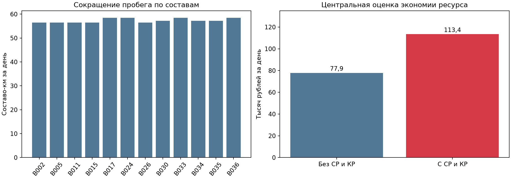
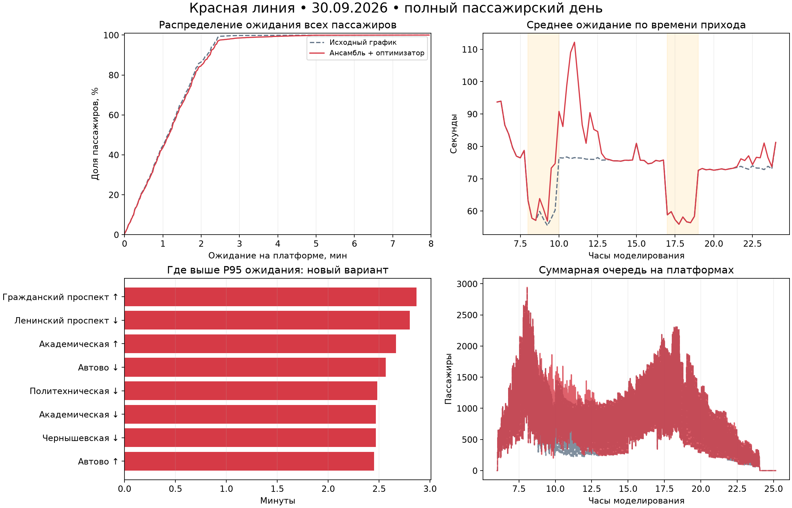
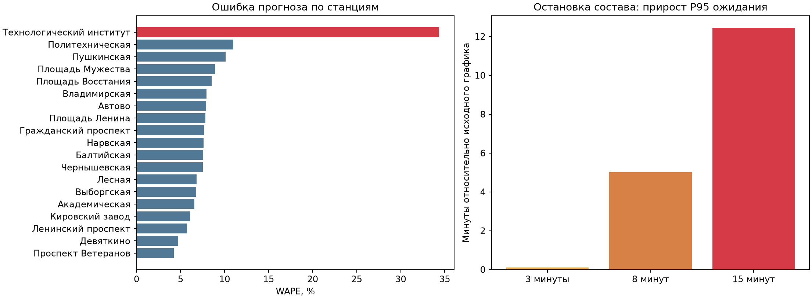

# Красная линия: исследование полного суточного прогона

Дата исследования: 10.10.2026. Модельный день: 30.09.2026, вход пассажиров 06:00–24:00, завершение наблюдения 01.10 в 02:00. Сравниваются исходный синтетический календарный график FIFO и полный ансамбль с текущим оптимизатором. Медианный оптимизатор и прежний оптимизатор в этом прогоне не участвовали.

Основной результат: расчётный ресурс обслуживания сократился на 2,52–2,56%, а среднее ожидание увеличилось на 2,79 секунды. Все 758 936 пассажиров завершили поездки. Однако цель целиком не выполнена: локальные требования к посадке нарушены в пяти группах в обоих вариантах. Аварийные проверки также не дают основания считать систему готовой к эксплуатации.

| Итог дня | Исходный график | Ансамбль + оптимизатор |
| --- | --- | --- |
| Пробег, составо-км | 27 962,6 | 27 274,5 |
| Завершили поездку, человек | 758 936 | 758 936 |
| Среднее ожидание, с | 69,48 | 72,28 |
| P95 / P99 ожидания, с | 140 / 148 | 142 / 211 |
| Максимум в вагоне / составов на линии | 150 / 53 | 150 / 53 |
| Локальных групп с нарушениями посадки | 5 из 2 474 | 5 из 2 474 |

## Что доказано этим сравнением

Независимый аудит подтвердил одинаковые пассажирские группы, парк, геометрию, начальные условия и seed=7. Проверены сохранённые траектории, целостность конечных состояний, баланс пассажиров, пробег и ограничения движения. Единственная не пройденная итоговая проверка обоих вариантов: local_boarding_service. Общий статус goal_achieved=false; денежная экономия в кассе и эксплуатационный допуск не установлены.

Пробег сократился на 688,1 км (2,46%), или на 10,12 км в среднем по каждому из 68 составов. Изменения коснулись 12 «Балтийцев»; у остальных 56 составов пробег не изменился. Среднее по всему парку нельзя выдавать за фактическую экономию каждого состава.

# Экономика: стоимость и экономия вместе

| Показатель | Без СР и КР | С СР и КР |
| --- | --- | --- |
| Исходная стоимость за день, ₽ | 3 086 297 | 4 431 687 |
| Стоимость после оптимизации за день, ₽ | 3 008 408 | 4 318 271 |
| Экономия за день, ₽ | 77 889 | 113 416 |
| Экономия, % | 2,52 | 2,56 |
| Стоимость после оптимизации на состав парка/день, ₽ | 44 241 | 63 504 |
| Экономия на состав парка/день, ₽ | 1 145 | 1 668 |
| Стоимость после оптимизации, ₽/составо-км | 110,30 | 158,33 |
| Экономия на сокращённый составо-км, ₽ | 113,19 | 164,82 |
| Экономия на каждый исходный составо-км, ₽ | 2,79 | 4,06 |

Расчёт: стоимость ресурса = сумма по составам и видам ремонта (пробег × цена ремонта / межремонтный пробег). ТО1: 12 тыс. км, ТО2: 42 тыс., ТР1: 160 тыс., ТР2: 320 тыс., ТР3: 640 тыс.; СР: 1,92 млн для «Юбилейного» и 1,28 млн для «Балтийца»; КР: 5,1 млн км. Интервалы и цены приняты из ваших условий. Это линейное начисление износа, а не календарь оплат.

| Удельный ресурс | Без СР и КР | С СР и КР |
| --- | --- | --- |
| Юбилейный — ₽/составо-км | 104,00 | 144,17 |
| Балтиец — ₽/составо-км | 113,19 | 164,82 |

## Годовой сценарий: 250 повторений этого дня

| Показатель за 250 аналогичных дней | Без СР и КР | С СР и КР |
| --- | --- | --- |
| Исходная стоимость всего парка, млн ₽ | 771,57 | 1 107,92 |
| Стоимость после оптимизации, млн ₽ | 752,10 | 1 079,57 |
| Экономия всего парка, млн ₽ | 19,47 | 28,35 |
| Экономия в среднем на состав парка, тыс. ₽ | 286,36 | 416,97 |

Это условный годовой сценарий. Выходные, сезонность, другие дни спроса и календарные ограничения ремонта не проверены. Полная таблица 68 составов, дневных и годовых стоимостей и процентов: economy_per_train.csv. Сокращение километров может отложить ремонт; превращение этого эффекта в снижение годового бюджета нужно согласовать с реальной ремонтной программой. Двойной счёт вложенных работ в разных ремонтах также требует проверки.

# Неопределённость и цена дополнительного ожидания

| Экономия при независимой ошибке пробега | Без СР и КР | С СР и КР |
| --- | --- | --- |
| За день, тыс. ₽ | -226,85 … 382,62 | -343,53 … 584,57 |
| За 250 дней, млн ₽ | -56,71 … 95,66 | -85,88 … 146,14 |

Погрешность ±5% применяется только к рассчитанному пробегу, отдельно для исходного и нового вариантов. Межремонтные нормативы не меняются. Цены СР и КР имеют погрешность ±20%, одинаковую для обеих стратегий. Показаны крайние сочетания допущений, не доверительные интервалы. При независимых ошибках пробега знак экономии не гарантирован.

| Если ошибка пробега общая для двух вариантов | Без СР и КР | С СР и КР |
| --- | --- | --- |
| Экономия за день, тыс. ₽ | 73,99 … 81,78 | 100,99 … 126,55 |

Общая ошибка означает один множитель масштаба для пробега обоих вариантов. При таком отдельном допущении экономия остаётся положительной. Данные пока не позволяют выбрать независимую или общую модель ошибки; обе оценки показаны явно.

| Дополнительное ожидание всех пассажиров | Значение |
| --- | --- |
| За день, человеко-часов | 589,22 |
| За 250 аналогичных дней, человеко-часов | 147 304 |

| Порог условной стоимости времени | Без СР и КР | С СР и КР |
| --- | --- | --- |
| ₽ за дополнительный пассажиро-час | 132,19 | 192,49 |

Порог показывает, при какой оценке дополнительного часа пассажира монетизированный ущерб сравняется с расчётной экономией обслуживания. Он не является тарифом или установленной стоимостью времени. Энергия, труд, фактические отказы от поездки и упущенная выручка не измерены. Доход 50,9 ₽ за поездку сам по себе не задаёт число отказов; умножать на него задержавшихся пассажиров нельзя.

## Какие ремонты дают эффект

| Вид | Эквивалент отложенных ремонтов/250 дней | Без СР/КР, тыс. ₽ | С СР/КР, тыс. ₽ |
| --- | --- | --- | --- |
| TO1 | 14,3354 | 1 978,29 | 1 978,29 |
| TO2 | 4,0958 | 1 744,82 | 1 744,82 |
| TR1 | 1,0752 | 1 027,85 | 1 027,85 |
| TR2 | 0,5376 | 1 832,60 | 1 832,60 |
| TR3 | 0,2688 | 12 888,70 | 12 888,70 |
| SR | 0,1344 | не включён | 5 913,36 |
| KR | 0,0337 | не включён | 2 968,27 |

Дробные значения обозначают сохранённый ресурс, а не фактически отменённые ремонты. Весь эффект этого прогона относится к «Балтийцам». ТР3 даёт около двух третей оценки без СР/КР: результат чувствителен к тому, насколько этот дорогой ремонт действительно зависит от пробега и может быть отложен.

# Время пассажиров: кто и сколько ждал

| Показатель, все 758 936 пассажиров | Исходный | Оптимизация |
| --- | --- | --- |
| Среднее, с | 69,48 | 72,28 |
| Медиана, с | 68 | 70 |
| P95, с | 140 | 142 |
| P99, с | 148 | 211 |
| Максимум, с | 477 | 477 |

| Ожидание на платформе | Исходный, чел. | Оптимизация, чел. | Доля при оптимизации |
| --- | --- | --- | --- |
| 0–1 мин | 334 575 | 327 167 | 43,11% |
| 1–2 мин | 320 224 | 313 307 | 41,28% |
| 2–3 мин | 102 375 | 107 178 | 14,12% |
| 3–5 мин | 1 163 | 10 672 | 1,41% |
| 5–8 мин | 599 | 612 | 0,08% |
| 8+ мин | 0 | 0 | 0,00% |

P99 вырос на 63 секунды, хотя P95 вырос всего на 2 секунды. От 3 до 5 минут ждали 10 672 человека вместо 1 163: рост в 9,18 раза. Это главный пассажирский недостаток найденной экономии. Ни один пассажир не ждал 8 минут или дольше; максимальное ожидание 7:57 в обоих вариантах. Ограничение интервала поездов и ограничение времени ожидания человека являются разными проверками.

| Приход пассажира | Человек | Среднее: до → после, с | P95: до → после, с |
| --- | --- | --- | --- |
| Вне пика | 478 989 | 76,10 → 79,54 | 142 → 146 |
| Утренний пик 08–10 | 129 385 | 58,74 → 62,39 | 110 → 130 |
| Вечерний пик 17–19 | 150 562 | 57,65 → 57,65 | 109 → 109 |

| Время всей поездки | Исходный | Оптимизация |
| --- | --- | --- |
| От турникета до посадки, среднее | 3:09 | 3:12 |
| От турникета до высадки, среднее | 24:11 | 24:14 |
| От турникета до высадки, P95 | 51:27 | 51:31 |

Время дано в мин:с. Путь от турникета до платформы задан как 120 секунд; выход из станции не моделируется. Полные времена поездок восстановлены по посадкам и последующим прибытиям тех же составов к станциям назначения. Это модельная оценка с синтетическим распределением направлений поездок, а не наблюдения реальных пассажиров.

# Графики ожидания и локальная посадка

↑: к Девяткино; ↓: к Проспекту Ветеранов. Период на графике определяется приходом на платформу. Все конечные очереди пусты; максимум суммарной очереди за день — 2 943 человека, максимум на одной платформе в одном направлении — 1 046. Эти максимумы одинаковы в обоих вариантах.

| Станция, время, к Ветеранов | Пассажиров | Пропустили 1-й поезд | Пропустили 2-й |
| --- | --- | --- | --- |
| Политехническая 07:45 | 554 | 38 / 6,86% | 0 / 0,00% |
| Академическая 07:45 | 1284 | 361 / 28,12% | 13 / 1,01% |
| Политехническая 08:00 | 499 | 115 / 23,05% | 0 / 0,00% |
| Академическая 08:00 | 1291 | 517 / 40,05% | 90 / 6,97% |
| Лесная 08:15 | 675 | 74 / 10,96% | 0 / 0,00% |

Всего 1 112 пассажиров (0,147%) не сели в первый поезд: 1 009 сели во второй, 103 в третий. Числа совпадают с исходным графиком. Но ограничения ≤5% и ≤1% заданы для каждой группы «станция × направление × 15 минут», поэтому малые общие проценты не отменяют пяти локальных нарушений. Они возникли и в исходном графике; оптимизация их не устранила и не добавила новых.

# Безопасность и отказоустойчивость

В обычном дне проверены 15 926 интервалов нового варианта и 16 358 исходного. Нарушений минимума 113 секунд в пик, 150 секунд вне пика и максимума 480 секунд не найдено. Максимум на линии — 53 состава. Сохранены исполненная часть графика, движения в процессе, подготовка депо и закрытие обязательств по возврату.

| Загрузка вагона в пик, по отправлениям | Исходный | Оптимизация |
| --- | --- | --- |
| Средняя | 57,58 | 58,69 |
| P95 | 110 | 111 |
| P99 | 141 | 141 |
| Максимум | 150 | 150 |

Загрузка взвешена по событиям отправления отдельных вагонов, включая пустые; это не распределение впечатлений пассажиров и не доля времени. Реальная путевая схема конечных не подтверждена: используются предположения TOTAL2/standby1. Прохождение модельных проверок не означает подтверждение блокировок, сигнализации и эксплуатационной безопасности.

| Остановка | Макс. интервал, с | Δ среднего ожидания, с | Δ P95, с | Макс. очередь на платформе | Ещё едут в конце |
| --- | --- | --- | --- | --- | --- |
| 3 мин | 293 | 5,74 | 6 | 696 | 0 |
| 8 мин | 593 | 34,96 | 301 | 1272 | 13 |
| 15 мин | 1013 | 104,77 | 747 | 2162 | 227 |

Это синтетические проверки на исходном графике, не полноценное сравнение аварийной политики нового ансамбля. Расчёт каждого случая занял 6,8–7,6 секунды, однако все три имеют статус evaluation_incomplete. При 3 минутах движение прошло проверку, но локальная посадка нарушена; при 8 и 15 минутах максимальный интервал превышает 480 секунд. В последних двух случаях восстановление пассажирского движения к концу наблюдения не завершено. Это оставшиеся в пути люди, а не доказательство потери пассажиров.

Команда удерживает парк и распространяет задержки по затронутому направлению. Проверка занятости блок-участка всеми поездами и сигнализации отсутствует; внешнее время доставки уведомления не измерено. Восьмиминутный бюджет реакции и максимум интервала 8 минут нельзя смешивать. Быстрый расчёт не гарантирует безопасного и своевременно доставленного решения.

## Решения и объяснения

За день сохранено 71 решение: 5 изменений COST_SOLVER в 08:45, 09:30, 09:45, 10:45 и 21:45, остальные 66 — KEEP. Самый долгий расчёт решения занял 251,53 секунды, меньше 480. Доказательства глобальной оптимальности нет: часть поисков завершена не полностью, выбирался лучший проверенный допустимый по применённым проверкам вариант.

В 23:45 сохранён KEEP с evaluation_error / input_contract_error и fallback_service_verified=false. Причину по журналу установить нельзя: исходное исключение не сохранено, а этот код обобщает ValueError всего расчётного процесса. Имеются 70 сохранённых прогнозов; отсутствие последнего файла не доказывает сбой именно ML. Конечные журналы дня проверены независимо.

Для 71 решения имеются 26 ответов YandexGPT и 45 шаблонных объяснений, прошедших проверку. Нельзя представлять все 71 текст как ответ LLM. Итоговый счётчик — 1 835 048 токенов; денежная стоимость API не установлена и в расчёт не входит. LLM не меняет ограничения и команды. Проверка структуры и чисел не доказывает причинную корректность каждого объяснения.

# Качество прогнозов и переносимость

| Прогноз пассажирского входа | Результат |
| --- | --- |
| Общий WAPE | 7,67% |
| WAPE в пик / вне пика | 6,37% / 8,49% |
| Среднее смещение относительно факта | −1,80% |
| Покрытие q10–q90 / номинал | 75,77% / 80% |
| Доля фактов не выше q90 / номинал | 85,62% / 90% |

Проверены 10 640 прогнозов на 15-минутные станции-интервалы из 70 моментов выпуска; горизонты перекрываются, это не 10 640 независимых случаев. Ансамбль включает LightGBM, persistence, GRU с тремя seed и фиксированный стекинг. Родной шаг стекинга — 30 минут, выдача на 15 минут адаптирована. Сдвинутые и обычные выпуски дают близкий WAPE на этом дне, но это не независимая валидация адаптации.

Наибольшая ошибка — «Технологический институт», WAPE 34,37%; у этой станции используются резервный исторический прогноз и некалиброванный интервал. Далее «Политехническая»: WAPE 11,00%, фактическое покрытие верхней границей q90 всего 76,96%. Средняя точность скрывает локальное недопокрытие. Это аргумент за калибровку запаса по станции и горизонту, а не за один общий запас для всей линии.

30 сентября уже использовалось при разработке: это исследование поведения системы, не новый независимый тест. Времена публикации погодных признаков неизвестны, строгая доступность всех внешних данных в момент решения не доказана. Исходный график синтетический, распределение поездок и ряд путевых ресурсов заданы предположениями. Перенос на реальный день требует фактического графика, OD, ограничений инфраструктуры и подтверждённых ремонтных правил.

Этот прогон не отвечает на вопрос, лучше ли ML медианы: отдельного варианта «тот же оптимизатор + медиана» здесь нет. Экономию нельзя причинно приписать только ансамблю: одновременно сравниваются наличие управления и способ прогноза.

# Что делать дальше

| Приоритет | Действие | Критерий результата |
| --- | --- | --- |
| 1. Надёжность | Восстановить диагностику последнего шага и проверку KEEP; явно обрабатывать закрытие дня и горизонта. | Нет непроверенных fallback; причина каждого отказа сохранена. |
| 2. Локальное качество | Добавить ограничение роста P99 и доли ожидания ≥3 минут по станции и направлению; отдельно определить допустимую политику при исходно невыполнимых 5%/1%. | Экономия ≥1% при выполнении утверждённых локальных требований. |
| 3. Прогноз | Покрыть ансамблем «Технологический институт», откалибровать q90 по станции, пику и горизонту на отдельном периоде. | Подтверждённое покрытие на новых днях; без будущих признаков. |
| 4. Честное сравнение | Одинаковый оптимизатор и ограничения: ансамбль против медианы; диагностически добавить идеальный прогноз как верхнюю границу. | Разделён вклад модели и управления; идеальный прогноз не выдан за рабочее решение. |
| 5. Аварии | Остановки 3/8/15 минут на новом контроллере с блок-участками, восстановлением и временем доставки уведомлений. | Нет выдачи неподтверждённой команды; режим деградации показан явно. |
| 6. Перенос | Заморозить настройки и проверить новые будни, выходные, пики и аномалии на одинаковых случайных реализациях. | Парные оценки эффекта по дням; отдельные худшие случаи. |
| 7. Реальные деньги | Сверить ремонтную программу, вложенность работ, календарные интервалы, энергию и отказы пассажиров. | Расчёт ресурса отделён от изменения оплачиваемого бюджета. |

Предлагаемый следующий эксперимент: минимизировать стоимость обслуживания с жёстким сохранением физики и локального качества, добавить ограничение на хвост ожидания и проверить на отложенных днях. Не перебирать одинаковые значения интервала по сетке: решать совместный выбор выпуска, снятия и интервала с проверкой кандидата в пассажирской модели. Порог P99 или доли ≥3 минут сначала закрепить как условие эксперимента; менять его по результатам тестового дня нельзя.

## Итог исследования

Решение полезно как демонстрация управляемой экономии ресурса: полный день закрыт, центральная оценка выше 1%, среднее ожидание растёт мало. Сейчас слабые места — длинные ожидания, локальные непосадки, недокалиброванные прогнозные интервалы, последний отказ расчёта и неполная проверка аварий. Считать полученные 19,47–28,35 млн ₽ гарантированной годовой экономией или готовностью к реальному управлению нельзя.

## Источники и воспроизводимость

Источник: metro52_full_day_20261009, конечные result.json, passenger_checkpoint.json.gz, motion.json, review/comparison.json, forecast_review/report.json и incidents/result.json. Агрегация заново сверила пассажирский баланс, суммы ожидания, средние итогового отчёта и SHA256 источников. Ни прогнозы, ни пассажирская симуляция при исследовании повторно не запускались. Полный технический PDF кампании содержит 231 страницу; настоящее исследование выделяет результаты и ограничения.

Рядом сохранены CSV распределения ожидания, периодов, всех станций, локальных нарушений, ожидания ≥5 минут, 68 составов, качества прогноза и аварий. Границы корзин ожидания: левая включена, правая исключена. P95/P99 посчитаны по пассажирам с весом count, методом ближайшего ранга. Таблицы и графики относятся к завершённому дню, без остатка ненаблюдённых пассажиров.
